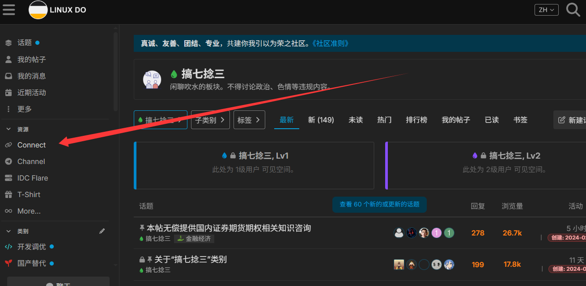
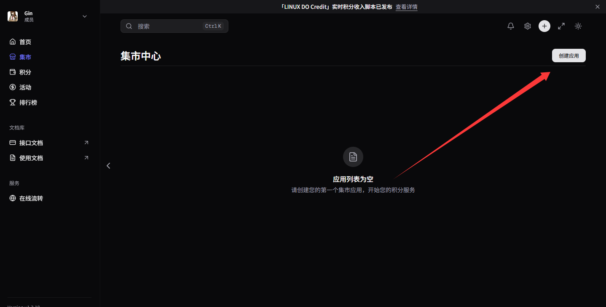
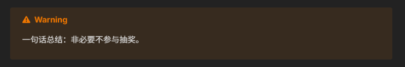

---

id: 2473862

title: "一些L站的基本信息和相关网址"

created_at: 2026-06-25T08:46:31.818Z

username: x1051445024

display_username: "Gin"

---

# 一些L站的基本信息和相关网址

本人也是新人，在L站逛了几天，总结了些经验。希望能帮助到后来的佬友。

**有些网址和板块是设置门槛的，账户等级/LDC（linux do credit）/社区积分**，因此本贴写出这三个的升级方法。

# 1.账户等级

账户等级在官方的帖子里有明确说明。

[【新人请看】了解Discourse信任度](https://linux.do/t/topic/2460) [

文档共建](/c/wiki/42)

> Discourse 论坛信任等级解析

> 用户信任系统是 Discourse 的基石之一。信任等级的设计旨在：

>

> 为论坛中新用户设置一个沙盒环境，避免他们在了解论坛操作时不小心伤害到自己或其他用户。

> 随着时间的推移，为经验丰富的用户赋予更多权限，让他们可以帮助维护和管理他们付出了大量时间建设的社区。

> 正如[《网络社区建设》](http://www.amazon.com/Community-Building-Web-Strategies-Communities/dp/0201874849?ref=blog.discourse.org)一书中所提到的，任何社区的参与者都有一个自然的进阶过程。

>

>  ![[图片]](https://cdn3.ldstatic.com/original/2X/9/9db11f9fe14b8eb33e9791815bd1984ed15170b9.png)

> 这成…

简单来说等级会跟以下几个有关，：

I 访问天数

II 点赞和收到的点赞

III 阅读帖子的数量/时间

**因此可能有很多佬友不习惯或者不喜欢点赞，那么任务完成不了，可能都无法到达等级2**

（ 等级2有个要求是至少点赞1次）

## 所以在这里大大方方的给其他佬友点赞

0级升1级，1级升2级的具体条件，以及2级怎么判断升3级还差哪些条件。

等级和成员等称号的对应关系是：

**0级（ 新用户），1级（基本用户），2级（成员），3级（活跃用户）**

0级升1级：

- 进入至少**5**个话题

- 阅读至少**30**篇帖子

- 总共花费**10**分钟阅读帖子

1级升2级：

- 至少访问**15**天，不必连续

- 至少点赞**1**次

- 至少收到**1**次点赞

- 回复至少**3**个不同的话题

- 进入至少**20**个话题

- 阅读至少**100**篇帖子

- 总共花费**60**分钟阅读帖子

2级升3级的话，可以从connect里面看自己还差多少，位置在下图红色箭头的链接

也可以直接访问链接[https://connect.linux.do/](https://connect.linux.do/) 来查看自己距离3级还差哪些条件。

# 2.LDC

这个是很多虚拟产品和福利贴里需要使用的。先说获得方式

**所有佬友记得linux do注册好后，紧接着登录下面这个网站。**

### [LINUX DO Credit](https://credit.linux.do/)

Linux Do 社区积分服务平台

这个网站如果不连接L站账号，即便你每天都逛L站，帖子发的冒烟，点赞点到抽筋，你的LDC还是0！

## 因为没有绑定！

所以千万记住每天在L站学习完后，登陆一下LDC，领取一下每日补贴。

LDC也可以通过在credit里面创建应用，把自己的虚拟产品放上去销售来换取积分（我没创建过，所以具体的要求可以按照官方文档来看[LINUX DO Credit](https://credit.linux.do/docs/how-to-use) ）

有了LDC之后，不仅各个福利贴的可以用。还有以下几个渠道能消耗多余的LDC。

### [LD士多 - Linux DO 社区积分兑换中心](https://ldcstore.com/)

在 LD士多 使用 Linux.do 社区积分兑换精选虚拟物品与服务。

这个站点里面会有卖公益站邀请码或是部分公益站额度的，还有许许多多的虚拟物品（表情包，各种求职文档，四六级资料啥的）。

### [Loading...](https://hub.linux.do/)

AI development platform.

这个网站是L站元宇宙的 **额度交换市场**，一般会有其他佬友在上面分享蹬不完的API，你可以通过LDC来换取额度使用你想要用的模型。

# 3.社区积分

社区积分的查看方式在以下链接登陆后，下方“*我的信息*”里面

### [实时数据 - LINUX DO CDK](https://cdk.linux.do/dashboard)

Linux Do 社区 CDK 快速分享平台 - 让分享变得更简单

社区积分一般会跟L站获得的徽章/等级挂钩。徽章的获取方式可以参照以下这篇帖子

[盘点L站的徽章 长期更新！（2026.2.17 更新）](https://linux.do/t/topic/342888/) [

文档共建](/c/wiki/42)

> 盘点 L 站的徽章长期更新!（2026.2.17 更新！！！）

>

> [!warning] 注意！！！！！！

> 做 Wiki 编辑的徽章就做，别把整个教程帖子内容覆盖成无意义的内容！！！

>

>

>

> [!caution] 注意、注意、注意

> 由于服务器有延迟，可能会存在达成了徽章获取条件但没有拿到徽章的情况，请坐和放宽，至多到第二天的凌晨四点就会刷新徽章获取情况。如果还是没有，请试试在过了 cf 盾之…

## 归根结底，还是要多看帖，多交流，多点赞。保持在社区里的活跃度，待人友善，积极讨论！

之前也有人提出了抽奖的问题，L站的抽奖跟别的社区不一样，千万不要想着抽过来囤起来或者单纯只是抱着当分母的心态“试一试”，详情规则看

[进一步优化对抽奖帖回复被举报的处理方式](https://linux.do/t/topic/1993635) [

运营反馈](/c/feedback/2)

> 从[我发现我几乎所有的发言都被举报了，最近论坛内的言论有点风声鹤唳啊](https://linux.do/t/topic/1992043)继续讨论：

>

>  ![[image]](https://cdn3.ldstatic.com/original/4X/5/e/8/5e80f9d9f205dc8a838777543814712b25771b5f.png)

> 虽然置顶公告和[社区准则](https://linux.do/guidelines)早就对举报异议做出了指引，但总有那不管不顾的非要跳出来直接发个帖子，大量占用公共资源。

> 我们可以把情况分为两种：

>

> 如果发帖人对举报异议不知情的，那么说明根本没看社区准则，可处理。

> 如果发帖人对举报异议知情的，那么说明他根本不在乎社区准则，可处理。

>

> 我这个人嘛，虽然在置顶…

很多的抽奖贴无论楼主设置的要求回复词是什么，**千万要记住社区准则至上**

抽奖贴的回复基本要求是：这个奖品我“为什么要”，获得了之后“要干什么”。

### 千万不要在抽奖贴回复凑字数，包括符号、英文等各种

### 千万不要在抽奖贴直接复读、复制他人回复

### 千万不要在抽奖帖回复与奖品无关的内容

抽奖的核心观念，总结成站长说的一句话

希望我的贴子能够帮到后来的佬友们！

如果有任何修改建议或者提醒，可以私信我，我会进行修改

---

*来源: https://linux.do/t/topic/2473862.json*

