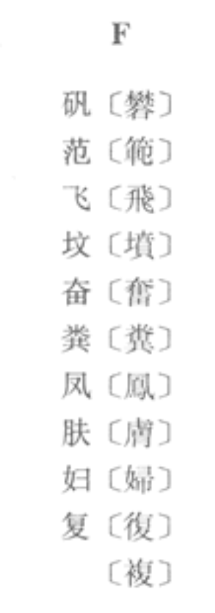
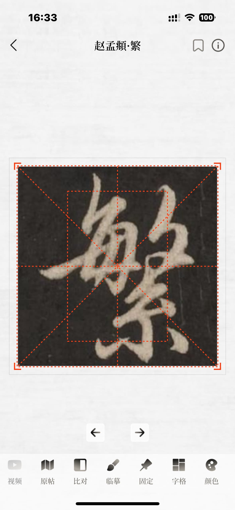

---

id: 248093

title: "这么多年我都写错了吗？“繁”字到底怎么写？"

created_at: 2024-11-01T10:03:48.413Z

username: bubao

display_username: "一念"

---

# 这么多年我都写错了吗？“繁”字到底怎么写？

最近刷到抖音一个有趣的话题：“**繁**”字的上面的“**每**”字是**横折**而不是**横折钩**。

百度搜 **“繁”字笔顺** ，第四笔也是横折。

然后有人说：繁体字是横折钩，简体字是横折。

## 繁简体字有区分？

先解释清楚什么是简体字，其实应该叫做**简化字**：

> 在1956年国务院公布的《汉字简化方案》，并最终制定出了一个《简化字总表》

>

> – 百度百科词条简化字

虽然颁布过两次总表，但是二简字被停用了，那我们看看第一次总表有没有简化过**繁**字。

1964年发布的《关于简化字的联合通知》分为下面几个部分：

1. **第一表不作简化偏旁⽤的简化字**

2. **第二表可作为简化偏旁⽤的简化字和简化偏旁**

3. **第三表应用第二表所列简化字和简化偏旁得出来的简化字**

那有没有可能简化过**敏**字呢？明显不会，**繁**字的部首是**糸**，而且现在的**敏**字单独写也是有勾的。那表2表3也没必要看了，**“繁”字就没有被简化过。**

所以**繁体字是横折钩，简体字是横折** 是错误的解释。

## 古人写的“**繁**”字

下面是我挑选出来有勾的“**繁**”字

可以看到，上面的“**繁**”字的确是带勾的，古人也写错了？

再有，在《说文解字》中对“繁”的解释：

> 【卷十三】【糸部】附袁切（fán）

>

> 马髦饰也。从糸每声。《春秋传》曰：“可以称旌緐乎？”

>

> 𦅳，䋣或从𢍍。𢍍，籀文弁。

其中的“緐”与“繁”字同义，这里面就表明了**繁**字是由**每**组成的。

那是现代人写错了吗？

都不是，原因是字形。

## 写字的对与错

我并没有找到关于**字形**的解释，但是按照**字的研究（1） 字、字形、字型、字体风格和字体文件**这篇文章的说法：

> 同一字可以有不同的字形，而不影响其表达的意思，其中不同字形的概念包括不同字体、不同书写方式

这么看来，“**繁**”字有勾没勾都没有错，只是字形的区别。

在**百度百科-繁**里面就有各个地区的楷书的写法有对比：

[繁- 字形对比](https://baike.baidu.com/item/%E7%B9%81/4574289#4-1)

我的理解是，在字体设计时为了美观，把笔画改为横折。但是并不代表对错，仅仅是字形不一样而已，如果认为“繁”字有勾是错字，那是不是后边还会因为笔锋问题，间架结构问题而被认为是错字呢？

## 相关参考

- [百度百科-简化字](https://baike.baidu.com/item/%E7%AE%80%E5%8C%96%E5%AD%97/585127)

- [字的研究（1） 字、字形、字型、字体风格和字体文件](https://www.cnblogs.com/yc0806/p/15827583.html)

- [百度百科-繁](https://baike.baidu.com/item/%E7%B9%81/4574289)

---

*来源: https://linux.do/t/topic/248093.json*

