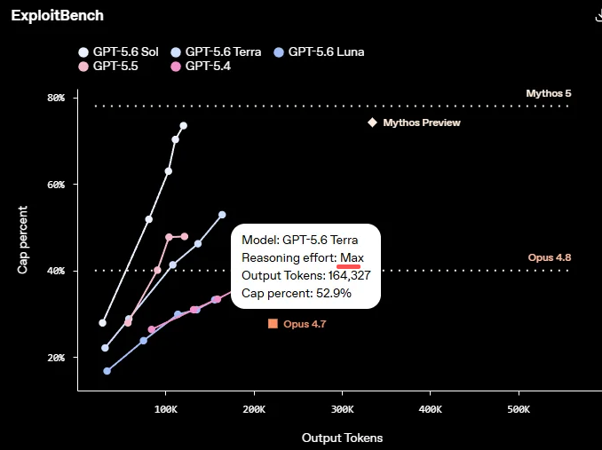
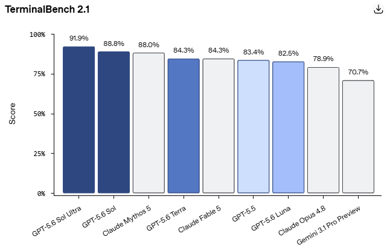
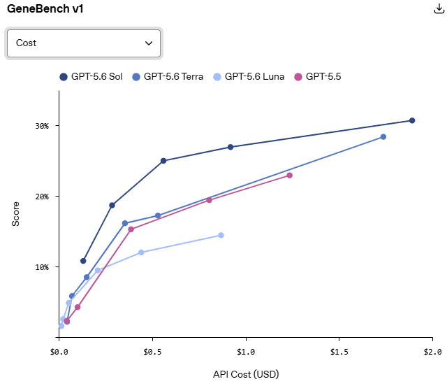
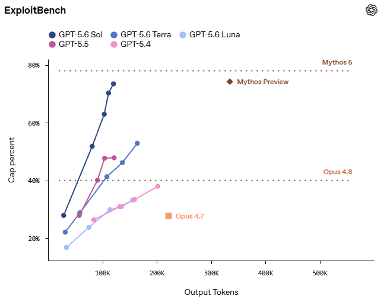
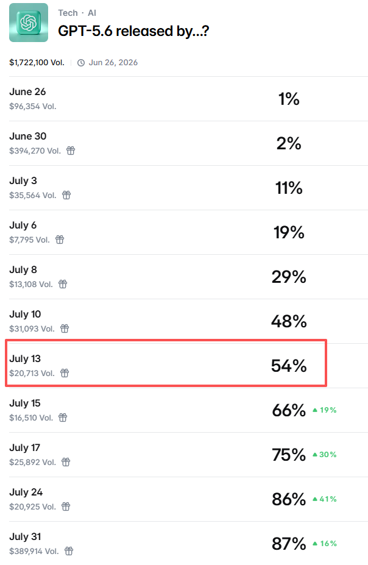
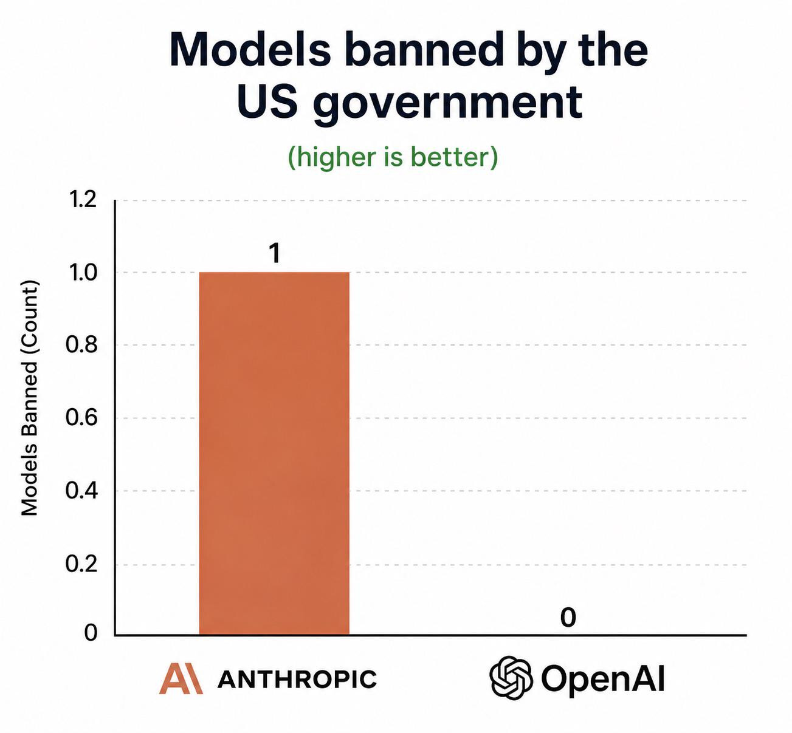

---

id: 2483453

title: ":fire:【大模型系列37】关于GPT-5.6，你想知道的一切【更新Arena Agent评分】"

created_at: 2026-06-27T01:06:06.961Z

username: dwqxq1

display_username: "dwqxq1"

---

# :fire:【大模型系列37】关于GPT-5.6，你想知道的一切【更新Arena Agent评分】

## 基本资料

官方文：[https://openai.com/index/previewing-gpt-5-6-sol/](https://openai.com/index/previewing-gpt-5-6-sol/)

系统卡：[GPT-5.6 Preview System Card - OpenAI Deployment Safety Hub](https://deploymentsafety.openai.com/gpt-5-6-preview)

### 价格

gpt-5.6-sol=输入$5/输出$30，价格对标5.5=$5/$30和opus=$5/$25，性能对标fable

gpt-5.6-terra=$2.5/$15，价格对标5.4=$2.5/$15和sonnet=$3/$15，性能对标5.5和opus4.8，sonnet5

gpt-5.6-luna=$1/$6，价格对标5.4-mini=$0.75/$4.5和Haiku$1/$5

5.6写缓存=输入价格1.25x，参考5.5是输入价格1x，涨价25%

5.6读缓存=输入价格10%，与5.5一样

### 上下文窗口

官方没提，大概率还是跟5.5一样，Codex里限400k，API支持1m

### 推理强度

5.6貌似新增了Max effort

### 速度

正常版速度没提

说7月份出运行在Cerebras芯片的高速版，5.6-sol最高达到750tps，价格暂不知道

## 评分

### 官方自评

---

---

---

### 第三方评分

估计不会很快出来，大多数第三方评测网站也没有访问权限

---

## 渠道

根据政府要求，暂时只对少量企业用户开放，由政府对逐个企业批准

PolyMarket对正式对公众面市时间的预测中位数是7月13日左右

这个公众发布，暂不确定是像要求Fable那样仅限美国人，还是不限

---

## 最后，发张梗图

---

*来源: https://linux.do/t/topic/2483453.json*

