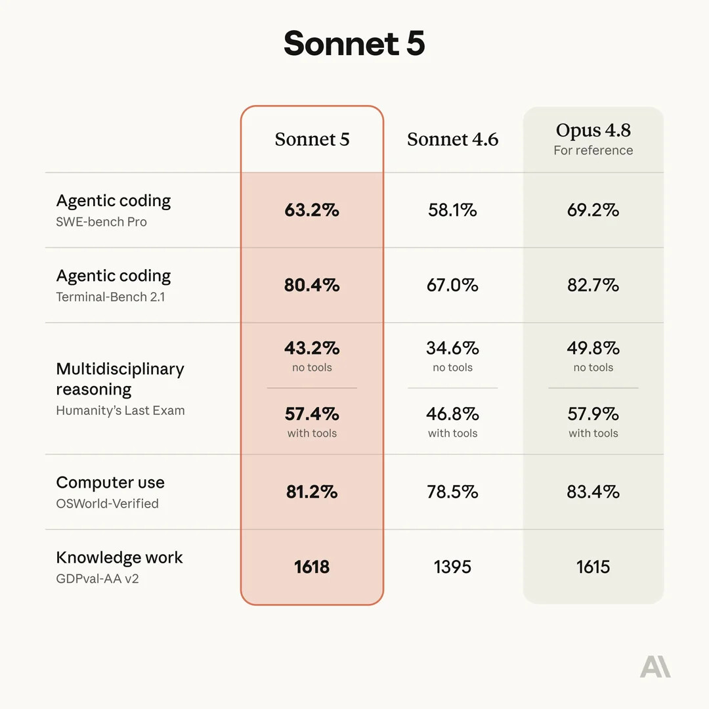
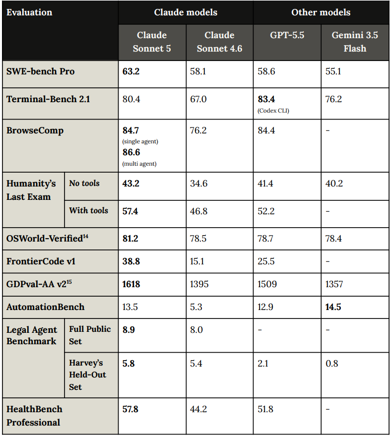
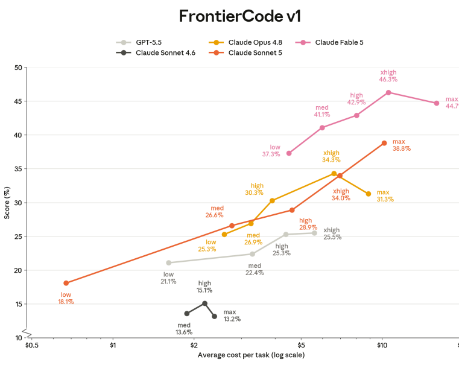
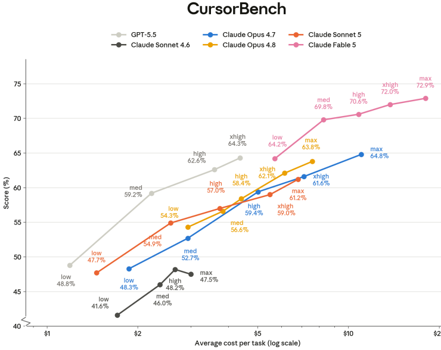
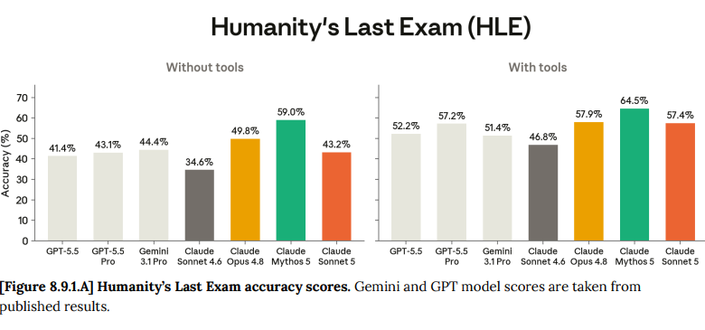
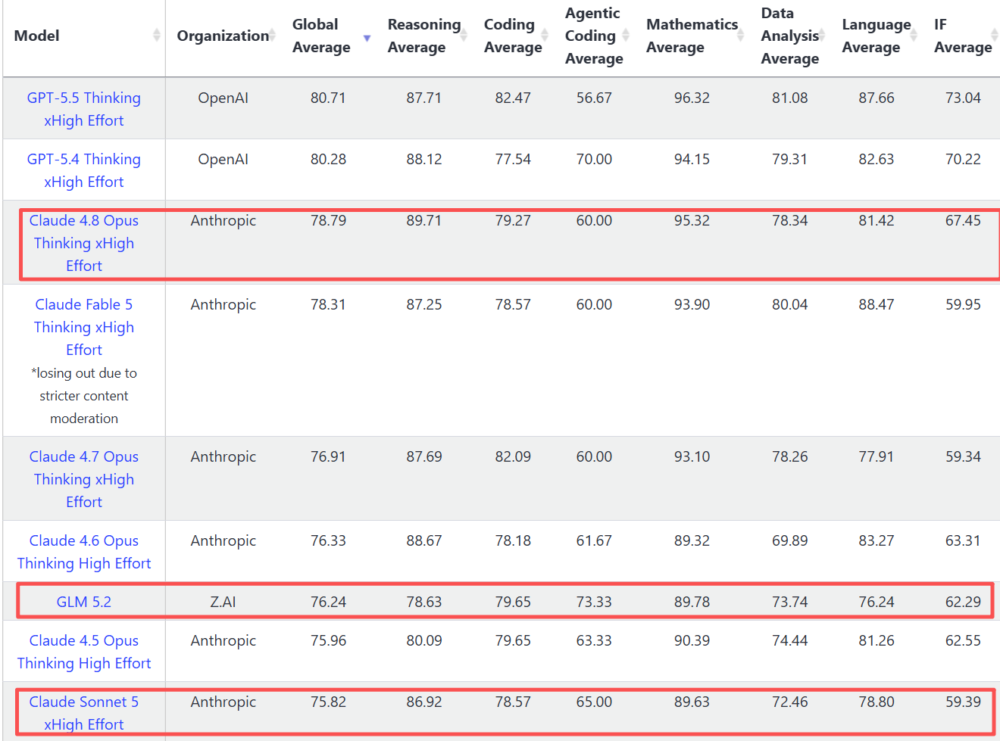
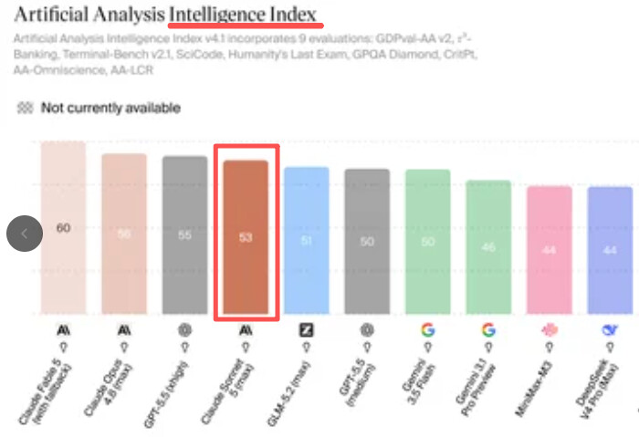
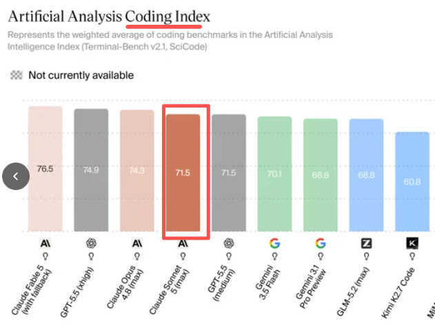
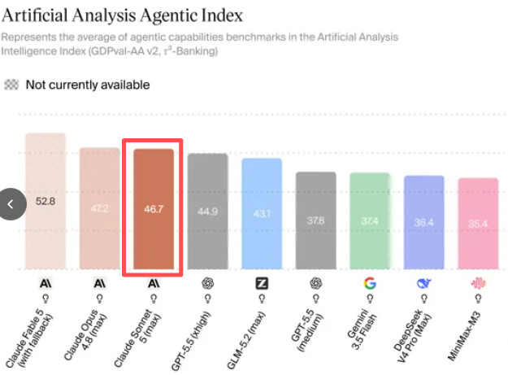

---

id: 2510095

title: ":fire:【大模型系列38】关于Sonnet5,你想知道的一切【更新Arena Agent评分】"

created_at: 2026-07-01T14:34:12.240Z

username: dwqxq1

display_username: "dwqxq1"

---

# :fire:【大模型系列38】关于Sonnet5,你想知道的一切【更新Arena Agent评分】

官方文:[Introducing Claude Sonnet 5 \ Anthropic](https://www.anthropic.com/news/claude-sonnet-5)

系统卡(145页):[https://www-cdn.anthropic.com/9e6a1044980d8c4ed85669faf9c2a8342e2e9f1e/Claude%20Sonnet%205%20System%20Card.pdf](https://www-cdn.anthropic.com/9e6a1044980d8c4ed85669faf9c2a8342e2e9f1e/Claude%20Sonnet%205%20System%20Card.pdf)

### 上下文

1m

### 价格

长期$3/$15价格不变,但临时调$2/$10到8月31号

考虑A社并没有降价习惯,推测可能是因为

Ⓐ换分词器导致更费token

Ⓑ应对5.6-luna的性能冲击

Ⓒ应对glm5.2的价格冲击

## 评分

### 自评

新能介于sonnet4.6和opus4.8之间

---

---

---

---

---

LiveBench评分

来源:[LiveBench](https://livebench.ai/#/)

---

LMArena评分:暂未上线

来源:[Arena Leaderboard | Compare & Benchmark the Best Frontier AI Models](https://arena.ai/leaderboard/)

---

ArtifactialAnalys评分:暂未上线

来源:[https://artificialanalysis.ai/](https://artificialanalysis.ai/)

---

---

---

## API渠道

### 官网

### OpenRouter

来源：[Claude Sonnet 5 - API Pricing & Benchmarks | OpenRouter](https://openrouter.ai/anthropic/claude-sonnet-5)

---

## 最后,发个梗图,祝佬友与Sonnet5愉快的玩耍

---

---

*来源: https://linux.do/t/topic/2510095.json*

