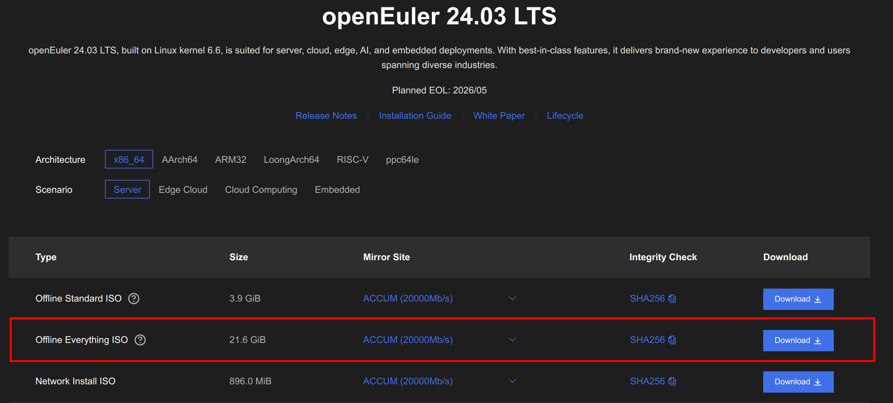
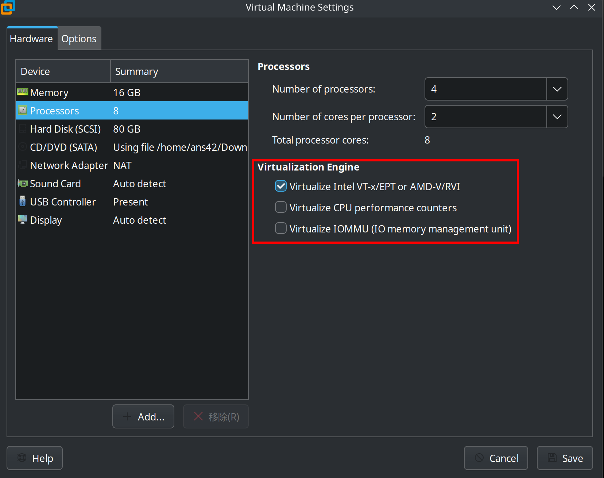
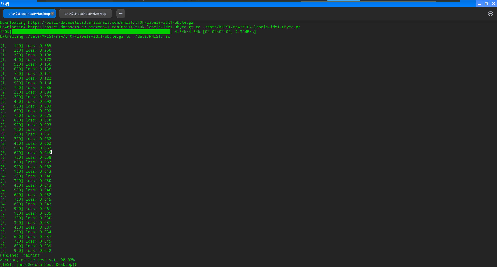

---

id: 253567

title: "VMware 安装 openEuler 并跑通 MNIST"

created_at: 2024-11-07T15:51:11.689Z

username: answerend42

display_username: "answerend42"

---


# VMware 安装 openEuler 并跑通 MNIST


## 前言

用 VMware 17.5 安装 openEuler 24.03 LTS，安装 conda, Pytorch 并跑通一个简单的 MNIST 上的神经网络训练。



## VMware 安装

略去

## OpenEuler

### 初步配置

1. 创建虚拟机，iso 即上图下载得到，开启 VT 虚拟化选项（这一步需要在 BIOS/UEFI 选项中开启 CPU 虚拟化），方便一会开启 VMware tools 同步剪贴板。



1. 进入安装界面，在安装选项中勾选额外的开发环境，磁盘选择自动分区即可，创建 root 用户和一般用户。

2. 等待安装完成自动重启。

### 安装桌面，VMware tools

选择喜欢的桌面安装，本文选用 DDE，这里是[官方指南](https://docs.openeuler.org/zh/docs/24.03_LTS/docs/desktop/%E5%AE%89%E8%A3%85DDE.html)，其他桌面环境也可以在链接中找到。

```
sudo dnf update
sudo dnf install dde
sudo systemctl set-default graphical.target
sudo reboot
```

重启后登录，打开终端准备安装 VMware tools

```
sudo dnf install open-vm-tools
sudo dnf install open-vm-tools-desktop
```

注意：宿主机也应该安装 VMware tools，如果是 Linux，在对应的包管理器中安装 open-vm-tools 即可

### 安装 conda

```
wget https://repo.anaconda.com/miniconda/Miniconda3-latest-Linux-x86_64.sh
chmod +x Miniconda3-latest-Linux-x86_64.sh
bash Miniconda3-latest-Linux-x86_64.sh
```

添加到环境变量

```
vim ~/.bashrc
```

在最后一行添加 `export PATH="$HOME/miniconda3/bin:$PATH"`，保存并退出

```
source ~/.bashrc
```

现在 conda 应当可以被终端正确的识别为名令

用 `conda --version` 测试是否成功安装

## Pytorch 安装和测试

用 conda 创建一个测试环境 `TEST`

```
conda create -n TEST
```

激活环境

```
conda init
conda activate TEST
```

安装 Pytorch（这里只安装CPU版）

```
conda install pytorch torchvision torchaudio cpuonly -c pytorch
```

下面是一段 简单的 MNIST 数据集下载并训练测试的代码，添加到 `test.py`

```
import torch
import torch.nn as nn
import torch.optim as optim
import torchvision
import torchvision.transforms as transforms

# 定义神经网络
class Net(nn.Module):
    def __init__(self):
        super(Net, self).__init__()
        self.fc1 = nn.Linear(28 * 28, 512)
        self.fc2 = nn.Linear(512, 256)
        self.fc3 = nn.Linear(256, 10)

    def forward(self, x):
        x = x.view(-1, 28 * 28)
        x = torch.relu(self.fc1(x))
        x = torch.relu(self.fc2(x))
        x = self.fc3(x)
        return x

# 设置设备
device = torch.device("cuda" if torch.cuda.is_available() else "cpu")

# 加载数据
transform = transforms.Compose([transforms.ToTensor(), transforms.Normalize((0.1307,), (0.3081,))])

trainset = torchvision.datasets.MNIST(root='./data', train=True, download=True, transform=transform)
trainloader = torch.utils.data.DataLoader(trainset, batch_size=64, shuffle=True)

testset = torchvision.datasets.MNIST(root='./data', train=False, download=True, transform=transform)
testloader = torch.utils.data.DataLoader(testset, batch_size=64, shuffle=False)

# 初始化网络
net = Net().to(device)

# 定义损失函数和优化器
criterion = nn.CrossEntropyLoss()
optimizer = optim.Adam(net.parameters(), lr=0.001)

# 训练网络
for epoch in range(5):  # 5个训练周期
    running_loss = 0.0
    for i, data in enumerate(trainloader, 0):
        inputs, labels = data[0].to(device), data[1].to(device)

        optimizer.zero_grad()

        outputs = net(inputs)
        loss = criterion(outputs, labels)
        loss.backward()
        optimizer.step()

        running_loss += loss.item()
        if i % 100 == 99:
            print(f'[{epoch + 1}, {i + 1:5d}] loss: {running_loss / 100:.3f}')
            running_loss = 0.0

print('Finished Training')

# 在测试集上验证
correct = 0
total = 0
with torch.no_grad():
    for data in testloader:
        images, labels = data[0].to(device), data[1].to(device)
        outputs = net(images)
        _, predicted = torch.max(outputs.data, 1)
        total += labels.size(0)
        correct += (predicted == labels).sum().item()

print(f'Accuracy on the test set: {100 * correct / total:.2f}%')
```

运行

```
python test.py
```




---


*来源: https://linux.do/t/topic/253567.json*

