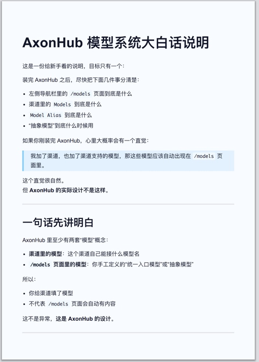
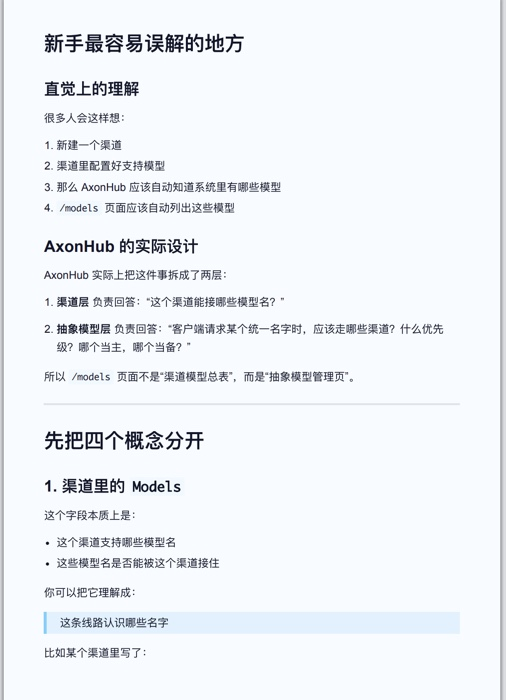
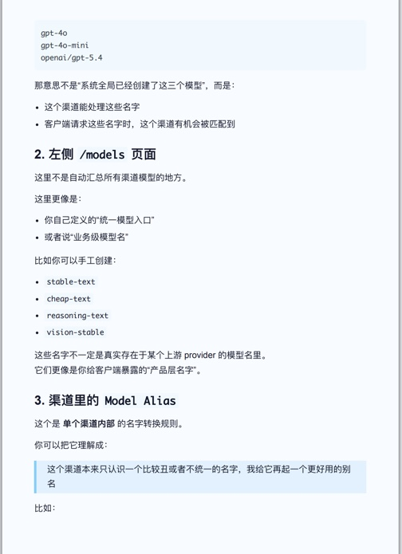
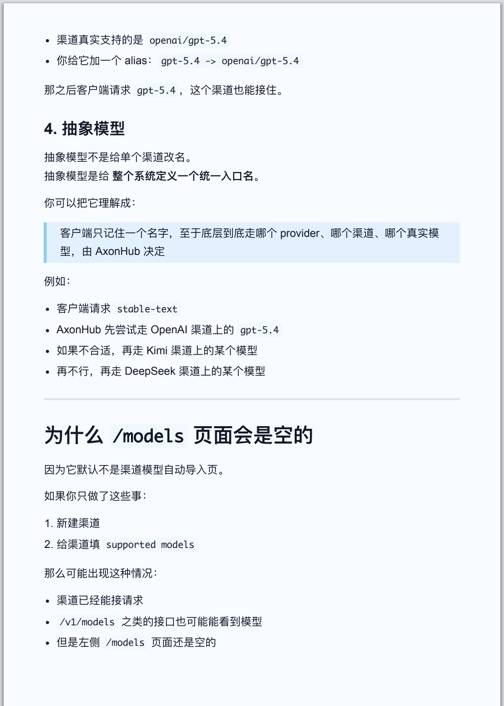
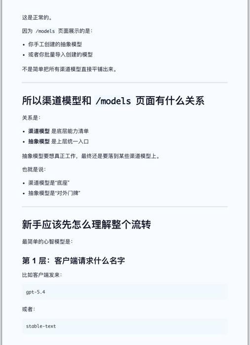
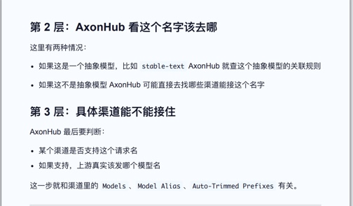

---

id: 2540878

title: "一文搞懂 axonhub 里渠道模型、抽象模型、模型别名"

created_at: 2026-07-07T12:48:07.259Z

username: dfeiwej

display_username: "dfeiwej"

---

# 一文搞懂 axonhub 里渠道模型、抽象模型、模型别名

# 前言

一直以来想找一个能够统一管理中转站 API 的工具。看了站里面大家的讨论，主要是像 New-API 这一类及二开的，然后像 bestruirui/octopus、cita-777/metapi 以及 looplj/axonhub。我之前试用过 metapi，但是里面的模型路由用得不太顺手，虽然它的签到功能非常好。octopus 使用的过程当中，主要是工具的调用有问题，所以后面最终选择了 axonhub。但是 axonhub 装完以后遇到的第一个问题就是，为什么左边导航栏里面的模型是空的？在添加了渠道正常使用以后，模型仍然是空的。今天让 Codex 读 GitHub 上面的 Wiki，以及很多 Wiki 没有写到的，直接让 Codex 读源代码。终于搞清楚了里面的关系，然后让 Codex 写了一篇大白话，供各位佬友参考。

更准确的理解应该是：

- **渠道模型** 是底层线路能接什么名字

- **Model Alias** 是单个渠道里怎么把名字变顺手

- **抽象模型** 是系统对外暴露什么统一入口，以及这个入口背后走哪些线路

把这三件事分开以后，AxonHub 的模型系统就会突然变得很好理解。

---

*来源: https://linux.do/t/topic/2540878.json*

