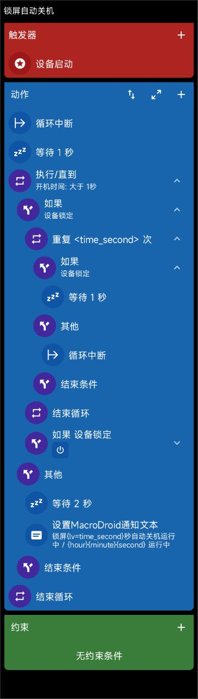

---

id: 255971

title: "MacroDroid实现锁屏之后超过预订时间自动关机"

created_at: 2024-11-10T15:41:43.048Z

username: whp98

display_username: "hahazhuq"

---

# MacroDroid实现锁屏之后超过预订时间自动关机

目的是让闲置手机偶尔用完锁屏自动关机省电，保护电池，需要root权限

宏截图如下

---

*来源: https://linux.do/t/topic/255971.json*

