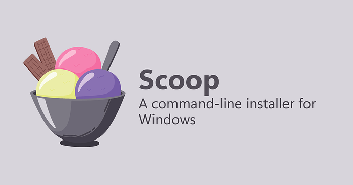

---

id: 2561124

title: "我的 Windows 重装工作流"

created_at: 2026-07-10T14:36:16.667Z

username: akane8086

display_username: "思茜"

---


# 我的 Windows 重装工作流


[第一版](https://linux.do/t/topic/1465089)

[第二版](https://linux.do/t/topic/1667411)

## 碎碎念

---

这是一篇非常个人化的文章，里面的东西未必都适合大家，我的有些选择大家可能觉得怪怪的，是因为我习惯了或者是因为一些问题不得不委屈一下自己，也欢迎大家在评论区发表一下自己的方案，这样的话大家都能够互相学习，进步…

这好像不是我第一次写这种文章了，感觉有点造轮子，写了好几遍人也累了，以后文章有变动的话我就直接在文章里面改或者是 po 在评论区里了

## 事前准备

---

- 关闭主板的 安全启动（Secure Boot）（不然的话没法进 PE）

- U 盘

- Ventoy（因为 Rufus 有点浪费了，只能烧录单个镜像，用 Ventoy 的话还可以放很多个镜像和文件）

- PE（微 PE，这里用到 **V2.3** 版本）

- 系统镜像（我喜欢在 Massgrave 下载，因为不用登录，这里用到的是 Windows 10 21H2 LTSC）

- 驱动（我只用到显卡驱动）

- 卸载 Edge 脚本（因为我讨厌 Edge，也用不到）

- 浏览器安装包（Zen）

- 代理软件安装包（要用到代理软件是因为家里的网络有点抽象，MAS 激活脚本有时候没办法连上服务器。这里用的是 Bettbox，可以用内置的同步功能（需要支持 WebDAV 的网盘），同步订阅，覆写脚本，设置）

- 运行库（Zen 和部分软件依赖，一般电脑建议下载`Visual C++ v14 Redistributable`的`x86`和`x64`版本）

### 下载链接

- [Ventoy](https://www.ventoy.net/cn/index.html)

- [微 PE](https://www.wepe.com.cn/download.html)

- [Windows 10 21H2 LTSC 系统镜像](https://massgrave.dev/windows_ltsc_links)

- [NVIDIA 驱动](https://www.nvidia.cn/drivers/)

- [卸载 Edge 脚本](https://github.com/AveYo/fox/blob/main/Edge_Removal.bat)

- [Zen](https://zen-browser.app/)

- [Vivaldi](https://vivaldi.com/zh-hans/)

- [Floorp](https://floorp.app/)

- [Bettbox](https://github.com/appshubcc/Bettbox)

- [vc_redist（运行库）](https://learn.microsoft.com/zh-cn/cpp/windows/latest-supported-vc-redist?view=msvc-170)

### 系统镜像校验 SHA256

校验 SHA256 是为了确保下载的镜像是否完整，不然重装的时候提示镜像损坏的话，手头没有多余的电脑会很难搞。Massgrave 的下载页面会提供镜像的 SHA256

- 打开 PowerShell （不需要以管理员身份运行）

- 输入

```
certutil -hashfile 文件名 SHA256
```

- 文件名那一步直接把你的镜像文件拽进去即可，不需要手动输入路径

- 按回车运行，对比网站提供的 SHA256，如果数值一致，那就可以放心使用

## PE 环境下使用 Dism++ 安装系统

[https://home.gamer.com.tw/artwork.php?sn=5195025](https://home.gamer.com.tw/artwork.php?sn=5195025)

不是很喜欢用镜像带的安装器安装系统，因为调节分区大小只能输入 MB 而非 GB，我喜欢在 PE 用 DiskGenius 分好区再打开 Dism++ 安装系统

## 调教一下

---

- 激活系统

打开 CMD 输入以下命令即可

```
irm https://get.activated.win | iex
```

附上 [Massgrave](https://massgrave.dev)

> 激活命令最好不要通过这种第三方域名，太不可控，去 MAS 仓库下载 ps1 源码，让 AI 审计一下，以后固定用审计过的版本（commit）

- 关闭粘滞键

- 调节电源计划（台式机随便造，直接设置成卓越性能，息屏时间设置成永不）

- 没有输入法候选框？别怕，打开设置更新即可，不想更新的话看看下面这个

### [GitHub - brokyz/Win10_LTSC_2021_FixPacks: 一键修复win10 ltsc...](https://github.com/brokyz/Win10_LTSC_2021_FixPacks)

一键修复win10 ltsc 2021官方镜像的CPU占用问题，输入法显示问题，激活系统并添加微软应用商店。

### [GitHub - adavak/Win_ISO_Patching_Scripts: Win_ISO_Patching_Scripts](https://github.com/adavak/Win_ISO_Patching_Scripts)

Win_ISO_Patching_Scripts

## 常用软件

---

| 名称 | 下载链接 | 介绍 |

| --- | --- | --- |

| 微信 | [官网](https://weixin.qq.com) | 社交软件 |

| QQ | [官网](https://im.qq.com/index/#/) | 社交软件 |

| Vesktop | [官网](https://vesktop.dev/) | 社交软件，Discord 的第三方客户端，内置了  Vencord，首次加载可能需要比较久的时间 |

| Telegram | [官网](https://desktop.telegram.org) | 社交软件 |

| Steam | [官网](https://store.steampowered.com) | 游戏下载平台 |

| Zen | [官网](https://zen-browser.app/) | 浏览器，基于 Gecko 内核，自定义和美观度比 Floorp 高太多了 |

| Vivaldi | [官网](https://vivaldi.com/zh-hans/) | 浏览器，因为垂直标签页和高度自定义让我根本换不掉 |

| Floorp | [官网](https://floorp.app) | 浏览器，但是 Gecko 内核，因为不小心把 Vivaldi 更新到 Snapshot 版本，用不了 Manifest V2 版本 uBlock Origin，就直接迁过来了，自定义也不少，不过相比 Vivaldi 藏得更深，实际体验个人感觉其实和 Vivaldi 没差 |

| Bettbox | [Github](https://github.com/appshubcc/Bettbox) | 代理软件，是 FlClash 的 Fork 版本 |

| 7-Zip | [官网](https://www.7-zip.org) | 解压软件，受不了 Bandizip 的广告 + 不是很喜欢用破解 就过来坐牢了 |

| Bandizip | [官网](https://www.bandisoft.com/bandizip/) | 解压软件，是的，到头来又换回 Bandizip 了，智能解压，压缩包预览这些功能别的软件给不了 |

| FastStone Image Viewer | [官网](https://www.faststone.org/) | 看图软件，没 IrfanView 那么复古，也没有 qView 那么毛坯，应该是我的理想型了 |

| qView | [官网](https://interversehq.com/qview/) | 看图软件，只有看图功能 |

| IrfanView | [官网](https://www.irfanview.com) | 地表最强看图软件，启动很快，有时候需要在图上勾勾画画就换成这个了，qView 太毛坯了，需要中文还有支持额外的格式需要自己打补丁（已弃用，原因：用着不顺手） |

| mpv-lazy | [Github](https://github.com/hooke007/mpv_PlayKit) | 播放器，比 PotPlayer 能折腾 |

| IDM | [官网](https://www.internetdownloadmanager.com) | 下载器，换了不知道多少个都不如 IDM，断档的存在 |

| Notepad3 | [Github](https://github.com/rizonesoft/Notepad3) | 记事本替代品 |

| WPS Office | [官网](https://www.wps.cn) | 办公软件 |

| SnowShot | [官网](https://snowshot.top/zh/index.html) | 截图软件，我觉得是 PixPin 的平替，该有的功能都有，而且开源不收费 |

| ShareX | [官网](https://getsharex.com) | 截图软件，功能很多，受不了 PixPin 的会员制 |

| PixPin | [官网](https://pixpin.cn/) | 截图软件，兜兜转转还是这个用着比较顺手 |

| Everything | [官网](https://www.voidtools.com/zh-cn/) | 全局文件搜索软件 |

| FastCopy | [官网](https://fastcopy.jp) | 拷贝软件，汉化一言难尽 |

| 卡巴斯基 | [官网](https://www.kaspersky.com.cn/downloads/standard-free-trial) | 杀毒软件，[激活码](https://www.bilibili.com/video/BV1yp4y1Z7jG/) |

| HiBit Uninstaller | [官网](https://www.hibitsoft.ir/Uninstaller.html) | 卸载软件，个人感觉比 Geek Uninstaller 删的干净，不过官网在伊朗，可能时不时会炸 |

| DDU | [官网](https://www.wagnardsoft.com/display-driver-uninstaller-ddu) | 卸载显卡驱动软件 |

| Ditto | [官网](https://sabrogden.github.io/Ditto/) | 剪切板软件 |

| PowerToys | [Github](https://github.com/microsoft/PowerToys) | 微软整的工具箱，里面有很多好用的小功能 |

| LocalSend | [官网](https://localsend.org/zh-CN) | 可以跨平台传输文件 |

| QuickLook | [官网](https://quicklookapp.vercel.app) | 按空格可以快速预览文件 |

| Wise Disk Cleaner | [官网](https://www.wisecleaner.com/wise-disk-cleaner.html) | 清理软件 |

| Czkawka | [Github](https://github.com/qarmin/czkawka) | 可以扫描重复文件的工具，扫描很快 |

| mediafire_rs | [Github](https://github.com/nickoehler/mediafire_rs) | 可以批量下载 Mediafire 文件的 CLI 工具 |

| MegaBasterd | [Github](https://github.com/tonikelope/megabasterd) | 下载 Mega 网盘的工具，支持断点续传，Mega 网盘貌似有个 5 GB 下载额度，只有过了 6 个小时才会重置一遍当前 IP 地址的额度，可以用这个工具暂停之后切节点继续下载 |

| FolderMove | [官网](https://foldermove.com/) | 可以将固定安装在 C 盘的软件软链接到别的分区 |

| PowerShell 7 | [官网](https://learn.microsoft.com/en-us/powershell/scripting/install/install-powershell-on-windows?view=powershell-7.6) | 没什么好说的 |

| Windows Terminal | [Github](https://github.com/microsoft/terminal) | 终端 |

| 火绒小工具合集 | [蓝奏云](https://wwqn.lanzoul.com/ip6YY1ithygb) | 密码 9wuj，[来源](https://www.bilibili.com/video/BV1yp4y1Z7jG/)视频简介 |

| Flow Launcher | [官网](https://www.flowlauncher.com/) | 启动器，开源，但是默认安装在 C 盘，有洁癖选择选择便携版 |

> 

> 7-Zip 貌似这样子设置能达到和 SmartZip 的 智能解压 差不多的效果

### 黑魔法

| 名称 | 下载链接 | 介绍 |

| --- | --- | --- |

| IDM 破解补丁 | [Github](https://github.com/YuHuanTin/IDM_Cracker) | 伊朗人整的，安全性未知，但是我的卡巴斯基没有报毒，大家看着来吧 |

| SmartZip | [Github](https://github.com/vvyoko/SmartZip) | 7-Zip 的扩展，有智能解压功能，但是很久没更新了 |

| MyClash | [Github](https://github.com/AIsouler/MyClash) | Bettbox 的覆写脚本，可以防止 DNS 泄露，规则组也挺好的 |

| sing-mix | [Github](https://github.com/Sakyvo/sing-mix) | [@Sakyvo](/u/sakyvo) 佬整的覆写脚本 |

| Everything 扩展 | [哔哩哔哩](https://www.bilibili.com/video/av116640742179556/) | 如题所示 |

| EverythingCmdPal | [Github](https://github.com/lin-ycv/EverythingCommandPalette) | 使用 PowerToys 的命令面板时可以调用 Everything 搜索文件 |

| Askahh 测速 | [官网](https://askahh.com) | 打野机场用的 |

| 一个朋友 | [官网](https://ygpy.net) | 作用同上 |

## 浏览器扩展 & 油猴脚本

---

### 浏览器扩展

| 名称 | 下载链接 | 介绍 |

| --- | --- | --- |

| 篡改猴 (Tampermonkey) | [官网](https://www.tampermonkey.net) | 脚本管理器，之前写的是暴力猴，但是因为兼容性不怎么样，就换回来了 |

| 简约翻译 (Kiss Translator) | [Github](https://github.com/fishjar/kiss-translator) | 翻译扩展，从之前沉浸式翻译爆出有泄露隐私问题之后就换成这个了，搭配翻译 API 使用 |

| uBlock Origin | [Github](https://github.com/gorhill/ublock) | 开源的去广告扩展，貌似现在还支持 Manifest V2 的 Chromium 浏览器越来越少了，如果你的浏览器只支持 Manifest V3 的话，去看看 AdGuard 吧 |

| AdGuard | [官网](https://adguard.com/zh_cn/welcome.html) | 作用同上，支持 Manifest V3，效果怎么样不清楚，没用过 |

| AHA Music | [官网](https://aha-music.com/zh) | 听歌识曲扩展 |

| Librezam | [Github](https://github.com/FoxRefire/Librezam) | 作用同上 |

| Bitwarden | [官网](https://bitwarden.com) | 密码管理器扩展，浏览器自带的太废物了，这个还能多端同步，免费的方案也够用 |

| Checker Plus for Gmail | [作者主页](https://jasonsavard.com/zh-CN/Checker-Plus-for-Gmail) | 可以从侧边栏调出 Gmail，不需要单独开一个页面 |

| Vencord | [官网](https://vencord.dev) | Discord 用的扩展，可以体验 Fake Nitro |

| Powerful Pixiv Downloader | [官网](https://pixiv.download/index-zh-cn.html) | 顾名思义，可以下载 pixiv 的图片 |

| SponsorBlock | [官网](https://sponsor.ajay.app/) | 可以跳过 YouTube 视频的赞助或者是废话片段 |

| 小电视空降助手 | [官网](https://www.bsbsb.top/) | 可以跳过 B站 视频的赞助或者是废话片段 |

| Looper for YouTube | [Chrome 应用商店](https://chromewebstore.google.com/detail/looper-for-youtube/iggpfpnahkgpnindfkdncknoldgnccdg) | 让 YouTube 视频可以循环播放（其实右键视频就有个循环播放按钮） |

| Unhook | [官网](https://unhook.app) | 可以去掉 YouTube 页面恼人的部分，比如说我把 Shorts 给移除掉了 |

| BetterLyrics | [官网](https://betterlyrics.org) | 不需要 Youtube Premium 就能够体验 YT Music 歌词翻译，还带美化效果 |

| Search By Image | [Firefox Browser Add-Ons](https://addons.mozilla.org/en-US/firefox/addon/search_by_image/) | Floorp 没有带以图搜图，只能用这个扩展弥补了 |

| LinuxDo Scripts | [Github](https://github.com/anghunk/linuxdo-scripts) | 屏蔽特定话题 |

### 我的 uBlock Origin 规则

```
https://raw.githubusercontent.com/217heidai/adblockfilters/main/rules/adblockdns.txt
https://raw.githubusercontent.com/lingeringsound/adblock_auto/main/Rules/adblock_auto.txt
https://raw.githubusercontent.com/damengzhu/abpmerge/refs/heads/main/abpmerge.txt
```

### [GitHub - 217heidai/adblockfilters: 去广告合并规则，每8个小时更新一次。](https://github.com/217heidai/adblockfilters)

去广告合并规则，每8个小时更新一次。

### [GitHub - lingeringsound/adblock_auto: 自动合并 Adblock 规则，用于网页广告拦截](https://github.com/lingeringsound/adblock_auto)

自动合并 Adblock 规则，用于网页广告拦截

### [GitHub - damengzhu/abpmerge: 广告拦截规则合并](https://github.com/damengzhu/abpmerge)

广告拦截规则合并

---

### 油猴脚本

| 名称 | 下载链接 | 介绍 |

| --- | --- | --- |

| 知乎美化 | [油猴](https://greasyfork.org/zh-CN/scripts/412212-%E7%9F%A5%E4%B9%8E%E7%BE%8E%E5%8C%96) | 宽屏显示、暗黑模式、屏蔽首页活动、调整图片最大高度… |

| 知乎增强 | [油猴](https://greasyfork.org/zh-CN/scripts/419081-zhihu-enhancement) | 移除登录弹窗、屏蔽首页视频、屏蔽用户、屏蔽关键词… |

| Github 增强 | [油猴](https://greasyfork.org/zh-CN/scripts/412245-github-enhancement-high-speed-download) | 高速下载 Git Clone/SSH、Release、Raw、Code(ZIP) … |

| 蓝奏云网盘增强 | [油猴](https://greasyfork.org/zh-CN/scripts/419224-%E8%93%9D%E5%A5%8F%E4%BA%91%E7%BD%91%E7%9B%98%E5%A2%9E%E5%BC%BA) | 文件排序、右键显示菜单、直接下载文件、显示更多文件… |

| CSDNGreener | [油猴](https://greasyfork.org/zh-CN/scripts/378351-csdngreener-csdn%E5%B9%BF%E5%91%8A%E5%AE%8C%E5%85%A8%E8%BF%87%E6%BB%A4-%E5%85%8D%E7%99%BB%E5%BD%95-%E4%B8%AA%E6%80%A7%E5%8C%96%E6%8E%92%E7%89%88-%E6%9C%80%E5%BC%BA%E8%80%81%E7%89%8C%E8%84%9A%E6%9C%AC-%E6%8C%81%E7%BB%AD%E6%9B%B4%E6%96%B0) | 关闭 CSDN 可恶的登录弹窗 |

| 跟踪链接优化 | [油猴](https://greasyfork.org/zh-CN/scripts/456881-%E8%B7%9F%E8%B8%AA%E9%93%BE%E6%8E%A5%E5%87%80%E5%8C%96) | 有些网站会在链接后面加上一串用于跟踪和推广的参数，特别不美观，这个可以去掉 |

| Microsoft Bing Rewards 每日任务脚本 | [油猴](https://greasyfork.org/zh-CN/scripts/477107-microsoft-bing-rewards%E6%AF%8F%E6%97%A5%E4%BB%BB%E5%8A%A1%E8%84%9A%E6%9C%AC) | 可以自动搜索刷 Rewards，Rewards 攒够了可以换购物卡卖钱 |

| Bilibili-Gate | [油猴](https://greasyfork.org/zh-CN/scripts/443530-bilibili-gate) | 可以自定义 B 站页面，去掉多余的广告或者是功能模块 |

| Bilibili-Evolved | [Github](https://github.com/the1812/Bilibili-Evolved#%E5%AE%89%E8%A3%85) | 作用同上，不过功能更强大，可以搭配使用 |

| LinkSwift | [Github](https://github.com/hmjz100/LinkSwift) | 一些网盘可以绕过登录限制下载，我只在夸克网盘触发过 |

| AnMe | [油猴](https://greasyfork.org/zh-CN/scripts/563142-anme) | 多账号管理器，但是 Github 上的 Star 数量不多，看着来吧 |

| Gemini Markdown Fixer | [Github](https://github.com/ShadowbanUser/gemini-markdown-fixer) | 修复 Gemini 网页版的 Markdown 加粗语法失效问题 |

| SponsorBlock Lite | [油猴](https://greasyfork.org/en/scripts/560869-sponsorblock-lite) | 作用同 SponsorBlock 和 小电视空降助手，但是是脚本形式，且两者都兼容 |

> 建议用 [SponsorBlock Lite](https://greasyfork.org/en/scripts/560869-sponsorblock-lite) 脚本来替代 SponsorBlock 和小电视空降助手，可以少安装几个扩展

**一至四的介绍照搬了 Github 上，在这里致歉 orz**

[第一至第四个](https://github.com/XIU2/UserScript)

[CSDNGreener](https://github.com/adlered/csdngreener)

[跟踪链接优化](https://github.com/cilxe/JavaScriptProjects)

[Microsoft Bing Rewards 每日任务脚本](https://github.com/huaisha1224/Microsoft-Rewards)

[Bilibili-Gate](https://github.com/magicdawn/Bilibili-Gate)

[AnMe](https://github.com/Zhu-junwei/AnMe)

[我的扩展 & 油猴脚本收藏夹](https://github.com/stars/akane8787/lists/extensions)

## 收尾工作

---

### 安装 Scoop



### [Scoop](https://scoop.sh)

A command-line installer for Windows

下面是我的安装命令，安装目录按需修改

```
# 设置 Scoop 的用户级安装目录
$env:SCOOP='D:\Scoop'
[Environment]::SetEnvironmentVariable('SCOOP', $env:SCOOP, 'User')

# 设置 Scoop 的全局安装目录（需要管理员权限）
$env:SCOOP_GLOBAL='D:\Scoop_Global'
[Environment]::SetEnvironmentVariable('SCOOP_GLOBAL', $env:SCOOP_GLOBAL, 'Machine')

# 设置当前用户的 PowerShell 脚本执行策略
Set-ExecutionPolicy -ExecutionPolicy RemoteSigned -Scope CurrentUser

# 下载并执行 Scoop 安装脚本
Invoke-RestMethod -Uri https://get.scoop.sh | Invoke-Expression
```

### 恢复微软商店

貌似 LTSC 版本都不带微软商店，可以看看下面这个


### [Windows LTSC Download | MAS](https://massgrave.dev/windows_ltsc_links)

All download links lead to genuine files only.


### 安装 WinGet

- 先下载以下文件

[WinGet Github 下载链接](https://github.com/microsoft/winget-cli)


- 解压`DesktopAppInstaller_Dependencies.zip`

- 打开 PowerShell

- 输入

```
Add-AppxPackage -Path (路径这里把你的依赖文件逐个拖进去)
```

- 最后再输入上面的命令，但是把` Microsoft.DesktopAppInstaller_8wekyb3d8bbwe.msixbundle`拖进去

- 输入`WinGet`检测是否安装完成

装好了 WinGet 之后也能够双击安装`.msixbundle`文件

### 解决打开游戏弹出 `ms-gamingoverlay` 弹窗问题

- 按住`Win+R`，输入`regedit`

- 搜索

```
HKEY_CURRENT_USER\SOFTWARE\Microsoft\Windows\CurrentVersion\GameDVR
```

- 找到`AppCaptureEnabled`，将其数值数据改成`0`，基数为十六进制

- 如果没有`AppCaptureEnabled`，就创建一个`DWORD(32位)值`，将其命名为`AppCaptureEnabled`即可

### Floorp 调优

- 解决关闭最后一个标签页大退的问题

地址栏输入

```
about:config
```

在顶部的搜索栏输入

```
browser.tabs.closeWindowWithLastTab
```

将`true`改为`false`即可

### yt-dlp 小窍门

- 快速删除下载视频`[abc123]`后缀

在视频所在文件夹空白处按住 Shift + 右键，选择“在此处打开 PowerShell”，执行：

```
Get-ChildItem -File | Rename-Item -NewName { $_.Name -replace ' \[[^\]]+\](?=\.[^.]+$)', '' }
```

即可

不确定会不会误伤别的文件

[@Sakyvo](/u/sakyvo) 我的好朋友

> 你好佬友，我自己使用这个脚本卸载的Edge，项目地址：

>

> `https://github.com/AveYo/fox/blob/main/Edge_Removal.bat`

> 我自己实测成功的系统（没有重新出现Edge）：

>

>

> win10 21H2。截至更新到目前 win10 22H2 19045.6937 版本依然没有重新出现Edge浏览器。（22H2 19045.6937版本是目前win10最新版，参见`https://learn.microsoft.com/en-us/windows/release-health/release-information`）

>

>

> win11 23H2 及 24H2。卸载后，也没有出现随系统更新而重新出现Edge的情况，你可以试一下。

>

>

> 注意：如果该脚本默认卸载webview2，如果你需要保留的话，先用记事本编辑一下：

>

> `$also_remove_webview = 1`

>

> 改为

>

> `$also_remove_webview = 0`

>

> 保存后再执行该脚本即可。

> 如果只是查看图像的话可以试试[qview](https://interversehq.com/qview/)

[window 10/11 自动化安装教程（自定义配置减少臃肿，达到清爽效果）+ tools](https://linux.do/t/topic/162783) [


资源荟萃](/c/resource/14)

> 1. 镜像下载地址

> 推荐原版历史镜像网站：

> 伟大的msdn新网站：[https://next.itellyou.cn/](https://next.itellyou.cn/) （主力）

> xitongku：[https://www.xitongku.com/](https://www.xitongku.com/)  （备用）

> window11个人就建议直接从官网下载ios：[Download Windows 11](https://www.microsoft.com/software-download/windows11)

>

> 个人推荐bt下载的软件：

> 比特彗星-BitComet：[https://pan.lanpw.c…](https://pan.lanpw.com/b073c7g4f)

[win10 ltsc安装Affinity.msix等misx安装包](https://linux.do/t/topic/1933698) [


开发调优](/c/develop/4)

> 系统Windows10 ltsc

>  ![[image]](https://cdn3.ldstatic.com/original/4X/a/5/6/a56b94854e9109b19e51106733fc75998f29bf46.png)

> 我想安装affinity或可画，但是提供的是msix安装包，于是执行

>  add-appxpackage C:\Users\Administrator\Downloads\Canva.msix

>

> 报错

> add-appxpackage : 部署失败，原因是 HRESULT: 0x800B010A, 无法建立到信任根颁发机构的证书链。

> 错误 0…

[重装系统过程的经验分享--Win11 IoT 企业版 LTSC 2024](https://linux.do/t/topic/2173672) [


开发调优](/c/develop/4)

> 前言介绍

> 首先我的电脑是联想的拯救者笔记本，重装的目标系统是Windows 11 IoT 企业版 LTSC 2024，这是官方的系统，比正式的版本是要精简一些（更新并且安装完相关组件之后大概是30GB，纯系统是20GB，还有其他一些它自己配置的东西，有利于系统稳定运行吧，什么虚拟内存之类，还有系统还原相关），然后就是比较稳定，不怎么更新，其他好像没啥优点了吧，我主要是体验重装的过程，毕竟会重装…

[轻薄本开荒配置记录](https://linux.do/t/topic/451233) [


文档共建](/c/wiki/42)

> 开头

> 因为反感之前用的续航堪堪一小时的笨重16寸「超级」本，并且有着带着笔记本在各个课程上来回的需求，于是在24年9月趁着国补入手了ThinkBook 14+ U7 + 1T固态。

> 首先是持续了 1~2 个星期的查看比价和评测。

> 然后是了解可能遇到的问题，了解如何验机。

> 具体当时参考了哪些意见已经不太可考（估计是在v2，贴吧，smzdm搜了一圈）

> 总之大概经历了下面的过程：

>

> 调研

> 验机

> …

[重装电脑用Scoop管理软件,清爽多了!](https://linux.do/t/topic/566873) [


开发调优](/c/develop/4)

> 这篇文章写给谁看？ 

>

> 所有 Windows 用户，特别是：

>

> 经常需要安装、配置开发工具的开发者、程序员 。

> 厌倦了每次重装系统都要手动下载、安装、点“下一步”的每一个人 。

> 希望电脑保持干净整洁，告别混乱的安装目录和注册表残留的效率追求者 。

> 无论是电脑小白还是老司机，都能轻松上手！

>

>

>

> 预…

[win系统下基于 Scoop 的高效软件管理实践](https://linux.do/t/topic/434805) [


文档共建](/c/wiki/42)

> 在 Windows 系统中,软件的安装和管理一直是让人头疼的问题。需要手动下载安装包、点击下一步、自定义安装路径,卸载时还可能残留各种注册表项和临时文件。而在重装系统后,更是要花费大量时间重新安装和配置各种软件。今天给大家介绍一个强大的命令行包管理工具 - Scoop,它不仅能帮助我们实现 Windows 软件的一站式自动化管理,更让系统重装后的软件恢复变得异常简单 - 只需一条命令,所有软件就能…

[hibit uninstaller 官网进不去](https://linux.do/t/topic/2142802/7) [


搞七捻三](/c/gossip/11)

> 可以从[互联网档案馆](https://web.archive.org/)进入：

>

>

>  ![[Hibit]](https://cdn3.ldstatic.com/original/4X/2/a/e/2ae97375e7ae2d6ab8092e85f14d3e81bfc6fc7c.jpeg)

[软件开荒实践：Windows下Scoop+Winget+UniGetUI软件管理方案分享](https://linux.do/t/topic/772552) [


开发调优](/c/develop/4)

> 前言

> 前阵子刚把新电脑验机，没啥问题后就着手准备开荒了，以前的电脑不管是软件还是数据尽管是小心翼翼的管理最后还是越来越乱，于是我在想有没有更好的管理方案，同时也能为以后重装和新电脑开荒提前做准备。最终实践了一份我认为相对较好的管理方案分享给佬友们（或许不是很完善，后续不断完善，也欢迎大家一起讨论～）

> 方案是如何形成的

> 我对所需要安装的应用大致进行了一个分类：

>

> 编程类应用 / 软件

>

> IDE …


---


*来源: https://linux.do/t/topic/2561124.json*

