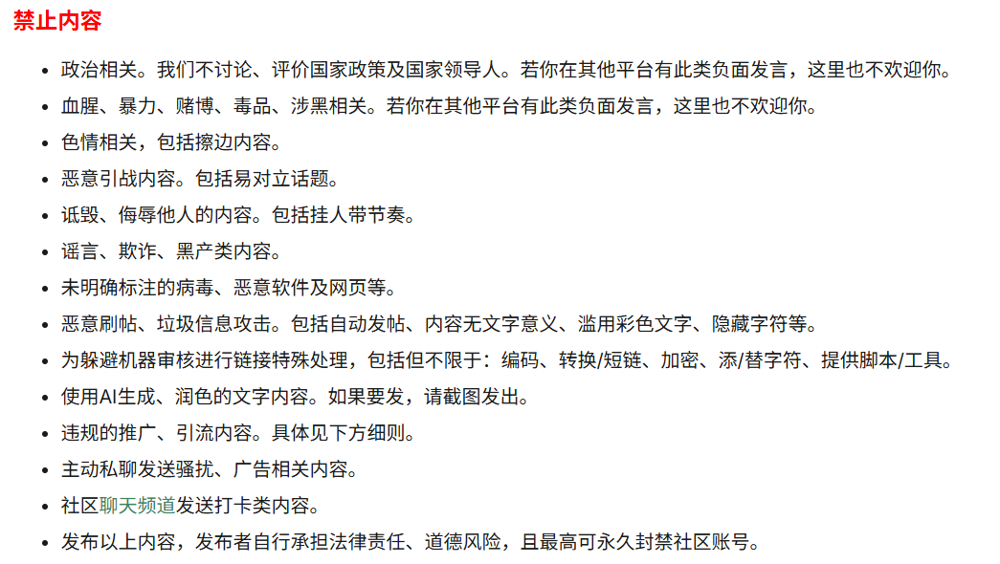
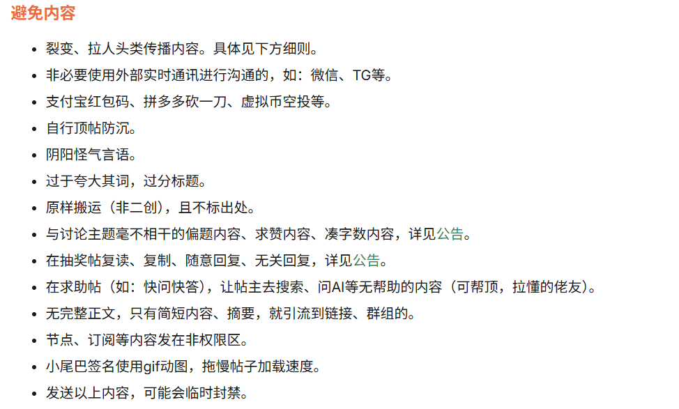
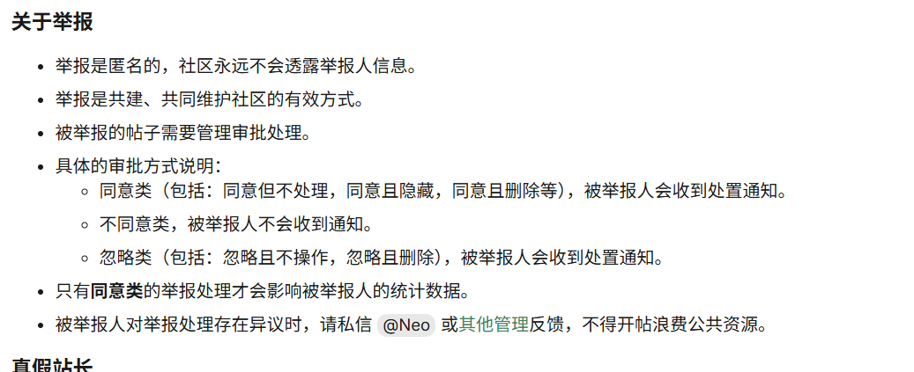
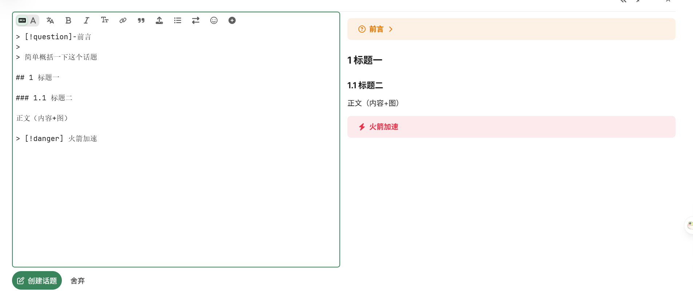
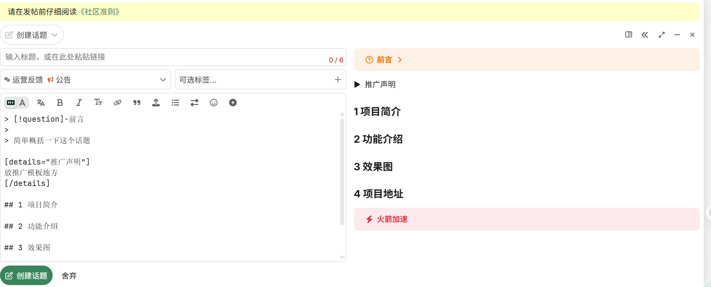

---

id: 2578415

title: "【指南】我要如何在站内水帖不被炼化"

created_at: 2026-07-13T14:31:46.468Z

username: xuanaixuan

display_username: "xuanxuan"

---


# 【指南】我要如何在站内水帖不被炼化


## 前言

> [!tip]+

> 不是，发帖这个有什么可教的，这不是很简单吗？

> 新佬入站都不敢发帖，唯唯诺诺，观察和学习佬友怎么发贴

>

> 那我问你，那贴子怎么给举报了、贴子怎么被下了、帖子怎么进审核，然后 10LDC 获得 MVP。

>

> 这你要怎么说! 

- 做兄弟在心中，你觉得我帖子有问题，快来反驳我，我受着。

- 此为 wiki 帖，诸位佬可以补充/修改错误内容，也可在评论中提供建议。

---

## 1 话题和帖子

> [!info]“话题” 指主帖，“帖子” 即传统意义的回复。

### 1.1 话题

话题，也可叫主贴，发起者即为楼主。其特征：

- 存在标题，可选择 1 个类别，至少 1 个或多个标签

- 内容上至少不能少于 20 个字符

- 存在编辑有效期（1级用户24小时内可编辑，2级/3级是30天内可编辑）

- 可以[申请自我管理](https://linux.do/t/topic/212928)，管理和长期编辑贴子

### 1.2 帖子

帖子，相当于对主贴内容的回复，2 至 n 楼的帖子

- 帖子只有内容，且不能少于 16 个字符

---

## 2 发贴须知

### 2.1 举报

你就说你有没有被情况炼化过，你就说你有没有被下过贴。

> [!tip]+ 帖子为什么被下

> 情况 1：那就是你的帖子太水，被检测到了自然被下。

>

> 情况 2：被举报了，帖子也会被下。

>

> 帖子被下会有 2 种情况

>

> 不会被记录到信任等级条件，安全无事

> 被记录到信任等级条件，超过 5 次后，近 100 天不能升级 TL3，严重封号







目前常见顷刻炼化贴：

- 非必要不抽奖

- 主动求 

- 违规推广/变相推广贴

- 被下帖然后发帖质疑

- 凑字数发贴

- 搞对立冲突，已造成负面情绪

- 内容过于色情

目前最常见被下贴：

| 类型 | 解决 |

| --- | --- |

| 萌新新人报到 | 去[集中贴](https://linux.do/t/topic/2327445) |

| anyrouter 相关讨论 | 去[集中贴](https://linux.do/t/topic/2496114) |

| 升降级/晒徽章/做徽章任务 | 尽量避免发布此类内容，可以在聊天区发。 |

无规矩不成方圆，这里告诫新佬谨言慎行，因为我只会心疼哥哥（黑化人格上线：嘿嘿嘿！10 ldc 到手）；此外无事不要乱举报，小心自己成为封号斗罗。

看到违规帖，你会怎么做？

- 使用 Boost/回帖提醒

- 选择举报中个人私信提醒

- 直接举报，为 10 ldc 冲锋

- 事不关己高高挂起

0

投票人

### 2.2 审核

> [!tip]- 简单来说，就是帖子触碰到了社区敏感信息。

>

> 在发帖前，提前 ctrl + c 备份一份帖子，无论帖子进不进审核，至少不会白写。

- 话题审核：当内容涉及到敏感信息帖子会进入审核，审核不通过不会邮件提醒且也不会撤回，另一种情况就是发帖模板有问题会撤回帖子。建议提前备份帖子，如果没有也可以私信管理获取原文。

- 帖子审核：当内容涉及到敏感信息帖子会进入审核，失败会发邮件提醒修改。

挽回待处理的主贴：[发话题不小心待审批 该怎么挽回自己的内容？可以尝试全选复制](https://linux.do/t/topic/2483076)

广告：[L站同款编辑器-「猎户座」 离线升级版，从此不怕论坛爆炸与发帖卡住丢失内容啦~](https://linux.do/t/topic/2566133)

### 2.3 发帖

发贴精髓：

- 首先确保标题和内容相符合

- 不要乱选类别和标签

- 选好类别权限区

- 内容字数至少要 16 字符，不要太水

- 内容上开头和结尾是精华，中间内容是一坨

- 长文章可以加个目录，安装个传送锚点

新人入站选择什么样类型贴发呢？

- 技术类，分享一些项目上技术。

- 讨论类，讨论技术或模型。

- 学习类/解决问题，快问快答，对技术上或工具上的发出问题。


注意，快问快答区的帖子，在问题得到解决后，需将有用的回答设为解决方案

解决方案可以设置多个，被设置解决方案的佬友均将得到10LDC奖励（不从你账户扣，是社区给予的）

- 分享类，分享自己的经验，或者开源项目。

- 福利类，（不推荐）

> [!todo] 佬友不知如何发帖，可套用下面的模板。

**模板1：基础模板**

```
> [!question]-前言
>
> 简单概括一下这个话题

## 1 标题一

### 1.1 标题二

正文（内容+图）

> [!danger] 火箭加速
```



- 布局-首（前言）、中（正文内容）、尾（口头禅/座右铭）；

- 前言部分可以是内容说明、提醒、话题简介；

- 正文可以文本+图形配合（AI生成内容一定要截图）；

- 尾巴就是用来放一些自己口头禅或者座右铭，名言名句都行。

---

**模板2：推广模板**

```
> [!question]-前言
>
> 简单概括一下这个话题

[details="推广声明"]
放推广模板地方
[/details]

## 1 项目简介

## 2 功能介绍

## 3 效果图（轮播图/拼图）

## 4 项目地址

> [!danger] 火箭加速
```



---

> [!todo]- 建议

>

> 新佬善用搜索：使用**论坛搜索功能**或搜索引擎中的 “**关键字 site:linux.do**” 来进行相关信息的首轮检索。若无法解决，再行提问或发帖 ~


---


*来源: https://linux.do/t/topic/2578415.json*

