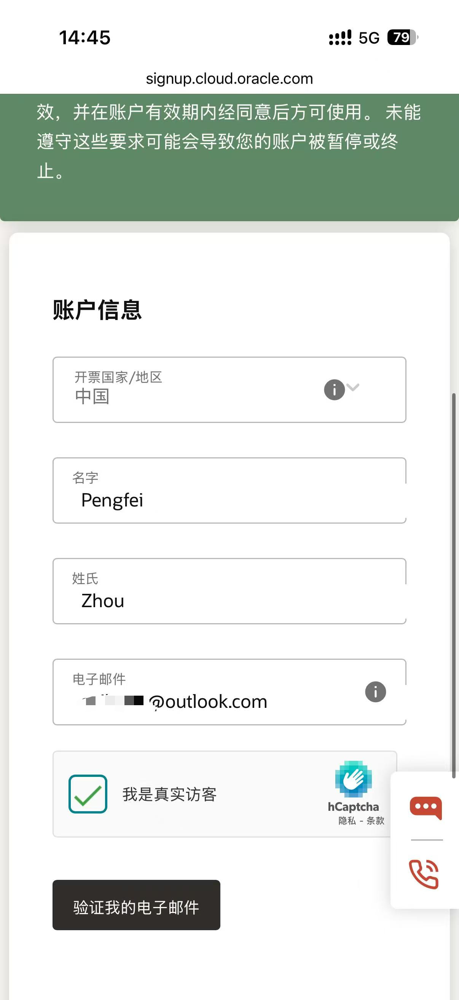
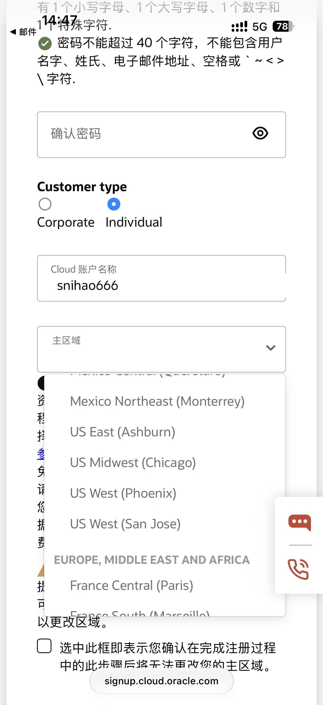
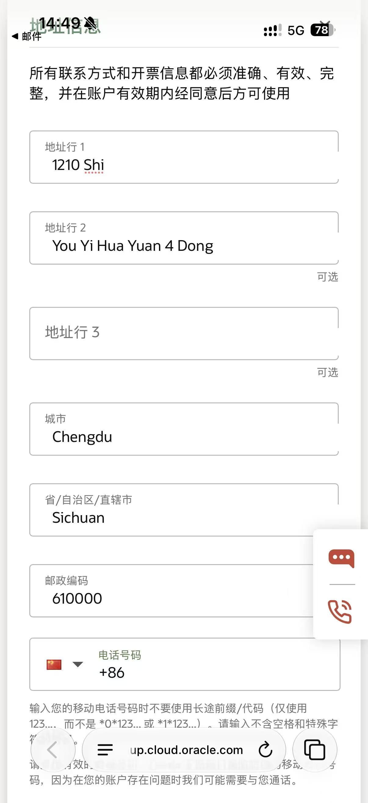
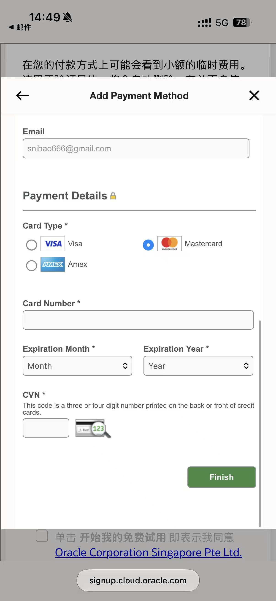
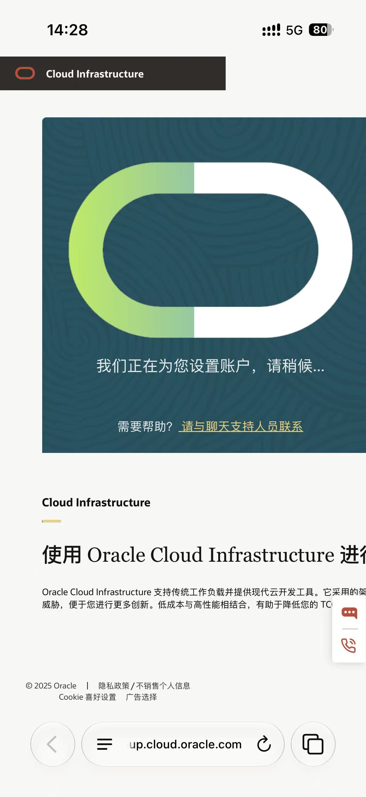

---

id: 2595524

title: "甲骨文成功开号，总共尝试4次！！！"

created_at: 2026-07-16T06:58:23.396Z

username: snihao

display_username: "碳水重度爱好者"

---

# 甲骨文成功开号，总共尝试4次！！！

就在刚刚，梯子太卡了导致摸鱼很不顺畅，就想着再去开一下甲骨文。没想到！！！成功了！！！ 

## 记录一下流程和设备，不谈教程

#### 设备

- 苹果手机

- 5G联通【用的流量】

- 全程vpn挂韩国节点

- 首次认证使用谷歌浏览器

- 后续认证使用Safari

- 邮箱：@outlook.com

- 招商银行万事达普卡

#### 流程

##### 一、首次认证

地址：[https://signup.cloud.oracle.com](https://signup.cloud.oracle.com)

填写完整信息后点击验证，在邮箱中跳转连接进行二次认证。

##### 二、二次认证

备用名和密码不展示，主区域我选的“US West (Phoenix)”倒数第二个。

##### 三、二次认证-地址信息

地址行1：写的房号（当然是假的）

地址行2：写的小区几栋（当然是假的）

城市、省份、编码和电话号码我都写的正确的。

##### 四、二次认证-支付方式

选择自己的卡填写即可

##### 五、验证成功就会出现一个跑道

验证失败就是大家都很熟悉的abc了~。最后祝各位佬都开成功！ 

---

*来源: https://linux.do/t/topic/2595524.json*

