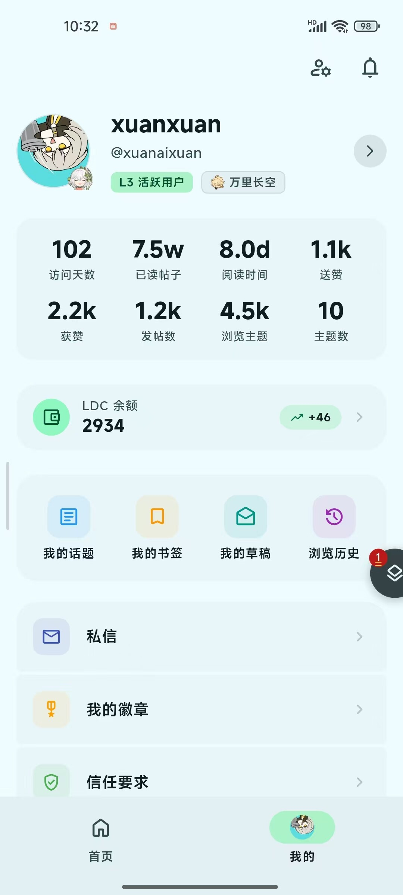
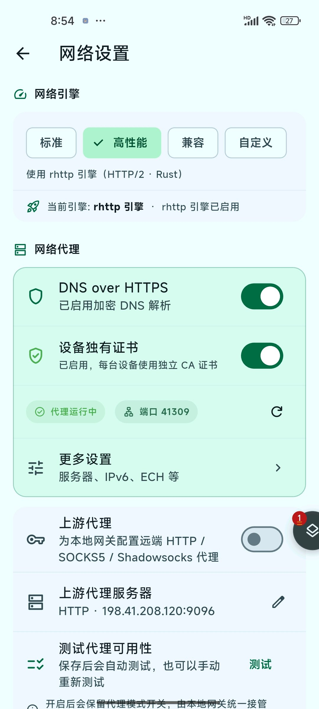
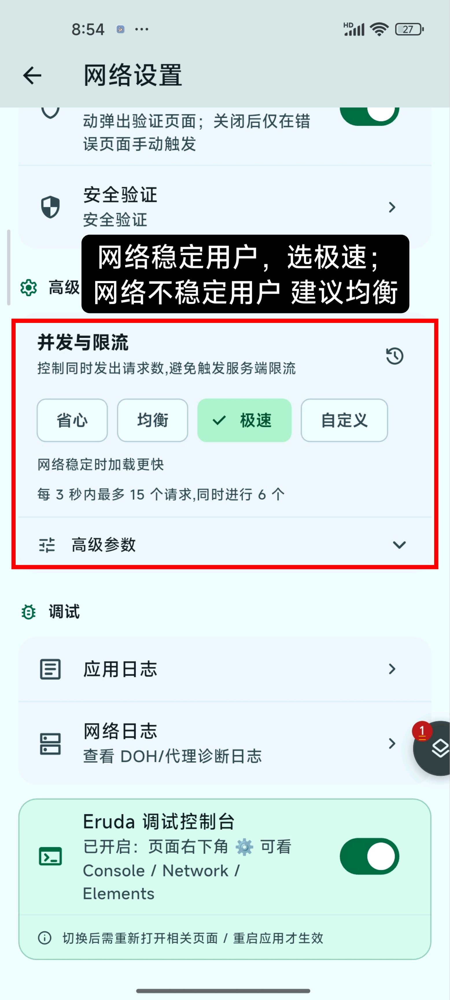
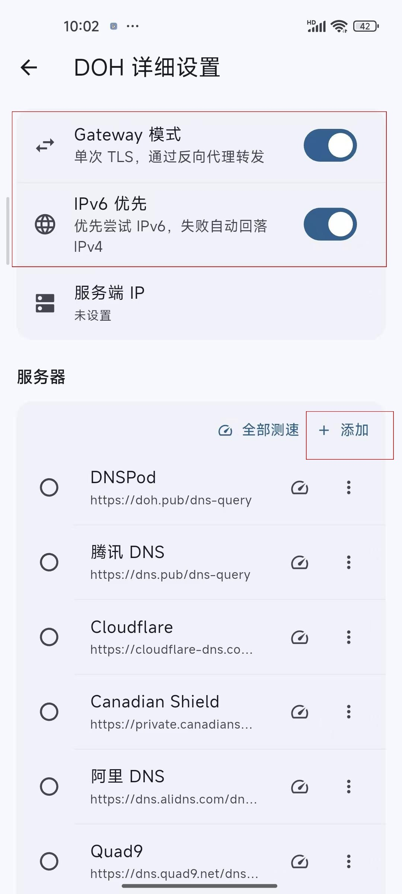
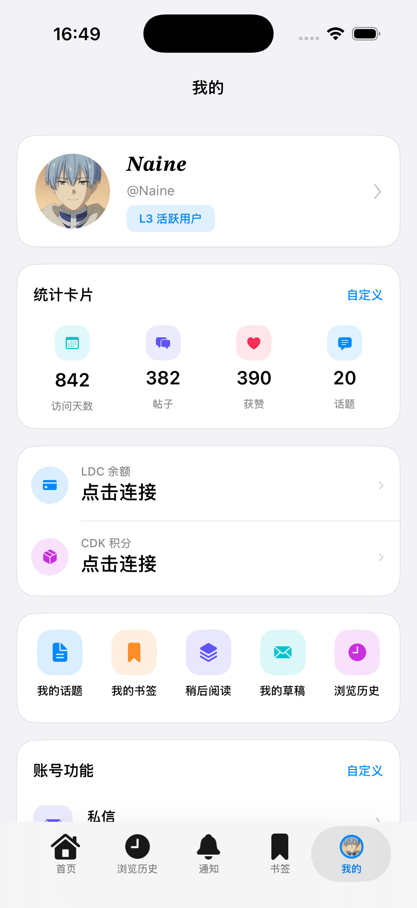

---

id: 2598791

title: "【APP汇总】上 L 站💭"

created_at: 2026-07-16T14:17:49.162Z

username: xuanaixuan

display_username: "xuanxuan"

---


# 【APP汇总】上 L 站💭


**诸位佬友好呀！**

> [!question]- 上 L 站

> 来了！来了！终于可以随时随地的刷L站了，一天不刷浑身难受呀！ 

> 始皇陛下，咱们的官方App何时上线！本人汇总了目前可访问L站的App，大家可尝尝鲜。

## 前言

> [!warning]- 换帖

> 旧贴已经超时编辑了，申请自我管理可能很久才能通过，不如开新贴方便，旧贴就放深海区了。

> 旧贴地址：[【APP 汇总】LinuxDO第三方客户端 ](https://linux.do/t/topic/2369360) |[【LinuxDO CLI 汇总】终端上L站](https://linux.do/t/topic/2444979)

---

## NO.1【`FluxDO`】

作者： [@pyteng](/u/pyteng)

一款支持多平台的第三方客户端，基于 Flutter 开发，致力于为用户提供流畅、优雅的论坛浏览体验，让不同类型用户都能体验 L 站的乐趣。

功能：

- 内置浏览器

- 支持 `DoH` 直连

- Boots 弹幕化

- 预览主题弹窗

- 待看帖加入悬浮窗

- 富文本编辑器（语音、音视频与附件）

- 快捷按钮（置顶，未读贴，跳转…）




> [!quote]主贴： [FluxDO，一个逐渐健硕的第三方 L 站客户端](https://linux.do/t/topic/1609212)

### 1、下载地址


### [Releases · Lingyan000/fluxdo](https://github.com/Lingyan000/fluxdo/releases)

一个 Linux.do 第三方客户端. Contribute to Lingyan000/fluxdo development by creating an account on GitHub.

> [!todo]支持 Android，iOS，macOS，Windows，Linux

### 2、配置 `DoH`

第一步：找到**我的 > 应用设置 > 网络设置**

第二步：**网络引擎**选择 高性能，**网络代理** 都为 True，**并发与限流** 选择 均衡

第三步：点击网络代理下面的 **更多设置**

如果还是网络不行，需要添加 DNS 服务器，换个服务器，本贴最下面有分享 DNS 服务器。








### 3、问题指南

有问题就找[【FluxDO】问题指南](https://linux.do/t/topic/2435542)。

---

## NO.2 【`Dexo`】

作者： [@Eilgnaw](/u/eilgnaw)

一个原生 iOS Discourse 论坛客户端，使用 UIKit + Swift 构建。让 iOS 用户也能在手机上自由刷帖。

功能：

- 多论坛管理

- Boots 弹幕化

- 自定义 UI 配色

- 支持板块分类

[image1474×2786 199 KB](https://cdn3.ldstatic.com/original/4X/7/3/e/73ea6b25d1bad21888863177c53fae2109e277c9.webp)

[image1474×2786 159 KB](https://cdn3.ldstatic.com/original/4X/3/d/c/3dc5cc80216d000c817f80035f15081c1b794eea.webp)

[image1474×2786 266 KB](https://cdn3.ldstatic.com/original/4X/7/b/9/7b9f270fe02e81bade38daaa925e2784b87ab0d4.webp)

> [!quote] 主贴： [[开源推广] Dexo -支持 L 站的原生 iOS APP ,现已发布至 TestFlight](https://linux.do/t/topic/1989295)

### 下载地址

### [GitHub - Eilgnaw/dexo](https://github.com/Eilgnaw/dexo)

通过在 GitHub 上创建帐户来为 Eilgnaw/dexo 开发做出贡献。

> [!todo]-支持 iOS

> **TestFlight：** [加入 Beta 版“Dexo” - TestFlight - Apple](https://testflight.apple.com/join/3BnxhsWs)

---

## NO.3 【`ArkDO`】

一款为L站适配鸿蒙系统而生第三方客户端，它把 Discourse 的 JSON 接口直接渲染成原生 ArkUI 界面：帖子列表、话题详情、富文本正文、表情回应、投票、书签、通知、个人主页，都是原生控件绘制的，滚动跟手，支持深色模式和平板双栏。

作者：[@JoeyYin](/u/joeyyin)

功能：

- 支持多论坛切换

- 两级版块树抽屉，按分类看帖

- 话题详情窗口式分页加载，楼层 scrubber 拖动跳楼，按楼号直达

- 表情回应、Boost 助力、投票、“俺也一样”

- DoH 自定义 DNS（内置优选服务器，支持增删、切换、测速）

[image1920×1381 222 KB](https://cdn3.ldstatic.com/original/4X/4/5/1/4518f5cb76c1c70d4ba808beadedde4d20a3dc53.webp)

[image1920×1381 120 KB](https://cdn3.ldstatic.com/original/4X/2/9/8/2983595d1b7967415e23876b740bb660774ba141.webp)

> [!quote] 主贴： [【ArkDO】一切为了审核通过.....鸿蒙端的L站客户端(Discourse通用了)，.8月11号更新](https://linux.do/t/topic/2590051)

### 下载地址

### [GitHub - EnjoySR/ArkDO: LINUX DO 社区的第三方 HarmonyOS 原生客户端](https://github.com/EnjoySR/ArkDO)

LINUX DO 社区的第三方 HarmonyOS 原生客户端

> [!todo]-支持 HarmonyOS

> **TestFlight**：**https://appgallery.huawei.com/link/invite-test-wap?taskId=088213dc2aa736b00f963f4c6d1e7630&invitationCode=3FIpGrebmW4**

> **TestFlight：https://appgallery.huawei.com/link/invite-test-wap?taskId=e249c783580f12d09f8494de523ee94c&invitationCode=3FIpGrebmW4**

---

## NO.4 【`HarmonyDO`】

HarmonyDO 是一个面向 `LINUX DO` 社区的第三方原生鸿蒙客户端，提供更流畅、更贴近 HarmonyOS 原生能力的一个产品。

作者： [@Bigfanqie](/u/bigfanqie)

功能：

- 树形回复视图与最旧 / 最新 / 热门排序

- 小火箭简短回复：发布、删除、表情输入、两排折叠与同文聚合

- 应用内 WebView 浏览

[image1216×2688 121 KB](https://cdn3.ldstatic.com/original/4X/8/3/b/83bcaf1ee77fde24b8df267d1d7b666560919c65.webp)


> [!quote] 主贴： [时隔三月，LDO社区版（原 HarmonyDo）鸿蒙原生应用重磅更新！](https://linux.do/t/topic/2730027)

### 下载地址

### [GitHub - Amaz1ny/HarmonyDO-public: HarmonyDO 开源公开仓库](https://github.com/Amaz1ny/HarmonyDO-public)

HarmonyDO 开源公开仓库

> [!todo]-支持 HarmonyOS

> **TestFlight：** [AppTest](https://appgallery.huawei.com/apptest/23yYIIrUG95)

---

## NO.5 【`Litho`】

一款还在内测阶段的项目,目前发布了Android版本 和 iOS版本。

作者：[@huapai](/u/huapai)

功能：

- linuxdo与idcflare 双站切换

- MessageBus 聊天

- 双向分页 · 续读位置

- 抽奖专区 · 进行中 / 已开奖

> [!quote] 主贴： [【Litho 拓本 OpenTest】个人开发的L站三方客户端目前能测了](https://linux.do/t/topic/2543637)

### 下载地址


### [Litho · linux.do 与 idcflare 第三方客户端（iOS / Android 原生）](https://litho.cassianflorin.com/)

打穿 Cloudflare 盾、保持登录态、丝滑原生体验。一整份帖子流，一次成版。支持 linux.do 与 idcflare.com 站点切换。iOS TestFlight 公测中，Android APK 同步更新。

> [!todo]-支持 iOS，Android

> **TestFlight：** [加入 Beta 版“Litho 拓本” - TestFlight - Apple](https://testflight.apple.com/join/PZc9vmmZ)

---

## NO.6 【`Fire`】

Fire 是一个全新的原生客户端工作区，目标栈为 `Swift + Kotlin + Rust + UniFFI`。

作者： [@JackRiver19](/u/jackriver19)


> [!quote] 主贴： [【非官方】佬友想要 佬友得到 ios原生L站App开源推广 欢迎pr和体验 已正式开启Testflight公测！](https://linux.do/t/topic/2231964)

### 下载地址

### [GitHub - peterich-rs/fire: Fire 是面向 Linux.do 社区的非官方第三方原生iOS Android客户端](https://github.com/peterich-rs/fire)

Fire 是面向 Linux.do 社区的非官方第三方原生iOS Android客户端

> [!todo]-支持 iOS，Android

> **TestFlight：** [加入 Beta 版“Fire for LinuxDo” - TestFlight - Apple](https://testflight.apple.com/join/2f99ustv)

---

## NO.7 【`Doer`】

Doer是一个二开Dexo使用FluxDo风格的一个ios原生第三方LinuxDo客户端；Doer在Fluxdo风格的基础上加入wechat/telegram主题，还有一些自带的小程序，也可以将经常访问的网站收录到小程序里面。

作者：[@Naine](/u/naine)

功能：

- Fluxdo风格的基础上加入wechat/telegram主题

- 自带的小程序、NewAPI 签到(支持静默重新认证)、工具箱和插件坞。




> [!quote] 主贴： [【开源推广】Doer 一个原生的第三方LinuxDo IOS客户端](https://linux.do/t/topic/2770398)

### 下载地址

### [GitHub - moliango/doer](https://github.com/moliango/doer)

通过在 GitHub 上创建帐户来为 moliango/doer 开发做出贡献。

> [!todo]-支持 iOS

---

## NO.8 【 浏览器桌面端 】

一般我们通过浏览器访问 L 站，浏览器生成桌面端工具来访问也是一样的；


无论是pc端还是移动端都可以用的方式，需下载 Chrome 浏览器,或者可配置 doh 浏览器就行。


**1、创建桌面图标**


**2、配置浏览器-doh**

步骤：设置 > 隐私与安全 > 安全 > 选择 DNS 提供商，自定义并输入 DNS 服务器地址


> [!tip]-温馨提示

>

> 如果机场稳定且快，也可不用配置doh

> [!todo]-支持 iOS，Android，Windows，macos，Linux

---

## NO.9 【`Discoursehub`】

始皇主推的 `DiscourseHub`，通过内置浏览器来访问 `L站` 。


> [!quote] 主贴： [本论坛的移动端应用](https://linux.do/t/topic/2191)

### 下载地址


### [搜索 - App Store](https://apps.apple.com/cn/iphone/search?term=Discoursehub)

在 App Store 上查找与“Discoursehub”相关的 App 和游戏，包括“Discourse Hub和DisHub”。

> [!todo]-支持 iOS，Android

---

## **[附加] DoH 汇总**

快（始皇分享的）

```
// 始皇
https://i4cm5lqxfu.cloudflare-gateway.com/dns-query
https://[自定义子域名].ddd.oaifree.com/query-dns
// 香港
https://edge.47258.xyz/linuxdo
// 日本
https://gameapi.47258.xyz/linuxdo
```

中

```
https://us-kan-w-p-1.nashkan.net/dns-query
https://us-nyc-w-p-1.nashkan.net/dns-query
https://dns.neeb.it/dns-query
https://dns.nick-slowinski.de/dns-query
https://dns.telekom.de/dns-query
https://dns.t53.de/dns-query
https://dns.vaioswolke.xyz/dns-query
```

慢

```
https://doh.lv/dns-query
https://doh.nic.lv/dns-query
https://ns1.opennameserver.org/dns-query
https://dns.decky.eu/dns-query
https://kronos.plan9-dns.com/dns-query
https://doh.archuser.org/dns-query
```

其他：[doh 方案汇总](https://linux.do/t/topic/1469823) | [自建DoH分享 三网优化+国内外域名分流](https://linux.do/t/topic/2474358)

---

你们都在用哪个app

- FluxDO

- Dexo

- ArkDO

- HarmonyDO

- Litho

- Fire

- Doer

- 浏览器/桌面图标

- Discoursehub

- 其他

0

投票人

> ![!danger]- 起飞咯~

> 感谢开源！


---


*来源: https://linux.do/t/topic/2598791.json*

