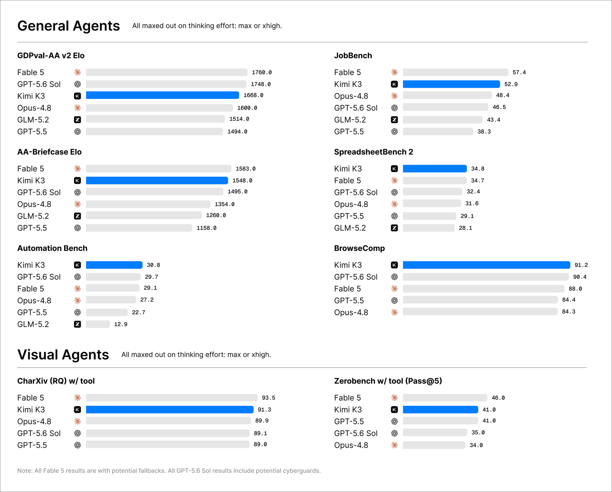
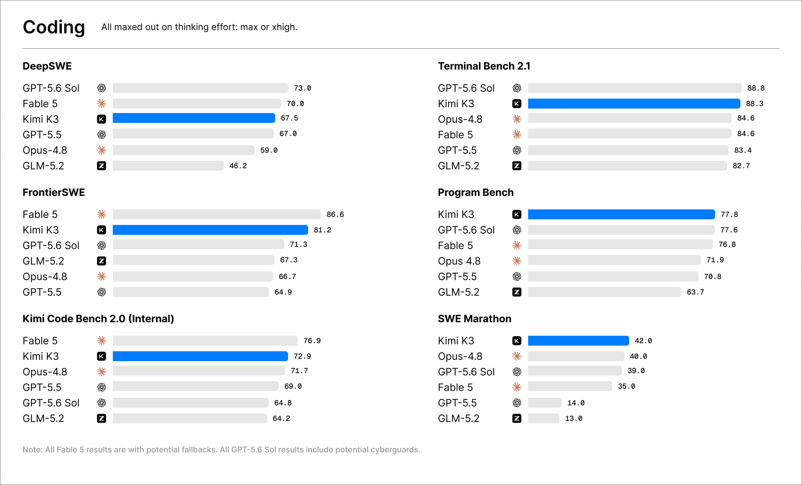
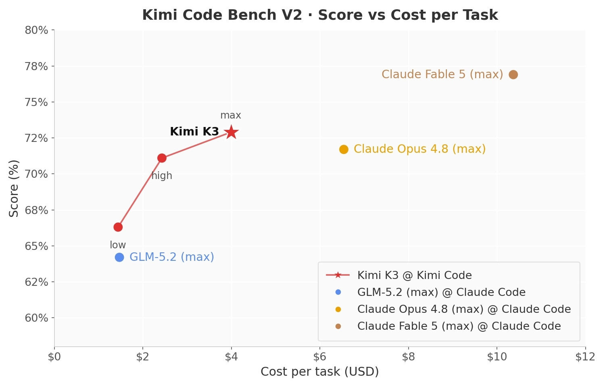
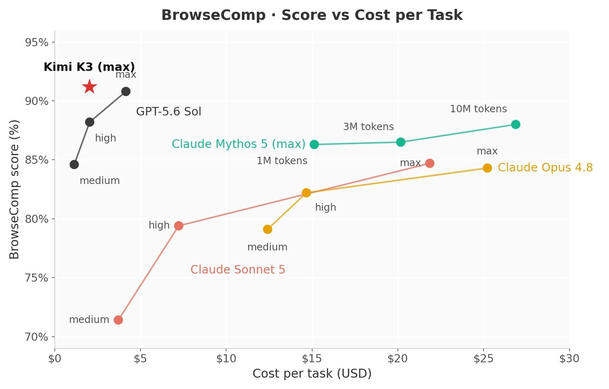
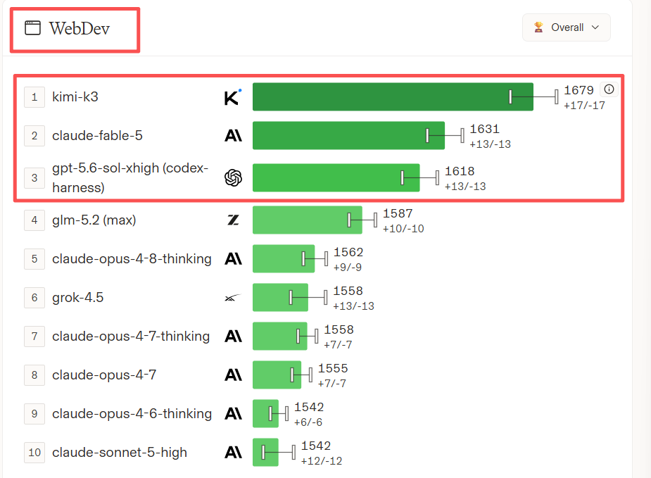
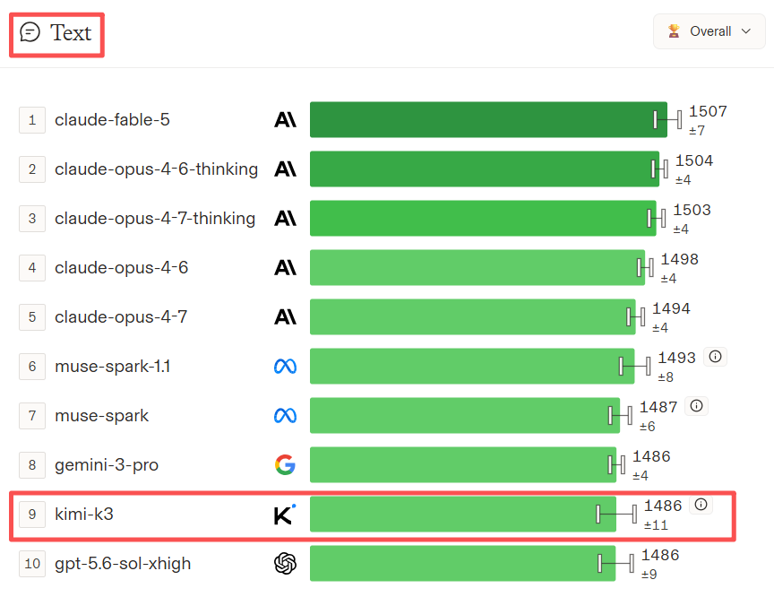
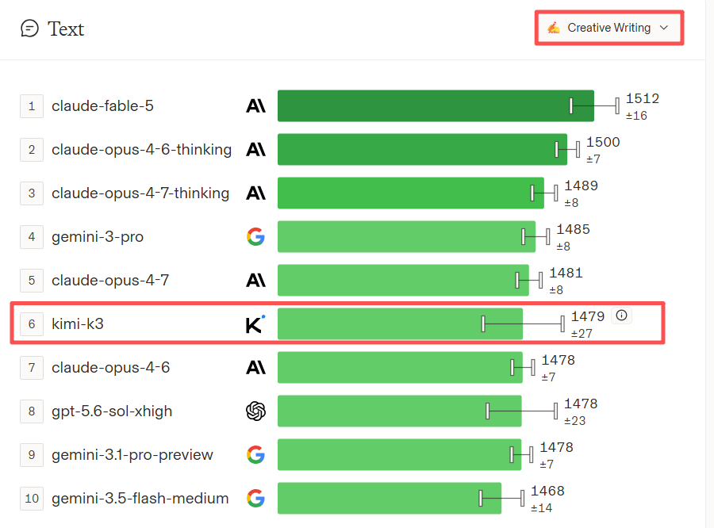
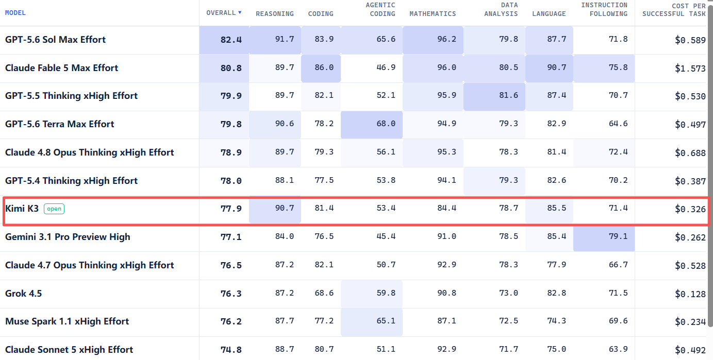
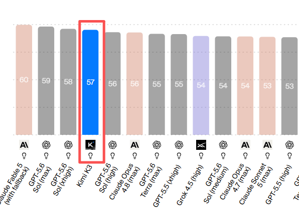
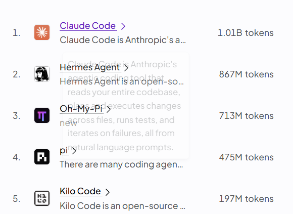

---

id: 2603188

title: ":fire:【大模型系列39】关于Kimi K3,您想知道的一切【底楼更新Arean Agent评分】"

created_at: 2026-07-17T06:51:21.781Z

username: dwqxq1

display_username: "dwqxq1"

---

# :fire:【大模型系列39】关于Kimi K3,您想知道的一切【底楼更新Arean Agent评分】

## 基本资料

官方文:[Kimi K3 - Kimi API Platform](https://platform.kimi.ai/docs/guide/kimi-k3-quickstart)

官方文:[Kimi K3 Tech Blog: Open Frontier Intelligence](https://www.kimi.com/blog/kimi-k3)

价格:[Flagship Model Kimi K3 Pricing - Kimi API Platform](https://platform.kimi.ai/docs/pricing/chat-k3)

effort:暂时只有max一种

参数:2.8t,参考deepseek4=1.6t,glm5.2=0.75t

上下文:api是1m,包月只有$99及以上会员是1m,$99以下是256k

价格:输入$3,输出$15,与sonnet和terra价格相当,这价格相当自信啊

速度:62tps

## 评测

### 官方自评

---

---

---

---

### LMArena评测

来源:[Arena Leaderboard | Compare & Benchmark the Best Frontier AI Models](https://arena.ai/leaderboard/)

---

---

---

### LiveBench评测

来源:[LiveBench](https://livebench.ai/#/)

---

### ArtifacialAnalyse评测

来源:[https://artificialanalysis.ai/](https://artificialanalysis.ai/)

---

## Chat渠道

### 官网

### LMArena未上线

### OpenRouter已上线

来源:[AI Chat Playground - Compare AI Models Side by Side | OpenRouter](https://openrouter.ai/chat)

---

## API渠道

### 官网已上线

### OpenRouter已上线

来源:[Kimi K3 - API Pricing & Benchmarks | OpenRouter](https://openrouter.ai/moonshotai/kimi-k3)

---

## Coding渠道

### 官网会员

来源:[Kimi AI 官网 - K3 上线，专为智能体编程与知识工作打造](http://www.kimi.com/membership/pricing)

要用全局梯子才能看到国际版价格

0.25x=没有国际版/¥49

1x=$19/¥99,2agent

5x=$39/¥199,4agent

15x=$99/¥699,8agent,有1m上下文

30x=$199/没有中国版

---

### opencode-GO已上线

只能用$15

---

### CodeBuddy

有积分就可以用

---

## Kimi-K3常用配套Harness（来自OpenRouter统计）

---

*来源: https://linux.do/t/topic/2603188.json*

