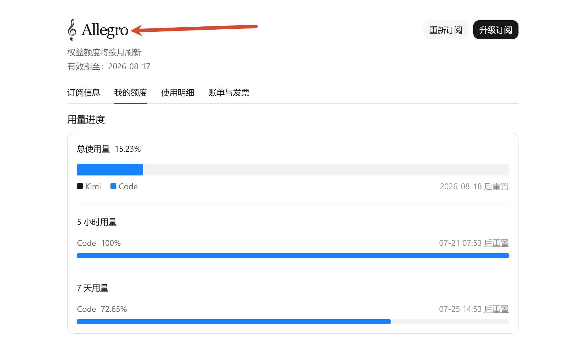

---

id: 2621643

title: "【26.07】国内外模型、Harness感受以及渠道"

created_at: 2026-07-20T15:33:16.433Z

username: XTer

display_username: "XTer"

---

# 【26.07】国内外模型、Harness感受以及渠道

以下纯手打，有什么问题评论说

起因是最近7天，眼睛一睁就是蹬，也用了不少国模和不同渠道，因此感觉可以来写点什么了

下文的模型/渠道基本用过，有哪些我没提及的模型/渠道欢迎补充

---

## 前提：

模型、harness是两种东西，但是它们是相辅相成的

### 模型

指的是 deepseek v4 pro、glm 5.2、 gpt 5.6 sol、opus 4.6等东西，

它们可以通过api形式提供服务，也可以通过订阅的形式直接在harness里用（当然也可以反代出来，但是这个不是我们要考虑的）

### harness

可以粗暴理解为你用的软件（其实不全是这个意思）

常见一些tui界面的比如 Codex Cli 、Claude Code 、 Grok build、 Kimi Code、Opencode等

一些gui界面的比如 Codex（Chatgpt）、Claude Desktop、QoderCN、Zcode、Opencode、Cursor等

大部分是模型厂商专门为了自己家的模型适配的，

但是也有一些，例如Claude Code、Cursor，是相对更加通用的、甚至比原厂商还要更好用的

---

## 原则

### 尽量不用中转站

它可以完整获取你的所有输入信息、可以给你返回任意指令

能用官方尽量用官方

而且说不定给你的模型还是假的呢

你以为你用的是Fable小姐，实际上给你提供服务的是小弱智haiku

网上一搜一大把

其实不少大厂也算是中转站的一种，比如京东云、火山coding plan；但是相对来说更加可信一点，不会乱卖你数据，顶多自用

因此我下面推荐的渠道一般也是直接对接官方的，尽量减少数据被二次贩卖

---

## 国外

有一个特殊的存在：

### Cursor

【直付】 支付宝直接充值即可

#### 模型&Harness

这是一个啥都提供的的软件

这个相当于你充值200刀可以用400-500刀左右的额度，比率比其他的低

但是因为harness本身做的很好、自身提供量大管饱的Grok/Composer，而且可以支付宝直接支付人民币

因此想要稳定的/公司提供报销的建议直接纳入考虑

与之类似的还有devin等，也有不少人把它们反代出来用

有机会也可以冲一个20刀pro会员/用其他手段自己往里面接入自己的api，会是一个不错的选择

#### 厂家

其实之前还有不少羊毛事件，cursor本身也是一个巨大的草台班子，这里就不展开讲了

比如说之前20刀充值可以当200刀用、因为退款按时间退所以可以速刷流等

### Claude：

【闲鱼】max 5x/20x

【苹果】礼品卡直冲

【闲鱼/卡网/外卡】kiro等渠道

【Cursor】

#### 厂家Anthropic

注意这个封的超级勤快，而且claude code有后门前科，你会知道为什么A\叫A\，而且是真的相当排华

#### 模型：

Opus 4.6：曾经的白月光，说话也很舒服，不少人甚至拿去角色扮演、很少的怪味口癖

Opus 4.8：多了一点怪味口癖，部分人群认为不是很好，我是觉得还挺可靠的，主agent开一个xhigh就是一个干

Fable 5：没有刚出来那么神、但是还是相当神，Fable小姐也是一个白月光，又聪明又会写前端，就是有点太敏感肌了，容易直接不提供服务

总结：我爱你啊Fable小姐~

[linux.do/t/topic/2513484](https://linux.do/t/topic/2513484)

#### Harness

而且说到Claude Code，这个其实是一个设计相当优秀的Harness

几乎接啥啥好用，而且本身子代理的设计也相对合理

### GPT：

【苹果/谷歌/外卡】pro 20x 、正价plus

【闲鱼/L站/卡网】其他日抛渠道、48team

【Cursor】

#### 厂家

Openai其实属于相对大善人类型的，是真不容易封，而且Tibo三天两头重置，相当舒服

但是6月也有前科，就是516截断降智；而且我觉得马上5.6也要思考截断了

#### 模型

嗯，对于5.4 5.5 5.6 sol我的感受就是除了

1. 不说人话

2. 前端是shi

其他方面是一个相当可靠的帮手

小贴士是如果你不用子agent、那么主agent不要开max思考强度

#### Harness

Codex，怎么说呢，调好了也不是不能用，用着还挺舒服的，但是仅限gpt模型

配合Trellis（魔改版）等框架使用更好哦~

但是软件巨卡无比！！！（codex app），写的这么烂的软件都不知道为什么会出现在2026年的超级大公司

### Grok：

【闲鱼/其他】SuperGrok 试用号

【闲鱼/外卡/苹果】SuperGrok 低价区/正价

【外卡/苹果】X premium+赠送

【Cursor】 甚至用的是Auto池，爽啊

#### 模型

又快又相对好

可以处理大部分不难的问题

但是目前貌似又有降智事件了 7/22

期待老马说的2T新模型

#### Harness

grok build其实挺好用的，然后老马又开源了，就是之前有上传整个仓库的问题

Cursor更是夯

其他你也可以反代出来接进其他地方

### Gemini：

呃呃真的有人还用哈基米吗？

属于曾经的白月光，现在呃呃，能力不行我只能说，美国豆包称号不是白来的

---

## 国产

### Kimi K3：

【直付】官网套餐（已售罄）

【直付】Opencode go（不推荐，量很少）

#### 模型

前端无敌，我相当喜欢

真的觉得前端可以和Fable碰碰手腕了

但是是真的不耐用

实测当前版本699档5小时大约1亿token（或者说1500w左右纯输入），但是我这个缓存率比较低只有85%；按其他人的说法月限大约3B，这比oai的pro 20x的性价比要低很多

对于逻辑性和难的问题，还是不如Opus4.8 / GPT5.5

#### Harness

kimi code也不是不能用，而且对kimi有单独适配

也可以接入claude，也挺聪明的

### Glm：

【直付】火山套餐（4倍活动持续到8.8）

【直付】Opencode go

【直付】智谱Coding Plan

#### 模型

感觉能力有gpt 5.4-5.5之间，相对可靠，前端不算太丑

属于那种可以放心交给他的那种

#### Harness

至于Zcode，其实做的不错哦，甚至有人说接入kimi的体验也不错

甚至是一个我觉得用起来挺顺手的gui harness，子代理也可以方便的配置

就是对于其他厂和自定义模型的体验不是特别好，你敢相信2026年的软件还只能手填模型id吗？

### Deepseek：

【直付】官网

【直付】Opencode go

你D老师直接冲就可以了，原价也不贵，甚至原价两倍也不算太贵

期待正式版和官方harness，梁圣的恩情还不完

### Qwen：

【直付】Qoder/QoderWork

【直付】阿里TokenPlan

#### 模型&harness

感觉QoderWork的Qwen 3.8 max笨笨的，不喜欢，严重怀疑降智了/没有RL

问题就是如果是宣传的Fable级别，至少QoderWork里面的绝对没有达到

甚至我觉得有点过于蠢笨了，很红温的体验，比mimo还差

然后QoderCN里面的需要开会员，没试过，希望阿里能赞助我一下我去试试

[Qwen3.8max是我蹬的姿势不对吗？](https://linux.do/t/topic/2640783) [

国产替代](/c/domestic/98)

> 买的Token plan 140的套餐，是不是我用的harness不对啊

> 目前在Zcode和Claude Code、QoderWork里面用过，不说K3、明显不如glm5.2，甚至打不过前代的Qwen3.7max

>  ![[image]](https://cdn3.ldstatic.com/original/4X/2/6/0/260e93c0601994b2eabb7487e22268c63fdfd15a.png)

>  ![[image]](https://cdn3.ldstatic.com/original/4X/9/8/e/98efad3685d9a11647ce0851cdddfe51bd8f9292.png)

> 而且还会中英文参杂的输出，实际上用下来指令遵循很差、也不会自主探索、相当不省心

> 为啥会这样，还是说有什么诀窍？他在排行榜…

试过了，一样的蠢笨，没招了

Qwen 3.7 max我当时很喜欢，当时水平也不差，趁着芒果台活动，狂用超多，用爽了，属于中规中矩的选择，大致glm水准吧

---

*来源: https://linux.do/t/topic/2621643.json*

