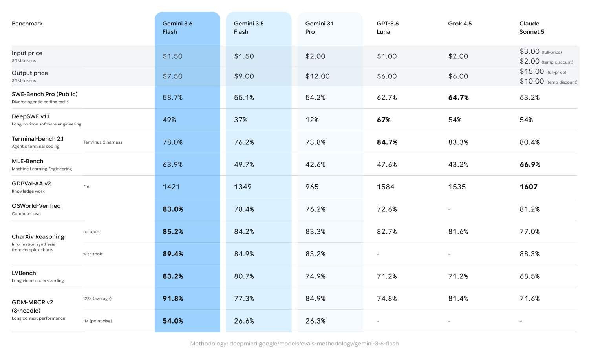
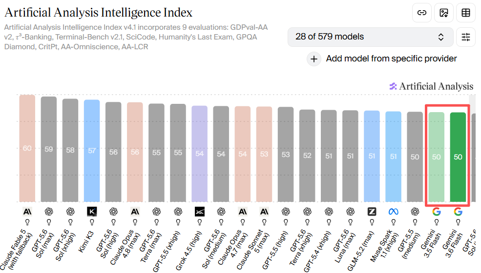
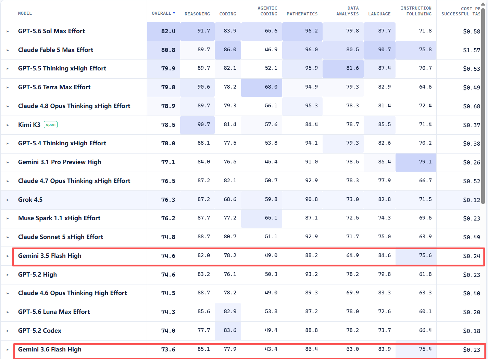
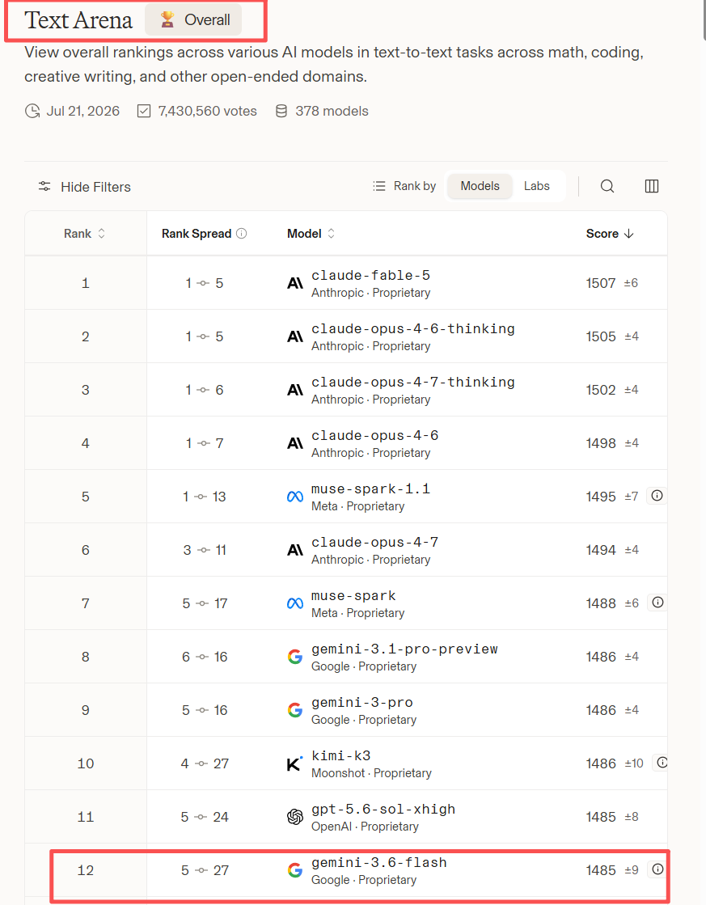
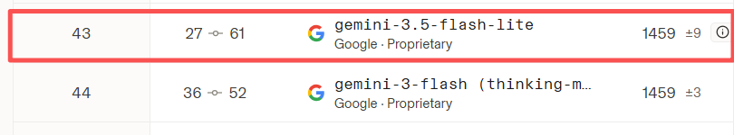
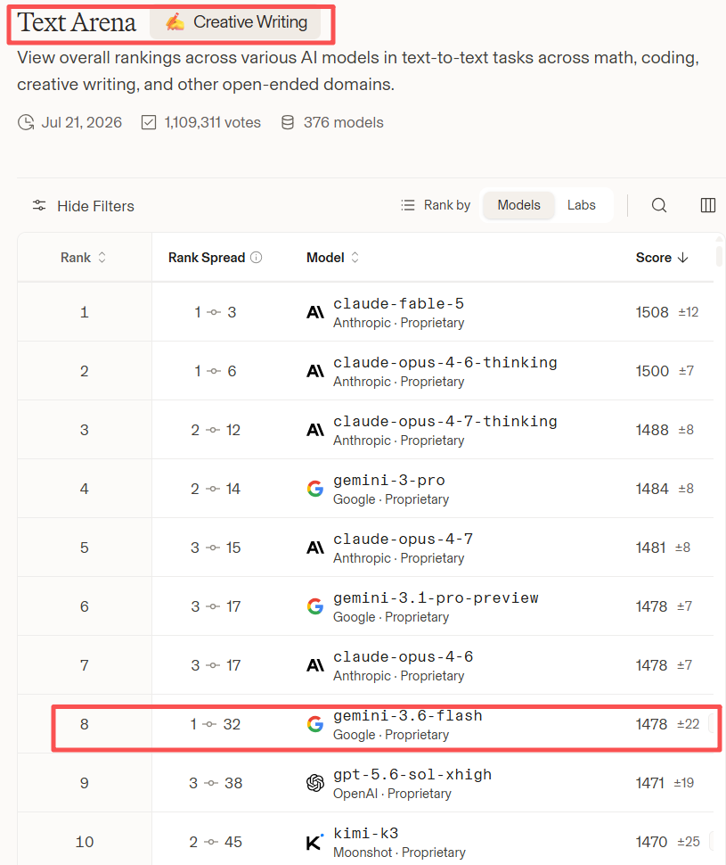
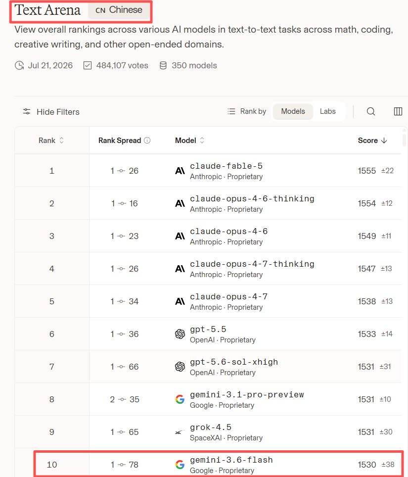
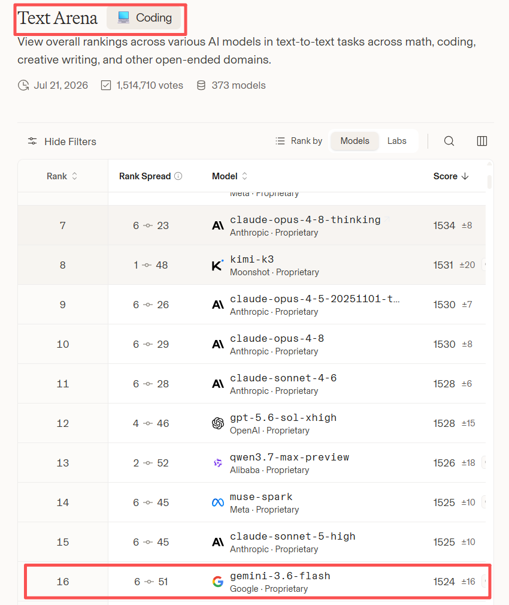
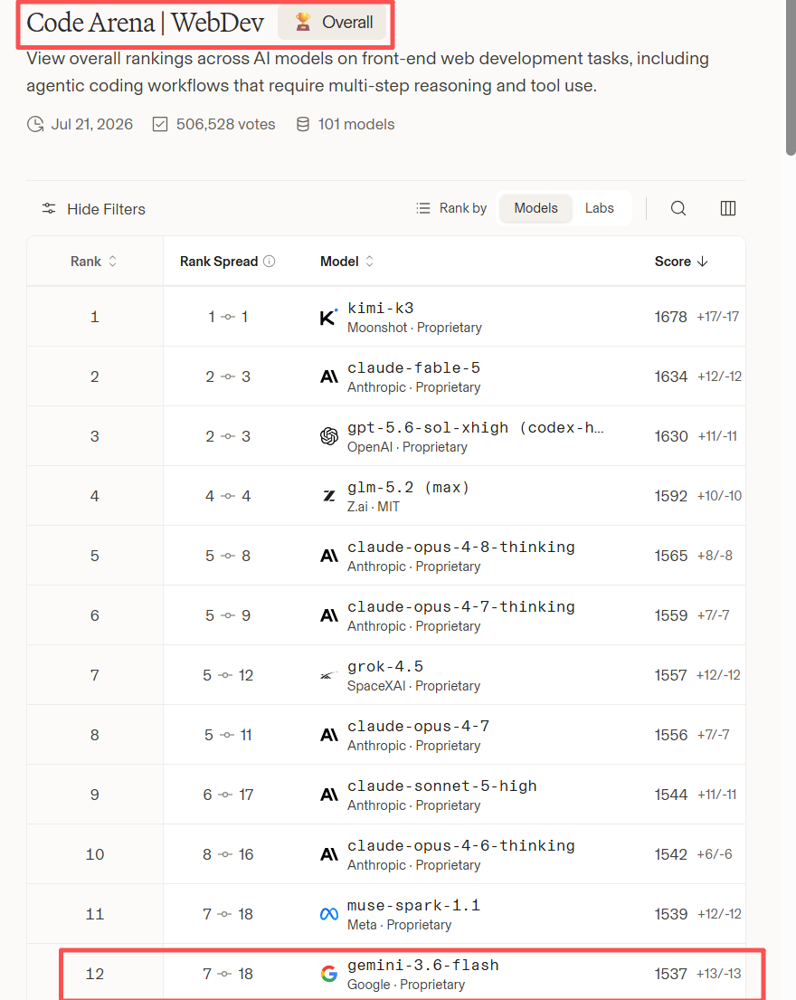
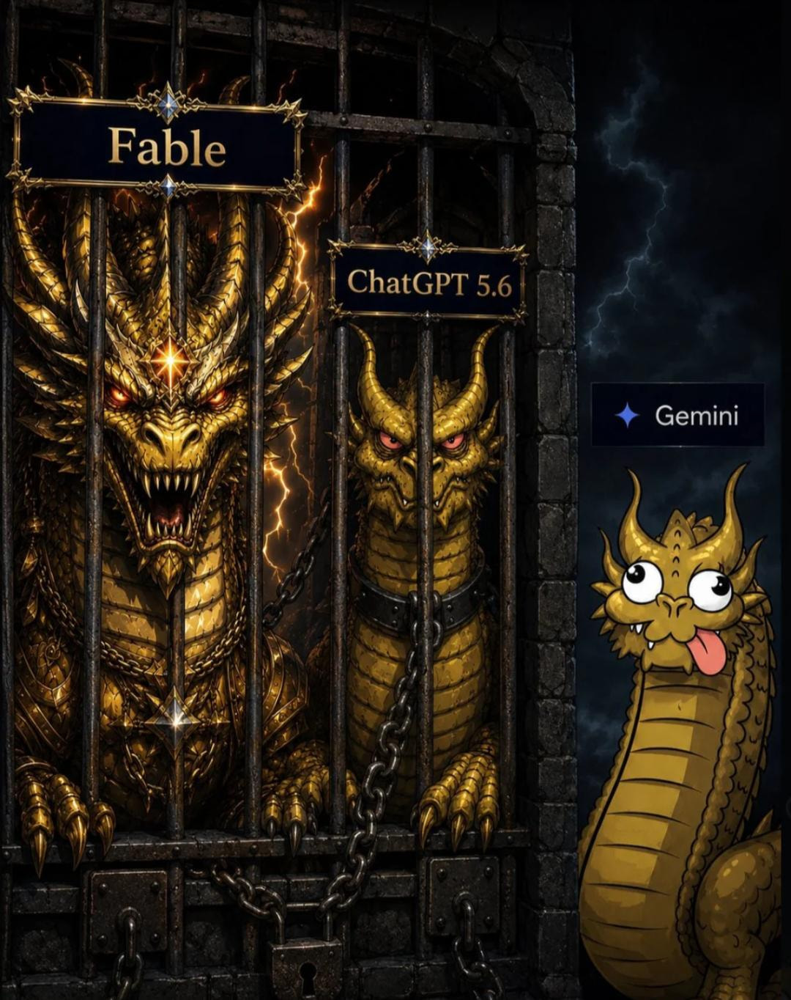

---

id: 2633302

title: ":fire:【大模型系列40】关于Gemini 3.6 Flash 和 3.5 Flash-lite,你想知道的一切"

created_at: 2026-07-22T07:04:42.828Z

username: dwqxq1

display_username: "dwqxq1"

---

# :fire:【大模型系列40】关于Gemini 3.6 Flash 和 3.5 Flash-lite,你想知道的一切

## 基本资料

官方文:[3.6 Flash, 3.5 Flash-Lite, and 3.5 Flash Cyber](https://blog.google/innovation-and-ai/models-and-research/gemini-models/gemini-3-6-flash-3-5-flash-lite-3-5-flash-cyber/)

3.6-flash模型卡:[https://storage.googleapis.com/deepmind-media/Model-Cards/Gemini-3-6-Flash-Model-Card.pdf](https://storage.googleapis.com/deepmind-media/Model-Cards/Gemini-3-6-Flash-Model-Card.pdf)

3.5-flash-lite模型卡:[https://storage.googleapis.com/deepmind-media/Model-Cards/Gemini-3-5-Flash-Lite-Model-Card.pdf](https://storage.googleapis.com/deepmind-media/Model-Cards/Gemini-3-5-Flash-Lite-Model-Card.pdf)

### 价格

来源:[https://ai.google.dev/gemini-api/docs/pricing](https://ai.google.dev/gemini-api/docs/pricing)

3.6-flash = 输入$1.5/输出$7.5

参考3.5-flash = $1.5/$9

参考3-flash = $0.5/3

自称比3.5-flash节约17%token

3.5-flash-lite = $0.3/$2.5

参考3-flash-lite = $0.25/1.5

### 速度

3.6-flash:275tps(ArtificialAnalysis),158tps(OpenRouter)

3.5-flash-lite:350tps(ArtificialAnalysis),124tps(OpenRouter)

上下文1m不变

## 评分

### 官方自评

---

### ArtificialAnalysis

来源:[Gemini 3.6 Flash - Intelligence, Performance & Price Analysis](https://artificialanalysis.ai/models/gemini-3-6-flash#intelligence)

---

### LiveBench评分

来源:[LiveBench](https://livebench.ai/#/)

---

### Arena Text 综合分,还凑合

来源:[LLM Leaderboard - Best Text & Chat AI Models Compared](https://arena.ai/leaderboard/text)

---

#### Arena Text 创意写作分

来源:[LLM Leaderboard - Best Text & Chat AI Models Compared](https://arena.ai/leaderboard/text/creative-writing)

---

#### Arena Text 中文分

来源:[LLM Leaderboard - Best Text & Chat AI Models Compared](https://arena.ai/leaderboard/text/chinese)

---

#### Arena Coding分

来源：[LLM Leaderboard - Best Text & Chat AI Models Compared](https://arena.ai/leaderboard/text/coding)

---

#### Arena WebDev分

来源：[WebDev AI Leaderboard - Best AI Models for Web Development](https://arena.ai/leaderboard/code/webdev)

---

#### Arena Agent分：未上线

来源：[Agent Arena | AI Agent Performance Leaderboard](https://arena.ai/leaderboard/agent)

---

## Chat渠道

### 官网,App,AIStudio已上线

### Arena未上线

## API渠道

### 官网已上线

### OpenRouter已上线

3.6-flash:[Gemini 3.6 Flash - API Pricing & Benchmarks | OpenRouter](https://openrouter.ai/google/gemini-3.6-flash)

3.5-flash-lite:[Gemini 3.5 Flash Lite - API Pricing & Benchmarks | OpenRouter](https://openrouter.ai/google/gemini-3.5-flash-lite)

## 最后发张梗图,祝佬友与gemini-3.6-flash愉快地玩耍吐槽

---

*来源: https://linux.do/t/topic/2633302.json*

