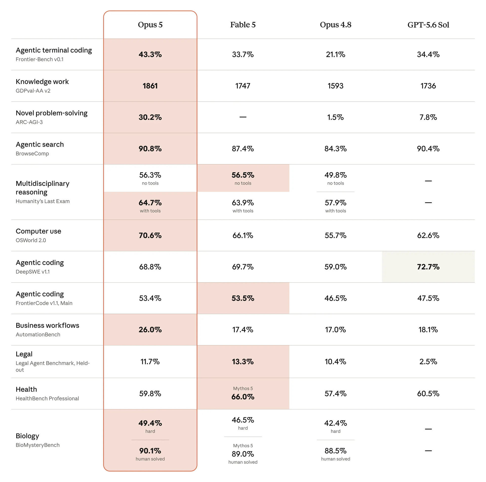
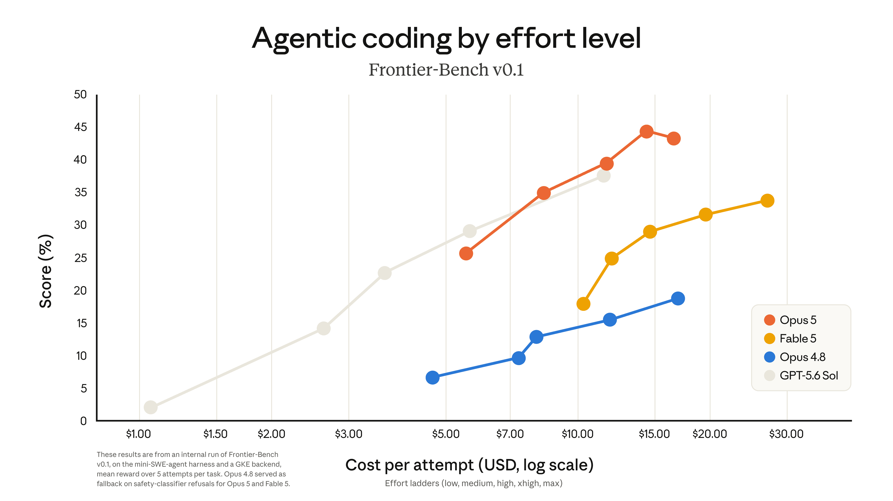
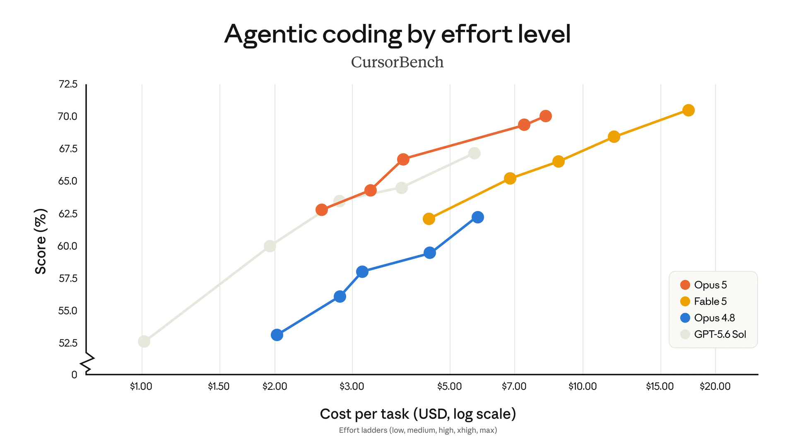
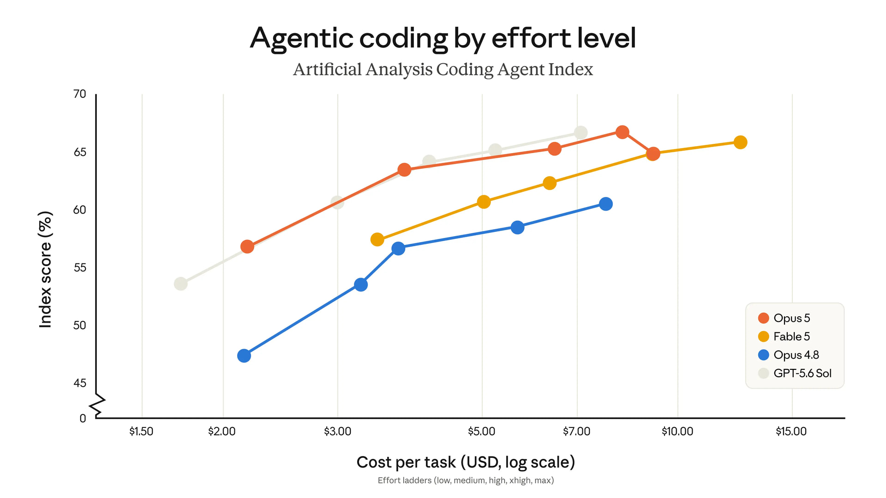
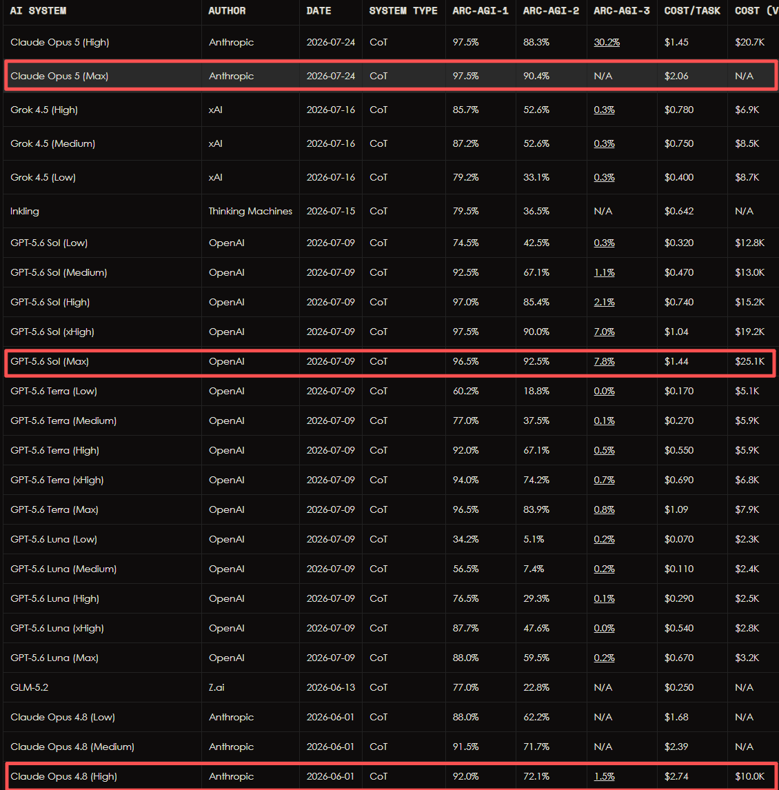
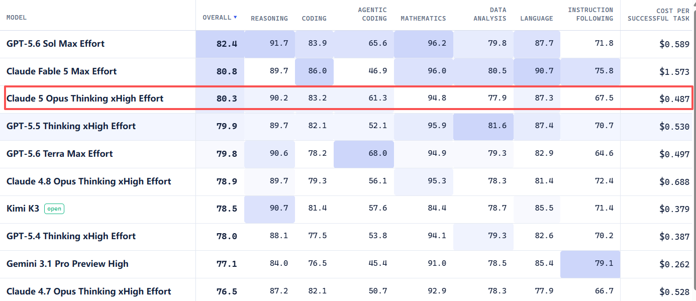
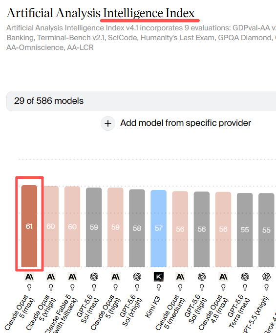
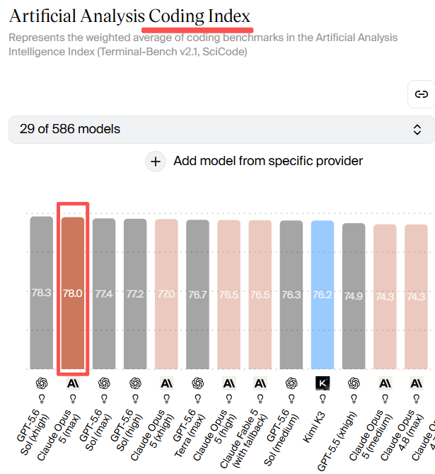
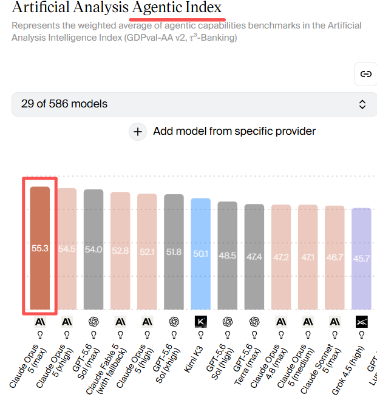
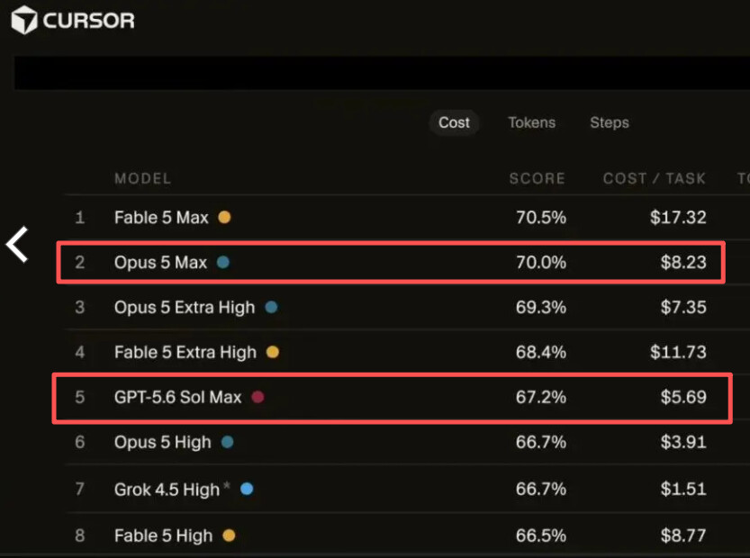

---

id: 2648931

title: ":fire:【大模型系列41】关于Opus 5, 你想知道的一切【楼底更新Arena前端反超k3】"

created_at: 2026-07-24T18:56:32.984Z

username: dwqxq1

display_username: "dwqxq1"

---

# :fire:【大模型系列41】关于Opus 5, 你想知道的一切【楼底更新Arena前端反超k3】

## 基本资料

官网文:[Introducing Claude Opus 5 \ Anthropic](https://www.anthropic.com/news/claude-opus-5)

模型卡(193页):[https://www-cdn.anthropic.com/c5fbac3f0b1280a933ebd26d3cb8bb9f5bdeaf48/Claude%20Opus%205%20System%20Card.pdf](https://www-cdn.anthropic.com/c5fbac3f0b1280a933ebd26d3cb8bb9f5bdeaf48/Claude%20Opus%205%20System%20Card.pdf)

价格:输入$5/输出$25不变

上下文:1m不变

速度:57tps(OpenRouter)

训练数据:2605

## 评分

### 官方自评

---

---

---

---

ARC-AGI评分

来源:[ARC Prize - Leaderboard](https://arcprize.org/leaderboard)

---

### LiveBench

来源:[https://livebench.ai](https://livebench.ai)

---

### ArtificialAnalysis评分

#### 综合

来源:[https://artificialanalysis.ai/](https://artificialanalysis.ai/)

---

---

---

### CursorBench评分

来源:[Cursor · CursorBench](https://cursor.com/cursorbench)

---

### Arena评分未上线

来源:[Arena Leaderboard | Compare & Benchmark the Best Frontier AI Models](https://arena.ai/leaderboard/)

---

## Chat渠道

### 官网/app/桌面版已上线

### Arena未上线

### OpenRouter上线

---

## API渠道

### 官网已上线

### OpenRouter已上线

来源:[Claude Opus 5 - API Pricing & Benchmarks | OpenRouter](https://openrouter.ai/anthropic/claude-opus-5)

---

## Code渠道

### Claude Code CLI/Desktop已上线

---

### 最后, 发张梗图, 祝佬友与Opus5愉快地玩耍

---

*来源: https://linux.do/t/topic/2648931.json*

