---

id: 265110

title: "怎样运行yolo v9"

created_at: 2024-11-20T09:32:18.657Z

username: xianrenzhou

display_username: "周周"

---

# 怎样运行yolo v9

# 怎样运行yolo v9

## 简介

yolo v9 是最新发布（曾经）的yolo模型，一句话总结：比前代更好，更快，更强。

本文旨在用最简单的方法吧yolov9的代码跑起来，因此不涉及训练部分，仅教会大家怎么使用yolov9的官方权重进行图像检测。

## 准备

某些网址可能无法打开，建议全程加速器环境下载

1. git工具 [Git - Downloading Package (git-scm.com)](https://git-scm.com/download/win)

2. miniconda 虚拟环境软件，也可以使用anaconda , 只是miniconda 更加轻量化。[Index of /anaconda/miniconda/ | 清华大学开源软件镜像站 | Tsinghua Open Source Mirror]([Index of /anaconda/miniconda/ | 清华大学开源软件镜像站 | Tsinghua Open Source Mirror](https://mirrors.tuna.tsinghua.edu.cn/anaconda/miniconda/)

注意下载软件要选择合适的版本，主要是x86和arm版本软件记得区分，一般intel的cpu使用x64版本

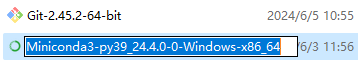

## git安装(可选)

1.双击安装包安装

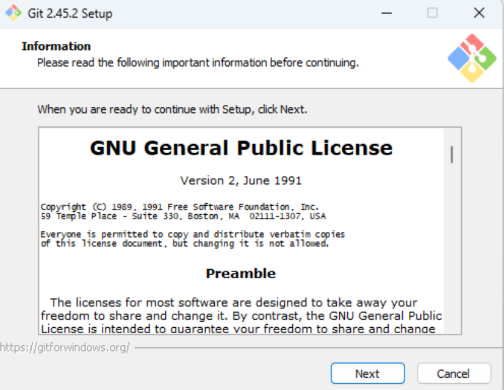

2.一直点击下一步

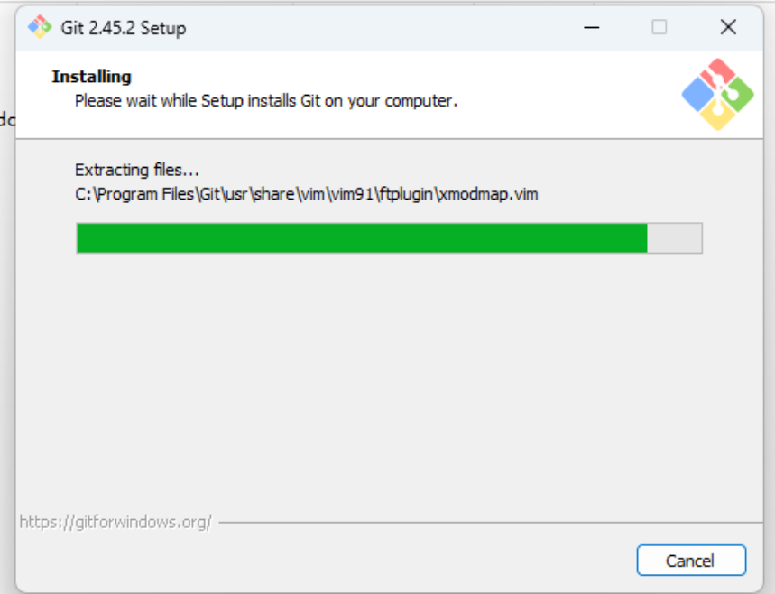

3.验证一下安装成功没有，windows+R键，左下角输入cmd,进入命令行

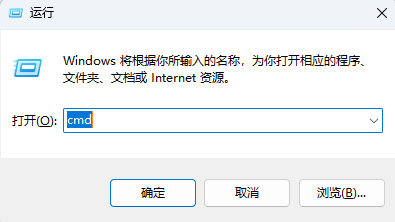

在命令行中输入`git -v`，显示出git版本号就是安装成功：

## miniconda安装

双击安装包安装，一直点击下一步，不过我们需要**记住安装路径**。后面需要用到。

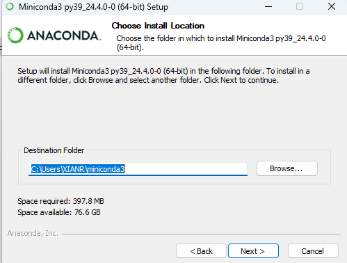

安装可能需要一段时间：

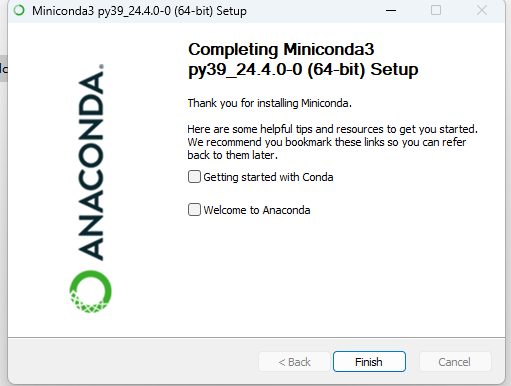

把上图两个钩取消然后点击finish即可。

安装完成之后需要配置环境变量，在windows搜索栏搜索环境变量

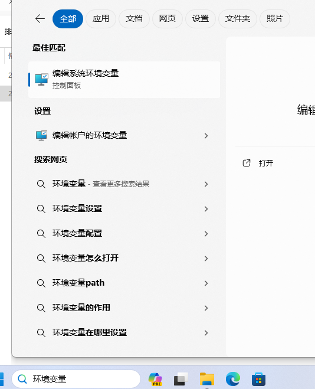

点进去选择

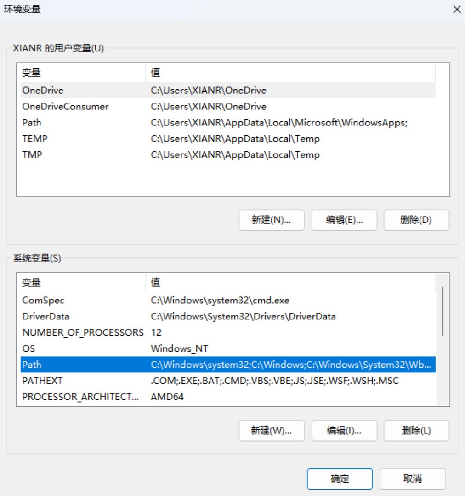

点进去，新建3个环境变量：

`C:\Users\XIANR\miniconda3`

`C:\Users\XIANR\miniconda3\Library\bin`

`C:\Users\XIANR\miniconda3\Scripts`

注意，上面三个变量中的`C:\Users\XIANR\miniconda3`自行替换为你的安装路径，如，小明的安装路径在D:\miniconda3，那小明的三个环境变量就是：

`D:\miniconda3`

`D:\miniconda3\Library\bin`

`D:\miniconda3\Scripts`

配置完成后如下：

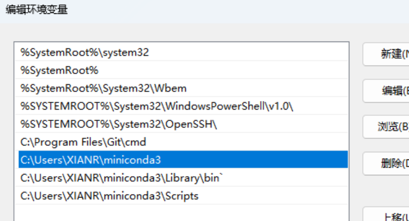

点击三次确定保存

然后windows+r打开CMD,输入`conda -V`出现Conda版本号即为安装成功

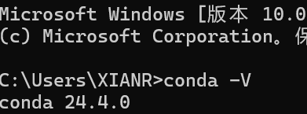

## 新建python环境

在cmd中 输入`conda create -n yolo python=3.9`，等待一段时间后，出现下面界面，输入y

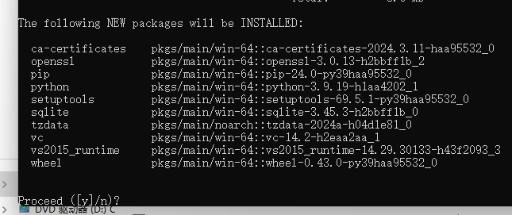

注意：如果下载缓慢请开加速器

出现如下提示即创建环境成功：

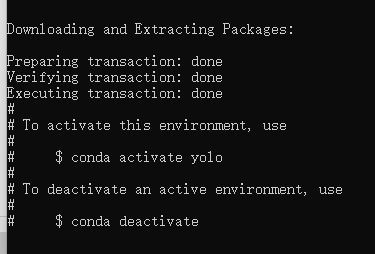

然后输入 `conda init`关掉cmd再次打开，输入`conda activate yolo`，当左边出现yolo字样的时候，我们的python环境就创建成功了。

## yolo源码下载

### 如果你在第一步安装了git

新建一个文件夹用来存放源码，在文件管理器的地址栏输入CMD,回车，会在当前建立的文件夹下打开CMD

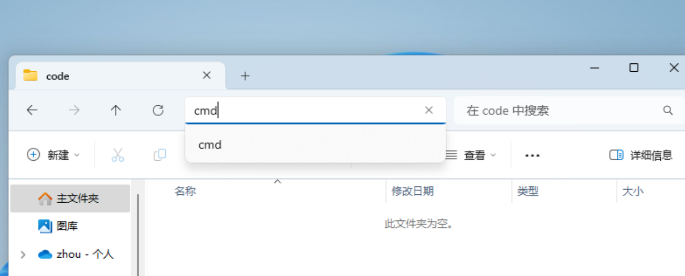

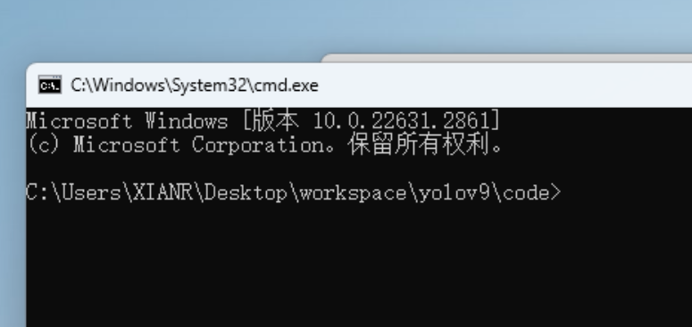

输入`git clone https://github.com/WongKinYiu/yolov9.git`

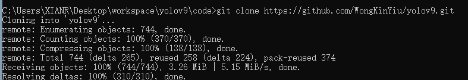

此时在文件夹中已经出现了yolov9的代码

### 如果你没安装git

在 [GitHub - WongKinYiu/yolov9: Implementation of paper - YOLOv9: Learning What You Want to Learn Using Programmable Gradient Information](https://github.com/WongKinYiu/yolov9) 中自行下载源码后解压即可。

## python包安装

进入源码文件夹，在地址栏输入cmd进入命令行

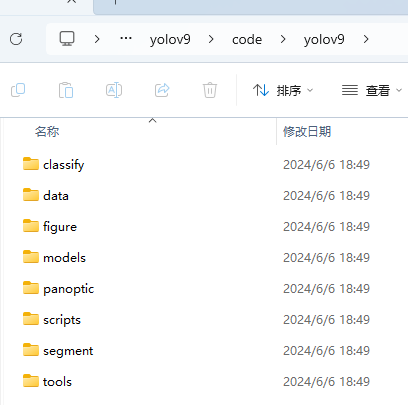

在命令行输入 `conda activate yolo`

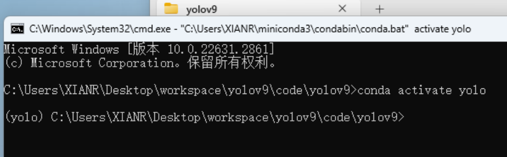

### 如果你有加速器

输入命令 `pip install -r requirements.txt`

### 如果你没加速器

输入命令 `pip install -r requirements.txt -i https://pypi.tuna.tsinghua.edu.cn/simple`

此时会自动下载依赖并安装，可能需要等待很长时间。

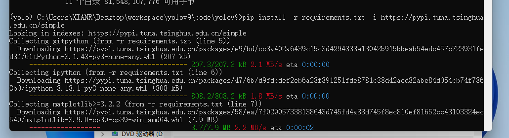

当出现successfuly 的时候，就成功了！如果你报错了，请重新来一遍，这是配环境的过程中难以避免的。

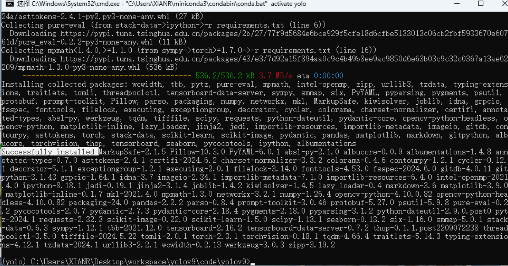

## 下载预训练权重包

在 [Releases · WongKinYiu/yolov9 · GitHub](https://github.com/WongKinYiu/yolov9/releases) 里下载预训练模型，随便挑一个pt为后缀的，下载完后，改名为yolo.pt，放到代码目录下

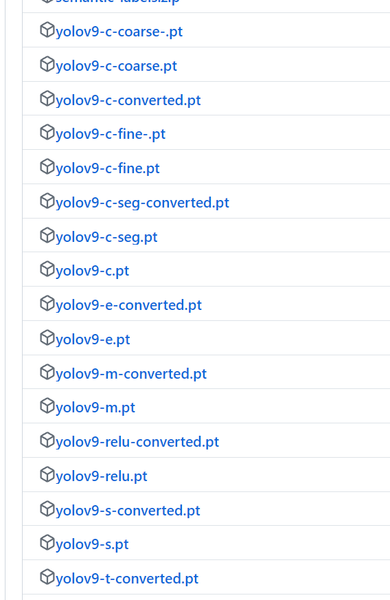

## 运行

恭喜你来到这一步，接下来就是激动的运行时间了。

我们首先可以找几张图片放在yolo的data/images文件夹中

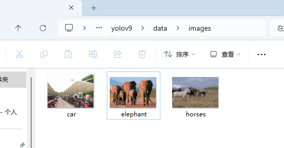

回到yolo代码主目录，打开cmd.

然后在命令行中输入 `python detect.py` 等待一会，出现下图结果即运行成功

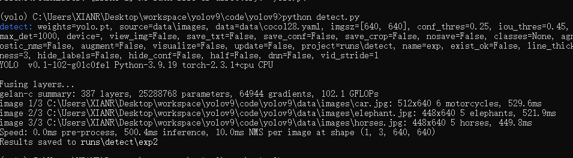

图中显示我们的结果在 ` runs\detect\exp2`文件夹中，打开文件夹即可看到结果：

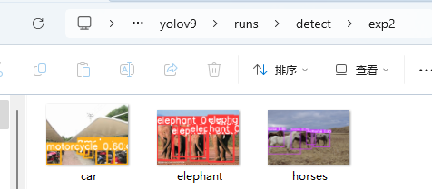

---

*来源: https://linux.do/t/topic/265110.json*

