---

id: 267991

title: "ubuntu24.04安装模型训练环境"

created_at: 2024-11-23T08:40:28.996Z

username: ZuiFengTing

display_username: "醉染枫亭"

---


# ubuntu24.04安装模型训练环境


1. 安装英伟达驱动


应用程序-> 附加驱动 → 选择驱动版本 → 应用更改（需要选择点击两遍）->重启


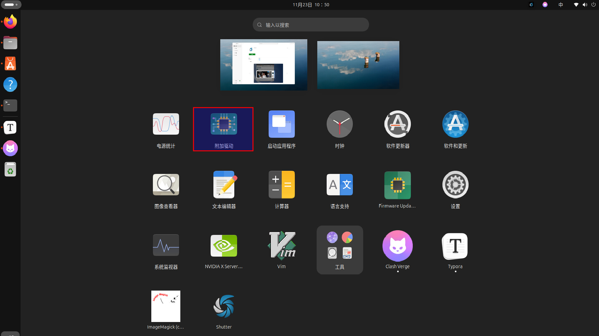


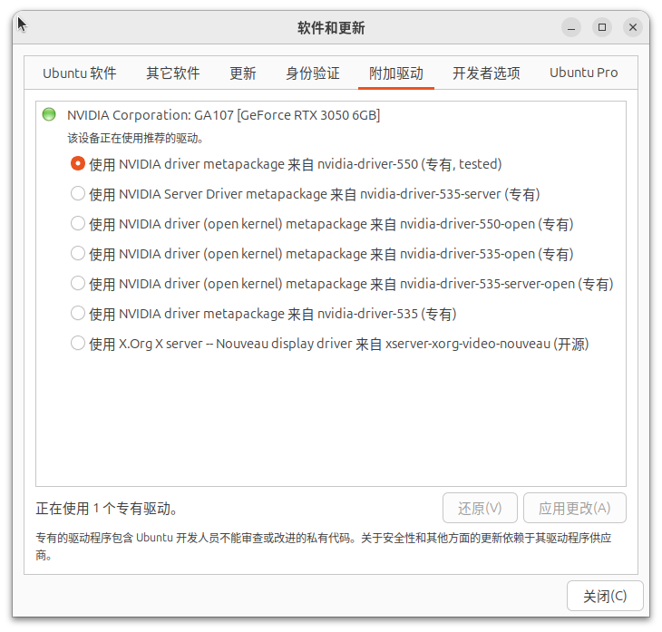


控制台输入nvidia-smi


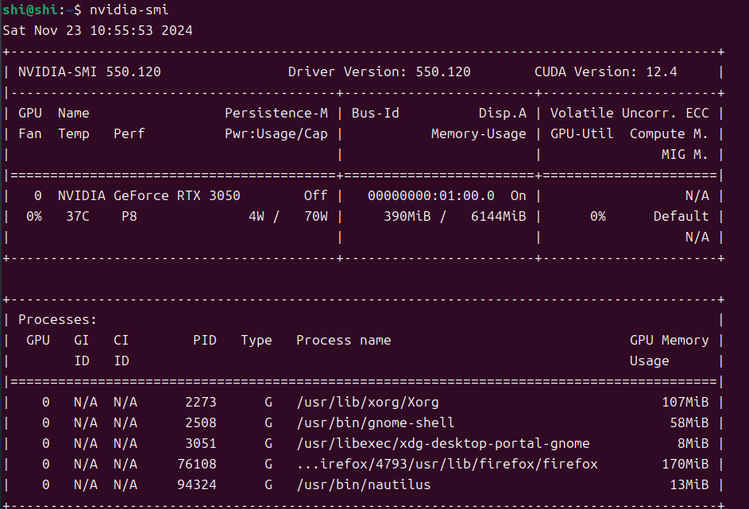

2. 安装cuda


根据上面图片，比如我这个电脑安装的550的驱动，对应的版本就是12.4,去官网下载12.4版本。[官网地址](https://developer.nvidia.com/cuda-toolkit-archive)


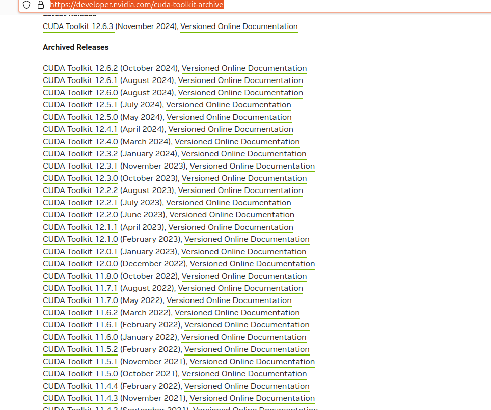


选择对应的版本


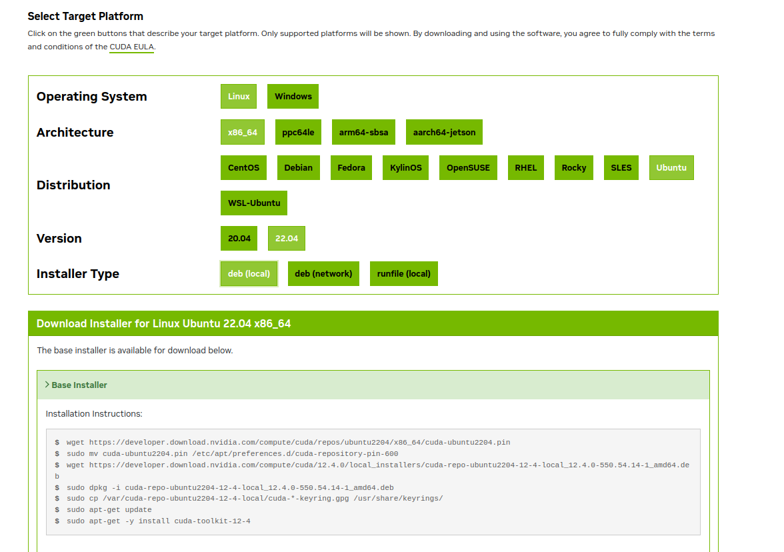


根据顺序执行下方的命令，大概会在最后一条报错

解决方案:

- 打开镜像文件并修改


sudo vim /etc/apt/sources.list.d/ubuntu.sources

- 向sources文件中添加如下内容


Types: deb


URIs: [Index of /ubuntu](http://archive.ubuntu.com/ubuntu/)


Suites: lunar


Components: universe


Signed-By: /usr/share/keyrings/ubuntu-archive-keyring.gpg

- 更新


sudo apt-get update

- 重新安装


sudo apt install cuda -y

cuda环境变量配置：

```
sudo nano ~/.bashrc
```

- 将以下内容添加进文件最后

```
export PATH=/usr/local/cuda-12.0/bin${PATH:+:${PATH}}
export LD_LIBRARY_PATH=/usr/local/cuda-12.0/lib64${LD_LIBRARY_PATH:+:${LD_LIBRARY_PATH}}
```

- 注意修改上面的版本号为自己下载的版本

- 保存退出后（Ctrl+x），更新一下环境变量：

```
source ~/.bashrc
```

这时候在执行 nvcc -V 就能够显示cuda版本了。

1. 安装cudnn


cuDNN是对CUDA的一些补充,下载对应CUDA12.4的cuDNN压缩包(这一步可能需要注册英伟达账号)。解压之后得到cuda目录，cuda目录下面有include和lib64两个子目录，将这两个目录下面的所有文件拷贝到CUDA 12.4安装路径对应的目录下面即可。


[cuDNN下载地址](https://developer.nvidia.com/rdp/cudnn-archive)


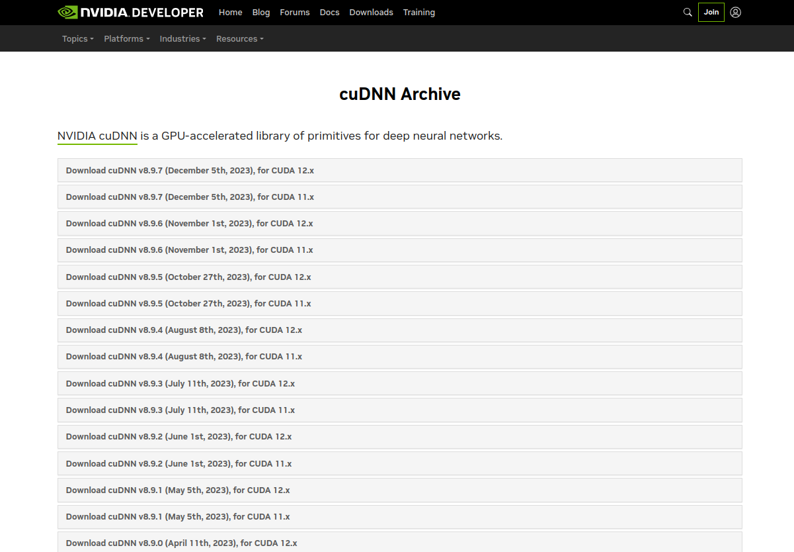

```
tar -xvf cudnn**
cd cudnn-linux-x86_64-8.9.3.28_cuda12-archive
#以下是安装命令
sudo cp -r lib/* /usr/local/cuda-12.4（自己检查具体的版本修改路径）/lib64/
sudo cp -r include/* /usr/local/cuda-12.4（自己检查具体的版本修改路径）/include/

#为更改读取权限：
sudo chmod a+r /usr/local/cuda-12.4（自己检查具体的版本修改路径）/include/cudnn*
sudo chmod a+r /usr/local/cuda-12.4（自己检查具体的版本修改路径）/lib64/libcudnn*
```

检查cudnn是否安装成功

```
cat /usr/local/cuda-12.0/include/cudnn_version.h | grep CUDNN_MAJOR -A 2
```

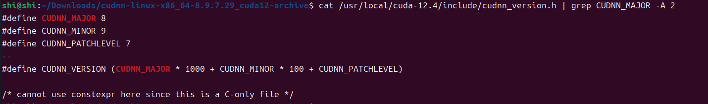

1. 安装conda


[conda下载地址](https://www.anaconda.com/download/success)


安装 Anaconda

```
bash Anaconda3-2024.10-1-Linux-x86_64.sh
```

输入yes 回车直到安装成功


注意事项：

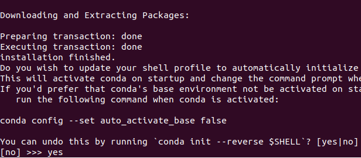

如果没有设置的话，也不要急，可以手动初始化

```
source ~/anaconda3/bin/activate
```

执行完成后进入base环境


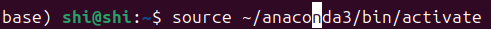

```
conda init
```

执行完成后最后一行如下：


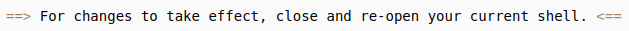


关闭终端重新打开

```
cat ~/.bashrc
conda --version
```

conda就安装完毕了

其他的conda命令

```
#创建虚拟环境
conda create -n your_env_name python=X.X（3.6、3.7等）

#激活虚拟环境
source activate your_env_name(虚拟环境名称)

#退出虚拟环境
source deactivate your_env_name(虚拟环境名称)

#删除虚拟环境
conda remove -n your_env_name(虚拟环境名称) --all

#查看安装了哪些包
conda list

#安装包
conda install package_name(包名)
conda install scrapy==1.3 # 安装指定版本的包
conda install -n 环境名 包名 # 在conda指定的某个环境中安装包

#查看当前存在哪些虚拟环境
conda env list
#或
conda info -e
#或
conda info --envs

#检查更新当前conda
conda update conda

#更新anaconda
conda update anaconda

#更新所有库
conda update --all

#更新python
conda update python
```

1. 使用conda安装yolov8

- 创建虚拟环境


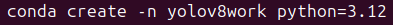

- 激活虚拟环境


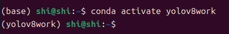

- 安装依赖


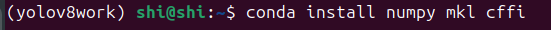

- 安装pytorch


- 安装yolo

```
pip install ultralytics
```

- 测试YOLOv8 是否安装成功

yolo predict model=yolov8n.pt source='https://ultralytics.com/images/bus.jpg

```
```

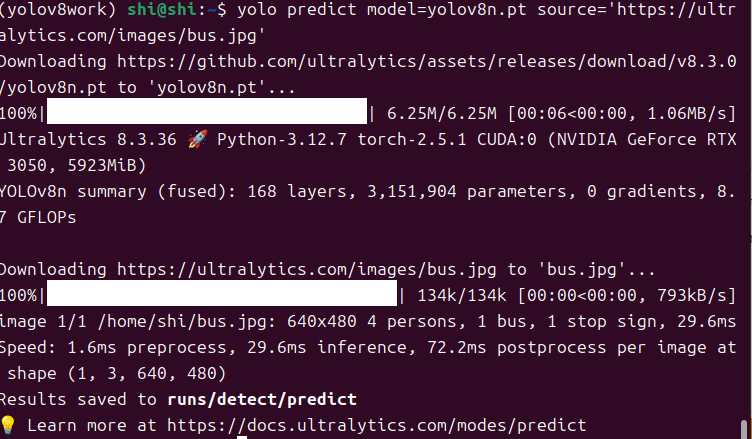

- pycharm 引用conda环境


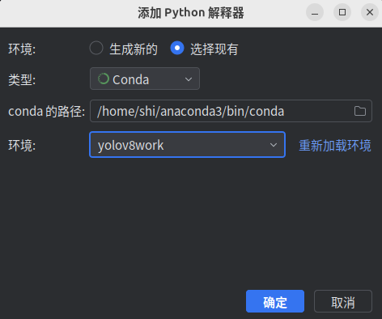


---


*来源: https://linux.do/t/topic/267991.json*

