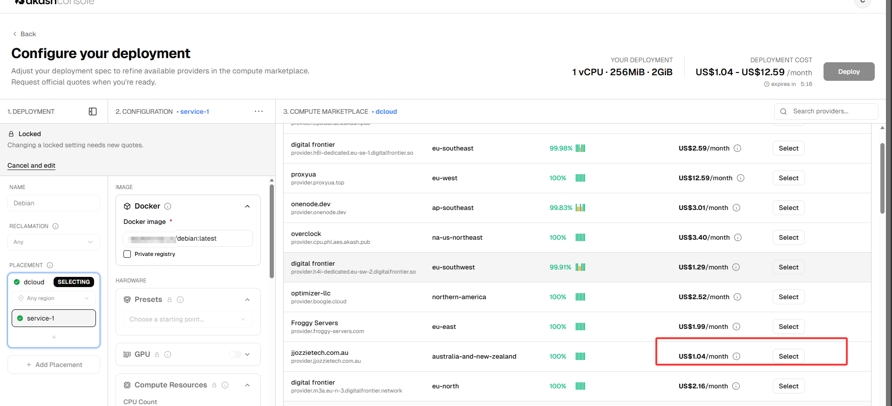
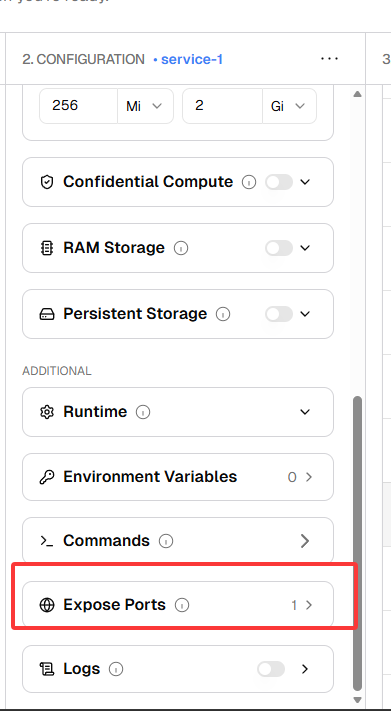

---

id: 2682444

title: "白嫖Akash的小鸡点亮全球的教程"

created_at: 2026-07-31T03:20:45.218Z

username: cdy1145

display_username: "cdy1145"

---

# 白嫖Akash的小鸡点亮全球的教程

Akash貌似是个Web3项目，但我们能用它开小鸡。

1. 打开项目官网：

akash.network

2. 注册账户

这个我不用多说，直接邮箱验证码注册

3. 创建容器

左边填配置，右边填地区。

地区最便宜的好像就是澳洲的。如图:

如图可以配nat：

4. 用

这就不多说了

---

原理就是它赠送1$的额度而无需验证。

---

*来源: https://linux.do/t/topic/2682444.json*

