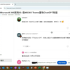

---

id: 268289

title: "Microsoft 365系列03: 在MS365 Teams里与ChatGPT对话"

created_at: 2024-11-23T15:39:41.196Z

username: zhuzx

display_username: "Nathan"

---

# Microsoft 365系列03: 在MS365 Teams里与ChatGPT对话

有感于佬友分享的免费ChatGPT API，故做了一个可以在Microsoft Teams 里面可以使用的工作流。

[https://linux.do/t/topic/179901](https://linux.do/t/topic/179901)

当下最火的技术之一，莫不是大语言模型 ChatGPT，大家在ChatGPT的网页上输入问题，就可以快速的获取答案，而且是已经归纳总结、整理好的的结果，比常用的搜索引擎要方便快速的多。

然而我想要的，是在不离开 Microsoft Teams的前提下，也可以进行这样的对话，就是说，把 ChatGPT 集成到 Microsoft Teams 应用内。

通过 ChatGPT 的 API，与 Microsoft 365 API，就可以实现这样的功能，而且在与ChatGPT对话时，是会包含上下文的内容，这样可以让 ChatGPT 的回答更加准确。

整体思路如下：

[image524×554 53.6 KB](https://cdn3.ldstatic.com/original/4X/4/c/5/4c5eb26e9caa519652fea813cbd2a1ad3e007c02.png)

首先，Microsoft 365 的 Power Automate 服务，提供了 根据用户自定义关键词触发工作流的选项。

[image639×561 37.9 KB](https://cdn3.ldstatic.com/original/4X/a/b/4/ab4345c81dcfbad584a6cb49e05afc02e9ef87ad.png)

其次，Microsoft 365 Graph API 包含了将Teams内信息提取出来的 API，这一点，我们在之前的文章中也有初步介绍。通过文档可以查到，它包含的Teams Channel message API，也就是 Teams 频道或聊天消息，可以获取我们发送的消息，也可以创建新的消息（包含答复消息 reply to message）。详细信息，可以到官方文档查看更多，不过这就为实现上述功能提供了可能。

[image1020×640 43.4 KB](https://cdn3.ldstatic.com/original/4X/c/3/9/c39bb22621bbdac3d7bebcd3f10e95728bfa3a2b.png)

这里有一点提示，就是我们需要收集Teams message的关联信息，比如要区分是第一条信息，还是后面回复的信息，是我发出去的信息，还是ChatGPT的返回信息（因为ChatGPT的API中会将它的返回信息放入 role 为 assistant 中，而将用户提问的信息放入 role 为 user 中）：

[image924×624 56.6 KB](https://cdn3.ldstatic.com/original/4X/1/a/b/1abb004aef1ee2d1a6c9b3ad7857c91e53bbc25d.png)

再次，ChatGPT 服务，也是有其官方API，可以实现调用，具体如下：

[image721×408 17 KB](https://cdn3.ldstatic.com/original/4X/9/2/b/92babbc70c980f15f6c828e6ac9fbb5c9c6cc49c.png)

所以，当我们有了 ChatGPT 服务的相关内容（也就是 API key），和需要的模型名称，按上图的格式，将问题以 http post的方式发送到 ChatGPT API ，就可以得到想要的回答。

当然，这里除了 ChatGPT，像国内的阿里服务 通义千问，也是类似的，其API格式与 ChatGPT类似，大家可以自行了解。

最终的工作流就这样搭好了，可以在 Teams 中快乐的使用 类ChatGPT服务了~~~

因为太长，不方便截图，就截个大概的模样吧，如想进一步了解，可以单独联系我。

[image259×901 34.8 KB](https://cdn3.ldstatic.com/original/4X/0/2/2/0221bb899813c673d08805b7e5caefc9239490b1.png)

以上只为抛砖引玉~~

为此我还录制了一个视频，在我的B站和微信公众号(zhuzx_1)视频号里都上传了。

很少录视频，应该是有很多不足的地方，欢迎大家批评指正：

### [在Microsoft365 Teams 中 与 ChatGPT 对话_哔哩哔哩_bilibili](https://www.bilibili.com/video/BV1dDB4YMEpL/)

在Microsoft365 Teams 中 与 ChatGPT 对话, 视频播放量 79、弹幕量 0、点赞数 3、投硬币枚数 2、收藏人数 2、转发人数 1, 视频作者 zhuzxb, 作者简介 ，相关视频：如何将阿里通义千问集成到微软Microsoft...

---

*来源: https://linux.do/t/topic/268289.json*

