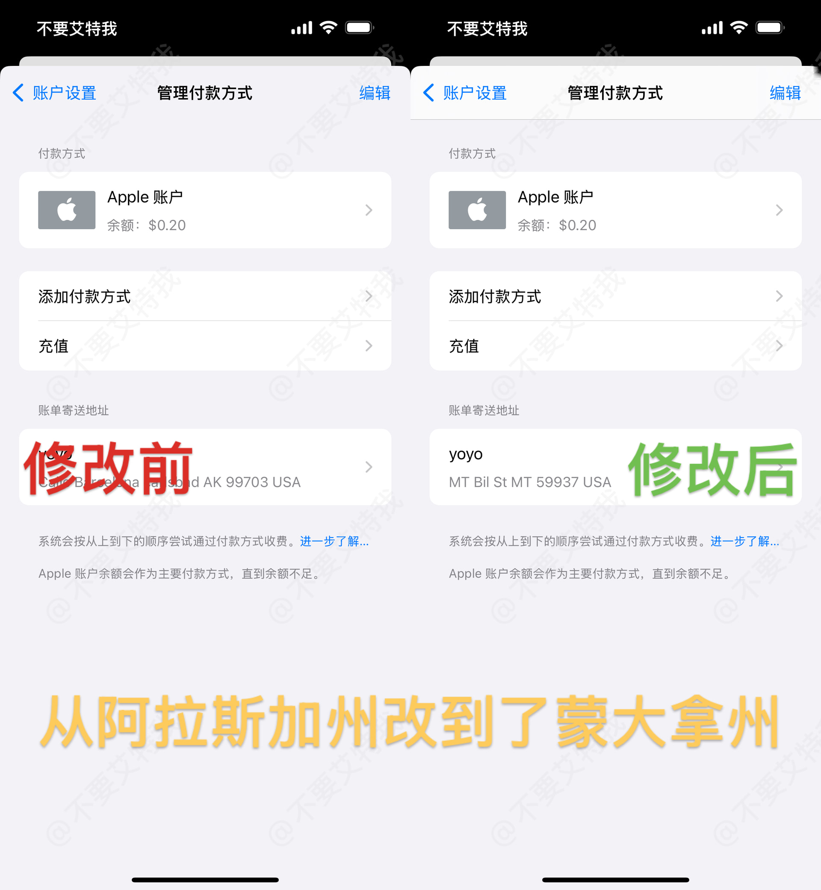

---

id: 2684730

title: "【教程】将有余额的 Apple ID 修改至免税州"

created_at: 2026-07-31T09:26:35.541Z

username: d.to

display_username: "胖大星"

---

# 【教程】将有余额的 Apple ID 修改至免税州

注册了美区 Apple ID 充值了 20 美金，订阅 GPT 的时候却提示商店余额不足，想修改到免税州却又要求绑卡，今天这个教程教你丝滑修改 Apple ID 至免税州，不需要科学上网，也不需要银行卡和 PayPal 等其他付款方式。

全程在 App Store 里面操作，我这个本来就是免税州，为了演示我从阿拉斯加州改到了蒙大拿州。

1、点击账号

2、点击付款方式

3、直接返回

4、点击账单寄送地址

5、点击编辑

6、选择免税州

7、点击完成

点完成后会自动调回到绑卡界面，只要确定账单寄送地址显示的是免税州，其他的就不用管了！

---

*来源: https://linux.do/t/topic/2684730.json*

