---

id: 2696042

title: ":fire:【大模型系列42】关于Qwen 3.8 max和27B, 你想知道的一切"

created_at: 2026-08-03T04:18:05.474Z

username: dwqxq1

display_username: "dwqxq1"

---

# :fire:【大模型系列42】关于Qwen 3.8 max和27B, 你想知道的一切

## 基本资料

官方文：[https://qwen.ai/blog?id=qwen3.8](https://qwen.ai/blog?id=qwen3.8)

价格:输入$2/输出$6

参考kimi k3=$2.5/15,gpt-5.6-terra=$3/$15

参数:qwen-3.8-max=2.4t

qwen-3.8-27b

上下文: 标准128k,最大1m

最大输出:128k

Effort：最高xhigh，没有max

话说如果有qwen-3.8-max max也会怪怪的

## 评测

### 官方自评

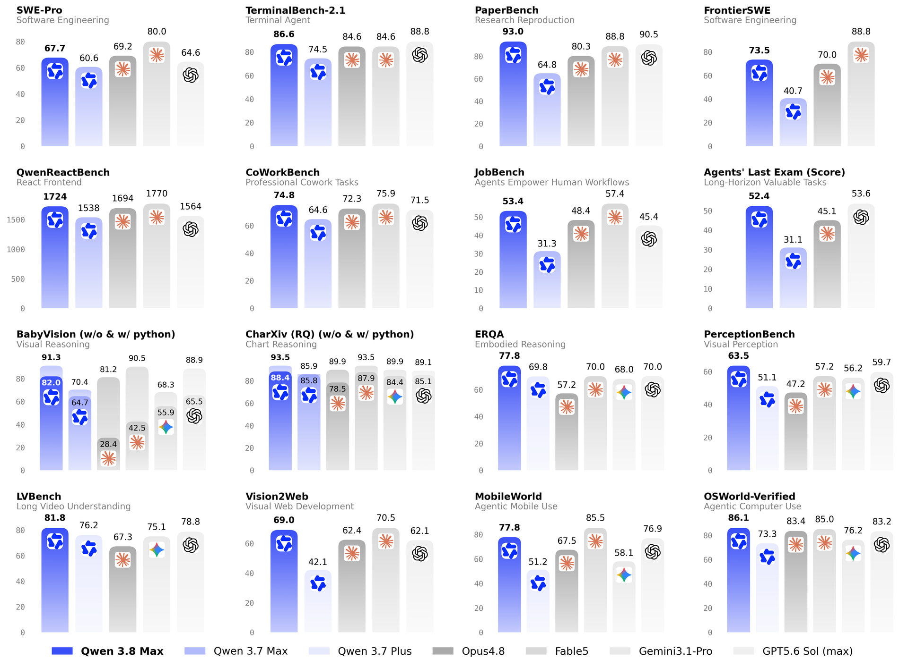

---

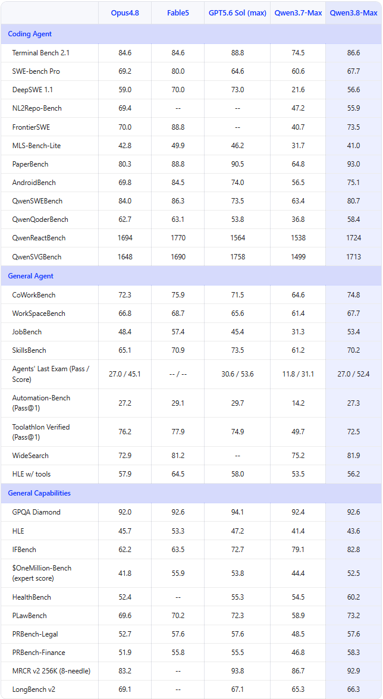

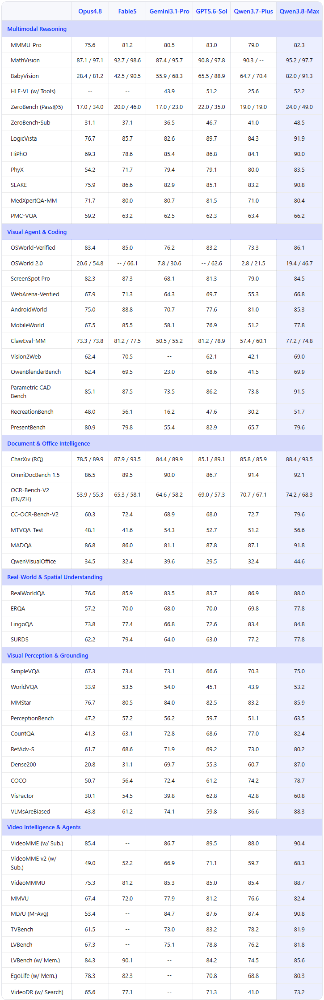

---

### ArtificiAlanalysis评分

来源:[https://artificialanalysis.ai](https://artificialanalysis.ai)

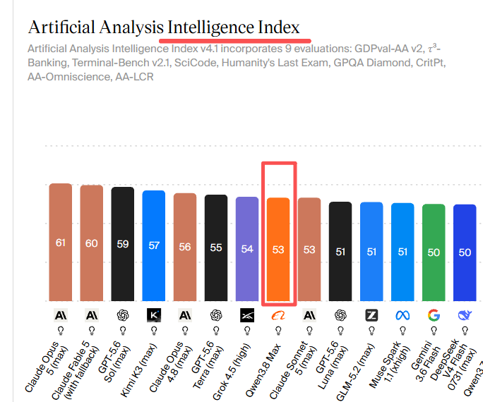

---

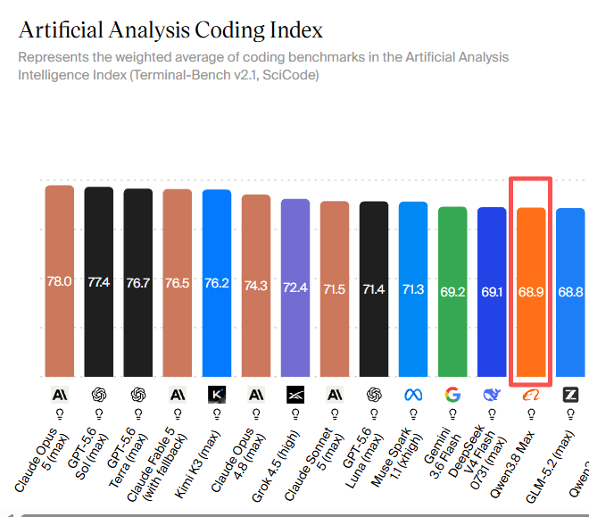

---

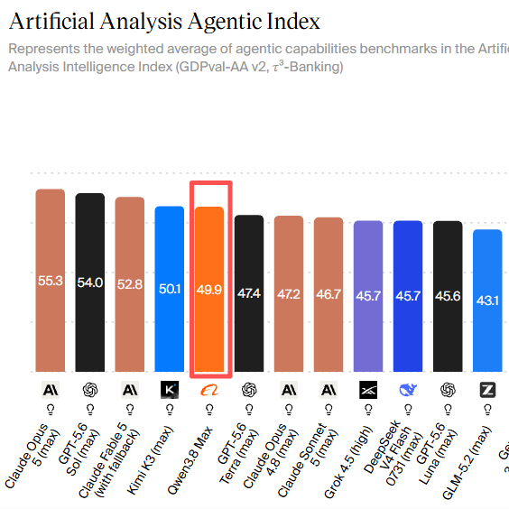

---

### Arena评分

来源:[Arena Leaderboard | Compare & Benchmark the Best Frontier AI Models](https://arena.ai/leaderboard/)

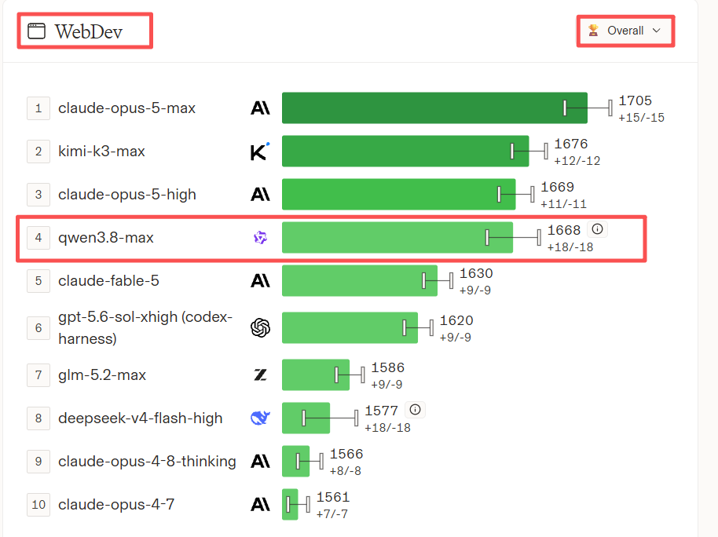

---

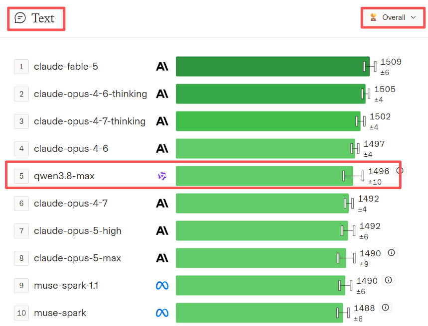

---

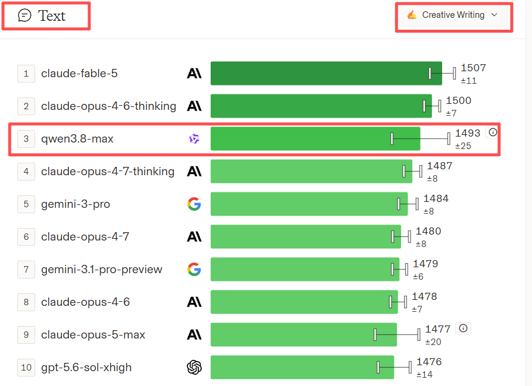

---

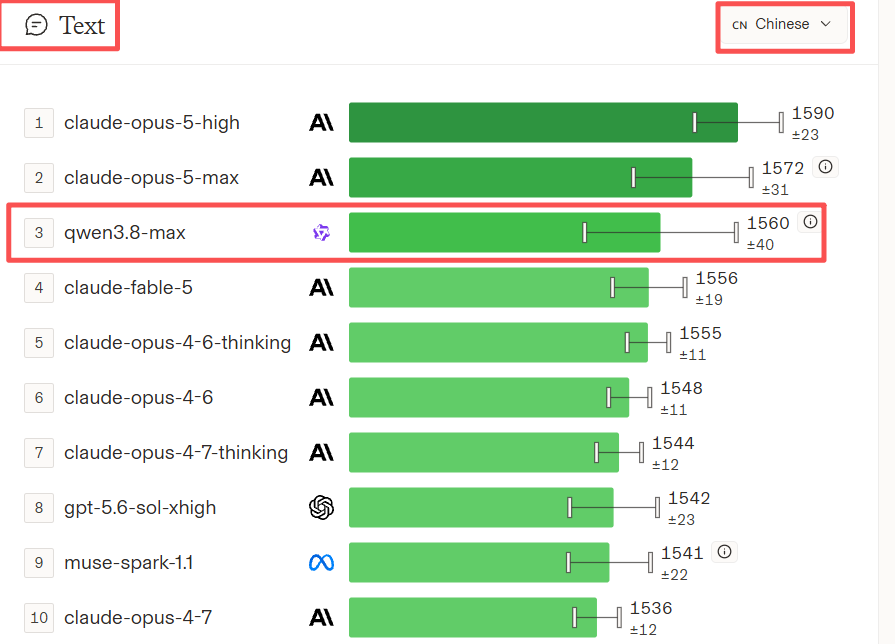

---

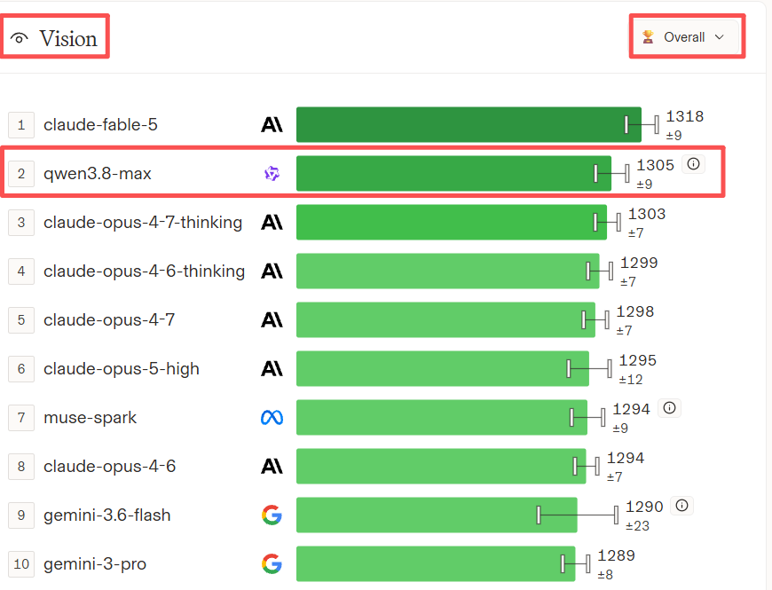

---

### LiveBench评分

来源:[https://livebench.ai](https://livebench.ai)

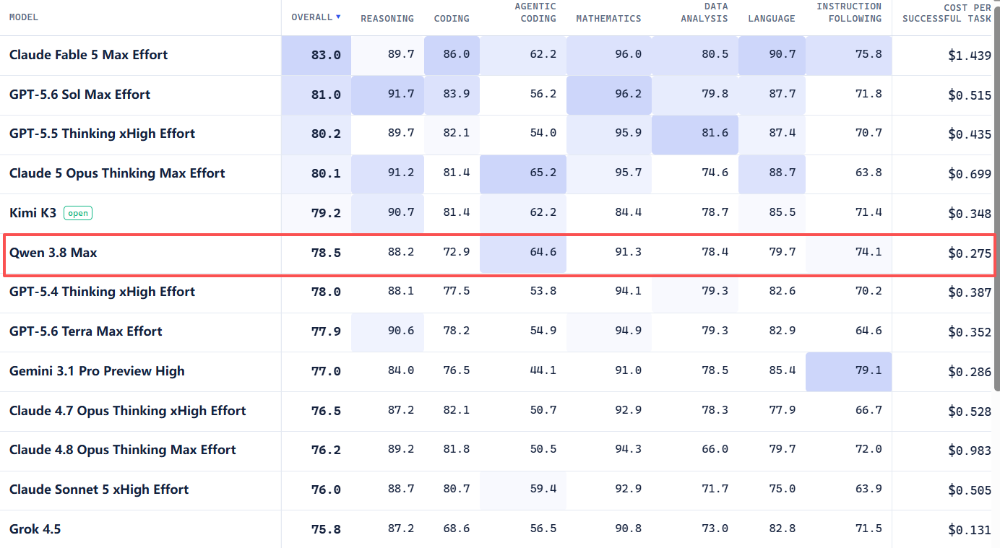

---

## Chat渠道

### 中国官网/App

来源:[https://www.qianwen.com/](https://www.qianwen.com/)

### 国际官网

来源:[https://qwen.ai/](https://qwen.ai/)

### Arena Chat未上线

来源:[Chat with Multiple Frontier AI Models](https://arena.ai/text/direct)

---

## API渠道

### 官网API已上线

### OpenRouter API已上线

来源:[Qwen3.8 Max - API Pricing & Benchmarks | OpenRouter](https://openrouter.ai/qwen/qwen3.8-max)

---

## Coding渠道

中国版:[大模型服务平台百炼控制台](https://bailian.console.aliyun.com/tab=plan#/efm/subscription/overview)

国际版:[Token Plan (Team Edition) - AI model subscription plans and pricing - Alibaba Cloud Model Studio - Alibaba Cloud Documentation Center](https://www.alibabacloud.com/help/en/model-studio/token-plan-overview)

1x=¥39=$6

4x=¥139=$18

16x=¥499=$68

---

## 最后发张梗图,祝佬友与qwen愉快地玩耍

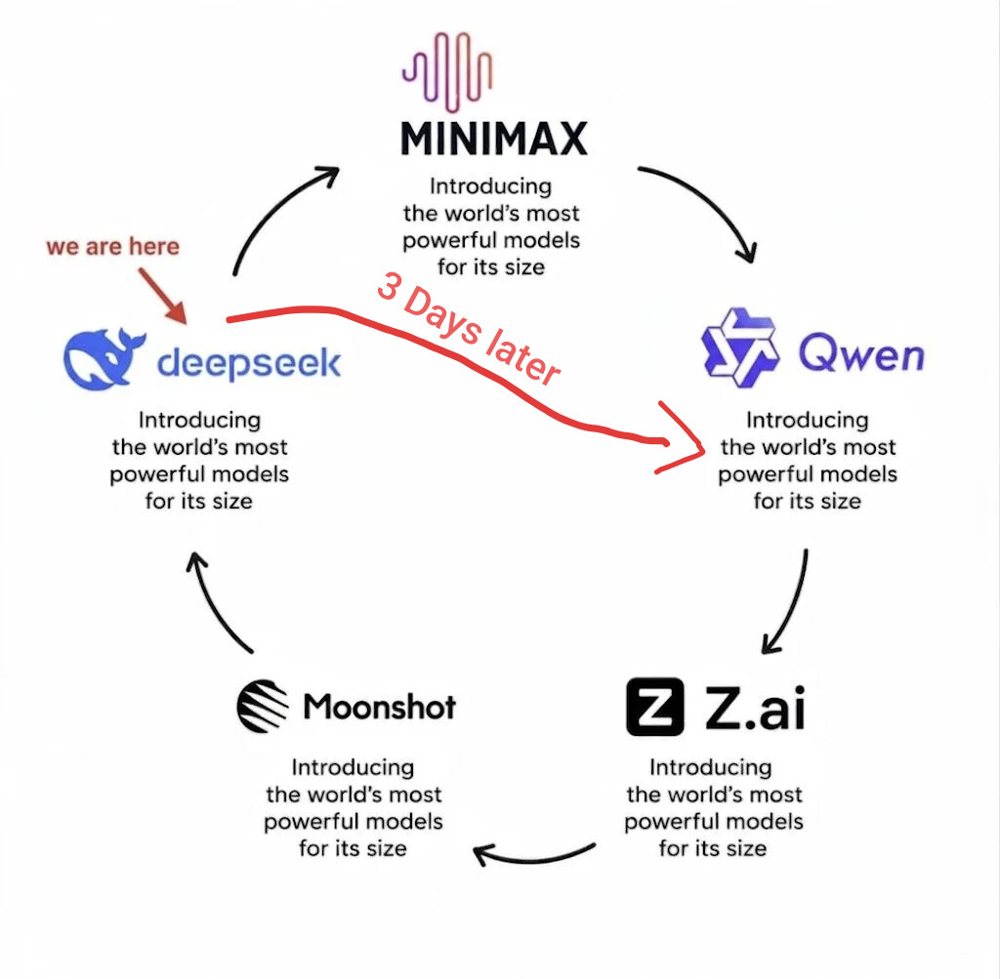

---

*来源: https://linux.do/t/topic/2696042.json*

