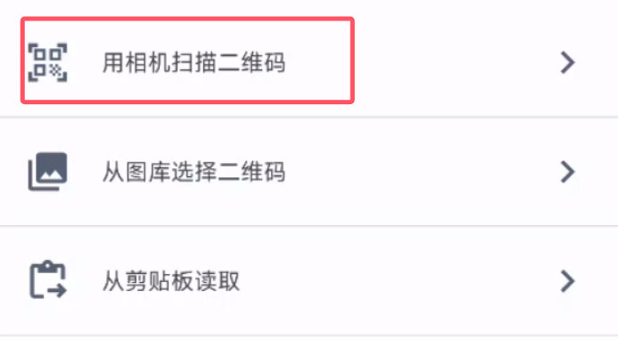
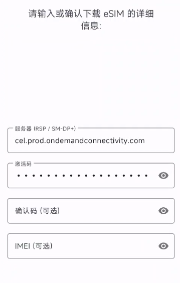
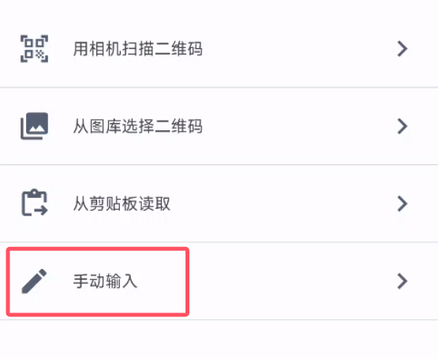
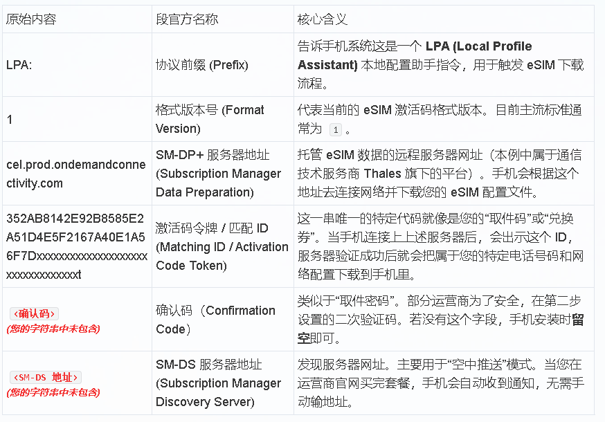
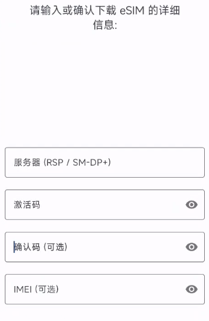

---

id: 2703019

title: "esim下载URL/二维码 写入小白卡教程"

created_at: 2026-08-04T08:27:34.462Z

username: beisika10368

display_username: "beisika10368"

---

# esim下载URL/二维码 写入小白卡教程

# **一、基础知识**

1. esim写小白卡，相当于写入带esim的手机中，只不过小白卡代替了esim的手机。

2. esim写入小白卡后，就相当于实体sim卡了。可以随便插到android,苹果任意操作系统，任意手机上使用。

3. esim的url，只能供一次写入小白卡，写入后，esim信息会与小白卡的ID进行绑定。

4. 已写入小白卡的esim信息，无法直接拷贝到其他小白卡。必须通过中转或者联系发卡方重新获取URL

5. 小白卡你可以想像成:

U盘，U盘里可以存储文件，文件可以新增或删除。存储的文件个数由U盘的容量决定。

小白卡，小白卡里可以存储esim信息，esim信息可以新增或删除。存储的esim信息个数由小白卡的容量决定。

6. 小白卡有便宜有贵的。大家可自由选择。如对质量有要求，可选品牌的.

贵的有售后，质量相对更好一点，有专门的app

便宜的一般在PDD出没，质量看人品。一般用开源的easyeuicc

# **二、准备工作**

1、一台android手机(需要支持OMAPI)—如果使用苹果手机，则需要外购读上卡器【不推荐】

2、一个ESIM的下载URL/二维码

3、下载easyeuicc（作用:用于将获取到的esim码写入到实体卡中）：[版本发布 - PeterCxy/OpenEUICC - Angry.Im Software Forge](https://gitea.angry.im/PeterCxy/OpenEUICC/releases)

4、一张EUICC白卡(作用:空白的sim实体卡，可以把申请好的esim写到卡里，相当于用esim的申请方式，申请到了一张sim实体卡。当然一张空白卡可以刷入多张esim切换)，

# **三、写入小白卡**

1、手机插入小白卡，打开easyeuicc.

2、点击[+]

3、方法一:

a、找一个生成二维码的网站。输入LPA:+刚才保存esim码。生成二维码。

b.选择[用相机扫描二维码].

c.等待完成.

4、方法二：

a、选择[手动输入].

b、标准的全球 GSM 协会（GSMA）LPA 激活格式完整版为：

LPA:1$【SM-DP+ 地址】$【匹配 ID】$【确认码】$【SM-DS 地址】

观察SIM激活码

LPA:1$cel.prod.ondemandconnectivity.com$352AB8142E92B8585E2A51D4E5F2167A40E1A56F7Dxxxxxxxxxxxxxxxxxxxxxxxxxxxxxxxxx

可得到以下信息

c、将内容分段填入。

d.等待完成.

---

*来源: https://linux.do/t/topic/2703019.json*

