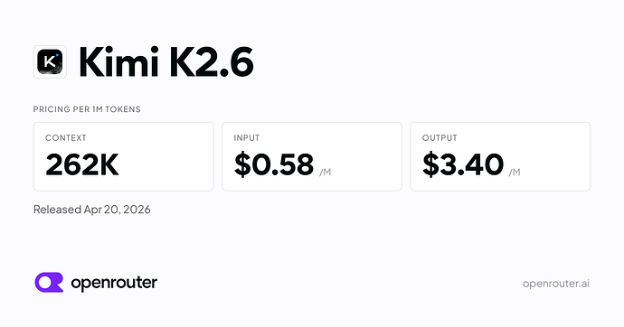
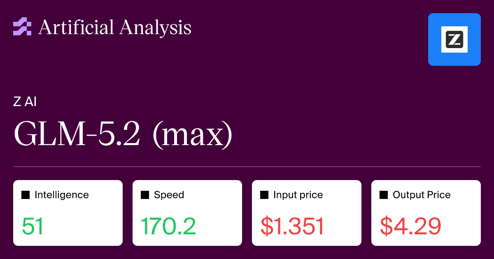

---

id: 2707121

title: "评估不同第三方提供的模型质量的榜单"

created_at: 2026-08-05T05:39:15.252Z

username: norra1

display_username: "BOOSTMEISTER 2014 DH"

---

# 评估不同第三方提供的模型质量的榜单

即使是同一个模型，不同第三方部署出来也区别很大，比较直观的是速度和价格，但是模型能力表现体现不出来，这些榜单为选择供应商提供了一些更具体的参考，当然不难发现即使是同一个厂商，不同模型表现也不一样。所以还得具体分析。

kimi 之前有一个 K2 Vendor Bench

现在似乎更新成了 Kimi Vendor Verifier

MiniMax Provider Verifier

openrouter 自己搞的，方法：

### [Auto Exacto - Automatic tool-calling provider optimization](https://openrouter.ai/docs/guides/routing/auto-exacto)

Learn how Auto Exacto automatically optimizes provider ordering for tool-calling requests using throughput, success rate, and benchmark signals.

使用办法，可以在模型底下看，比如

### [Performance - Kimi K2.6 - API Pricing & Benchmarks](https://openrouter.ai/moonshotai/kimi-k2.6#performance)

Different companies host the same model. OpenRouter routes your request to one of them based on the routing mode you pick — Balanced (price + speed), Nitro (fastest), or Exacto (highest tool-calling accuracy). | Kimi K2.6 is Moonshot AI's...

AA最近刚上的。

### [GLM-5.2 (max): API Provider Performance Benchmarking & Price Analysis |...](https://artificialanalysis.ai/models/glm-5-2/providers)

Analysis of API providers for GLM-5.2 (max) across performance metrics including latency (time to first token), output speed (output tokens per second), price and others. API providers benchmarked include Wafer, FriendliAI, Makora (NVFP4), Baseten...

点击模型进入，不是独立榜单

---

*来源: https://linux.do/t/topic/2707121.json*

