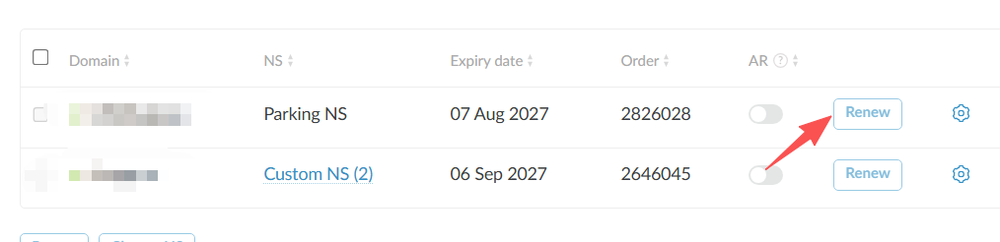
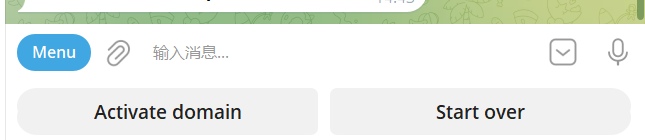
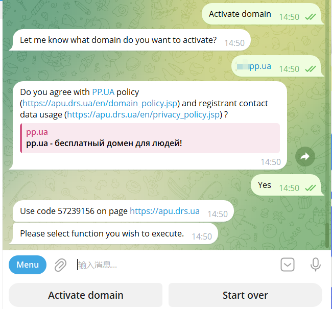
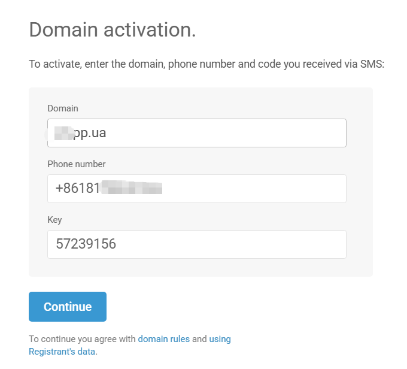
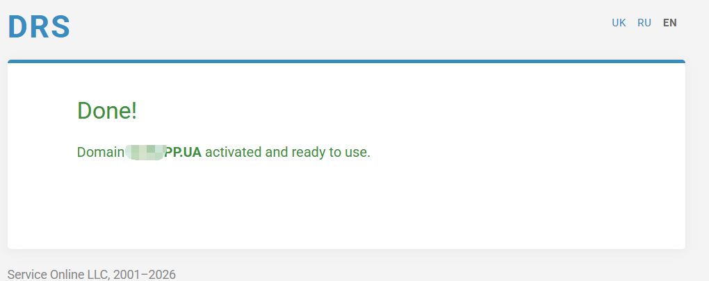

---

id: 2723323

title: "pp.ua 域名续费教程"

created_at: 2026-08-08T06:52:42.229Z

username: k452b

display_username: "干啥啥不行"

---

# pp.ua 域名续费教程

感谢之前佬分享的pp.ua域名注册教程，今年也是到期了，续费费了点时间才搞明白，现在发出来供大家参考。

两个注册商：

### [Реєстрація доменів, хостинг](https://98.com.ua/ua/userserv.html)

### [Sign in | NIC.UA](https://nic.ua/en/my/domains)

Sign in to NIC.UA

登录之后找到域名续费，续费后会出现等待，等待期间要自己上tg关注ppuabot这个号主动激活。

点击renew需要等一段时间才会进入激活状态。

tg关注ppuabot，然后点Activate domain，会授权手机号，授权手机号后发送域名，点Yes得到验证码，进入网站激活就可以了。

---

*来源: https://linux.do/t/topic/2723323.json*

