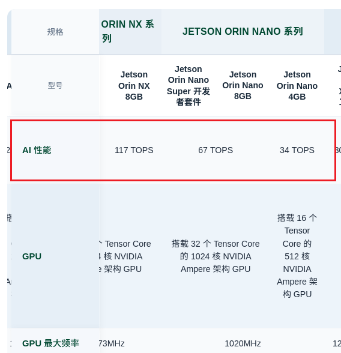

---

id: 2739439

title: "【学习笔记】显卡技术指标：显存、显存带宽和算力"

created_at: 2026-08-11T09:24:48.780Z

username: pupa

display_username: "王二狗"

---


# 【学习笔记】显卡技术指标：显存、显存带宽和算力


这几天在研究本地部署大模型，很是好奇怎么判断一个显卡能不能运行大语言模型（LLM，以下简称 LLM），如果能的话，怎么判断能运行多大的模型，吐字速度有多快？这个问题也可以等价为：显卡的技术参数到底代表了什么？花了点时间和查找了资料，有了这篇文章。这篇文章纯手打，也是现学现卖，如有错漏，欢迎指正。

# 技术指标：显存、显存带宽和算力

简单来说，一个显卡重要的参数就三个：显存、显存带宽和算力。

## 算力

算力比较好理解，一般用每秒能运行多少次运算来衡量一个显卡的算力。常用的算力单位有 TOPS（每秒能够进行多少万亿次操作）和 FLOPS（每秒能够进行多少万亿次浮点运算），比如下图的 Jetson Orin Nano 系列：



这里面的 8GB 型号的 67 TOPS，是指其最高可达到 67 TOPS 的 INT8 AI 性能。需要注意的是，TOPS / FLOPS 通常是理论峰值或特定测试口径下的峰值，并不代表运行任意模型时都能达到这个速度。实际运行 LLM 时，还会受到模型结构、算子、精度/量化方式、软件框架以及 GPU 利用率等因素影响，所以这个数值不能直接等同于实际的 LLM 推理速度。

## 显存

显存类似于 CPU 的内存，可以理解为 GPU 用来存放模型参数以及运行过程中需要处理的数据的高速存储空间。

在运行 LLM 的时候，如果显存太小，无法同时容纳模型权重以及运行所需要的 KV Cache、临时缓冲区等数据，就无法按照当前的配置在 GPU 上完整运行模型，简单来说，**显存大小决定了你能运行多大的模型。**

比如，全量的 DeepSeek-V4-Flash 如果使用 FP16 存储，按照约 284B 参数计算，仅模型权重理论上就需要：

284B × 2 Bytes ≈ 568 GB

再考虑模型文件中的额外开销以及实际运行所需的其他显存，通常会达到 600 GB 级别。因此，个人消费级显卡很难直接运行这种规模的 FP16 模型，要运行只能使用量化版本。比如使用 NVIDIA DGX Spark（128GB 统一内存）部署 2-bit 混合动态量化的 DeepSeek-V4-Flash，量化后的模型权重可以压缩到 80～96.5GB。

## 显存带宽

显存带宽指的是 GPU 与显存之间理论上每秒能够传输的数据量，可以简单理解为“GPU 从显存中持续读取和写入大量数据的速度”。显存带宽决定了 GPU 从外部显存持续获取大量数据的能力，显存带宽越大，数据从显存搬运到显卡计算核心的速度就越快。**一般来说，制约模型输出速度的最大因素就是显存带宽。**。


接下来抽丝剥茧，看看怎么计算模型所需要的显存大小以及算力和显存带宽是怎么影响模型输出速度的？

# 计算 LLM 需要的显存大小

大语言模型在运行的时候，第一步就是把模型参数、kv缓存等运行所需数据先放到显存里面。即使算力再高，如果显存很小，也只能运行一些小的模型。而算力和显存带宽决定了你跑模型的速度，算力越高、显存带宽越大，模型推理输出就越快。

怎么**估算**运行一个 LLM 需要多大的显存呢？这里有个很方便的工具网站可以一键计算：[估算大模型所需显存](https://help.aliyun.com/zh/pai/product-overview/estimation-of-the-required-video-memory-for-the-model)（里面也有说明计算方法）。

简单来说，显存占用 = 模型权重 + KV 缓存 + 激活值 + 其它杂七杂八的东西（PyTorch 框架、输入数据、CUDA 核心等）。

其中模型权重通常是大头。对于上下文较短、batch 较小的情况，可以把模型权重占用作为估算显存需求的主要参考，并额外预留一部分显存给 KV Cache 和其他运行时开销。

网上有时会使用“模型权重占用 × 1.5”这样的经验值进行粗略估算，但是当上下文长度很长或者 batch 较大时，KV Cache 的占用会明显增加，甚至可能成为显存占用的大头，这个时候用“模型权重占用 × 1.5”就不太准确了。

以一个 7B 大小的模型为例，如果模型使用 INT8 量化，那么理论上每个参数需要 8 bit，也就是 1 Byte。

那么理论上的权重大小就是：

7B × 1 Byte ≈ 7 × 10⁹ Bytes ≈ 7 GB

实际量化模型还可能包含 scale、zero point、分组信息等额外数据，因此实际模型文件大小通常会比这个理论值稍大。

# LLM 的推理过程

LLM 推理过程分为两步：

## 阶段一：预填充（Prefill）阶段

这一阶段要把用户输入的文本“编码”成模型能理解的上下文向量表示。用户输入 1024 个 tokens，就需要对这 1024 个 tokens 做计算，从而得到模型能够理解的上下文向量。这里的计算是并行的，也就是输入的 1024 个 tokens 同时计算得到向量。

在这一阶段，运算任务会更大一些（需要一次性处理 1024 个 tokens 的运算），而搬运任务（从显存往计算核心搬数据）会轻一些（只需要从显存搬运一次模型数据），**这一阶段（预填充），制约速度的主要因素是算力**。

## 阶段二：解码

解码阶段是“自回归”的，也就是说，模型生成下一个 token 的时候需要依赖上一个 token 的计算结果，计算是“串行”的——必须计算完当前 token 才能计算下一个 token，而每次计算 token 都需要把显存中的模型参数搬运到计算核心中。

在这一阶段，运算的任务会小一些（一次只需计算输出一个 token），而搬运任务会重一些（每生成一个 token，都需要访问大量模型权重以及之前生成内容对应的 KV Cache），这一阶段（解码），**制约速度的主要因素是“搬运速度”，也就是显存带宽**。

这一阶段如果只计算一个请求的一个 token，GPU 的计算资源可能无法得到充分利用，所以在实际推理服务中，一般会让显卡同时处理多个请求。

例如：

```
请求 A → 当前需要生成 Token A
请求 B → 当前需要生成 Token B
请求 C → 当前需要生成 Token C
请求 D → 当前需要生成 Token D
```

然后把这些请求组成一个 batch，让 GPU 一次进行批量计算（批处理），这样可以提高 GPU 计算单元的利用率，从而提高整体吞吐量。

最后做一个总结：

1. 显存容量主要决定模型及其运行时数据能不能装下；

2. 预填充阶段通常更偏向计算密集型，算力越强，处理输入的速度通常越快；

3. 解码阶段在单用户、批处理数量很小的时候，推理速度受显存带宽制约较大。

4. 当批处理数量较大时，GPU 的计算资源利用率会提高，此时算力对整体吞吐量的重要性会明显增加。


---


*来源: https://linux.do/t/topic/2739439.json*

