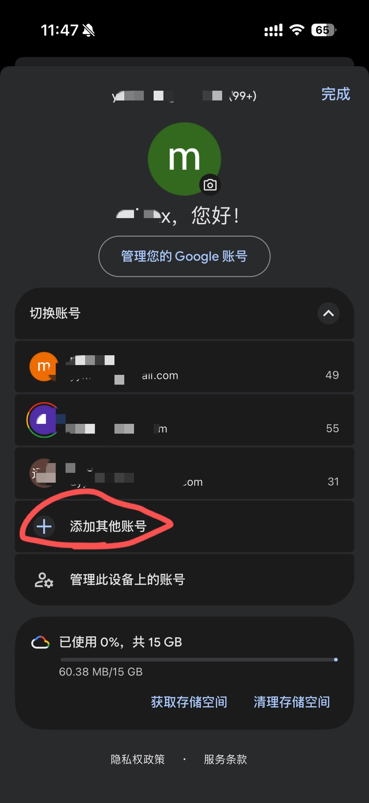
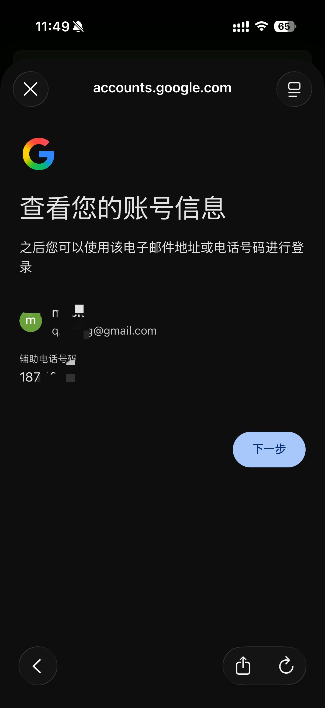
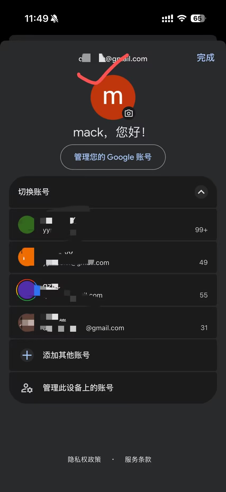
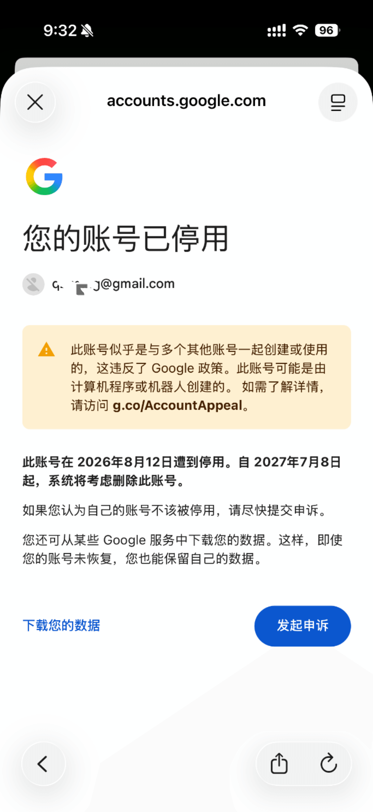
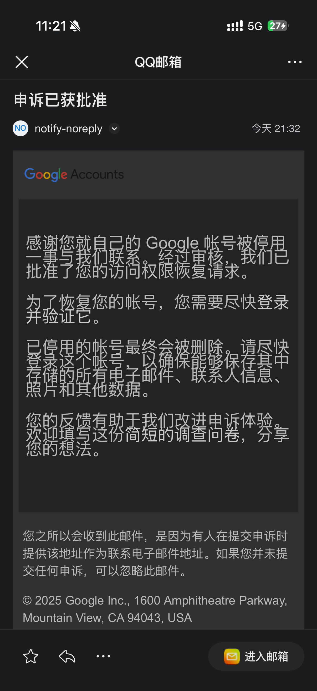

---

id: 2740826

title: "【教程】注册Google账号教程[未失效]"

created_at: 2026-08-11T16:19:19.064Z

username: YYmica

display_username: "YYmica"

---

# 【教程】注册Google账号教程[未失效]

**本教程需要一部拥有魔法的手机以及Gmail(苹果好说，安卓需要Google全家桶)**

注册时可以留意一下这两位位佬所说滴

[【教程】注册Google账号教程[未失效]](https://linux.do/t/topic/2740826/72) [

文档共建](/c/wiki/42)

> 提醒一下可能会强制号码认证无法短信会自己绑定一个自己手机上的号码一个号码只能注册2/3个号左右

[【教程】注册Google账号教程[未失效]](https://linux.do/t/topic/2740826/85) [

文档共建](/c/wiki/42)

> 如果使用临时的电话接码的话，后面电话找不出来即便过了申诉，也没办法登录了。

> [!question] 第一次发帖 不太会布局 请见谅各位佬！！！

> [!warning]- 尽量使用纯净的节点 以及没有被风控的手机号及手机

以下是教程（以苹果为例，安卓同理）

1.首先打开你的Gmail点击右上角的设置（打开后以下页面）

2.然后选择google

3.选择创建账号-个人创建

4.输入姓氏 名字（忘截图了）

5.输入生日和性别（忘截图了）

6.可以根据自己喜好输入自己想要创建的邮箱

7.输入密码

8.添加辅助手机号（亲测国内可以）

9.然后对一下信息

10.酱酱～创建成功

图一封禁的提示

图二解封的邮件

> [!warning]- 后面概率会被当成机器人注册被封（图片最后一张），不用怕直接申诉就好 会给通过的！！！！

---

*来源: https://linux.do/t/topic/2740826.json*

