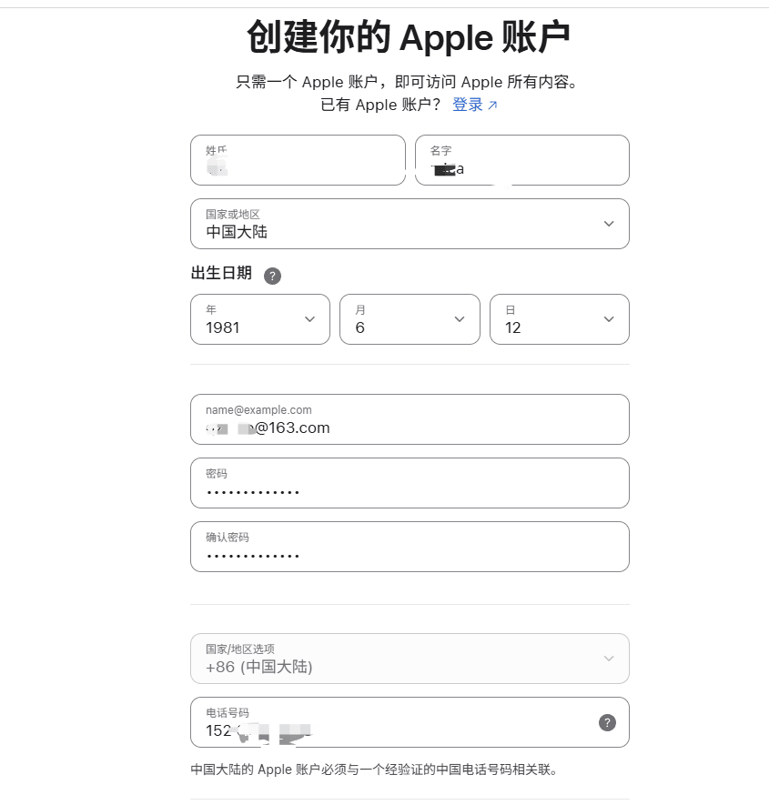
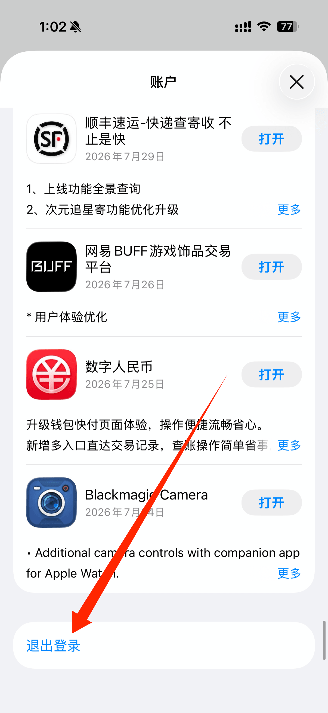
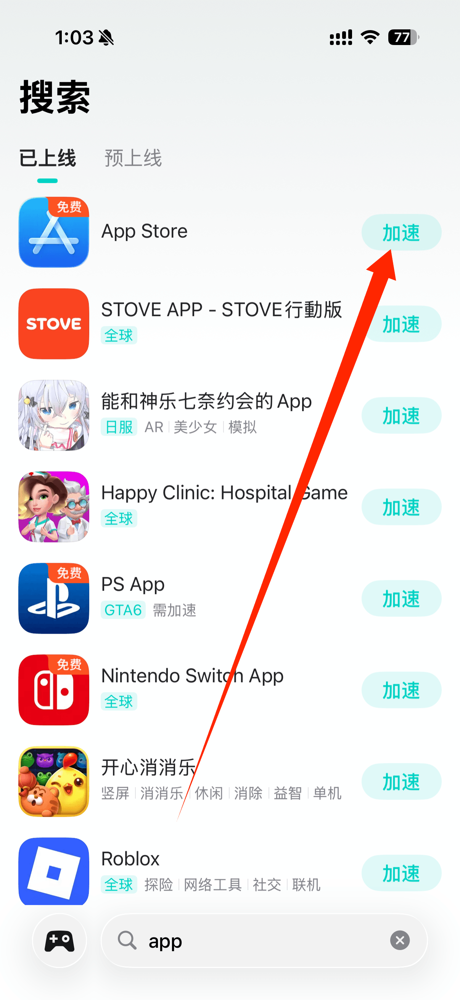
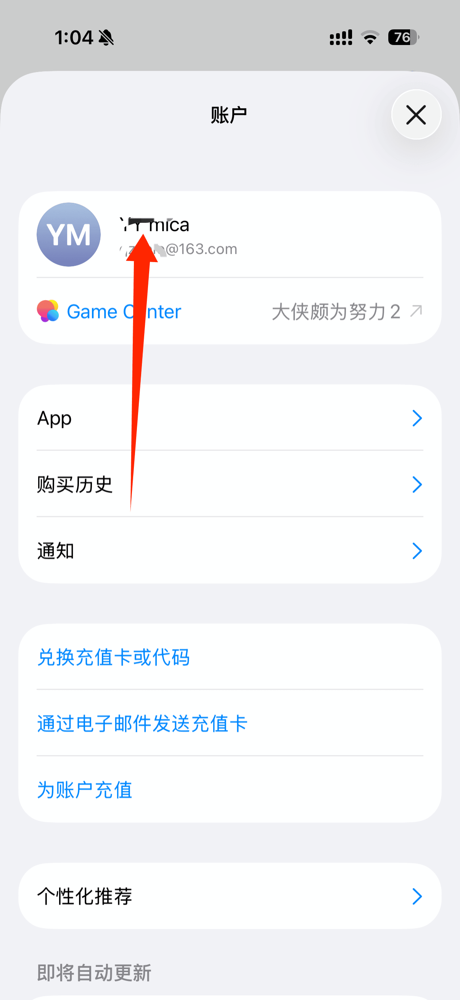
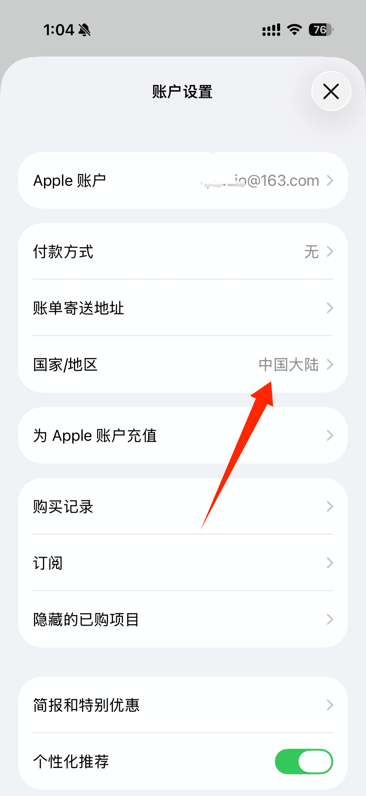
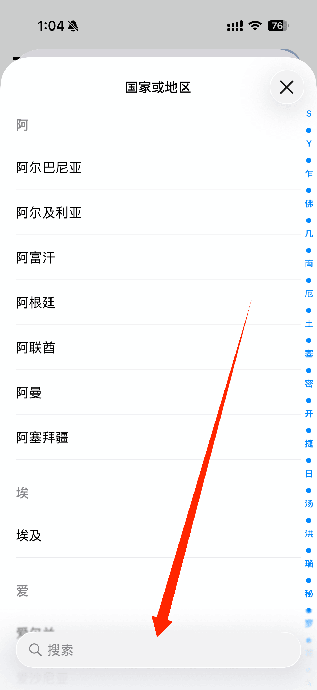
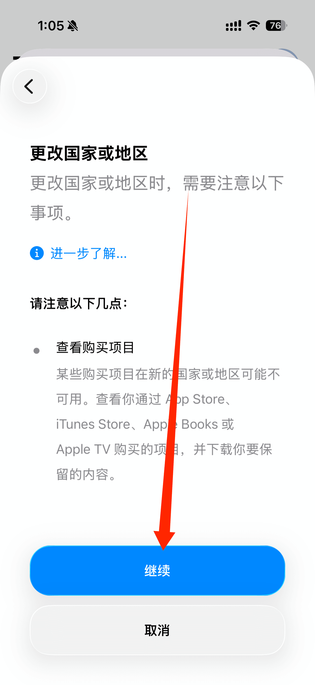
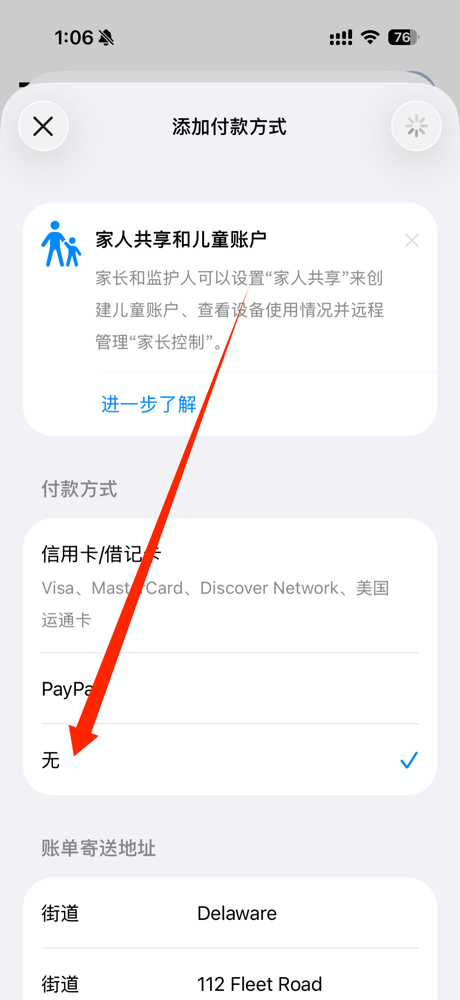
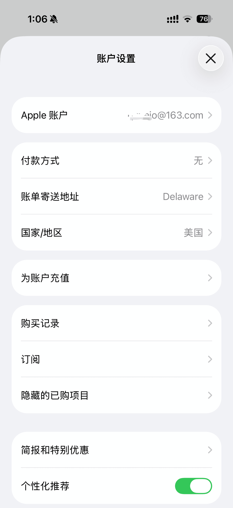

---

id: 2745312

title: "【教程】美区等部分外区apple ID注册指南"

created_at: 2026-08-12T10:28:46.407Z

username: YYmica

display_username: "YYmica"

---

# 【教程】美区等部分外区apple ID注册指南

# **准备**

1. 准备一个全新的邮箱

2. 手机号（国内的也可以）

3. 一份目标地区地址信息(可以搜索某某地区地址生成)

切记美区apple ID一定要免税州不然多花冤枉钱（ **Oregon（俄勒冈州），Alaska（阿拉斯加州），Delaware（特拉华州），Montana（蒙大拿州）和New Hampshire（新罕布什尔州）**）

4. 一台 iPhone

# **教程**

1.首先新注册一个中国区的apple ID

2.然后下载UU加速器（可以试试自己的节点，但有可能没有无，没有无的话就用UU加速器）

3.UU加速器搜索App Store，进行加速

4.App Store登录新注册的账号

5.点开个人页面 然后点击国家与地区

6.搜索你想更换的地区（部分地区有无的选项，本次测试美国）

7.然后选择无 填写账单地区（美区最好免税区哦）

8.点确定就更换成功了

**一定要养养号**

也可尝试这位佬的方法

[【教程】美区等部分外区apple ID注册指南](https://linux.do/t/topic/2745312/13) [

文档共建](/c/wiki/42)

> 直接在iPhone上注册，成功率更高，一步到位，不需要改地址，不要要对应区网络（我曾注册日区时，全程挂着英区IP，购买内购时在美IP）

>  ![[PixPin_2026-09-06_22-54-17]](https://cdn3.ldstatic.com/original/4X/b/e/8/be871402873db5f56ded3b31dd505705ac286f99.png)

> 1.iPhone改地区为US，关闭定位服务

> 2.在设置找到邮件，添加新账户，选择iCloud，选择创建新的Apple ID

> 3.常规流程走下去就行，年龄，邮箱，密码，绑定手机（手机完全没有账号登录…

---

*来源: https://linux.do/t/topic/2745312.json*

