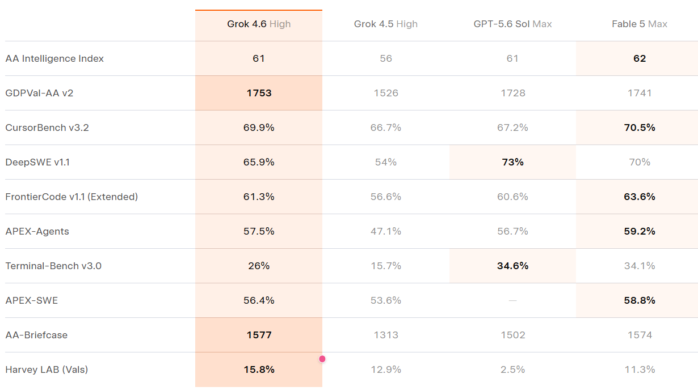
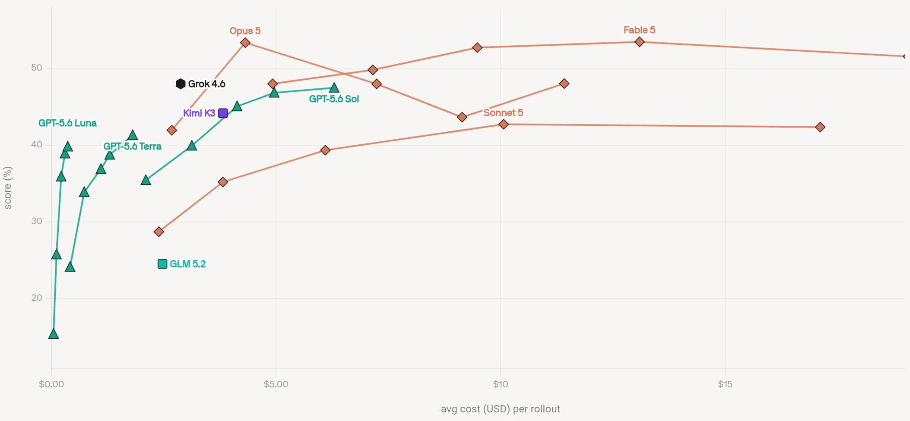
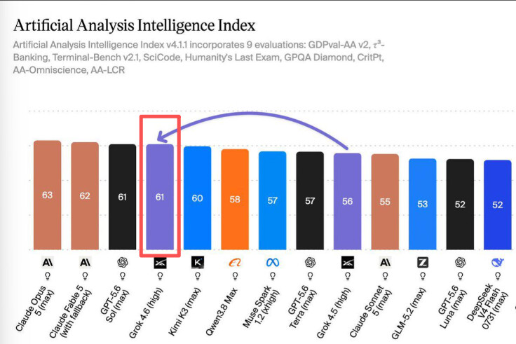

---

id: 2746698

title: ":fire:【大模型百科43】关于Grok 4.6，你想知道的一切【更新LiveBench和Artifacial】"

created_at: 2026-08-12T16:58:25.714Z

username: dwqxq1

display_username: "dwqxq1"

---

# :fire:【大模型百科43】关于Grok 4.6，你想知道的一切【更新LiveBench和Artifacial】

## 基本资料

官方文：[Introducing Grok 4.6 | SpaceXAI](https://x.ai/news/grok-4-6)

价格:输入$2/输出$6

参数：1.5T

---

## 评测

### 官方自评

---

---

### ArtifacialAnalysis评分

来源:[https://artificialanalysis.ai/](https://artificialanalysis.ai/)

---

### Arena评分暂未上线

来源:[Arena Leaderboard | Compare & Benchmark the Best Frontier AI Models](https://arena.ai/leaderboard)

---

### LiveBench评分暂未上线

来源:[LiveBench](https://livebench.ai/#/)

---

## Chat渠道

### Grok官网/app

### x官网/app

### Arena direct chat

来源:[Chat with Multiple Frontier AI Models](https://arena.ai/text/direct)

---

## API渠道

### 官网已上线

### OpenRouter已上线

来源：[Grok 4.6 - API Pricing & Benchmarks | OpenRouter](https://openrouter.ai/x-ai/grok-4.6)

---

*来源: https://linux.do/t/topic/2746698.json*

