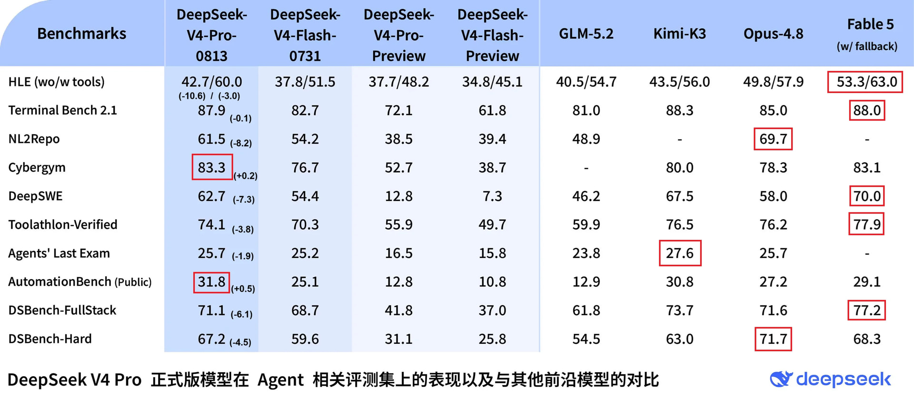
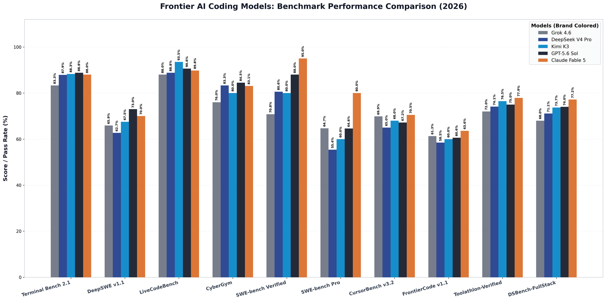
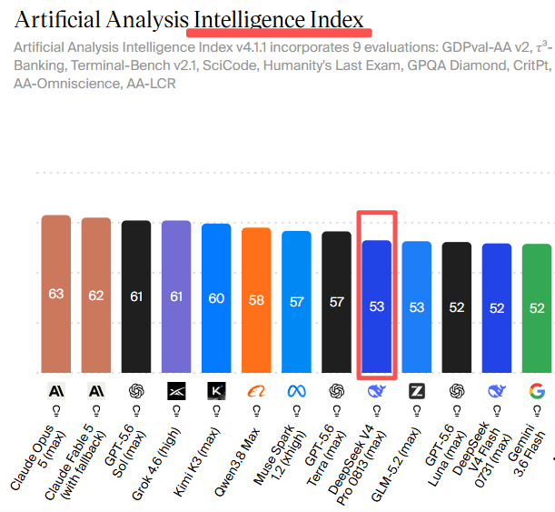
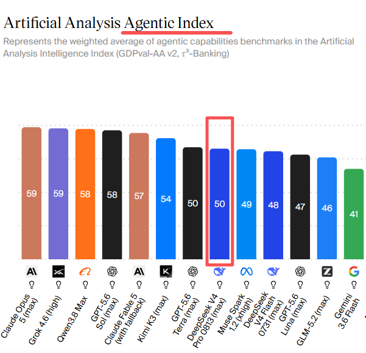
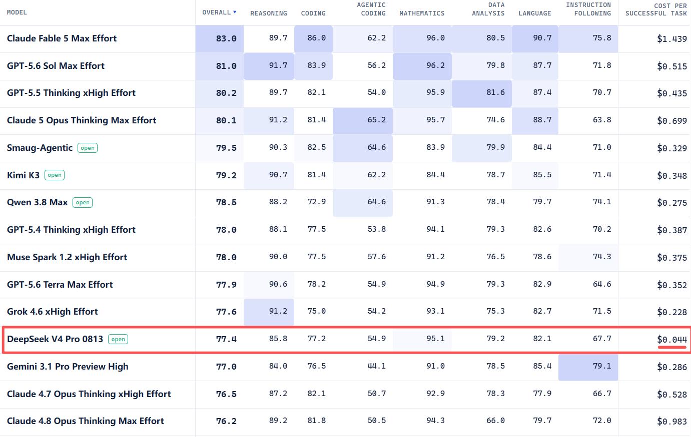

---

id: 2746711

title: ":fire:【大模型百科44】关于Deepseek v4 pro 0813和Harness，你想知道的一切"

created_at: 2026-08-12T17:01:43.742Z

username: dwqxq1

display_username: "dwqxq1"

---

# :fire:【大模型百科44】关于Deepseek v4 pro 0813和Harness，你想知道的一切

## 基本资料

官方文: 梁圣在写代码, 懒得发公告

价格：输入$0.435/输出$0.87

上下文：1m不变

最大输出:384k不变

知识截止日期:2605

参数：1.6T

---

## 评测

### 官方自评

---

---

### ArtifacialAnalysis评分

来源:[https://artificialanalysis.ai](https://artificialanalysis.ai)

---

---

### Arena评分暂未上线

来源:[Arena Leaderboard | Compare & Benchmark the Best Frontier AI Models](https://arena.ai/leaderboard)

---

### LiveBench评分

来源:[https://livebench.ai](https://livebench.ai)

---

## Chat渠道

### 官网/App已上线

梯子开全局登录deepseek.com才是国际版, 特征是显示可以谷歌账号登录, 搜索应该可以搜到被墙的网站,例如x

### Arena未上线

---

## API渠道

### 官网API已上线

### OpenRouter API已上线

来源:[DeepSeek V4 Pro 0813 - API Pricing & Benchmarks | OpenRouter](https://openrouter.ai/deepseek/deepseek-v4-pro-0813)

---

---

*来源: https://linux.do/t/topic/2746711.json*

