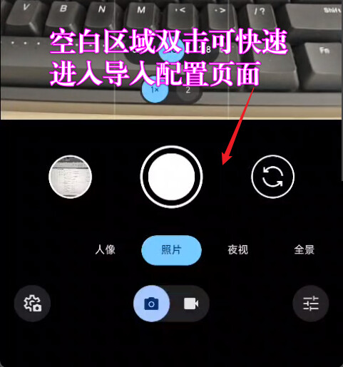

---

id: 274728

title: "小米 14 Pro 使用谷歌相机"

created_at: 2024-11-28T09:57:05.914Z

username: 91smile

display_username: "91smile"

---

# 小米 14 Pro 使用谷歌相机

# 小米 14 Pro 使用谷歌相机

> 各位大佬如果有更好的使用建议，让我们一起维护这个文档。

---

进入 [GCam](https://www.celsoazevedo.com/files/android/google-camera/) 下载安装包，下载稳定版本 [Stable Versions ](https://www.celsoazevedo.com/files/android/google-camera/dev-suggested/)，根据系统版本和 CPU 架构选择对应版本下载。

包名：[MGC_相机版本_修改版本_snap.apk   针对高通芯片优化，**小米 14 Pro 推荐安装此版本**

说明：小米手机可以安装全部版本，但推荐安装优化过的版本，其次在尝试其他版本。

---

## 一、下载安装包

| 开发者 | 推荐星级 | 链接与配置文件 |

| --- | --- | --- |

| BSG | ★★★★★ | **BSG 9.3: MGC_9.3.160_V34 (BSG, 2025-06-07, configs, android 11+)** |

| BSG | ★★★★ | **BSG 9.2: MGC_9.2.113_A11_V29 (BSG, 2024-10-05, configs, android 11+)** |

| BigKaka | ★★★★ | **BigKaka 9.2: AGC9.2.14_V14.0 (BigKaka, 2025-01-16, configs)** |

| BigKaka | ★★★★ | **BigKaka 8.4: AGC8.4.300_V14 (BigKaka, 2025-02-22, configs)** |

注：建议每位开发者推荐的版本不超过 2 个。

---

## 二、安装相机

[如何在 Android 上安装 APK 文件](https://www.celsoazevedo.com/files/android/how-to-install-apk-file/)

安装完成后小米 14 Pro，拍照会变成纯黑。这个是时候需要下载刚刚对应安装包的 * configs*, 找到对应手机型号下载 xml 配置文件

## 导入相机配置文件（Settings configs）

Gcam 教程 [如何在 Google 相机端口中加载和保存 XML 配置](https://www.celsoazevedo.com/files/android/google-camera/f/settings09/)

在手机根目录创建配置文件夹 ，顶部文件夹 必须与 DCIM、Downloads 等文件夹在同一级别创建。例：`/GCam/`

- GCam 9.x：`/GCam/Configs9/`

- GCam 8.x：`/GCam/Configs8/`

- GCam 7.x：`/GCam/Configs7/`

- GCam 6.x：`/GCam/Configs/`

1. 移动 configs （配置文件）到配置目录下面

2. 打开相机，点击设置 → 更多设置 ->Configs-Load

快捷加载方式如下：

---

## 三、设置

1. 相机页面内预览默认为 Google Photos (谷歌相册)，选择小米相册为预览：相机设置 → 更多设置 → Gallery → 小米相册

2. 相机页面预览为黑色，

- 预览恢复默认为 Google Photos；

- Interface 项修改机型尝试，Hardware level 项修改为 Level 3+ 。

1. 打开闪退，尝试导入 Xiaomi 14 等配置；

2. 相机页面黑屏，待补充

---

## 四、存在的其他问题

1. 小米 14 和 Pro 都有下面问题

- 开启 AWB 后无法保存

*(AWB doesn’t work on the main lens, photos don’t get saved when it is on. Turn it off when shooting on Main lens. Otherwise, AWB works on the other lenses fine. Rest of the features are also working perfectly fine apart from this.)*

---

说明：

---

*来源: https://linux.do/t/topic/274728.json*

