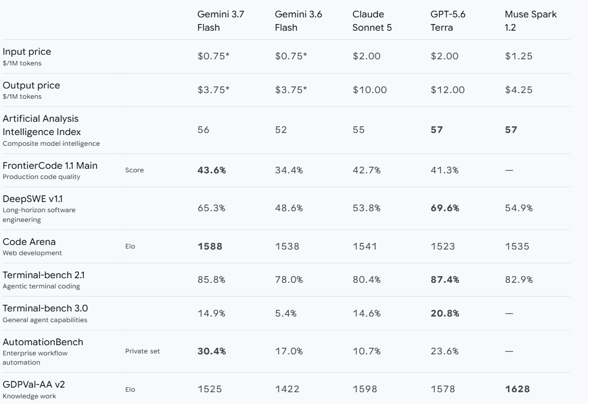
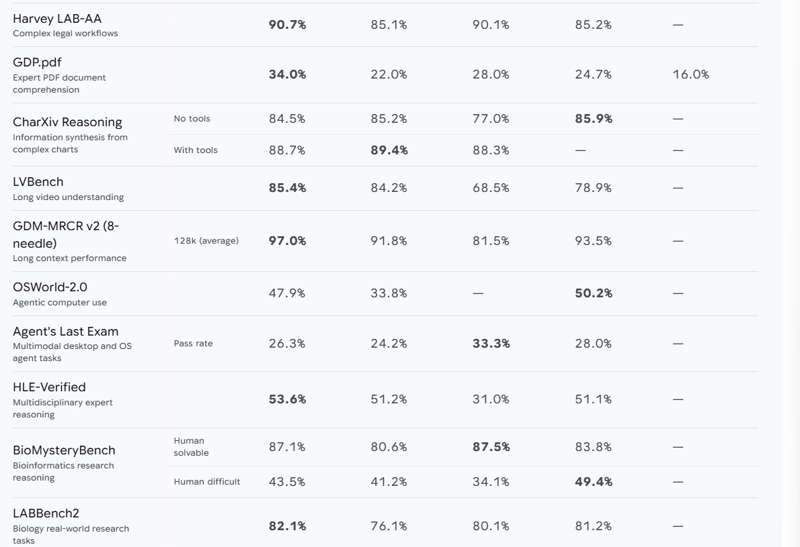
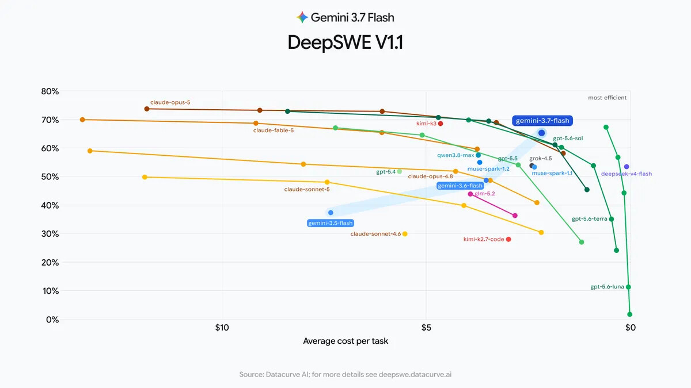
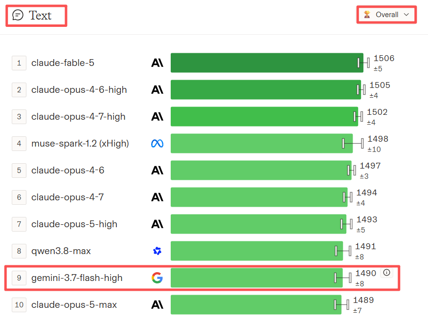
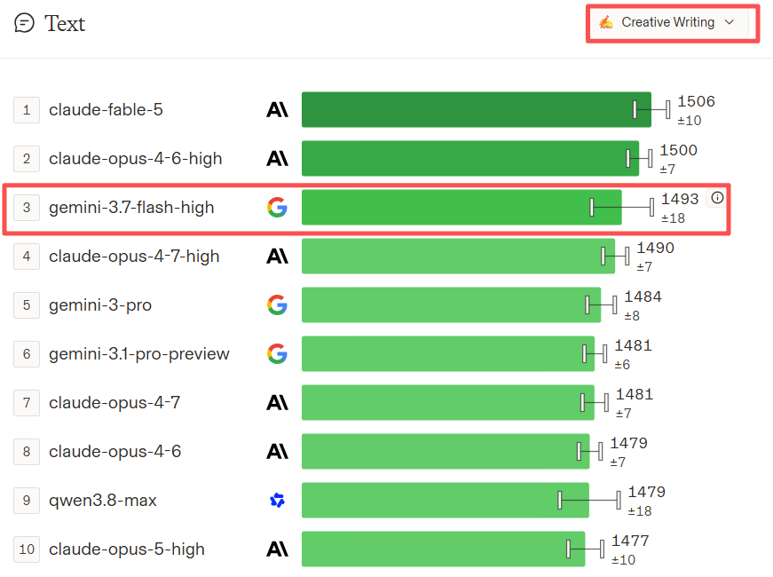
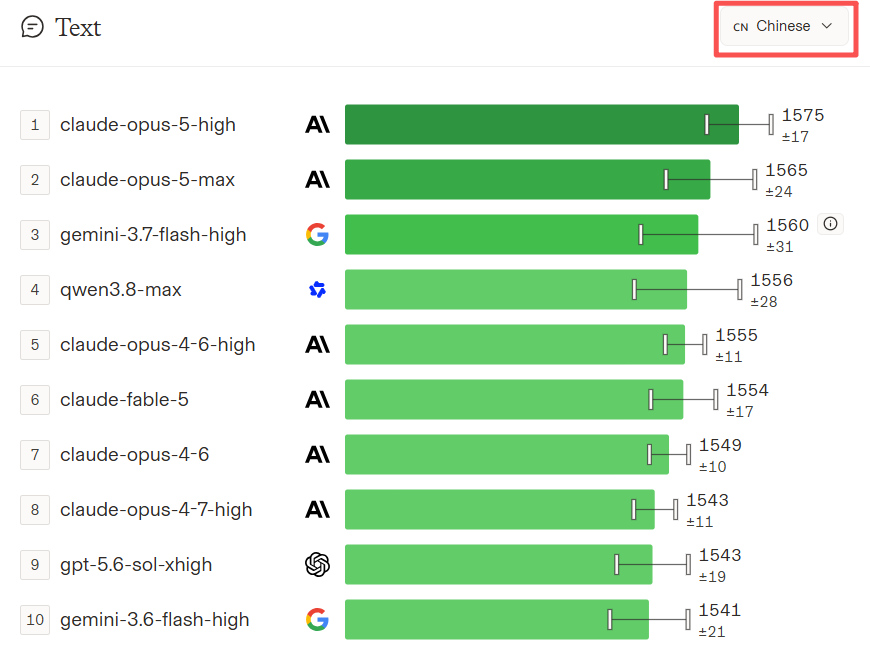
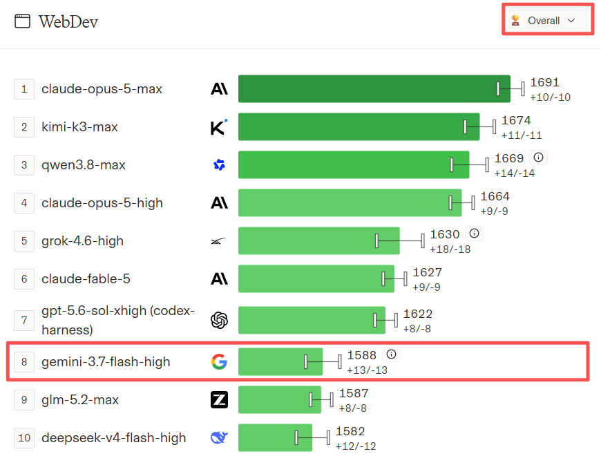
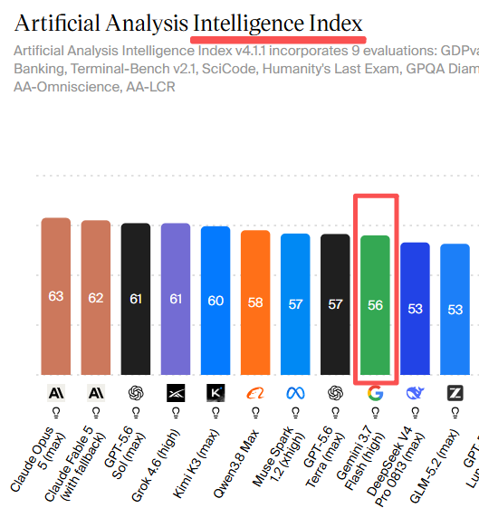
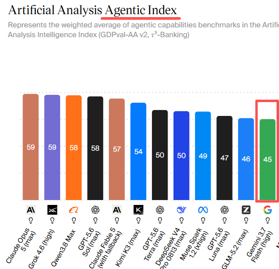
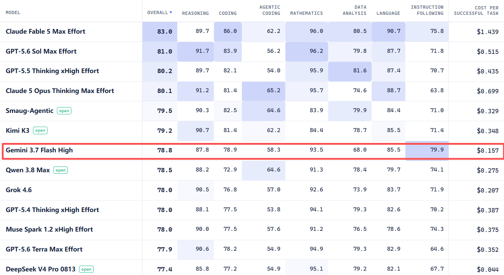

---

id: 2754491

title: ":fire:【大模型百科45】关于Gemini 3.7 flash，你想知道的一切"

created_at: 2026-08-14T06:48:27.406Z

username: dwqxq1

display_username: "dwqxq1"

---

# :fire:【大模型百科45】关于Gemini 3.7 flash，你想知道的一切

## 基本资料

官方文：[Gemini 3.7 Flash: our most intelligent workhorse model](https://blog.google/innovation-and-ai/models-and-research/gemini-models/introducing-gemini-3-7-flash/)

模型卡：[Gemini 3.7 Flash - Model Card — Google DeepMind](https://deepmind.google/models/model-cards/gemini-3-7-flash/)

价格：输入$0.75/输出$3.75，暂时比上代降价一半

270101恢复1.5/7.5

Flash 3.1=输出$3 → 3.5=$9 → 3.6=$7.5 → 3.7=$3.75,这价格反复横跳, 可能代表着Gemini地位的兴衰

文档：[https://ai.google.dev/gemini-api/docs/models/gemini-3.7-flash](https://ai.google.dev/gemini-api/docs/models/gemini-3.7-flash)

上下文：1m不变

最大输出：64k不变，显著少于其他前沿

---

## 评分

### 官方自评

---

---

### Arena

来源：[Arena Leaderboard | Compare & Benchmark the Best Frontier AI Models](https://arena.ai/leaderboard/)

---

---

---

---

### Artificialanalysis评分

来源:[https://artificialanalysis.ai](https://artificialanalysis.ai)

---

---

### LiveBench评分

来源:[https://livebench.ai](https://livebench.ai)

---

## Chat渠道

### 官网/App/AIStudio/Google已上线

### Arena未上线

---

## API渠道

### 官网已上线

### OpenRouter已上线

来源:[Gemini 3.7 Flash - API Pricing & Benchmarks | OpenRouter](https://openrouter.ai/google/gemini-3.7-flash)

---

*来源: https://linux.do/t/topic/2754491.json*

