---

id: 2762111

title: "神人电台漂到B站以后"

created_at: 2026-08-16T08:50:45.606Z

username: ZRainbow

display_username: "ZRainbow"

---

# 神人电台漂到B站以后

最近我最爱的下饭视频是2MoreMinutes博主翻译的“神人电台”系列。

这档节目原来叫Brooke & Jubal in the Morning，其中最出名的环节是Second Date Update。一般是一位听众在第一次约会以后突然被对方冷落，自己又想不明白问题出在哪里，于是找电台帮忙。主持人把电话打给另一方，问清楚他为什么不愿意再见面，最后再尝试撮合一次第二次约会。

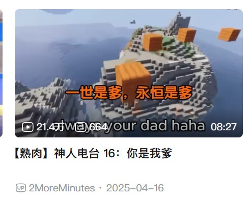

节目官方对成功率没有太多信心，对娱乐效果倒相当诚实。很多期节目一开始只是普通的约会不合，电话接通以后，新情况一件接一件往外冒，前面听起来还算合理的人，几分钟后神人属性一览无余。[［1］](https://podcasts.apple.com/us/podcast/brooke-and-jeffrey-second-date-update/id1252638476)

想想来从小就爱看这种东西，就和街头大妈看吵架一样，以前看《非诚勿扰》，还记得一句“宁愿在宝马车上哭，也不愿在自行车上笑”。后面觉得不带劲，又喜欢看江西台的《金牌调解》，鸡毛蒜皮的小事情吵到后面打起来，太开心了。

长大了，B站的推送机制就发现我也是个神人，很快推送给我，后面发现神人显然不止我一个。2MoreMinutes在2025年4月11日发布了《神人电台01》，截至成稿整整好好200期视频。

第一期目前约有30万播放，早期多期也达到了十几万乃至数十万播放。这个成绩不算特别优秀，但是稳定的不行。粉丝群也建了起来，各种外号和new clear之类的梗也传起来，明显已经不只是偶尔翻译一段外国音频，而是一档有固定名称、连续编号和稳定观众的中文栏目。[［2］](https://search.bilibili.com/all?keyword=基督山%2F)

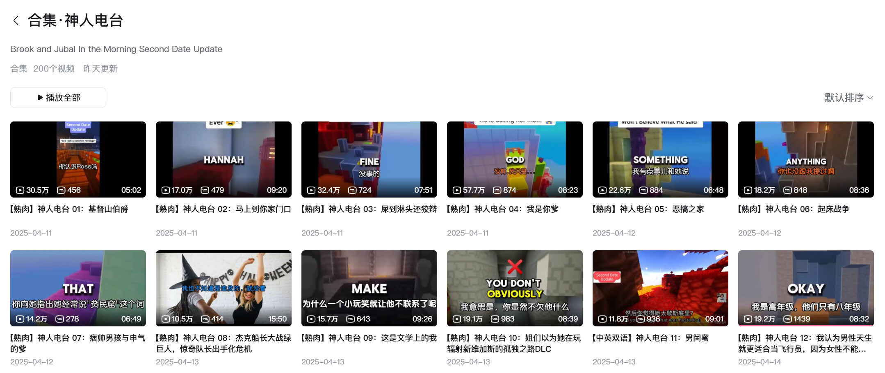

要说这个学法的人就是讨厌，看多了我就总是想它是怎么做出来的，以及后面的合规问题。

2MoreMinutes的视频保留了原版英语音频，据她说为了迎合观众的ADHD，画面里一定会放个Minecraft跑酷视频吸引注意，然后屏幕中间铺一层中英双语字幕。

UP主还会重新取标题，完成切分和编号。像“基督山伯爵”“约会笑传之藏藏baby”这些中文名称，显然是得到大神通。

我最初以为这些包装是UP主的独创，后来顺着评论区查了一下，才发现其实这些东西早有先例。

2024年10月至11月，TikTok用户已经频繁刷到Brooke & Jubal旧节目片段配Minecraft跑酷的视频。美国媒体也早有报道，把Second Date Update音频和Minecraft跑酷视为一种固定搭配。[［3］](https://www.dexerto.com/tiktok/viral-second-date-update-radio-host-has-one-request-for-tiktok-accounts-reposting-his-content-2981209/)

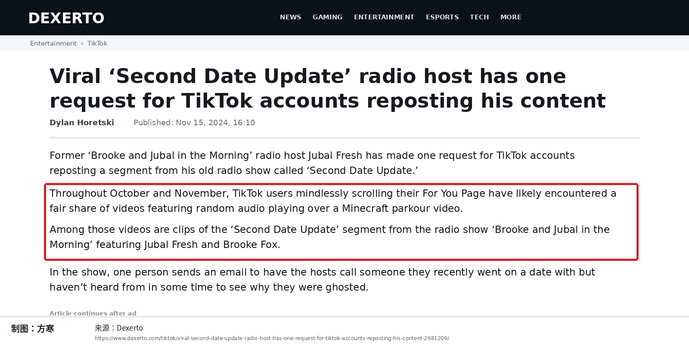

所以，这种视频形式不是2MoreMinutes首先创造的。

不过，现在能够确认的也只有形式上的先后。我还没有仔细检查2MoreMinutes是自己找到原始节目、另外准备跑酷画面，再完成字幕和剪辑，还是直接采用了某位TikTok创作者已经做好的音画文件。

这首先关系到一个很普通的事实判断，也就是这条视频究竟经过了哪些人的手。

如果UP主自行取得节目音频，自己录制或另外取得跑酷画面，再完成中文制作，那么音频和游戏画面有各自的来源。

如果他是在TikTok成片上继续增加中文翻译，那么中间还多了一位短视频制作者。

最后呈现在B站上的画面差不多，具体的制作路径却可能完全不同。所以我说学法的人就是讨厌呢，小小的烤肉可能就有些法律问题需要回答了。

不过首要的是搞清楚节目是如何产生的。

## Radio On

顺着节目继续溯源，神人电台的来路也比我起初想象得完整。

Brooke & Jubal不是几个人加上一个工作室录制的网络聊天节目。Hubbard Radio Seattle在2011年将其推出，首播电台是西雅图的MOViN 92.5，也就是KQMV。

2016年，Premiere Networks将节目纳入全国联播体系，节目仍然由KQMV制作，再提供给美国各地的合作电台。官方介绍中提到，节目包括主持讨论、喜剧桥段、听众互动和经过编写制作的内容，Jubal本人也参与部分喜剧内容的写作与制作。[［4］](https://www.premierenetworks.com/press/premiere-networks-syndicate-hubbard-radios-brooke-jubal)

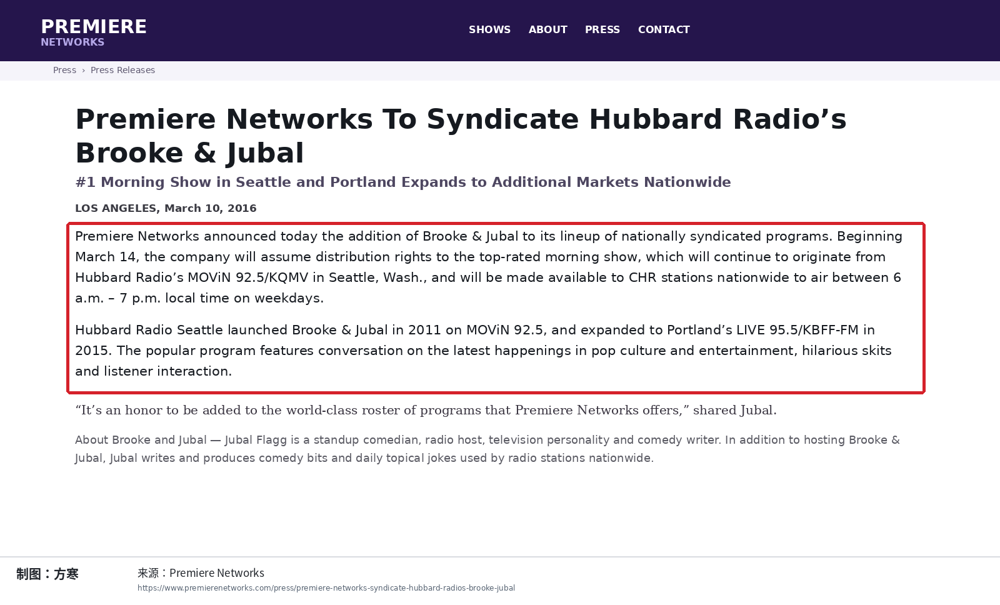

2016年那份公告还说，Premiere取得了节目的“distribution rights”。注意，这里的“distribution rights”还和中国著作权法意义上的“发行权”不太一样。新闻稿说的是**广播行业中的全国联播和渠道分发**，具体覆盖了哪些媒介、地区和使用方式，还要看没有公开的合同。

至少从这份资料可以看出，这档节目从制作到传播并不只牵涉Jubal一个人。主持人、电台、制作团队和联播商都可能处在节目不同的权利关系里，只是公开新闻稿没有继续告诉我们各自拿走了什么。

Jubal在2020年离开以后，节目改名为Brooke & Jeffrey。原来的Second Date Update也没有随着广播结束而消失。目前官方播客仍由iHeartRadio On-Demand持续更新，目录中大约有两千期节目，还会重新发布标有“Classics”的旧内容。[［5］](https://robertfeder.dailyherald.com/2020/04/10/jubal-fresh-vanishes-100-3-morning-show/)

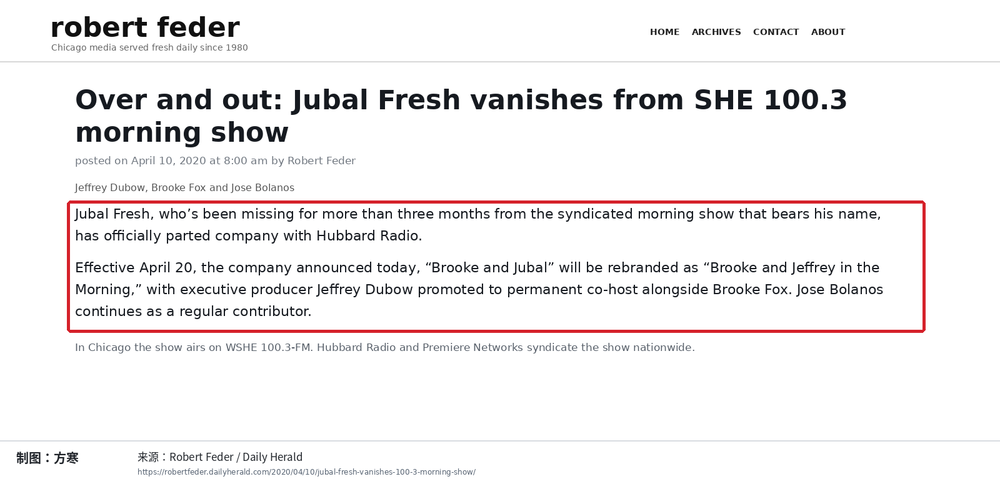

我拿B站上的《神人电台06：起床战争》做过一次简单对照。官方播客目录中有一期2017年11月15日发布的《Alarm Hand Slap》，人物同样是Laura和Mathew，故事也是两人共度一晚后，因为第二天早晨的一首歌发生了尴尬。[［6］](https://podcasts.apple.com/za/podcast/second-date-update-podcast-alarm-hand-slap/id1252638476?i=1000394851961)

这件事解释了一个很容易混淆的日期问题。

虽然我们看到的视频日期上写着2022年或者2025年，但不一定代表节目就是那一年录制的。只要音频里的主持阵容还是Brooke和Jubal，录制时间通常还要继续往前找。

于是，神人电台的漂洋过海之旅如此奇妙。旧节目先被官方播客保存，后来又在TikTok上配上Minecraft重新流行，最后才出现了带有中文翻译、双语字幕和连续编号的B站版本。

把这条传播路径弄清以后，法律问题自然而然浮现了出来。

> 不过要先说明一个前提是，我还没有和2MoreMinutes或者Tiktok上的视频作者取得联系。现有的公开视频没有展示授权文件，并不代表授权一定不存在。

> 现代专利权利制度及其责任体系在授权之外还有另外一个锚点，也就是是否盈利。我也同样无法根据播放量判断账号是否参加了平台激励、获得了多少收益。

> 因此下面我想讨论的 just want some fun，以及做一些学习，而不是替某个账号提前作出侵权认定。

## Law On

中美两国法律在专利这件事情上差异比较大，而这档节目作为网络视听作品又横跨两国，分析起来比较麻烦。

节目在美国制作，Jubal、电台、制作方和联播商之间的权利分配，首先要看美国法律和相关合同。中文视频在B站面向中国公众传播，权利人如果要求在中国获得保护，中国著作权法和我国涉外法律适用规则也会进入分析。中国著作权法按照国际条约等规则保护符合条件的外国作品，因此节目来自美国，不会使它在中国平台上自然变成无主内容。[［7］](https://www.ncac.gov.cn/xxfb/flfg/flfg_532/202103/t20210309_50530.html)

具体体现在一条视频上，**则是要把音频、视频、翻译三个个行为拆开。**

节目音频被取用和固定，涉及复制。节目中具有独创性的主持词、笑话和叙事被转成中文，涉及翻译。音频、跑酷和字幕被合成一个新文件，随后上传到B站，供观众在自己选择的时间观看，又可能涉及信息网络传播。

中国著作权法分别规定了复制权、翻译权和信息网络传播权。节目中受保护的语言表达、符合条件的表演以及最终形成的录音制品，也可能由不同主体分别享有权利。录音制品在网络上传播时，还可能同时涉及著作权人、表演者和录音制作者的许可。[［7］](https://www.ncac.gov.cn/xxfb/flfg/flfg_532/202103/t20210309_50530.html)

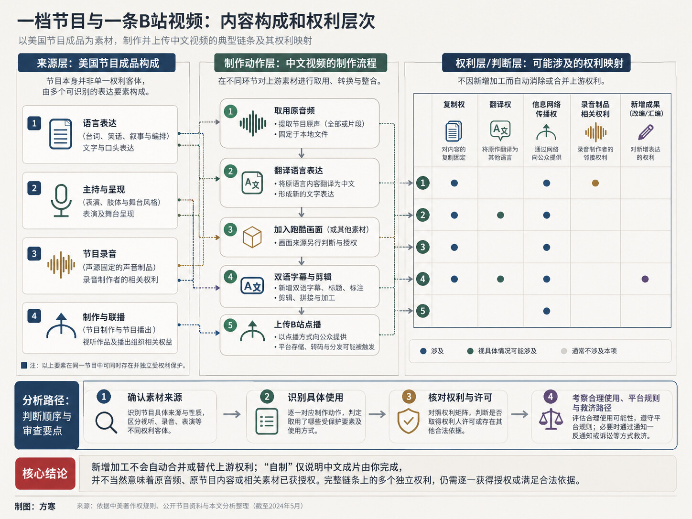

这里有一个术语上的小区别。

中文字幕翻译的是节目中的语言表达，并不是在法律意义上“翻译一份录音制品”。原声继续被完整或大段保留，属于对录音的使用。两种行为在同一条视频里同时发生，分析时仍然要分开。

当然，节目里每一句“嗯”“啊”或者普通的日常回答，也不会因为上过电台就自动成为一件作品。著作权保护的是具有独创性的表达，不保护单纯的事实、过于简短的语句和抽象的节目点子。

Second Date Update那套“打电话追问为什么没有第二次约会”的机制，别人可以借鉴。某一期具体的主持词、笑话、剪辑和录音，则是另一回事。[［7］](https://www.ncac.gov.cn/xxfb/flfg/flfg_532/202103/t20210309_50530.html)

Minecraft画面也要按同样的方式来看。

“给故事音频配跑酷”是一种创作形式，通常不会被某一个账号独占。某位创作者实际录制的跑酷过程、选取的路线、剪辑和完成的音画文件，却是具体内容。

Minecraft官方的使用指引允许玩家在符合条件时制作、分享乃至通过广告变现自己的游戏视频，但这种许可解决的是玩家如何使用游戏内容，没有顺便允许后来者直接拿走另一位创作者录制好的视频。[［8］](https://www.minecraft.net/en-us/usage-guidelines)

因此，我认为B站页面上的“自制”**并不是完全没有意义**。

它可以表示这份中文成片确实由UP主完成，视频中存在翻译、排版、标题和剪辑等新增内容。但它也没有能力把不同来源的素材合并成一份统一权属。

B站现行协议要求上传者自行保证对发布内容享有合法权利或已经获得相应授权，平台没有因为标注“自制”，就替上传者对每一层素材完成版权确认。[［9］](https://www.bilibili.com/blackboard/activity-pygMS1E70.html)

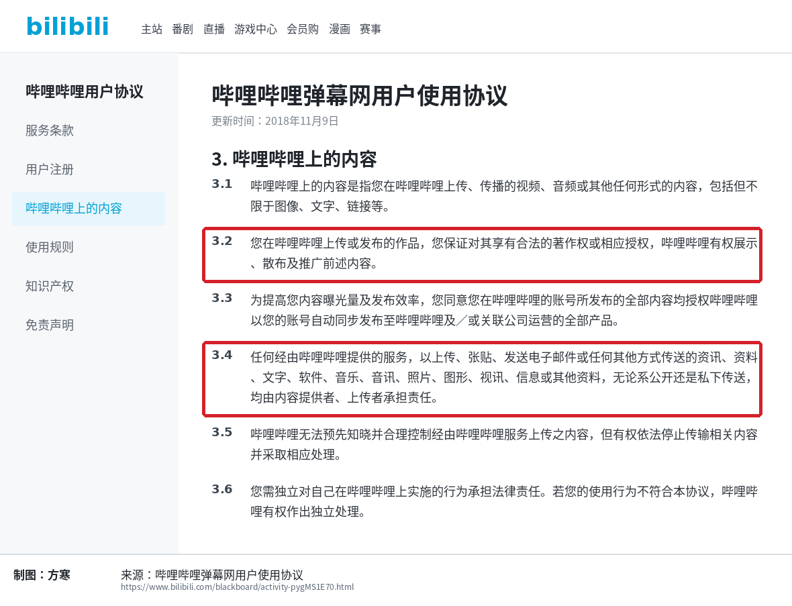

所以，如果要把2MoreMinutes简单称为“搬运者”是不太准确的。

中文翻译、标题和编排确实可能形成新的表达。中国著作权法也承认，翻译已有作品产生的新成果可以由翻译者享有著作权，只是翻译者在行使权利时，不能侵犯原作品的著作权。从这个角度说，别人把2MoreMinutes的字幕和中文标题原样抄走，不会因为底层节目来自美国，就自动变得没有问题。[［7］](https://www.ncac.gov.cn/xxfb/flfg/flfg_532/202103/t20210309_50530.html)

但反过来，**翻译者付出了劳动，也没有因此获得原音频的全部使用权。**

这和早年的字幕组问题很接近。字幕组完成听译、校对、时间轴和文化转换，为一部外语作品增加了真实的传播价值，未经许可使用完整原作的问题也不会随之消失。

个人博主又和传统字幕组有一点区别。过去的字幕组常常围绕某一份资源临时组织，翻译完成后再把文件交给社群。B站上的译制则围绕一个长期账号运行，标题、期数、更新时间、粉丝、弹幕和推荐共同构成栏目。

有关B站用户翻译的研究也发现，这些创作者既是外国内容的消费者，也是翻译和再生产者，观众反馈与平台机制还会持续影响他们的选材和制作。[［10］](https://journals.sagepub.com/doi/10.1177/20594364211000645)

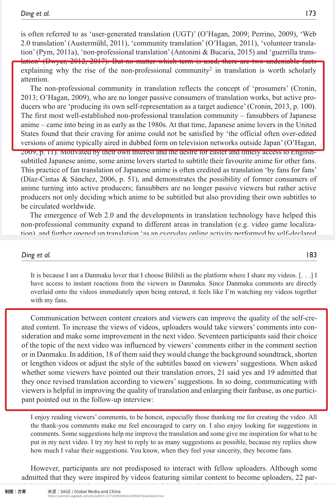

所以，把2MoreMinutes理解为一种平台化的个人译制者，或许比照搬传统字幕组更接近实际情况。他做的不只是把一句英语翻成中文，也包括选片、命名、更新和经营观众预期。

这些新增工作是否足以构成合理使用，又要回到视频的具体用途。

中国著作权法允许为了介绍、评论作品或者说明某个问题，适当引用已经发表的作品。这里看的是引用服务于什么目的、取用了多少，以及是否影响原作的正常使用。假如一条视频只截取必要片段，主体是制作者自己的分析和评论，合理使用的空间会大一些。若保留完整或接近完整的节目，字幕和跑酷主要帮助中文观众顺畅听完原来的故事，判断就会不同。[［7］](https://www.ncac.gov.cn/xxfb/flfg/flfg_532/202103/t20210309_50530.html)

增加Minecraft画面和中文翻译，说明制作者确实加入了新的劳动，却没有直接回答观众究竟在消费什么。如果观众点开视频，主要仍然是为了从头到尾听完这一期约会事故，那么原节目的娱乐功能基本保留了下来。

美国的fair use采用更开放的综合判断，也会考虑使用目的、作品性质、取用数量和市场影响。美国版权法还明确把翻译列为衍生作品的一种。语言发生变化、受众扩大，并不会单独决定使用是否合法。[［11］](https://www.law.cornell.edu/uscode/text/17/101)

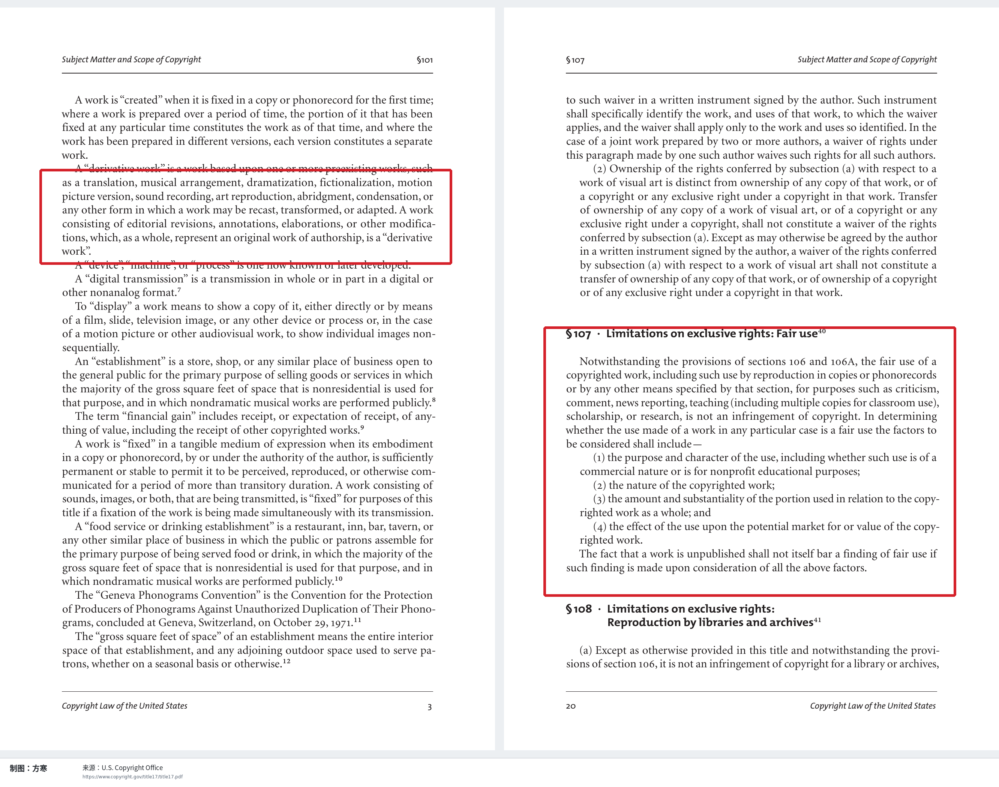

美国的Nihon Keizai Shimbun v. Comline案就涉及将日文新闻翻译、整理后向英文用户提供。法院没有因为内容换了语言、进入了新的受众群体，就直接认可fair use，而是继续考察具体表达被取用的程度、使用目的和对原权利人市场的影响。这个案件和神人电台的节目类型并不相同，却说明“翻译创造了新受众”只是分析中的一个事实，不是最终答案。[［12］](https://law.justia.com/cases/federal/appellate-courts/F3/166/65/630224/?utm_source=chatgpt.com)

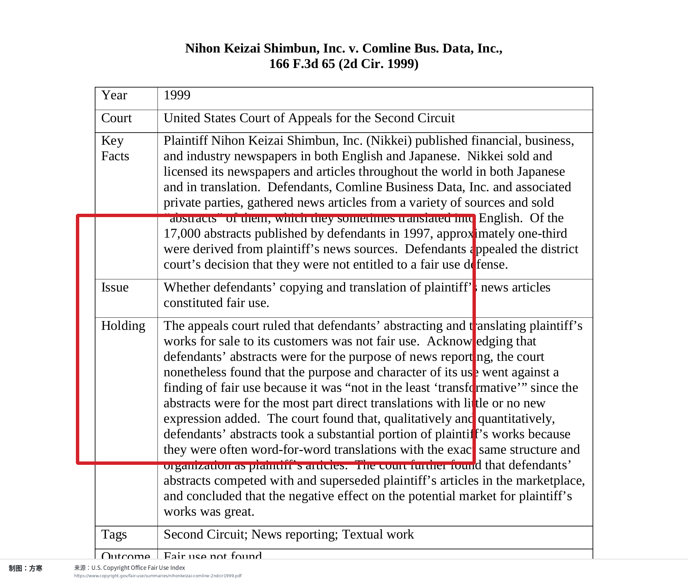

最后来到盈利，也是类似的情况。

我最初最容易注意到的，确实是这样一个已经连载上百期、拥有稳定播放量的账号有没有赚钱。

早年的字幕组讨论里，“为爱发电”与商业化之间也经常被画出一条很明显的道德界线。

但从民事著作权侵权来说，实际获得收益通常不是统一的成立条件。未经许可复制、翻译和通过网络传播受保护内容，即使观众免费观看，也可能产生民事责任。商业化会影响合理使用中的权衡，还可能影响过错评价和赔偿计算。能够证明的广告、平台激励、充电或者商单收益，也可能成为违法所得、实际损失或者许可费计算的参考。[［7］](https://www.ncac.gov.cn/xxfb/flfg/flfg_532/202103/t20210309_50530.html)

所以，一条视频是否收费，只回答了观众有没有直接掏钱。播放量、粉丝数和账号影响力当然具有商业价值，却不能不经过证据便直接换算成UP主的实际收入。

平台治理、民事救济、行政执法和刑事责任也有各自的条件。现实中较早出现的处理，往往是权利人向平台提交版权通知，平台删除视频或者断开链接，上传者再提交相应说明。视频被平台处理，并不等于法院已经作出侵权判决。当然，一条视频长期存在，也不能说明平台已经确认它合法。[［13］](https://www.ncac.gov.cn/xxfb/flfg/flfg_532/200701/t20070109_50525.html)

权利人还可以直接提起民事诉讼。**版权行政部门的处罚通常还要考虑行为是否损害公共利益。刑事责任则有更严格的主观和客观门槛，不适合看到一条视频播放量很高便提前讨论。**

结合之前的字幕组来说，很多人会自然想到人人影视字幕组案。而这起案子之所以进入刑事领域，与其涉及三万多部未经授权的影视作品、六百多万会员、上千万元非法经营额以及明显的组织化、商业化规模有关。它可以说明字幕活动在极端规模下可能产生的法律后果，却很难直接类比到一个B站个人账号。[［14］](https://www.court.gov.cn/zixun/xiangqing/416612.html)

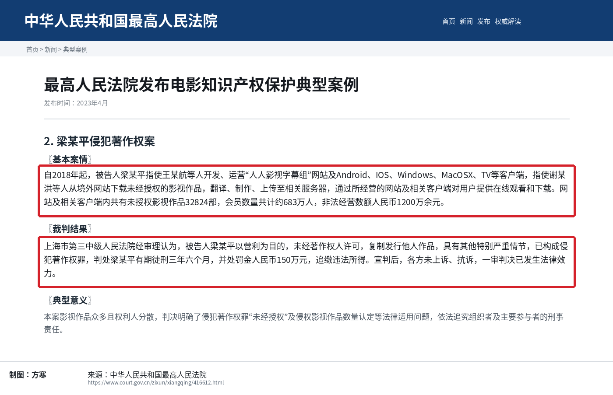

查到这里，还有一个事实会让前面的判断缓和一些。

**Jubal本人对TikTok上的这轮传播并不排斥。 ** 据Dexerto对他2024年11月TikTok视频的转引，Jubal知道创作者在发布旧节目片段，也知道其中有人进行变现。他表示支持这些创作者获得收益，只希望上传者标注自己，让观众能够找到内容来源。[［3］](https://www.dexerto.com/tiktok/viral-second-date-update-radio-host-has-one-request-for-tiktok-accounts-reposting-his-content-2981209/)

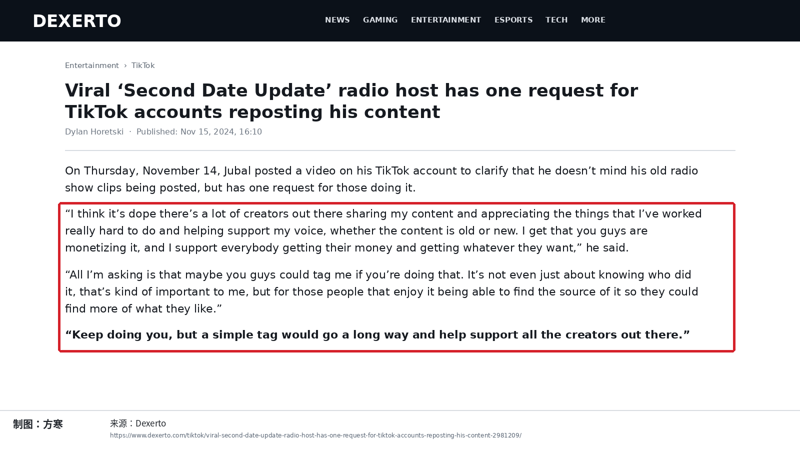

这条消息很重要。它至少说明，节目的一位核心主持人并没有把这轮传播理解成完全违背自己意愿的使用。

不过，很可惜的是 Jubal 说话有没有用还是一个未知数。

Jubal谈论的语境是TikTok上的旧节目片段。他是否同时允许完整或近乎完整的节目、中文翻译、B站长期连载和重新命名，公开回应没有写清。

更重要的是，Brooke & Jubal由电台制作并进入全国联播，相关权利可能分布在主持人、雇主、制作方和其他主体之间。美国的职务作品制度也可能使符合条件的节目成果由雇主或制作主体取得权利，具体仍要看工作关系和合同。[［4］](https://www.premierenetworks.com/press/premiere-networks-syndicate-hubbard-radios-brooke-jubal)

因此，Jubal的态度不能当作毫无意义的客套，只能说作为核心主创，他是欢迎的，为法律在自由心证时增加一份善意允许的可能。

但再往前一步，假如他本人确实掌握某些权利，他的表态可能在一定范围内支持非独占许可或者权利人容忍的判断。至于范围有多大、能否覆盖B站中文版本，还要结合原始视频、用词、语境和权利归属具体分析。

这也解释了为什么“官方播客本来就能免费听”无法把问题直接解决。

官方平台允许公众点开节目，意味着听众获得了收听服务。保存文件、重新配图、制作完整翻译并上传到另一个平台，则属于新的使用。中国著作权法对于许可合同也要求明确权利种类、地域和期间，未明确许可的权利，原则上不能仅凭原作品已经公开便推定存在。[［7］](https://www.ncac.gov.cn/xxfb/flfg/flfg_532/202103/t20210309_50530.html)

如果节目方后来注意到这些中文视频，现实中的处理也不会只有“全部起诉”和“完全不管”两个选项。它可以接受这种传播，要求注明来源。可以限制使用时长，要求链接官方节目。可以补签许可、安排分成，也可以针对部分视频发出删除通知。

**所以目前真正缺少的仍然是授权范围的公开信息，这也是为什么在展开分析之前之前就叠甲**。

授权真的很重要呀，尊重创作者本身也是在尊重自己。

## Your Phone lingling

一路讨论版权以后，还有一类同意很容易被忘记，也就是电话另一端的人究竟同意了什么。

讲真，你突然收到一个电话，电话那一头告诉你你上电视了，然后你说的每一句话都会在互联网上永久成典，这不很诡异吗？

在分析这个节目接听电话的人的时候还要更特殊一些，由于节目性质，他们未必适合统一叫作“被采访者”。

有人主动向节目投稿，另一方则可能是节目组联系的约会对象。公开成片也无法告诉我们每一期的完整制作方式。真实通话、提前告知后的录音、事后补录、情境重演或者一定程度的脚本化，都有可能存在。

美国佬这种事情应该是经历得多了，包括电话采访、电话投票、民间调查等形式百花齐放。据此，美国联邦通信委员会对持牌广播机构有专门规则。电台为了广播而录制电话以前，原则上要告知通话参与者其广播意图。只有对方已经知道，或者根据当时情境可以合理推定其知情时，才适用例外。[［15］](https://www.ecfr.gov/current/title-47/chapter-I/subchapter-C/part-73/subpart-H/section-73.1206)

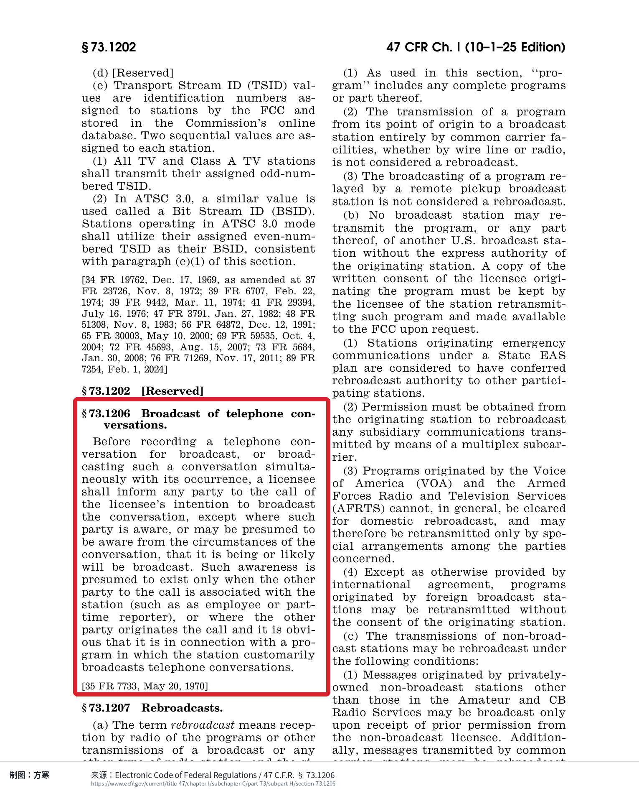

所以，最终节目里没有播放一段正式的同意声明，只能说明这段内容没有进入成片。节目组可能提前告知，也可能事后确认，单凭听众听到的版本无法判断。

**即便原节目在美国的制作完全合规，同意的范围仍然值得区分。**

一个人可能同意通话被录下来，也可能同意在原电台播出。节目后来被放入播客目录，长期保存和重复发布，是进一步的使用。若再由第三方翻译、重新命名并传播到另一个国家的平台，范围又往外扩了一步。

这里讨论的已经不完全是节目公司的版权。自然人对自己的声音、隐私和名誉也可能拥有独立利益。中国《民法典》规定，自然人的声音参照肖像权保护。不过，节目中的通话参与者通常位于美国，真要处理跨境人格权争议，还要考虑被侵权人的经常居所地法律，不能把中国法直接覆盖到所有环节。[［16］](https://www.scio.gov.cn/gxzt/dtzt/2020/gxw2020nqglhzt/lhyw_21031/202208/t20220802_289481_m_3.html)

中文标题和翻译也会影响人物怎样被另一群观众理解。

“神人电台”是一个很成功的中文名称，节目里的人还没开口，观众已经知道应该用什么心态看他。英语里的笨拙、古怪或者迟钝，经过中文梗和弹幕重新组织，效果可能被进一步放大。

这并不意味着搞笑标题当然构成名誉侵权。节目是否真实、人物能否被识别、翻译有没有歪曲以及适用哪一地法律，都要结合具体情况判断。只是要说明，翻译除了传递原意，也包含选词、语气和编辑判断。

而这方面的翻译失当或者过火，极有可能对受访者本身产生影响，同样在构成侵权时往往是结合传播范围等等进行考量的。

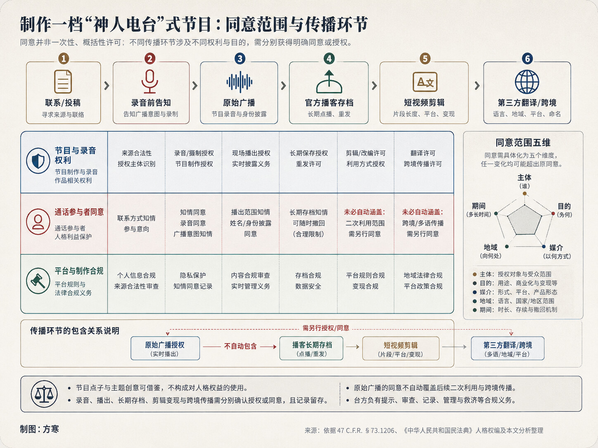

中国人多，神人也确实蛮多。自我开始关注神人电台以来，播放量其实是就视频正相关上升，类似的越来越多博主投身于这条赛道。

一个问题不禁油然生出，中国能不能做一档自己的神人电台呢？

很显然，基于上文的分析，版权反而不是最难解决的部分。“联系约会对象，询问为什么没有第二次约会”是一种节目构思。中国制作方可以自行招募参与者、设计主持方式、录制自己的节目。

**真正需要注意的是人的同意范围，以及对于人的保护。这在两国都是相同的。**

需要提前安排电话号码从哪里取得，参与者何时知道通话会被录制，内容是否会进入播客长期保存，是否会被剪成短视频，以及争议发生后怎样处理。公开制作和传播网络音视频，还会涉及节目制作、平台管理和个人信息等规则。[［17］](https://www.yuli.gov.cn/xjylx/c118409/202312/bf696ef04db646fe9cfcb4377f12dcc3.shtml?utm_source=chatgpt.com)

这大概就是我能基于神人电台思考到的内容。小小的节目居然能有那么多知识点零零散落，未来可以开一个针对公共创作领域的分析系列文章。

写的时候也有点胆战心惊的，不知道会不会对UP主产生影响。如果有影响请火速联系我删除…但目前就我这种体量…应该不会吧？

原节目真的很好笑，2MoreMinutes杰出的翻译、标题和长期整理确实增加了新的观看体验。

只是以后再看到“自制”两个字，我会把它理解成这条中文视频由谁制作，而不会把它当成其中所有素材已经完成授权的证明。

除此之外，我可能还会多想一个很实际的问题。

**这期的Minecraft到底是谁跑的？**

> 除另有说明外，本文文字及作者自制图表采用 CC BY-SA 4.0 国际许可协议发布。

> 转载、改编及商业使用应当适当署名、注明来源和修改情况，改编成果应采用相同或兼容许可。

> 文中第三方图片、商标、引文及另行标注的材料不在本许可范围内。

> 文章使用AI辅助生成图片并进行格式调整，**保证全文内容为我本人方寒真人写作。**

［1］iHeartRadio On-Demand：《Brooke and Jeffrey: Second Date Update》[EB/OL]，Apple Podcasts，[https://podcasts.apple.com/us/podcast/brooke-and-jeffrey-second-date-update/id1252638476](https://podcasts.apple.com/us/podcast/brooke-and-jeffrey-second-date-update/id1252638476)（访问日期：2026年8月16日）。

［2］哔哩哔哩：《“基督山”相关视频检索页》[EB/OL]，[https://search.bilibili.com/all?keyword=基督山%2F](https://search.bilibili.com/all?keyword=基督山%2F)（访问日期：2026年8月16日）。

［3］Dylan Horetski：《Viral ‘Second Date Update’ radio host has one request for TikTok accounts reposting his content》[EB/OL]，Dexerto，2024年11月15日，[https://www.dexerto.com/tiktok/viral-second-date-update-radio-host-has-one-request-for-tiktok-accounts-reposting-his-content-2981209/](https://www.dexerto.com/tiktok/viral-second-date-update-radio-host-has-one-request-for-tiktok-accounts-reposting-his-content-2981209/)（访问日期：2026年8月16日）。

［4］Premiere Networks：《Premiere Networks To Syndicate Hubbard Radio’s Brooke & Jubal》[EB/OL]，2016年3月10日，[https://www.premierenetworks.com/press/premiere-networks-syndicate-hubbard-radios-brooke-jubal](https://www.premierenetworks.com/press/premiere-networks-syndicate-hubbard-radios-brooke-jubal)（访问日期：2026年8月16日）。

［5］Robert Feder：《Over and out: Jubal Fresh vanishes from SHE 100.3 morning show》[EB/OL]，2020年4月10日，[https://robertfeder.dailyherald.com/2020/04/10/jubal-fresh-vanishes-100-3-morning-show/](https://robertfeder.dailyherald.com/2020/04/10/jubal-fresh-vanishes-100-3-morning-show/)（访问日期：2026年8月16日）。

［6］iHeartRadio On-Demand：《Second Date Update PODCAST: Alarm Hand Slap》[EB/OL]，Apple Podcasts，2017年11月15日，[https://podcasts.apple.com/za/podcast/second-date-update-podcast-alarm-hand-slap/id1252638476?i=1000394851961](https://podcasts.apple.com/za/podcast/second-date-update-podcast-alarm-hand-slap/id1252638476?i=1000394851961)（访问日期：2026年8月16日）。

［7］全国人民代表大会常务委员会：《中华人民共和国著作权法》[Z]，2020年11月11日第三次修正，国家版权局，[https://www.ncac.gov.cn/xxfb/flfg/flfg_532/202103/t20210309_50530.html](https://www.ncac.gov.cn/xxfb/flfg/flfg_532/202103/t20210309_50530.html)（访问日期：2026年8月16日）。

［8］Mojang Studios：《Minecraft Usage Guidelines》[EB/OL]，[Minecraft.net](http://Minecraft.net)，[https://www.minecraft.net/en-us/usage-guidelines](https://www.minecraft.net/en-us/usage-guidelines)（访问日期：2026年8月16日）。

［9］哔哩哔哩：《哔哩哔哩弹幕网用户使用协议》[EB/OL]，2018年11月9日更新，[https://www.bilibili.com/blackboard/activity-pygMS1E70.html](https://www.bilibili.com/blackboard/activity-pygMS1E70.html)（访问日期：2026年8月16日）。

［10］DING Ning，YANG Zhimiao，LI Sida，ZHANG Ailing：《Where translation impacts: The non-professional community on Chinese online social media—A descriptive case study on the user-generated translation activity of Bilibili content creators》[J]，Global Media and China，2021，6（2），DOI：10.1177/20594364211000645。

［11］Legal Information Institute：《17 U.S. Code § 101—Definitions》[Z/OL]，Cornell Law School，[https://www.law.cornell.edu/uscode/text/17/101](https://www.law.cornell.edu/uscode/text/17/101)（访问日期：2026年8月16日）。

［12］Nihon Keizai Shimbun, Inc. v. Comline Business Data, Inc., 166 F.3d 65（2d Cir. 1999）[CP/OL]，1999年1月22日，Justia，[https://law.justia.com/cases/federal/appellate-courts/F3/166/65/630224/?utm_source=chatgpt.com](https://law.justia.com/cases/federal/appellate-courts/F3/166/65/630224/?utm_source=chatgpt.com)（访问日期：2026年8月16日）。

［13］国务院：《信息网络传播权保护条例》[Z/OL]，国家版权局，2007年1月9日，[https://www.ncac.gov.cn/xxfb/flfg/flfg_532/200701/t20070109_50525.html](https://www.ncac.gov.cn/xxfb/flfg/flfg_532/200701/t20070109_50525.html)（访问日期：2026年8月16日）。

［14］最高人民法院：《最高人民法院发布电影知识产权保护典型案例》[EB/OL]，2023年11月3日，[https://www.court.gov.cn/zixun/xiangqing/416612.html](https://www.court.gov.cn/zixun/xiangqing/416612.html)（访问日期：2026年8月16日）。

［15］Electronic Code of Federal Regulations：《47 C.F.R. § 73.1206—Broadcast of telephone conversations》[Z/OL]，[https://www.ecfr.gov/current/title-47/chapter-I/subchapter-C/part-73/subpart-H/section-73.1206](https://www.ecfr.gov/current/title-47/chapter-I/subchapter-C/part-73/subpart-H/section-73.1206)（访问日期：2026年8月16日）。

［16］全国人民代表大会：《中华人民共和国民法典》[Z/OL]，国务院新闻办公室专题页，[https://www.scio.gov.cn/gxzt/dtzt/2020/gxw2020nqglhzt/lhyw_21031/202208/t20220802_289481_m_3.html](https://www.scio.gov.cn/gxzt/dtzt/2020/gxw2020nqglhzt/lhyw_21031/202208/t20220802_289481_m_3.html)（访问日期：2026年8月16日）。

［17］国家广播电影电视总局、信息产业部：《互联网视听节目服务管理规定》[Z/OL]，2007年12月20日发布、2015年修订，[https://www.yuli.gov.cn/xjylx/c118409/202312/bf696ef04db646fe9cfcb4377f12dcc3.shtml?utm_source=chatgpt.com](https://www.yuli.gov.cn/xjylx/c118409/202312/bf696ef04db646fe9cfcb4377f12dcc3.shtml?utm_source=chatgpt.com)（访问日期：2026年8月16日）。

---

*来源: https://linux.do/t/topic/2762111.json*

