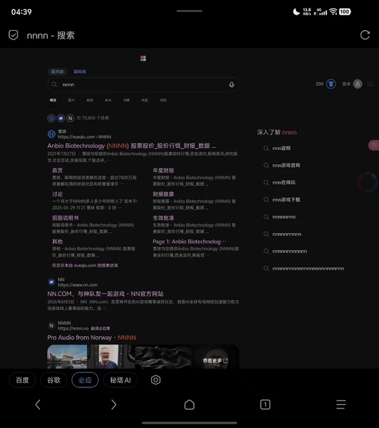

---

id: 2764573

title: "大折叠使用优化指南"

created_at: 2026-08-17T02:19:51.296Z

username: onecreeper

display_username: "onecreeper"

---

# 大折叠使用优化指南

# 背景

## 购机

前段时间购买了vivo X Fold 5，个人非常看重屏幕大小，主力台式机用的也是32寸的屏幕(电视没地方放啦)，于是选择了这台手机。vivo X Fold 5缺点很多，例如屏幕折叠的时候异响，或者是自动方向不如华为优秀(记得mate40可以根据摄像头实现自动方向)，用的上一代的SOC，8g3，相比于其他大叠，在影像水平上也低一些。然而它还有一个巨大的优点，便宜，是最便宜的全新大叠(大折叠)。相比于其他手机9k-10k的价位，这台手机丐版的价位在6k，虽然12G内存的版本屏幕是国产屏。

## 痛点

1. 旋转烦人: 上文提到了，它的自动旋转没有根据摄像头智能判断的能力，对于大折叠，用过的应该也大概知道，展开后横屏可以获得更大的空间。你可以开自动旋转，如果开了自动旋转你躺着玩，特别是侧躺的时候就会乱转，体验极其糟糕。我想起了android似乎原生带有一个机制：旋转屏幕后，出现一个黑色的按键，点击后可以旋转屏幕到当前方向。然而在早些的橘子系统版本，这个功能被砍掉了，近期的版本才加上。

2. 不适人握持: 大屏幕单手拿起来很难的，你可以叠起来但这样就损失了屏幕空间。

3. 屏幕大单手操作难: 虽然单手已经很难拿起来了，但是单手操作更难，我的手就那么大。vivo其实带有单手模式，你把它叠起来就行了然而内屏无法使用只能外屏用

# 解决

## 旋转

MacroDroid + fv悬浮球

- MacroDroid: 图形化的安卓自动工具

- fv悬浮球: 功能强大的悬浮球工具，甚至内置自动化

思路简述: MacroDroid创建一个磁贴，这个磁贴点击后会打开自动旋转，然后2s后关闭自动旋转，其实就是模拟的原生安装自带的那个小按钮。然后设置fv悬浮球手势，双击悬浮球触发这个磁贴。当我们想要横屏的时候双击这个磁贴就行了。如果用不惯悬浮球可以自行探索别的触发方案，例如我记得有些软件可以检测敲击动作等等，自行探索，我习惯悬浮球，也推荐试试悬浮球。

## 握持

这个其实最好解决，就是买支架。

第一种是利用半包手机壳的铰链部分。官方壳可以这么干，我这种塑料壳被我这样搞坏好几个了。

第二种是比较推荐的就是magsafe手机壳+磁吸支架

这样你的大折叠更加便于单手握持。

## 单手操作

这里介绍一个软件，[Quick Cursor](https://github.com/micku7zu/QuickCursor)(假开源，googleplay可下载，有内购)。本来看是付费软件不太想用，用了下发现其实免费版本功能都已经很齐全了。

它可以把屏幕右半边变成触摸板(绝对坐标也许比喻为数位板更加恰当)然后来操作屏幕，从屏幕右边划出来摇杆，然后长按摇杆可以进入自定义的菜单。

---

*来源: https://linux.do/t/topic/2764573.json*

