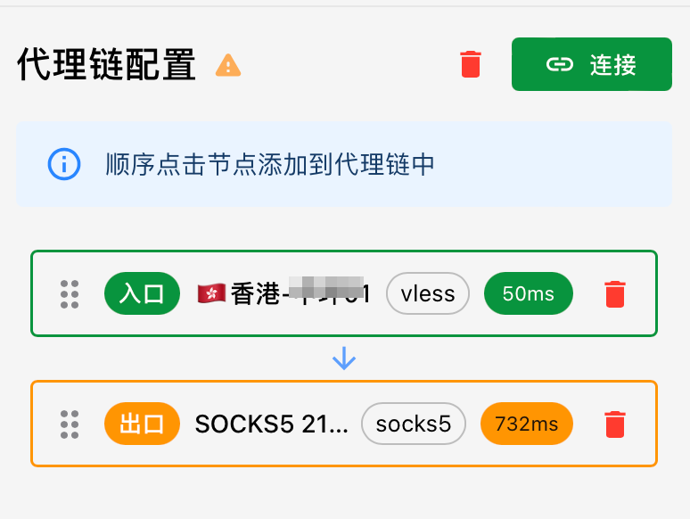
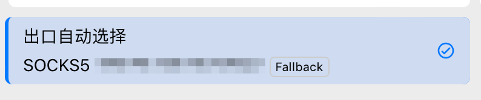

---

id: 2771233

title: "clash verge：复杂链式代理的实现"

created_at: 2026-08-18T07:22:00.942Z

username: wilsons

display_username: "wilsons"

---


# clash verge：复杂链式代理的实现


## 需求

大多数人的链式代理可能是这样的



但这有个缺点，入口和出口任意一个挂了，那么你的整个访问就挂掉了。

我想要的是，入口是一个集合，选择最优的路径，出口也是一个集合，一个故障切换另一个。如下：

```
                  客户端访问
                      │
                      ▼
      ┌────────── 自动选择 ──────────┐
      │                             │
   香港节点                       日本节点 ...
      │                             │
      └──────── 自动择优 ────────────┘
                      ↓
                 【当前最佳入口】
                      ↓
      ┌────────  出口自动选择 ────────┐
      │                             │
  代理ip地址1...                  代理ip地址2...
      │                             │
      └────────── 故障转移 ──────────┘
                      ↓
                  【最终出口】
                      ↓
                    服务器
```

这样的好处时，无论入口和出口都是多节点集合，防止单点故障引起不稳定。这里推荐入口用自动选择，可以优先选择最佳路径，而出口建议用故障转移，这样防止IP频繁变动。

## 原理

怎么实现呢？其实很简单，因为clash verge支持给出口节点指定入口节点，因此，只需要给你的节点设置如下配置即可

```
#proxies:
  - type: socks5
    name: SOCKS5 x.x.x.x:3000
    server: x.x.x.x
    port: 3000
    username: yourname
    password: yourpwd
    dialer-proxy: 自动选择
```

关键就是 “dialer-proxy: 自动选择” 这个，这个自动选择就是你机场的代理分组，自动选择这个一般都有。设置了dialer-proxy后则代表当你访问的出口是SOCKS5 x.x.x.x:3000时，则入口指向自动选择的代理分组。这就解决了入口集合问题。

但，出口集合怎么设置呢？没错就是代理分组。可以新建一个代理分组，节点就是你的出口节点。这样当你在代理中选择了这个分组后，就会根据你设置的要求选择一个节点访问，然后又会触发上一步的dialer-proxy，从而选择最佳入口。这样就完成了从入口到出口的集合化。

出口配置示例如下：

```
proxies:
  - type: socks5
    name: SOCKS5 111.111.111.111:1111
    server: 111.111.111.111
    port: 1111
    username: xxxx
    password: yyyy
    dialer-proxy: 自动选择

  - type: socks5
    name: SOCKS5 222.222.222.222:2222
    server: 222.222.222.222
    port: 2222
    username: xxxx
    password: yyyy
    dialer-proxy: 自动选择

proxy-groups:
  - name: 出口自动选择
    type: fallback
    proxies:
      - SOCKS5 111.111.111.111:1111
      - SOCKS5 222.222.222.222:2222
    url: http://www.gstatic.com/generate_204
    interval: 300
    tolerance: 50
```

## 实现

那么怎么和现有的配置融合呢？1是直接改配置文件，但有个确定刷新可能会重新被覆盖；2是通过扩展覆写配置改，但较为麻烦，你有时可能仅需覆盖某个子项，但必须连根节点一起复制再修改，非常不方便。

如果用扩展脚本呢？可以动态加载，但一个个适配也不方便。

于是让AI写了个智能覆盖与合并通用脚本，原理是，相同的叶子节点覆盖，不同则新增，也可以通过MERGE_MODES设置指定路径强制覆盖（无论是叶子或是非叶子），这样，你只需要把你关心的节点重写就好了。

通用脚本如下（需要自己修改配置）：

```
// ============================================================
// ① 你只需要修改这里：直接填写要合并进去的 YAML
// 可以用@数字表示把当前项显示到第几个位置0代表第一位，1代表第二位，-1代表倒数第2位，默认最后一位；对象数组，可以在对象中用 @:数字 表示该对象的索引位置
// ============================================================
const PATCH_YAML = `
ipv6: false

# 添加你的节点，并通过dialer-proxy指定入口集合
proxies:
  - type: socks5
    name: SOCKS5 111.111.111.111:1111
    server: 111.111.111.111
    port: 1111
    username: xxxx
    password: yyyy
    dialer-proxy: 自动选择

  - type: socks5
    name: SOCKS5 222.222.222.222:2222
    server: 222.222.222.222
    port: 2222
    username: xxxx
    password: yyyy
    dialer-proxy: 自动选择

# 配置代理分组，type:fallback代表故障转移
proxy-groups:
  - name: 出口自动选择
    type: fallback
    proxies:
      - SOCKS5 111.111.111.111:1111
      - SOCKS5 222.222.222.222:2222
    url: http://www.gstatic.com/generate_204
    interval: 300
    tolerance: 50

# 把 出口自动选择 代理组加入到主代理组
  - name: <这里是你主代理组名，通常是订阅节点名>
    proxies:
      - 出口自动选择
`;

// ============================================================
// ② 高级设置
// 一般不需要修改
// ============================================================

// 数组中的对象，用哪些字段判断“这是同一个子节点”。
// Clash/Mihomo 最常用的是 name。
const IDENTITY_KEYS = ["name", "id", "tag"];

// 默认合并行为：
//   普通对象 -> 递归合并
//   对象数组 -> 相同 name/id/tag 合并，不同则追加
//   普通数组 -> 去重后追加
//   叶子值 -> PATCH 覆盖原值
//
// 如果某个路径希望完全替换，可在这里指定 "replace"。
// 路径可以是叶子、对象或数组。
// 数组如果想把新增内容插到原数组前面，可使用 "prepend"。
const MERGE_MODES = {
  "proxy-groups[name=出口自动选择].proxies": "replace"
};

// ============================================================
// ③ 通用深度合并引擎
// 以下通常不需要修改
// ============================================================
let DebugConfig = null;
function debug(label, value) {

    if (!DebugConfig) {
        return;
    }

    if (!DebugConfig._debug) {
        DebugConfig._debug = [];
    }

    if (value === undefined) {

        DebugConfig._debug.push(label);

    } else {

        DebugConfig._debug.push({
            label: label,
            value: value
        });

    }

}
function isObject(value) {
  return value !== null && typeof value === "object" && !Array.isArray(value);
}
function hasOwn(obj, key) {
  return Object.prototype.hasOwnProperty.call(obj, key);
}
function clone(value) {
  if (Array.isArray(value)) return value.map(clone);
  if (isObject(value)) {
    const out = {};
    Object.keys(value).forEach(key => { out[key] = clone(value[key]); });
    return out;
  }
  return value;
}
function deepEqual(a, b) {
  if (a === b) return true;
  if (Array.isArray(a) && Array.isArray(b)) {
    if (a.length !== b.length) return false;
    for (let i = 0; i < a.length; i++) if (!deepEqual(a[i], b[i])) return false;
    return true;
  }
  if (isObject(a) && isObject(b)) {
    const ka = Object.keys(a), kb = Object.keys(b);
    if (ka.length !== kb.length) return false;
    for (let i = 0; i < ka.length; i++) {
      const key = ka[i];
      if (!hasOwn(b, key) || !deepEqual(a[key], b[key])) return false;
    }
    return true;
  }
  return false;
}
function getMergeMode(path) {
  return hasOwn(MERGE_MODES, path) ? MERGE_MODES[path] : "merge";
}
function getIdentity(obj) {
  if (!isObject(obj)) return null;
  for (let i = 0; i < IDENTITY_KEYS.length; i++) {
    const key = IDENTITY_KEYS[i];
    if (hasOwn(obj, key)) return { key: key, value: obj[key] };
  }
  return null;
}
function buildIdentityPath(parentPath, identity) {
  return parentPath + "[" + identity.key + "=" + String(identity.value) + "]";
}
function arrayContains(array, value) {
  for (let i = 0; i < array.length; i++) if (deepEqual(array[i], value)) return true;
  return false;
}
function extractArrayPosition(value) {
  if (typeof value !== "string") {
    return {
      value: value,
      index: null
    };
  }

  const match = value.match(/\s+@(-?\d+)$/);

  if (!match) {
    return {
      value: value,
      index: null
    };
  }

  return {
    value: value.slice(0, match.index).trim(),
    index: Number(match[1])
  };
}

function extractObjectPosition(value) {
  if (!isObject(value) || !hasOwn(value, "@")) {
    return {
      value: value,
      index: null
    };
  }

  const cloned = clone(value);

  const index = Number(cloned["@"]);

  delete cloned["@"];

  return {
    value: cloned,
    index: Number.isFinite(index) ? index : null
  };
}
function mergeArray(baseArray, patchArray, path) {
  const mode = getMergeMode(path);

  if (mode === "replace") {
    return clone(
      patchArray.map(item => {
        if (isObject(item)) {
          return extractObjectPosition(item).value;
        }

        return extractArrayPosition(item).value;
      })
    );
  }

  let result = Array.isArray(baseArray)
    ? clone(baseArray)
    : [];

  for (let p = 0; p < patchArray.length; p++) {

    const rawItem = patchArray[p];

    let positionInfo;

    if (isObject(rawItem)) {
      positionInfo = extractObjectPosition(rawItem);
    } else {
      positionInfo = extractArrayPosition(rawItem);
    }

    const patchItem = positionInfo.value;
    const targetIndex = positionInfo.index;

    /*
     * 对象数组：
     * 保留原来的 name/id/tag 合并逻辑
     */
    if (isObject(patchItem)) {

      const identity = getIdentity(patchItem);

      if (identity !== null) {

        let foundIndex = -1;

        for (let i = 0; i < result.length; i++) {

          const oldItem = result[i];

          if (!isObject(oldItem)) {
            continue;
          }

          if (
            hasOwn(oldItem, identity.key) &&
            oldItem[identity.key] === identity.value
          ) {
            foundIndex = i;
            break;
          }

        }

        const itemPath =
          buildIdentityPath(path, identity);

        let finalItem;

        if (foundIndex >= 0) {

          finalItem =
            deepMerge(
              result[foundIndex],
              patchItem,
              itemPath
            );

          result[foundIndex] = finalItem;

        } else {

          finalItem = clone(patchItem);

          result.push(finalItem);

        }

        /*
         * 对象移动位置
         */
        if (targetIndex !== null) {

          let moveIndex = targetIndex;

          if (moveIndex < 0) {
            moveIndex =
              result.length + moveIndex + 1;
          }

          if (moveIndex < 0) {
            moveIndex = 0;
          }

          if (moveIndex > result.length - 1) {
            moveIndex = result.length - 1;
          }

          const currentIndex =
            result.indexOf(finalItem);

          if (currentIndex >= 0) {

            result.splice(
              currentIndex,
              1
            );

            result.splice(
              moveIndex,
              0,
              finalItem
            );

          }

        }

        continue;

      }

      /*
       * 没有 name/id/tag 的对象
       */
      if (!arrayContains(result, patchItem)) {

        result.push(
          clone(patchItem)
        );

      }

      continue;

    }

    /*
     * 字符串数组
     */

    if (targetIndex !== null) {

      let insertIndex = targetIndex;

      if (insertIndex < 0) {
        insertIndex =
          result.length + insertIndex;
      }

      if (insertIndex < 0) {
        insertIndex = 0;
      }

      if (insertIndex > result.length) {
        insertIndex = result.length;
      }

      const oldIndex =
        result.indexOf(patchItem);

      if (oldIndex >= 0) {

        result.splice(
          oldIndex,
          1
        );

        if (oldIndex < insertIndex) {
          insertIndex--;
        }

      }

      if (result.includes(patchItem)) {
        result.splice(
          result.indexOf(patchItem),
          1
        );
      }

      result.splice(
        insertIndex,
        0,
        clone(patchItem)
      );

    } else {

      if (!arrayContains(result, patchItem)) {

        result.push(
          clone(patchItem)
        );

      }

    }

  }

  return result;
}
function deepMerge(base, patch, path) {
  path = path || "";
  const mode = getMergeMode(path);
  if (mode === "replace") return clone(patch);

  if (Array.isArray(patch)) {
    return mergeArray(Array.isArray(base) ? base : [], patch, path);
  }

  if (isObject(patch)) {
    const result = isObject(base) ? clone(base) : {};
    const keys = Object.keys(patch);
    for (let i = 0; i < keys.length; i++) {
      const key = keys[i];
      const childPath = path ? path + "." + key : key;
      if (hasOwn(result, key)) result[key] = deepMerge(result[key], patch[key], childPath);
      else result[key] = clone(patch[key]);
    }
    return result;
  }

  return clone(patch);
}

function stripComment(line) {
  let quote = null;
  for (let i = 0; i < line.length; i++) {
    const c = line[i];
    if (quote === '"') {
      if (c === "\\") { i++; continue; }
      if (c === '"') quote = null;
      continue;
    }
    if (quote === "'") {
      if (c === "'" && line[i + 1] === "'") { i++; continue; }
      if (c === "'") quote = null;
      continue;
    }
    if (c === '"' || c === "'") { quote = c; continue; }
    if (c === "#" && (i === 0 || /\s/.test(line[i - 1]))) return line.slice(0, i);
  }
  return line;
}
function splitKeyValue(text, lineNo) {
  let quote = null, depth = 0;
  for (let i = 0; i < text.length; i++) {
    const c = text[i];
    if (quote === '"') {
      if (c === "\\") { i++; continue; }
      if (c === '"') quote = null;
      continue;
    }
    if (quote === "'") {
      if (c === "'" && text[i + 1] === "'") { i++; continue; }
      if (c === "'") quote = null;
      continue;
    }
    if (c === '"' || c === "'") { quote = c; continue; }
    if (c === "[" || c === "{") depth++;
    else if (c === "]" || c === "}") depth--;
    else if (c === ":" && depth === 0) return [text.slice(0, i).trim(), text.slice(i + 1).trim()];
  }
  throw new Error("YAML line " + lineNo + ": expected key: value -> " + text);
}
function hasBlockMappingPair(text) {
  let quote = null, depth = 0;
  for (let i = 0; i < text.length; i++) {
    const c = text[i];
    if (quote === '"') {
      if (c === "\\") { i++; continue; }
      if (c === '"') quote = null;
      continue;
    }
    if (quote === "'") {
      if (c === "'" && text[i + 1] === "'") { i++; continue; }
      if (c === "'") quote = null;
      continue;
    }
    if (c === '"' || c === "'") { quote = c; continue; }
    if (c === "[" || c === "{") depth++;
    else if (c === "]" || c === "}") depth--;
    else if (c === ":" && depth === 0 && (i + 1 === text.length || /\s/.test(text[i + 1]))) return true;
  }
  return false;
}
function splitInline(text) {
  const out = [];
  let start = 0, quote = null, depth = 0;
  for (let i = 0; i < text.length; i++) {
    const c = text[i];
    if (quote === '"') {
      if (c === "\\") { i++; continue; }
      if (c === '"') quote = null;
      continue;
    }
    if (quote === "'") {
      if (c === "'" && text[i + 1] === "'") { i++; continue; }
      if (c === "'") quote = null;
      continue;
    }
    if (c === '"' || c === "'") { quote = c; continue; }
    if (c === "[" || c === "{") depth++;
    else if (c === "]" || c === "}") depth--;
    else if (c === "," && depth === 0) {
      out.push(text.slice(start, i).trim());
      start = i + 1;
    }
  }
  out.push(text.slice(start).trim());
  return out;
}
function parseScalar(text) {
  const s = text.trim();
  if (s === "") return null;
  if (s === "null" || s === "Null" || s === "NULL" || s === "~") return null;
  if (/^(true|True|TRUE)$/.test(s)) return true;
  if (/^(false|False|FALSE)$/.test(s)) return false;
  if (/^[-+]?\d+(\.\d+)?([eE][-+]?\d+)?$/.test(s)) return Number(s);
  if (s[0] === '"' && s[s.length - 1] === '"') {
    try { return JSON.parse(s); } catch (_) { return s.slice(1, -1); }
  }
  if (s[0] === "'" && s[s.length - 1] === "'") return s.slice(1, -1).replace(/''/g, "'");
  if (s[0] === "[" && s[s.length - 1] === "]") {
    const inner = s.slice(1, -1).trim();
    return inner ? splitInline(inner).map(parseScalar) : [];
  }
  if (s[0] === "{" && s[s.length - 1] === "}") {
    const inner = s.slice(1, -1).trim();
    const obj = {};
    if (!inner) return obj;
    const parts = splitInline(inner);
    for (let i = 0; i < parts.length; i++) {
      const kv = splitKeyValue(parts[i], "inline");
      obj[parseKey(kv[0])] = parseScalar(kv[1]);
    }
    return obj;
  }
  return s;
}
function parseKey(s) {
  s = s.trim();
  if ((s[0] === '"' && s[s.length - 1] === '"') || (s[0] === "'" && s[s.length - 1] === "'")) {
    return String(parseScalar(s));
  }
  return s;
}
function parseYamlSubset(yamlText) {
  const raw = yamlText.replace(/\r\n?/g, "\n").split("\n");
  const lines = [];
  for (let i = 0; i < raw.length; i++) {
    let line = raw[i];
    if (/\t/.test(line.match(/^\s*/)[0])) throw new Error("YAML line " + (i + 1) + ": tabs are not supported");
    line = stripComment(line).replace(/\s+$/, "");
    if (!line.trim() || line.trim() === "---" || line.trim() === "...") continue;
    const indent = line.match(/^ */)[0].length;
    lines.push({ indent: indent, text: line.slice(indent), lineNo: i + 1 });
  }
  if (!lines.length) return {};

  function parseBlock(index, indent) {
    if (lines[index].indent !== indent) throw new Error("YAML line " + lines[index].lineNo + ": unexpected indentation");
    return /^-($|\s)/.test(lines[index].text) ? parseSeq(index, indent) : parseMap(index, indent);
  }

  function parseMap(index, indent) {
    const obj = {};
    while (index < lines.length && lines[index].indent === indent && !/^-($|\s)/.test(lines[index].text)) {
      const line = lines[index];
      const kv = splitKeyValue(line.text, line.lineNo);
      const key = parseKey(kv[0]);
      const valText = kv[1];
      index++;
      if (valText !== "") {
        obj[key] = parseScalar(valText);
      } else if (index < lines.length && lines[index].indent > indent) {
        const child = parseBlock(index, lines[index].indent);
        obj[key] = child[0];
        index = child[1];
      } else {
        obj[key] = {};
      }
    }
    return [obj, index];
  }

  function parseSeq(index, indent) {
    const arr = [];
    while (index < lines.length && lines[index].indent === indent && /^-($|\s)/.test(lines[index].text)) {
      const line = lines[index];
      const content = line.text.replace(/^-\s?/, "");
      index++;

      if (content === "") {
        if (index < lines.length && lines[index].indent > indent) {
          const child = parseBlock(index, lines[index].indent);
          arr.push(child[0]);
          index = child[1];
        } else {
          arr.push(null);
        }
        continue;
      }

      // "- key: value" 形式的对象数组成员
      let mappingPair = null;
      if (hasBlockMappingPair(content)) {
        mappingPair = splitKeyValue(content, line.lineNo);
      }

      if (mappingPair !== null) {
        const obj = {};
        const key = parseKey(mappingPair[0]);
        const valText = mappingPair[1];

        if (valText !== "") {
          obj[key] = parseScalar(valText);
        } else if (index < lines.length && lines[index].indent > indent) {
          const child = parseBlock(index, lines[index].indent);
          obj[key] = child[0];
          index = child[1];
        } else {
          obj[key] = {};
        }

        // 同一个 sequence item 后续的映射字段
        if (index < lines.length && lines[index].indent > indent) {
          const continuationIndent = lines[index].indent;
          if (!/^-($|\s)/.test(lines[index].text)) {
            const tail = parseMap(index, continuationIndent);
            const tailObj = tail[0];
            Object.keys(tailObj).forEach(k => { obj[k] = tailObj[k]; });
            index = tail[1];
          }
        }

        arr.push(obj);
      } else {
        arr.push(parseScalar(content));
      }
    }
    return [arr, index];
  }

  const parsed = parseBlock(0, lines[0].indent);
  if (parsed[1] !== lines.length) {
    throw new Error("YAML line " + lines[parsed[1]].lineNo + ": could not parse remaining content");
  }
  return parsed[0];
}

function main(config, profileName) {
  DebugConfig = config;
  DebugConfig._debug = [];
  const patch = parseYamlSubset(PATCH_YAML);
  return deepMerge(config, patch, "");
}
```

把你待修改的配置放到PATCH_YAML变量中即可。

## 使用

然后在订阅的代理列表中选中“出口自动选择”即可。完美！




---


*来源: https://linux.do/t/topic/2771233.json*

