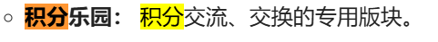

---

id: 2779149

title: "【教程】如何给佬友发红包"

created_at: 2026-08-19T13:59:30.730Z

username: starryskymeow

display_username: "空喵"

---

# 【教程】如何给佬友发红包

通过LDC站的**发红包**功能，或者基于**商户分发的第三方红包**，可以用于给佬友发放福利，也可以用于朋友间的私人积分赠与。本教程主要介绍如何发放与收取红包。对于没有注册LDC站的佬友，恰当提供教程指北。

---

### 目前官方红包限时开放。

欢迎给佬友发红包！

虽然官方红包对于积分流转的友好度远高于第三方红包，但官方红包限时开放，因此这里以雪佬的LDC红包站 `hb.unsnow.org` 为例，同时进行一个第三方红包站的配置教程。

---

# 收发红包的前置

**已经注册Linux DO Credit的佬友可以跳过**。

使用**邀请链接青春版**注册的佬友无法注册 Linux DO Credit，也因此**无法发放和领取红包**。可以用 Github 五年号注来注册进而获得Linux DO Credit的权限。

> **但是！** 一定要看但是：所有非[自助邀请系统](https://invite.linuxdo.org)生成的邀请链接，我们将其称之为 `邀请链接Lite版` 或 `邀请链接青春版`。

>

> **使用其注册的账号将没有 oauth 登录权限，也就是无法登录公益站等系统，这是唯一的不同点！** 已注册用户误点邀请链接，不会被额外限制，这一点已经做了防护，可以理解为与已注册用户无关。

### 如何注册 Linux DO Credit

### [LINUX DO Credit](https://credit.linux.do)

Linux Do 社区积分服务平台

没有注册的佬友直接授权注册即可，注册后才可以获取 LDC。

### LDC 的用途

可以参考下面佬等这篇帖子。简而言之，LDC 可以兑换佬友的各种服务。

[【新人入站从0级到三级经验总结】：升级？赚LDC？LDC有什么用？如何兑换Ai的API Tokens？如何提升社区分数？常用的站内频道？避免被封号注意点？等等，新人可参考，少走弯路！](https://linux.do/t/topic/2235030) [

文档共建](/c/wiki/42)

> 【先导篇】：

> 佬友们入站的原因，很多都是因为被站内的教程、干货、资源和Ai前沿信息所吸引，技术大咖喜欢这里的氛围，喜欢来这里发帖，而这良好的社区氛围背后是始皇站长对网站的费心维护、和对规则的不断优化，同时也少不了站内众多大佬的不断的高质量内容输出。

> 所以想融入社区，也为了社区长久发展，都遵守规则很重要。

> 有的新人会说，好像不注册L站，不升级也是能看帖子的，那为什么一定要注册L站？一定要升级呢？ …

# LDC官方红包

是LDC平台的官方活动，会在**部分节日期间限时开放**，如七夕等。官方LDC站的红包不消耗每日额度，赠与立刻到账，是节日发放红包的最佳选择。

### 创建红包

在成功注册 Linux DO Credit 后，进入主页，点左部菜单栏**活动**。

### 红包的金额配置

红包分为普通红包（金额相等）和拼手气红包（金额随机）两种方式，LDC红包总额下限为1LDC，总额上限为520LDC，领取人数上限为10000。目前的红包手续费费率为 5%，请注意手续费费率随时可能调整。

### 红包的封面与祝福语

可以自定义祝福语和自定义封面。祝福语上限为100字符，但实测较长的字符会引发截断，因此请使用较短的祝福语。

点击设置页面右上角的**自定义封面**即可设置封面。封面分为两种，一种是**背景封面**，默认为红色；另一种是**装饰图片**（背景图），默认为白色，会被红包覆盖。

### 如何发放红包

确认好红包各种参数后会进入输入 LDC 平台密码环节，然后你会得到一个链接，分享此链接即可。链接格式为`https://credit.linux.do/redenvelope/{id}`，id应该是一个17位的以9开头的数字串。

# 第三方红包平台（以雪佬的平台为例）

等待更新。

# 其他注意事项

### 如何领取红包

找到一个未领取的红包即可领取。如果需要找未领取的红包，可以去 [积分乐园](/c/credit/106) 搜索佬友发放的红包。

部分佬友可能会为了避免脚本抢红包而加入一些干扰字符导致无法直接领取，或者会出一些解谜题，此时在网址栏去掉干扰字符即可。

### 红包帖子规则

请注意**积分红包属于积分流转的一种，因此积分红包应该放在 积分乐园 板块中。** 目前很多佬友可能会发到其他的错误板块，如 [搞七捻三](/c/gossip/11) 和 [福利羊毛](/c/welfare/36) 等板块不适合发放积分红包。

- 官方发放红包**不计入今日消耗额度**，但请注意 LDC 平台随时可能会更改规则。

- 请注意**积分红包本质是赠与行为，红包和商户分发都不属于积分交易**，无法增加 LDC 平台积分，也无法享受积分交易的正常权益（发起争议等）。积分交易等行为应该走积分流转（如CDK站，士多等）的流程，而非使用积分红包功能。

### 红包帖子示例

官方红包帖的示例。

[【一万个红包】人人都有红包领 - 积分乐园 - LINUX DO](https://linux.do/t/topic/2777750)

雪佬平台红包帖可以搜索`继续给大家发红包`来查看。

这里也给一个示例。

[继续给大家发红包5 - 积分乐园 - LINUX DO](https://linux.do/t/topic/2810361)

---

*来源: https://linux.do/t/topic/2779149.json*

