---

id: 2795354

title: "Qwen3.8 27B 单16G显存显卡本地测试与部署教程（128K上下文+视觉保留）"

created_at: 2026-08-23T02:55:20.934Z

username: Ruby_axx

display_username: "Ruby"

---


# Qwen3.8 27B 单16G显存显卡本地测试与部署教程（128K上下文+视觉保留）


# 1. 基础知识

## 1.1 什么是本地部署

本地部署就是通过个人或者企业通过消费级设备或工作站设备，将云端开源大语言模型部署到本地私有化设备上的过程

## 1.2 本地部署所需的环境

**硬件层面**：一般而言需要一张消费级显卡，消费级显卡上满足显存≥16GB 的显卡都可以适用本教程。具体见下表

| 显卡厂商 | 起步型号 | 注解 |

| --- | --- | --- |

| Nvidia | 4060 Ti 16G / 5060 Ti 16G | 起步型号容易出现带宽瓶颈 |

| AMD | 7800 XT | 需要使用 ROCm，入手难度较大 |

| Intel | A770 16G | 需要使用 Vulkan，入手难度较大 |

**软件层面**：常用的推理后端包括 vllm，sglang，llama.cpp 等。最适合本地消费级显卡部署的后端是 llama.cpp。

> 关于 llama.cpp, 市面上的两款比较火的 chat desktop 软件 **ollama/lm studio** 都是基于 llama.cpp 后端。这俩软件的好处是支持一键下载部署，缺点是对于一些特性支持不到位，且没有针对具体的显卡进行优化。**所以本教程采用 llama.cpp 自部署与自编译**

## 1.3 Qwen3.8-27B

一款具备 27B（270e）参数的稠密模型，每次推理都需要所有参数进行一次完整计算，对显卡的核心算力与带宽都有很大的要求。


该模型基座基于 qwen3.5，包含 16 组 3 层线性注意力 + 1 层全局注意力。


该模型参数量上 FFN 层占据大头，约为 70% 的参数量，所以**对这些 FFN 层进行量化压缩才能在本地消费级显卡上部署**。

## 1.4 量化

量化就是对模型的参数存放在计算机中需要占据一定的 bit 位。参数多通过 float point number（浮点数简称 float/float point）的形式进行存储。


以 fp32 为例，一个 fp32 数需要占据 32bit 位，fp16 则是 16bit fp8 需要 8bit fp4 需要 4bit，int8 int4 同理看数字即可。


llm 的量化多以 Qx 来平衡，Q4 就是 4bit 左右的量化，有些量化带后缀，如 Q4_km，Q4 就是 4bit 量化，k 则是采用聚类的组量化，m 则是量化组的体量（s，m，x 分别表示小，中，大）。


**衡量一个模型的量化程度我们通常采用 bpw（bit per weight）来衡量，也就是每个参数大概是多少 bit。**

## 1.5 KvCache

类似 cpu 的 cache，采用局部性原理，在 llm 里先前被计算过的 kv，可能在后续被继续使用，采用 kvcache 可以加速 llm 的计算。 kvcache 也需要进行计算机存储，常用的量化有 fp16 q8 q4 等，本教程涉及到一个新的量化方案 ——**Turboquant**。

什么是 turboquant？

> Turboquant 是谷歌 26 年初提出的一种 kvcache 量化策略，不直接对数值进行 bit 位量化，而是采用一种更加先进的量化策略，简而言之 tb4 的量化精度可以解决 q8 左右的量化精度。其中的 tb4 即采用 4bit 存储的意思

一般地，k 和 v 会分别进行量化，常见的组合包括 q8+q8/q8+q4/q4+q4，turboquant 则可以采用 tb4+tb4/tb4+tb3/tb3+tb3。通常认为 k 会比 v 更加重要，**所以 tb4+tb3 是常用的量化方案**。

# 2. 三款量化版本点评

我测试三款不同量化策略的模型。下面是它们的点评与下载链接（包含抱脸与模搭）

## 2.1 Ridge 3.7bpw

等效量化 3.7bpw，量化策略非常激进的一版模型。这版量化主要针对 FFN 层进行量化，它的首尾部的 FFN 层采用 IQ3_S, 中间层 FFN 采用 IQ2_M 量化。这种激进的量化策略下带来了一定的能力退化，尤其是在指令遵循上有一定的问题，而且在我本地实测上容易出现死循环问题。评价为一般，网上对该网红量化模型的测评视频很多，我就不过多测试了。

[huggingface](https://huggingface.co/empero-ai/Qwen3.8-27B-Ridge-GGUF)

[modelscope](https://www.modelscope.cn/models/empero-ai/Qwen3.8-27B-Ridge-GGUF))

## 2.2 Unsloth UD-Q3_K_XL

约等效量化 3.8bpw，每一层都采用不同的量化策略，算是最均衡的一档模型，也是我测试最多的一款模型。Unsloth 的这版非常吃 KV Cache 的精度，具体见第三章的测评案例。

[huggingface](https://huggingface.co/unsloth/Qwen3.8-27B-GGUF)

[modelscope](https://www.modelscope.cn/models/unsloth/Qwen3.8-27B-GGUF)

## 2.3 Apex I-mini

等效 4.0bpw，质量上乘的一款量化，作者对每一层的量化敏感度进行测试，该量化版本可以配合 tb3+tb3 开启约 110k 的上下文。具体测评案例见第三章。

[huggingface](https://huggingface.co/mudler/Qwen3.8-27B-APEX-GGUF)

[modelscope](https://www.modelscope.cn/models/mudler/Qwen3.8-27B-APEX-GGUF))

# 3. 测试案例

我对 unsloth 的量化版本与 apex i-mini 的量化版本分别进行了一定的案例测试（主要是 unsloth 的版本）。


测试用例来自：[https://linux.do/t/topic/286836](https://linux.do/t/topic/286836)

## 3.1 鹈鹕骑自行车

> 创建一个 HTML， 内容是 SVG 绘制一个鹈鹕骑自行车的 2D 动画

**unsloth（tb3+tb3）：**


image2549×1235 265 KB

缺少腿部 IK，但动画逻辑完整。

**unsloth(tb4+tb3)：**


image2549×1219 222 KB

具备完整的腿部 IK，但少了一部分踏板。

**apex(q4+q4):**


image1920×916 178 KB

应该是质量上较好的一版但是腿部有点没对齐。

## 3.2 黑洞

> 使用 web 技术制作一个图形化预览黑洞效果的网页，要求外观和样式要类似于电影《星际穿越》里面的黑洞卡冈图雅。黑洞背景要有其他星星，黑洞要有跟电影里类似的吸积盘效果和引力透镜效应。用户可以用鼠标旋转观察，并且在侧边栏可以调整相关参数体现不同参数黑洞的不同效果。你可以使用你认为必要的技术来实现这个网页，既要保证性能也要完成必要的效果。可以引入你觉得必要的第三方图形库比如 three.js 等等之类。

**unsloth(tb3+tb3):**

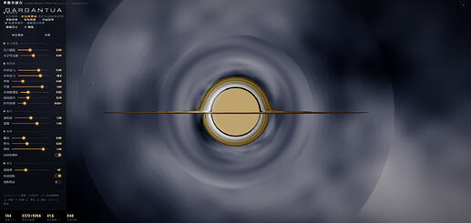

image1920×911 137 KB

第一轮是遇到了一些 bug（），单独提示有 bug 后自行修复。


下面是第一版的时候 gpt 的诊断报告：

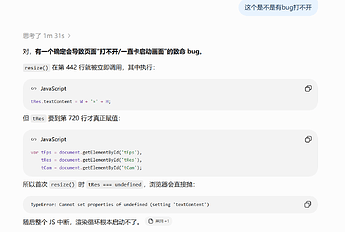

image1235×831 45.6 KB

这是它自己第二轮分析到的 bug

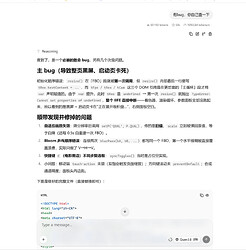

image1166×1184 152 KB

**unsloth(tb4+tb3):**


一轮直出

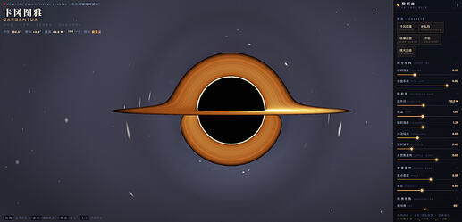

image1920×928 151 KB

## 3.3 天气卡片

> 你是 Apple Inc 的 UI 设计师，以 iOS 18 的设计风格做一个带有动画效果的天气卡片，要求是使用 HTML、CSS 和基础 JavaScript，使用横板天气页面（拥有 4 个天气卡片 (晴天，大风，暴雨，暴雪))。应足够美观，实现一定的交互效果。

**unsloth(tb3+tb3):**

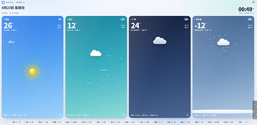

image1920×942 148 KB

## 3.4 上下文召回（90k 上下文）：

具体见本章开头该佬友收录题库的幻觉第一个 needle 用例。


最终 unsloth (tb3+tb3) 版本 90k 上下文上做到了 100% 召回。

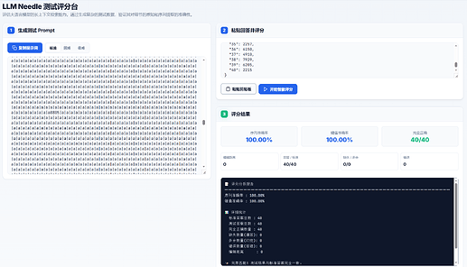

81fa022d9235fdf877bc2fc02923e0441986×1139 214 KB

## 3.5 逻辑题

### 糖果问题：

> 在一个黑色的袋子里放有三种口味的糖果，每种糖果有两种不同的形状（圆形和五角星形，不同的形状靠手感可以分辨）。数量如下：苹果味圆形 7、桃子味圆形 9、西瓜味圆形 8；苹果味五角星 7、桃子味五角星 6、西瓜味五角星 4。参赛者需在活动前决定摸出的糖果数目。问：最少取出多少个糖果，才能保证手中同时拥有不同形状的苹果味和桃子味的糖？

**unsloth(tb3+tb3):**

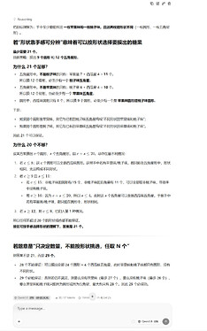

image725×1160 144 KB

同时考虑到了 21/29 两种情况

### 父女遗传问题

> 有一天，一个女孩参加数学考试只得了 38 分。她心里对父亲的惩罚充满恐惧，于是偷偷把分数改成了 88 分。她的父亲看到试卷后，怒发冲冠，狠狠地给了她巴掌，怒吼道：" 你这 8 怎么一半是绿的一半是红的，你以为我是

>

> 傻子吗？" 女孩被打后，委屈地哭了起来，什么也没说。

>

> 过了一会儿，父亲突然崩溃了。

>

> 请问：这位父亲为什么过一会儿崩溃了？他意识到了什么？

**unsloth(tb3+tb3):**

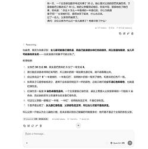

image1113×1115 157 KB

一次答对

### 洗车问题

> 我想洗车，离洗车店只有 50 米，你建议我开车去还是走去

**unsloth(tb3+tb3):**

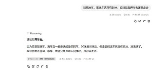

image1129×490 48 KB

也没有什么问题。

# 4. 部署

推荐在 wsl 环境下部署，以 50 系 N 卡为例。


**step.1 安装 wsl2**(powershell)

```
wsl --install -d Ubuntu-24.04
```

**step.2** 安装 cuda12.8

```
sudo apt update
sudo apt install -y cuda-toolkit-12-8
```

**step.3** 安装编译所需的依赖

```
sudo apt update
sudo apt install -y git cmake ninja-build build-essential
```

**step.4** 拉取 turboquant+mtp 特性的 llama.cpp 分支

```
cd ~
git clone https://github.com/TheTom/llama-cpp-turboquant.git
cd llama-cpp-turboquant

git checkout feature/turboquant-kv-cache
git pull
```

amd 版本可以采用以下链接版本：

[GitHub - Pascal-SAPUI5/llama.cpp-turboquant: TurboQuant KV-cache quantization for AMD ROCm — 3-4 bit KV cache with <10% overhead (Zandieh et al., ICLR 2026) · GitHub](https://github.com/Pascal-SAPUI5/llama.cpp-turboquant?utm_source=chatgpt.com)

**step.5** 编译 llama.cpp

```
rm -rf build

cmake -S . -B build -G Ninja \
  -DCMAKE_BUILD_TYPE=Release \
  -DGGML_CUDA=ON \
  -DCMAKE_CUDA_ARCHITECTURES=120

cmake --build build \
  --target llama-server llama-cli llama-bench \
  -j $(nproc)
```

nproc 可以替换具体的数字。

**step.6** 检查是否编译完成

```
./build/bin/llama-server --version
./build/bin/llama-cli --list-devices
```

# 5.llama.cpp 的 server-cli 启动参数解读

以一下一套启动 cli 为例：

```
./build/bin/llama-server \
  -m "~/models/ruby/Qwen3.8-27B-UD-Q3_K_XL/Qwen3.8-27B-UD-Q3_K_XL.gguf" \ #模型路径
  #--mmproj “路径” \  可选加载视觉编码器
  -c 131072 \ #上下文长度
  -ngl 99 \ # n-gpu-layer gpu负责多少层，直接拉满即可
  -ctk turbo3 \ #k量化方案 建议tb4，tb3测下来也还可以
  -ctv turbo3 \ #v量化方案，建议tb3
  -fa on \ #开启快速注意力，可以加速模型推理速度
  --no-mmap \ # 不启用mmap内存映射，模型直接在显存里不需要内存映射
  --no-host \ # 不把模型放入内存，不需要存入内存
  --cache-ram 0 \ # 这个也是不让模型放入内存
  -np 1 \ # 一次最多多大并发，若np=2 则单个会话最大上下文=c/np，即会变成2个64K
  -b 1024 \ #编码时每次的批处理大小，越大越吃显存但会加快编码速度（非推理速度）
  -ub 512 \ #每次送入gpu计算图大小，一般设为 b的1/2 或1/4
  # --spec-type draft-mtp \ 可开启mtp投机解码
  # --spec-draft-n-max 2 \ 必须先开启mtp才能使用，每次预测多少个token
  --jinja \ #在Chat模式下启用Jinja模板引擎，约束模型（可通过修改模板减少长思考问题，具体见github）
  --host 0.0.0.0 \ #地址
  --port 18080 #端口
```

> **2026.8.24 二编**: 经过实测实际上是 llama.cpp 支持将视觉编码器存放到 cpu 侧，由 cpu 完成解码，这一过程不占用显存，多花时间保留推理速度的同时完整保留视觉能力。

>

> 只需加如下两行指令即可

```
 # 将视觉编码器留存在内存中
 --no-mmproj-offload
 # 限制图像token最大为4096，4096本身已经很大了，其实也可以限制到2048，这大约有1080p左右的可视程度，若虚视觉position，那就保留4096为好。
 --image-max-tokens 4096
```

# 6. 作为本地 llm 的 api

llama.cpp 支持将 llm 转换成本地 api。


具体而言只需要按照第五章的指令进行启动，当后端出现下图的提示时就可以通过该 url 进行连接了。默认的 llama.cpp 后端不需要密钥，也可以自行设定（就不细致展开了）


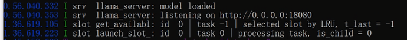

# 7. 结语

随着 llm 的发展，本地模型也会越来越强，tb3+tb3 的 unsloth q3 版本体感有 sonnet4.6 的水平。16g 显存的显卡可能上下文 128K 还不够用，但是智力和指令遵循层面已经完全合格。若想体验量化精度更佳的本地模型，可以使用显存更高的显卡。


btw: 有挑战才有乐趣

最后附上我本机的实测显存占用截图（tb3+tb3 131072 上下文）：

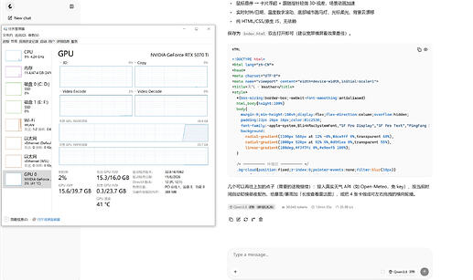

image1920×1142 263 KB

| 类型 | 区间 | 速度 |

| --- | --- | --- |

| prefill | 全长度 | 1400t/s |

| decode | 0-32K | 45->40t/s |

| decode | 32K-64K | 40->38t/s |

| decode | 64K-128K | 38->26t/s |


---


*来源: https://linux.do/t/topic/2795354.json*

