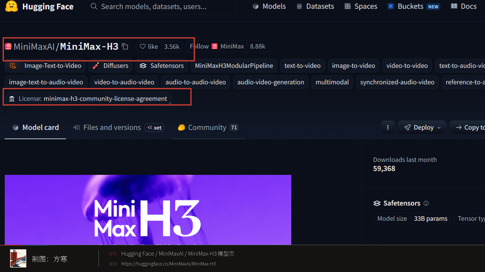
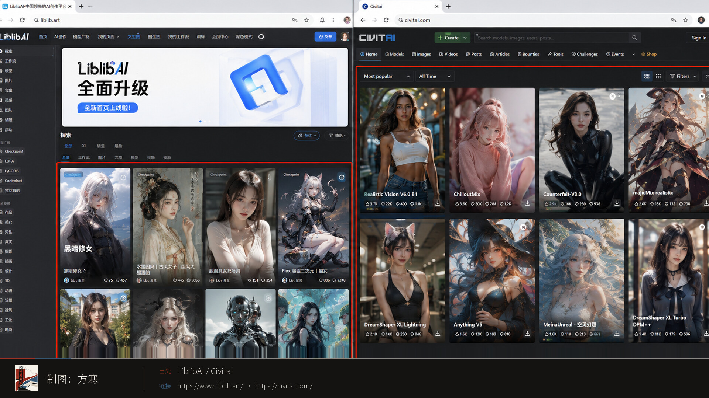
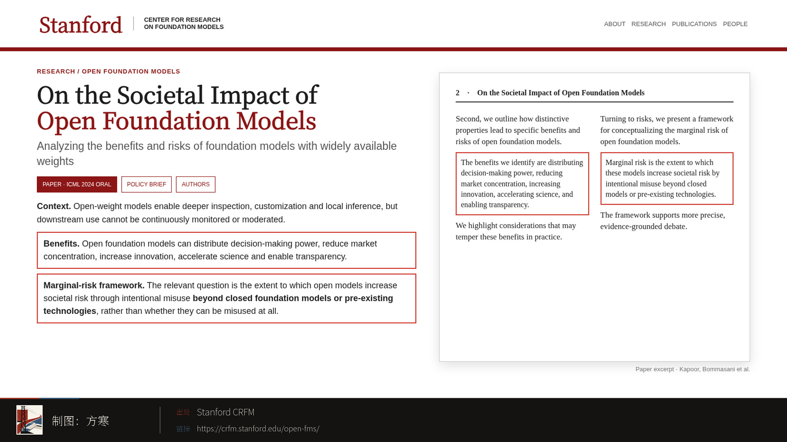

---

id: 2808060

title: "一张显卡、一间小屋和一部羞羞短剧：H3给监管出的新题"

created_at: 2026-08-25T07:19:30.075Z

username: ZRainbow

display_username: "ZRainbow"

---

# 一张显卡、一间小屋和一部羞羞短剧：H3给监管出的新题

最近事情好多，好累，陷入了一阵低迷情绪。最近走了出来，还是得要坚持，坚持才能有成果。

好讨厌租房

好想自由自在地做自己想做的事情啊

H3开源那几天，AI视频圈确实很高兴。

8月3日，MiniMax把H3的模型权重放了出来。三天后，它冲上Hugging Face热度榜首。华为昇腾、摩尔线程、沐曦、海光、AMD、Intel忙着做芯片适配，魔搭、ComfyUI、vLLM、SGLang等平台和推理框架也在首日跟进，前后有一百多家软硬件企业加入。连Stable Diffusion创始人Emad Mostaque也出来向MiniMax致意。一个视频模型发布，难得让产业链和开源社区一起显得喜气洋洋。[［1］](https://www.ncsti.gov.cn/kjdt/kjrd/202608/t20260810_252674.html)

大家高兴的原因不难理解。过去一年，视频模型进步得很快，真正能理解文字、图片、音频和视频，又能把声音、镜头和画面包装一起做掉的头部产品，大多还是网页里的一项付费服务。

H3支持最长15秒、最高2K、原生立体声音频，能力并非它独有，关键在于MiniMax愿意把其中最核心的生成权重交出来。开发者终于不必只围着一个付费按钮打转，可以下载、部署、量化、改造，再往自己的工作流里塞。[［2］](https://finance.sina.com.cn/stock/t/2026-08-03/doc-inikzqsf4632170.shtml)

这种外溢速度很惊人。模型刚发布，社区里已经有人拿它做电影片头、游戏菜单、动态海报、时尚广告和视频包装。把时间拉长一点看，围绕ComfyUI和各类开放模型形成的创作市场，早已远远超出“文生视频”演示。

国内创作者做同人二创、动态漫、角色一致性实验和AI短剧，国外团队把同类工作流塞进电影预演、视效、动画、品牌项目、游戏和现场视觉。ComfyUI自己形容得很准确，**它已经从一个实验性游乐场，长成了产业级创作引擎。**[［3］](https://blog.comfy.org/p/made-with-comfyui-2025-from-open)

正好，我采访了一名做AI短剧的朋友。

谈起H3，他也很兴奋。对于实际干活的人来说，榜单第一当然值得看，不过真正让人兴奋的还是**真正前沿的能力可以任由自己使用**。以后怎么压缩、怎么微调、怎么搭配其他模型，至少不用全听平台安排。

可话题转到短剧生意，这里就是另一幅图景了。

作品越来越多，成本并没有一路往下走，平台分账也开始收紧，流量、人员、场地等固定开支越来越大。大多数团队费劲做完一部剧，往往连被人看见的机会都没有，甚至会立刻被市场淘汰。

在这个背景下，H3的意义是重大的，有效地减少了工具成本，但随之带来的就是从业人员进一步增多，以及市场需求的进一步收缩。

整体而言，是不太好过的。也自然有了“AI短剧行业寒冬”的说法，戏称“监管还没入场，行业就快死了”。

由于朋友还和我算熟络，关于搞钱的路子，我们聊着聊着，便聊到了一个叫x果短剧的网站。

---

# 何为“x果”

x果与红果相对。看到这里，一定有绅士开始想到那方面的事情。

但出乎我意料的，x果剧场不是一个随手扔几段视频的网盘资源集合网站。

朋友*强迫*着我看了两眼。它有短片，有连载，有角色页，有图集，还有创作者入口。平台公开标明自己是成人向AI生成短剧网站，限定十八岁以上用户访问。

这个网站的结构和我之前被*强迫*看的某某传媒不一样（均为央视网等权威媒体报道过），**AI技术驱动导致剧中角色可以同时出现在多部作品中，人物又可以被训练成LoRA，由不同创作者反复调用。**

平台首页写着“一个角色，无数剧情”，还鼓励用户上传作品、创建角色，让更多人接着往下写。［4］

过去，类似的网站主要分发成片。x果同时在分发“演员”。一份角色LoRA进入十台电脑，十台电脑都可以重新开机，再给它换剧情、换衣服、换场景。

我顺手点开了其中一个叫“林巧芸”的角色。

这个页面看上去已经不太像视频网站里的演员词条，更像一份可以继续投入生产的数字资产档案。角色由“黄小树”在2026年5月创建，下面挂着6部作品、两个LoRA版本、站内播放和收藏数据。再往下翻，Z-Image和Wan 2.2两个模型版本已经分别给出触发词和下载入口。创作者把模型下载到本地，只要在工作流中调用对应的触发词，这张脸就能继续进入新的图片和视频。

更有意思的是，关联作品并不全部来自同一个账号。“黄小树”负责了角色设定和主要短片，另一名创作者“墨白”又用同一个人物制作了图集。一个人把角色做出来，另一个人可以接着使用，平台再把他们的作品重新收拢到同一张角色页面上。观众看到的播放、收藏和评分，也会反过来告诉创作者，这个角色还有没有继续拍下去的价值。

这里其实已经出现了一套很细的分工。有人负责角色的脸、身材、服装和人设，有人把它训练成可以复用的LoRA，有人写故事、拆镜头，有人负责生成画面，还有人只负责上传和整理作品。这些岗位可以分给几个人，也可以全压在一个创作者身上。AI没有把剧组里的工作全部消灭，只是把原本分散在选角、美术、演员管理和拍摄中的工作，压缩进一份模型文件和一套电脑工作流。

所以，x果首页那句“一个角色，无数剧情”并不只是一句宣传语。它背后已经有了一套小循环。角色因为作品获得观看，观看让这个角色更值得被下载，下载又带来更多作品，新的作品继续给角色积累流量。

这并不是x果一个网站想出来的特殊玩法，不如说是这个行业的特性。

研究者对Civitai公开悬赏市场连续十四个月的观察发现，LoRA是数量最多的悬赏类型。约48%的全部悬赏与NSFW有关，视频类悬赏中的比例达到69%，成人请求在后期已经超过每周悬赏的一半。用户购买的不只是一次性交付的图片或视频，还在购买一套可以不断生成新内容的工具。[［5］](https://arxiv.org/html/2601.09117)

另一项研究在Hugging Face和Civitai上识别出近3.5万个可下载的真人深度伪造模型变体，累计下载接近1500万次，其中96%以女性为对象。研究聚焦的是非自愿真人深伪，不能直接代表所有虚构成人内容，却足以说明一件事。模型市场已经把“针对某个人继续生成内容”变成了一项低门槛、可复制、可规模传播的能力。[［6］](https://arxiv.org/abs/2505.03859)

而要谈到实际内容和生成式AI的关系，也不是最近几个月才突然出现。

2017年，“deepfake”这个词第一次进入公众视野，指向的就是Reddit上用开源换脸技术制作的名人成人视频。2022年，Stable Diffusion把高质量图像生成权重带进个人电脑，此后又有角色模型、成人漫画、换脸工具、脱衣程序和LoRA市场。到了Wan等开放视频模型，静态图片开始变成连续片段。

H3所代表的下一步，**是人物参考、动作、声音和镜头控制继续汇合，并走向顶尖**。[［7］](https://mitsloan.mit.edu/ideas-made-to-matter/deepfakes-explained)

即便社区对H3某些身体细节和复杂动作的评价并不好，也没有阻止成人短剧先成为一项产品。短剧的逻辑相通，本来就可以依靠镜头切换、构图、遮挡、配音和剪辑，把模型不稳定的部分绕过去。市场并不要求每一帧都经得起解剖学考试，只要求它足以吸引注意、形成角色、持续更新，并最终把用户带进付费渠道。

当然，以H3为首的开放图片/视频模型不可能是导致这一灰色市场出现的根因，早在这之前就已发生。

在互联网的这一面，从业者为开源欢呼。一代代开放视频模型继续提高画面的生动程度，又不断降低本地部署、人物复用和批量生成的成本，市场那一头的利益空间也在不断放大，同样也有兴奋的声音传出。

朋友向我提到，他公开从事普通AI短剧创作，也会以AI创作者的身份参加OPC社区和相关项目。

**但这是没法养活自己的。**

于是，私下承接的另一部分业务则面向境外成人市场。正常短剧和成人订单共用角色生成、剪辑、配音、镜头衔接和账号运营能力，很多时候只是更换模型、工作流和发布渠道。

一名受访者当然不能替整个行业发言。**但在我了解了整个市场之后，我仍然倾向于判断，这不会是一个孤例。**

黄果证明了产品形态，模型悬赏市场证明了需求和生产资料都在交易，从业者的讲述则让这条转移路径落到了中国AI短剧的生产端。各个零件都已经有了。至于现在究竟有多少人在组装，只是还没有一份行业报告替我们数出来。

---

# 下行与上行

为什么会有人把好端端的AI短剧生产线接到成人市场，还是得回头看看国内短剧行业。

2026年第一季度，全行业上线微短剧约12.8万部，其中AI微短剧约12.2万部，占比超过95%。DataEye的监测显示，2026年上半年全网新上线AI短剧、AI漫剧约22.19万部，播放量破亿的只有1055部，比例约为0.47%，**超过九成作品很难出圈。**说得直白一点，AI解决了“能不能做出一部剧”的问题，产能溢出却顺手制造了二十多万部剧该由谁来看完的问题。[［8］](https://paper.people.com.cn/rmrbhwb/pc/content/202605/11/content_30155877.html)

AI短剧的成本优势是真实的。人民日报报道中的一组测算是，一部六十集、每集两分钟的中等真人短剧，过去要花五六十万元，同等规格的AI短剧已经可以压到二十万元以内。

小团队由此获得了过去很难想象的生产能力。**有人甚至用四个人制作百集短剧**，“一人剧组”“极简工作室”和“超级创作者”开始成为产业政策里的热门词。[［8］](https://paper.people.com.cn/rmrbhwb/pc/content/202605/11/content_30155877.html)

生产成本下降，商业成本可没在下降。

第一财经采访的从业者提到，随着赛道拥挤，AI短剧每分钟制作成本从约1000元涨到3000元甚至5000元。画面越精细，抽卡、重绘和人工修补越贵。平台侧的保底收益正在减少，普通作品一万播放量的分账，可能从过去的800元至1000元降到约100元。同一个爆款模板又会迅速出现若干换皮版本，作品刚上线就沉进流量池底部。[［9］](https://www.yicai.com/news/103302047.html)

即梦在2026年春季多次调整会员价格和积分规则后，一些AI漫剧创作者称 Seedance  已经接近不可替代，积分缩水和价格上涨会直接传导到制作成本。与此同时，可灵、Vidu等竞争者仍然存在。

不过，字节系同时连接抖音、红果这样的流量入口，掌握Seedance、即梦等生产工具，又握有番茄IP的定价资源。当模型、内容、工具和分发被装进同一套生态，中小创作者已经在变得越来越依赖平台。[［10］](https://www.yicai.com/epaper/pc/202604/10/content_50894.html)

这些，共同造就了短剧市场的K型分化。

向上的一支拥有IP、预算、头部模型、投流渠道和人工精修团队，可以把AI变成精品生产工具。

向下的一支由小团队和个人创作者组成，入场越来越容易，想被看见却越来越贵。他们有做剧的能力，却承担不起持续抽卡、高清重绘和长期投流，也拿不到稳定分账。

**中间那一层正在变薄。**

有人继续卷霸总、重生、修仙和猎奇，有人往擦边方向靠，还有一些人干脆换到境外市场。成人内容的付费逻辑更加直接，角色、尺度、猎奇和私人定制本身就可能成为购买理由，完整叙事不再是唯一门槛。本地模型又省去了逐次购买云端额度、接受平台审核和担心账号封禁的麻烦。

我打开推特时看到的许多“成人短剧广告”，严格说未必是推特广告系统投放的正式广告。它们更接近账号矩阵发布的预告、角色片段和站外导流。交易可以在独立站、Telegram群组或其他渠道完成，推特只负责把用户带到门口。

回到x果，沿着它们的公开入口继续往外找，还能看到另一套使用“黄果短剧”名号的站点和账号。

这套同名入口公开发布过一份创作者招募计划。招募对象包括AI导演、编剧和视觉艺术家，申请人需要提交个人简介和作品集，并熟悉Seedance、Kling等视频模型。招募方声称可以向创作者提供特定模型的使用支持，收购符合标准的作品版权，建立长期合作，再借助官方账号矩阵负责宣发。

这份招募信息把前面没有完全露出来的组织关系补上了。

平台或者品牌方承担的更像制片公司、版权采购方和发行方。它不一定自己雇齐所有员工，也不必在一间办公室里摆满显卡。它负责确定需要什么题材、什么质量和什么交付格式，提供或者协调模型能力，验收成片，购买作品，再把内容放进自己的站点和账号矩阵。

创作者则散在不同地方。有人写剧本，有人训练角色，有人熟悉视频模型和工作流，有人可以独自完成成片。大家并不一定互相认识，只要能够按照要求交付，就可以通过作品收购和长期承制关系，被重新装进同一条生产线。

**灰色市场的产业链已然非常成熟，甚至是分布式的。**

x果短剧自身的产品设计就是最好的印证，它们正在为这种协作提供接口。首页按角色、短片、连续剧、片段和图集整理内容，角色与LoRA可以由多名创作者调用，网站还设有创作者中心，允许用户上传作品和创建角色。另一套x果入口又把X和Telegram列为公开入口，并以“官方矩阵”作为对创作者的宣发条件。生产发生在私人电脑里，作品却可以被同一个品牌重新收拢、包装和分发。

一部片由此可能承担好几项工作。它首先是可以观看的内容，又是某个角色的样片，还是吸引用户进入独立站和群组的预告。从业者的一台电脑也由此可能装有多部片子的工作，白天是工作，晚上是生活，凌晨就继续工作了。

合规市场吸收不了快速膨胀的生产能力，正因这结构性的诱因，灰色市场得以诞生，又愿意为尺度、角色和定制付钱，一部分产能就会往那里流。

于是，承接产业快速扩张的新兴组织——OPC就成为了这个问题的一层现实背景。

上海已经出台“AI微短剧沪8条”，从智能算力、第三方模型API、视听语料、数字资产库到出海服务进行扶持，并提出建设AI微短剧OPC社区。这样的政策有其必要性。新的内容生产工具确实需要工位、算力和试验空间，也需要有人把模型能力转化成真正的产业。[［11］](https://finance.sina.com.cn/jjxw/2026-05-27/doc-inhzhxzw9420053.shtml)

但正如前文所说明的那样，产能的外流，也带着OPC往下走。

从业者领取到公共工位、算力券、模型券、短剧补贴或者政府孵化资源之后，其项目实际做什么，公共算力被用在哪里，申报业务和境外业务是否一致，合同、资金、模型调用和最终成果能否互相印证，审计就无所抓手了。

因此，由于行业的新兴，以及持续审查机制的缺失，以及模型能力的提高，真正让监管头疼的事情开始出现：

**项目从业者拿着公共资源，部署好本地项目，把门一关，轰轰烈烈地做起片来，怎么办？**

也就是，私人产能怎么管？公共资源流入灰色生产怎么办？

---

# 追逐

H3把这个变化摆得很明白。

MiniMax公开的完整系统有三层。H3-Context-IR负责理解和编排用户提交的文字、图片、音频和视频，H3-Base负责生成768P音视频，后续模块再把结果做到2K。

Context-IR仍然托管在MiniMax的云端，用户提交的内容和增强后的提示词会接受违法、色情和侵权检测。本地开放的核心则是H3-Base。开发者可以不用官方Context-IR，自己写一套前处理流程。[［12］](https://www.minimax.io/news/minimax-h3-open-source)

我在Wan的一些本地工作流里，也遇到过Qwen先对NSFW提示词表示拒绝。Wan官方原本就把Qwen提示词扩写设计成可选模块。这样的拒绝可能发生在提示词扩写层，可能发生在云端内容审核层，也可能来自生成后的分类器。不过，这些它未必已经写进视频模型最核心的生成能力里。模块一旦可以替换，**用户就可以保留，也可以拿掉。**[［13］](https://docs.comfy.org/zh/tutorials/video/wan/wan-video)

MiniMax在H3许可证问答中说得很直接。API由公司掌握基础设施，可以执行未成年人保护、版权合规和内容安全措施。权重离开基础设施以后，用户能够独立部署、修改和再分发，维持相同合规程度会困难得多。[［14］](https://huggingface.co/MiniMaxAI/MiniMax-H3/blob/main/docs/QA-about-License.md)

这里才是私人产能给监管增加压力的核心。

平台提供模型服务时，监管能找到一个明确的责任主体。平台知道谁注册了账号，使用哪个模型版本，输入过什么内容，审核系统拦截了什么。它可以更新规则、暂停服务、封禁账户、处理投诉，也可以在调查中交出日志。

模型进入本地以后，这些抓手一起松动。

开发者不知道用户装了什么LoRA，不知道他改了哪一层工作流，也不知道生成结果有没有被传播。已经下载的模型无法通过一次后台更新全部收回。房间里甚至可以完全断网。监管面对的对象由一家持续提供服务的平台，变成了许多各自拥有生产能力的个人和小团队。

这几年来，可量化、显存卸载、稀疏注意力、工作流封装和硬件迭代一直在往下降低门槛。ComfyUI已经宣称，通过动态卸载可以把本地运行推进到RTX 3060一类消费级设备。

“一张显卡”就是这套产能行走的方向——千家万户。

不过好在中国现有监管已经对此作出动作。

《生成式人工智能服务管理暂行办法》管到了训练数据来源、个人信息、知识产权、数据标注、模型优化和违法内容处置。GB/T 45652—2025专门处理预训练和优化训练数据安全，GB/T 45674—2025处理数据标注安全，GB/T 45654—2025规定生成式人工智能服务安全基本要求。强制性国标GB 45438—2025又把AI生成合成内容的显式、隐式标识落到技术方法上。[［15］](https://std.samr.gov.cn/gb/search/gbDetailed?id=33D40F1160BF5D92E06397BE0A0A5B93)

监管还在继续往模型内部走。2026年8月4日，全国网安标委启动《网络安全技术 人工智能模型开源安全指南》的参编征集。人工智能安全护栏、端侧大模型以及训练和推理框架安全要求，也陆续进入标准研制。

广电总局新出台的《微短剧发展管理办法》则要求AI生成、制作的微短剧添加标识，播出单位对算法、模型、数据和应用结果进行审核评估。境内制作、用于境外播出的微短剧，也被纳入相应管理。[［16］](https://www.tc260.org.cn/portal/article/2/e277e9cf94424b4cb2434ba552dc8279)

产能往下走，监管也在往下走。同任何产业的故事一样，这是一场永无止尽的马拉松。

不过，现有监管的管理条文出发，一个问题还是没有被解决，即服务提供者退场以后，这些标准怎样继续发生法律作用。

GB/T 45654可以告诉一家服务商该怎样测试模型安全，却不会自动产生检查私人电脑的权力。AI标识制度能够要求生成服务和传播平台添加、识别标识，断网运行的本地模型却可以完全不进入那条服务链。

《微短剧发展管理办法》假定存在一个能够识别的制作机构、短剧项目和播出单位。一个工作室不申报项目，不经过境内平台，直接把本地成片交给境外账户，规则已经写到了这类行为附近，监管未必知道规范所假设的主体在哪里。

现有制度已经不缺一句“禁止生成淫秽内容”。

它缺的是本地能力被微调、改装、接单和经营时，标准如何转化成有边界的法律义务。发生具体案件以后，监管又怎样合法进入那间屋子，准确看懂屋里的模型。

---

# 进入屋子

穿梭于国内外时，最容易为一个概念混乱。

x果短剧的打开时会直接显示 NSFW 提示。在这里，NSFW 只是平台提醒用户“上班不宜点开”的分类标签。**它不是中国法律上的罪名，也不是司法鉴定结论。**

裸体、性暗示、虚构成年人情色、医学影像、人体艺术、真人色情深伪和未成年人性化内容，全被这个词装在一起，法律性质却完全不同。

《刑法》第三百六十七条所说的淫秽物品，强调具体描绘性行为或者露骨宣扬色情并具有诲淫性。人体生理、医学知识作品，以及具有艺术价值的相关作品，不当然属于淫秽物品。作品是由真人拍摄、画师绘制还是AI生成，并不会改变这套内容判断。[［17］](https://gongbao.court.gov.cn/Details/96fea4e0b9e00def2295a1e598666f.html)

假设一名短剧制作方先在本地生成完全虚构的成年人内容，只供自己观看，没有接单，也没有传播，会怎么样呢？

在我国，《刑法》第三百六十三条规制以牟利为目的制作、复制、出版、贩卖、传播淫秽物品。没有牟利目的，也没有传播行为，通常很难直接进入第三百六十三条和第三百六十四条的犯罪评价。

2026年施行的新《治安管理处罚法》第八十条，却已经把“制作”淫秽物品写入处罚范围，并没有要求必须牟利或者传播。纯粹本地制作在条文文义上并不当然处于行政法之外。

可从一份法条走到一次合法处罚，中间还有很长的路。

**生成内容是否真的达到淫秽物品标准，文件是否由行为人主动制作，行为情节和社会危害如何评价，证据通过什么程序取得，都需要分别证明。**

第八十条写入“制作”，并不等于公安机关可以因为某个人安装了开放视频模型，就常态化读取他的硬盘、提示词和生成记录。

这是监管私人产能真正尖锐的地方。

在过往的案例中，制作方开始接单、收费和交付以后，情况就变了。

会员费、定制报价、付费群、广告收入、站外分账、收款记录和持续经营安排，都可以用来证明牟利目的。即使项目最后没有赚到钱，只要整个安排明确指向获利，也不当然排除刑法上的牟利目的。

不以牟利为目的，但传播达到情节严重程度，仍可能落入第三百六十四条。相关司法解释还把视频、图片数量、点击量、会员人数、广告费和会员费等事实纳入定罪量刑标准。[［18］](https://gongbao.court.gov.cn/Details/d16a316e0d4bf8421f11cb2dca9338.html?sw=传播淫秽)

把内容发到境外平台，也不会让境内制作行为自动消失。

湖北大冶的一起案件中，行为人使用AI批量生成淫秽小说，在境外网站销售约760篇次，获利两万余元，最终以制作、贩卖、传播淫秽物品牟利罪获刑。他原本也以为内容放在国外，国内就查不到。[［19］](https://www.ctdsb.net/c1716_202504/2433030.html)

另一条边界出现在具体人物被拖进画面的时刻。

完全虚构的成年人内容，首先涉及淫秽物品规范与公共文化秩序。把同学、前任、演员或者普通网友的脸和声音放进成人短剧，已经产生了明确受害人。肖像、声音、隐私和个人信息开始受到侵害。即使文件仍然锁在本地，行为人也已经在抓取、加工和性化另一个人的身份。

房门关着，不代表房间里只有创作者自己。

涉及未成年人时，保护理由更强。新《治安管理处罚法》明确规定，淫秽物品或者淫秽信息涉及未成年人的，从重处罚。有关淫秽电子信息的司法解释，也对包含不满十四周岁未成年人的内容设置了更严格的刑事标准。海外现实已经说明，这不是一种遥远风险。

UNICEF在2026年指出，使用儿童身份生成或修改的性化影像构成儿童性虐待材料，相关跨国调查估算，过去一年至少有约120万名儿童报告自己的图片曾被处理成露骨深伪。[［20］](https://xxgk.yczf.gov.cn/xzf/ycgaj/fdzdgknr/fgwj_41994/202601/t20260105_2305142.shtml)

这里也能看出，为什么笼统地喊“禁止NSFW”并不能完成法律分析。

虚构成年人内容、达到法定标准的淫秽物品、未经同意的真人深伪和未成年人性化内容，规制根据并不一样。越靠近具体受害人、未成年人和组织化牟利，国家介入的理由越充分。越接近没有传播、没有具体受害人的私人行为，公权力越需要解释自己凭什么发现、凭什么进入，以及干预到什么程度。

再往上游看，问题会更麻烦。

一部已经完成的视频，可以依据内容判断是否属于淫秽电子信息。一份LoRA通常只是一组参数，要和基础模型、提示词、工作流和输入素材一起运行，才能生成内容。

若仅因为一份LoRA能够生成成人画面，就把参数文件本身解释成淫秽物品，基础模型、剪辑软件乃至显卡都可能顺着同一条逻辑被拖进去。罪刑法定原则应该限制这样的无限扩张。

北京海淀法院2026年公布的一起案件很有参考价值。行为人建立付费群组，销售专门用于制作淫秽物品的AI程序和教程，并通过涉黄图片、视频吸引付费成员，最终构成非法利用信息网络罪。法院没有把程序和教程直接认定为淫秽物品，而是根据其设立群组、发布违法犯罪信息、预设特定参数和指令模板并从中获利的具体行为定罪。[［21］](https://www.cnr.cn/mspd/spcy/20260529/t20260529_527639637.shtml)

这提示了一条更细的责任路径。

H3这样的通用基础权重，与专门针对某位真人训练的色情LoRA，与预设成人动作、配套教程和收费服务的一键工作流，不应处在同一责任位置。要看行为人知道什么，控制什么，工具对违法用途有多强的专用性，他又从中获得了什么利益。

技术中立当然不可能是万能免责，技术危险也不能成为向上游无限追责的理由。

---

# 法律的工作

Alien Chat案已经将这套体制送进了法庭进行检验。

一审法院认定，两名开发运营者通过编写系统提示词，突破境外大语言模型原有的内容限制，又设置会员收费，构成制作淫秽物品牟利罪。两名被告人上诉后，争议集中在一个过去很少进入刑事法庭的问题上。淫秽内容究竟由基础模型、系统提示词还是用户输入造成，开发者又在多大程度上控制了最终输出。截至目前，该案二审尚未公布最终结果。[［22］](https://china.cnr.cn/gdgg/20260114/t20260114_527492847.shtml)

早在该案出台时，我便主张该案的一方面价值不在于提前宣布开发者必然就是“制作者”，而在证明了技术事实已经进入构成要件。

**系统提示词是否稳定引导淫秽输出，会影响对“制作”的判断。**

审核装在不可绕开的云端，还是一个可以删除的工作流节点，会影响开发者的控制能力。

LoRA只保持人物相貌，还是已经固化了特定性行为，会影响工具的专用化程度。

平台能否查看日志、更新模型、停止服务，也会影响它是否具有防止结果发生的能力和义务。

法教义学无法跳过这些事实，直接从“模型输出了色情内容”推导“最上游开发者应当负责”。同样，也不能因为输出由模型完成，就宣布没有任何人实施制作行为。

说到底，刑法上的行为、因果关系、明知和控制，都要落在真实的系统结构上。

进入具体案件以后，模型版本、文件哈希、量化方式、LoRA、训练素材、工作流、提示词、随机种子、推理参数和输入参考图，都会影响生成结果。它们需要和聊天记录、订单、收款、成片元数据及交付记录互相印证。

同一句提示词换一个模型版本，换一组随机种子，跑出不同画面并不奇怪。所谓复现实验，如果没有尽量恢复原来的环境，只能说明另一套系统生成了什么，无法证明行为人当时控制了什么。

这就是我所理解的法学家一定要懂模型才能产生的工作。

当然，不是要求每个学法律的人都去训练权重、写CUDA、搭ComfyUI。

**案例和业态正在呼吁着法学工作者至少要懂得哪一层在控制结果**，法官、检察官和监管人员则需要技术调查官、专家辅助人、鉴定机构和可重复实验，帮助他们把技术事实查清。最高人民法院已经提出完善技术调查官、专家辅助人和鉴定人参与技术事实查明的机制。面对生成式AI案件，这套能力不该只停留在专利和软件纠纷里。[［23］](https://www.court.gov.cn/fabu/xiangqing/497921.html)

法律人若完全不懂模型，容易走向两个方向。

一种是被“技术中立”四个字糊弄过去，看不见有人怎样通过系统提示词、LoRA和工作流主动制造违法能力。另一种是对技术产生恐惧，只要最终结果违法，便把基础模型开发者、开源社区和工具作者全部装进同一条责任链。

两个方向都不专业。

AI研究者当然也需要了解法律。只是让技术团队请律师、做合规，通常还有明确的工作入口。让法律研究者真正理解模型架构、训练过程和推理链路，难度更大。

**我认为，这件事再难，也必须有人去做。**

以后许多案件中，事实查不清并不是因为缺少法条，而是因为审判者根本不知道那份法条应该落在系统的哪一个节点上。

---

# 管得更深，管得更准

既然监管已经开始进入数据、模型和开源生态，下一步自然不是退回到“发现成片以后再删”的老路，真正难的是走到哪一层，找到谁，又凭什么找。

互联网中介之所以长期成为各国网络监管的落脚点，说到底就是因为逐个寻找用户太难。监管把一部分工作交给平台，借用它的账号体系、审核系统和日志，把原本散在千家万户的行为重新变得可见。很多年前，莱斯格讲“代码”也在塑造网络秩序，指的就是这个意思。法条规定一件事能不能做，平台架构则决定这条规定在日常使用中有没有一道必经的门。[［24］](https://cyber.harvard.edu/works/lessig/laws_cyberspace.pdf)

H3所代表的变化，恰恰是把这道门拆开了。

模型开发者还在，持续提供服务的平台却可能退场。用户可以更换提示词扩写，装上新的LoRA，重排工作流，最后拔掉网线。云端审核没有被“攻破”，本地生成根本就没有从那里经过。原来依附于平台的账号、日志、封禁和投诉机制，也跟着一起消失。

这种时候还照搬平台时代的思路，责任就很容易压错地方。

一种做法是把所有压力重新推给基础模型开发者。下游出了什么事，都追问当初为什么把权重放出来。问题在于，开发者确实控制模型怎样训练、怎样发布，却不再控制一份权重被谁下载、怎样修改、配了什么工作流，更不可能持续查看所有人的生成结果。

再往前走一步，要求所有本地模型强制联网、扫描内容、保存提示词并向外回传，倒是重新获得了可见性。只是这样一来，本地部署原本承载的隐私保护、商业秘密、独立研究和私人创作，也会跟着被掏空。

眼下不断扩张的人工智能标准体系，正好可以处理前一部分问题。

2026年8月，全国网安标委又相继启动人工智能模型开源安全指南、端侧大模型网络安全指南和模型开发安全指南的研制。监管确实已经从成片继续向数据、模型、端侧和开源生态下沉。[［15］](https://std.samr.gov.cn/gb/search/gbDetailed?id=33D40F1160BF5D92E06397BE0A0A5B93)

标准很重要，它们能够把“注意安全”这种空话，拆成数据怎么留档，本地权重怎么测，已知风险怎么披露，版本出了问题怎样响应。

不过标准的边界同样明确。《标准化法》区分强制性标准与推荐性标准，本身已经说明，技术标准和强制义务不是一回事。即使标准写得再细，进入场所、检查设备、扣押数据等公权力行为，仍然要有法定权限、条件和程序，能够用较小侵害方式达到目的时，也不能直接选择更强的手段。[［25］](https://www.cnipa.gov.cn/art/2019/7/29/art_104_67809.html)

国标毕竟只是一把尺子，不是一张搜查证。

顺着这个边界再往下看，责任应该落在哪里，反而会比原来清楚。

基础模型刚发布时，开发者最了解训练数据，也最有能力决定发布方式。这个阶段应该认真做数据核验、风险测试和版本记录，尤其要测试真正交付给用户的本地权重，不能只拿带着云端审核的API证明一切安全。模型卡、版本哈希、已知局限、测试摘要和事件响应渠道，也应当成为开放权重的正常配套。

这些工作做到了，责任就该有一处相对明确的终点。

开放权重天然具有两面性。它方便本地推理、检查和改造，也确实很难收回，难以持续监测下游使用。相关研究因此主张比较它相对于现有闭源模型和既有工具究竟新增了多少现实风险，而不是只要证明它“可以被拿来干坏事”，便将开放本身视作过错。开放权重还会降低市场集中、支持研究和中小团队创新，这些收益也不能从账本里抹掉。[［26］](https://crfm.stanford.edu/open-fms/)

开发者完成合理的数据合规、模型测试、风险披露和事件响应，没有主动引导，也没有实质帮助某项具体违法业务，后续独立改造便不该无限向上追责。把这条边界写明白，同样属于监管的一部分。否则，最先退出开放生态的往往是有公开身份、愿意持续维护的国内团队，匿名传播的境外权重照样四处流动，剩下的创作者则重新被赶回少数大厂的付费接口。

权重继续向下流动，情况又会发生变化。

一个普通角色LoRA可能被用于正常短剧，也可能被人拿去制作成人内容。可一份直接以某位真人为对象的色情LoRA、一套预设脱衣和性行为的工作流、一个专门承接未成年人性化内容的定制服务，已经很难继续用“通用技术”四个字一笔带过。

到了这里，制作者更清楚这套工具会被拿去做什么，也更能控制它怎样传播。他是否收费，是否配套提供素材和教程，收到举报后是否继续推荐，都会让责任的位置发生变化。

模型社区没有能力，也没有必要把每一个普通LoRA提前审一遍。对那些用途已经非常清楚的高风险工具，实名交易、举报核验、停止推荐、下架和必要的证据保存却可以做得更实。它们比普遍审查所有创作者便宜，也比把责任一路推回基础模型准确。

再往下，**订单、广告、社群、支付和持续分账出现以后，私人产能已经开始进入公共关系。**

这个时刻的监管理由最充分，留下的证据也最多。受害人可以报案，公开账号可以被发现，订单和资金能够相互印证，成片又可以反向追查模型、工作流和具体操作者。拿了公共工位、算力券、模型券和短剧补贴的OPC，还多出了一层更直接的关系。公共资金当然有权追问自己最后养出了什么，它要求项目用途真实、资金流向清楚、申报业务和实际经营一致，谈不上闯进私人生活。

完全用自己的设备、自己的钱，在本地做项目的人，则不能仅凭安装了某个模型便接受日常检查。调查需要从受害人、公开传播、交易、举报或者其他法定线索开始。

这样看下来，监管没有必要平均铺在每一个环节。

模型越通用，开发者承担的工作越接近测试、说明和留痕。工具越朝具体违法用途改装，责任越靠近改装者和经营者。内容开始伤害真人、走出房间或者持续收钱，执法也就获得了更强的理由和更清楚的路径。

“深”应当落在技术事实。哪一层改变了输出，哪一层能够停止分发，谁保有日志，谁掌握订单，都得查明白。

“准”则应当落在责任位置。开发者为自己真正控制的部分负责，专门工具的制作者为主动完成的改装负责，本地操作者和经营者为具体作品与生意负责。

至于公权力能走进私人设备多远，仍然应该取决于线索、权限和程序，如果能因为一份模型标准写得很细就自动放宽，那么是很可怕的。

---

# 再扯远一点

我想说的，H3背后其实是私人产能和公共秩序之间更加激烈的冲突。

过去二十年的网络治理，很大程度上建立在平台始终在场这件事上。公共监管没有逐个盯住所有用户，它借了平台的眼睛和手，同样赋予平台相关权力。

如今产业政策和开源社区正在做另一件同样重要的事。它们把原本集中在少数公司的能力拆出来，交给更多个人和小团队。开放权重、消费级显卡、算力券、OPC和一人剧组，说到底都在扩张私人产能，让普通人也拥有一套可以自行掌握的生产工具。

这两件事单独看都没有问题。

产业发展希望能力往下走，监管体系却长期依赖能力集中在平台。前者不断培养能够独立生产的个人，后者仍在寻找一个持续提供服务的中间人。

H3让这处错位显得格外清楚。一边欢呼权重终于可以自己拿回家，另一边突然发现，原来许多内容安全制度一直搭在“模型没有离开平台”这个前提上。

所以，冲突直接暴露行业的发展挑战监管逻辑，甚至在挑战整个社会秩序的公序良俗。

**一个人人有片做，人人有片看的社会是我们不能允许的。**

旧的逻辑因此当然会受到检验，一张显卡在叩问法律在技术结构变化以后还能不能继续兑现。如果只能在境内生效，法律的实际效力就开始取决于用户选择了哪一种技术架构。

**这会慢慢消耗规则的可信度。**

今天是成人短剧，明天也可能是诈骗、侵犯个人信息或者其他本地生成业务。每一条规范在纸面上都很完整，真正进入私人设备后却缺少发现、取证和归责的方法。久而久之，人们学到的便不是“这件事法律不允许”，而是“只要换个工具、拔掉网线、搬到境外账号，法律就很难碰到”。

社会主义国家对这件事的敏感，当然会更强一些。

在我们的法律和公共政策里，**文化产品不可以被看作一种只需由买卖双方自行决定的普通商品。** 未成年人怎样成长，女性和普通人的人格尊严怎样保护，公共文化空间最后被什么内容占据，本来就带着明显的公共属性。

可公共属性不等于公共权力可以无限延伸。

国家若为了证明这些价值仍然有效，要求每一个本地模型回传提示词，让每一台电脑持续扫描硬盘，最终损害的同样是法治。私人空间、正常创作、商业秘密和技术研究，不会因为监管遇到了新难题就自行消失。

这正是这组矛盾最难处理的地方。

公共监管若完全停在门外，灰色生产会把私人空间当作责任的藏身处。监管若不分青红皂白地进入每一间屋子，它又会把合法的私人产能一并当成风险。

解法很难靠一条口号给出来。至少有一条线可以逐渐看清：

**公共监管首要应当盯住私人产能进入公共关系的时刻。**

使用了公共资源，就接受公共审计。实际在各个OPC内部跑起来的业务，必须要直面实际的用途和盈利成本。工具被专门改造成伤害真人、未成年人或者批量生产违法内容的设备，设计者和经营者也不能永远躲在政策和基础模型后面。

至于一项通用能力本身，国家没有必要仅因它可能被滥用便先行收走。

这也解释了为什么开放模型不能被简单视作监管的敌人。它确实把一部分能力从平台手里释放出来，也能缓解前文谈到的K型分化，让小团队不必永远依附少数大厂的模型、价格和分发体系。公共政策既然希望更多人拥有生产能力，就不能等能力真正分散以后，又因为监管不习惯而把它们全部赶回围墙里。

真正要更新的是公共监管自身的连接方式。

平台时代，治理抓住的是少数中介。私人产能时代，治理要学会分辨能力怎样被改装，伤害从哪里出现，生意又在哪里留下痕迹。它不需要知道每台电脑今晚生成了什么，却要保证一旦有人拿屋里的模型去伤害他人、挪用公共资源或者持续经营灰色生意，门外有合法线索，屋内的技术事实能够复原，最后的责任也能落到具体的人。

我所期待的社会秩序，大概就是这么一回事。

它既包含国家把未成年人保护、人格尊严和公共文化秩序真正落到现实中的能力，也包含公权力知道自己应当在哪里停下。能管到是一种能力，管得有边界同样是一种能力。

真到了“人人有片看，人人有片做”的那一天，最省事的两个答案都很糟。一个是假装看不见，另一个是把每台电脑都变成哨所。

更费工夫的路，是承认私人产能还会继续增长，然后把公共监管重新安在那些可见、可证，也真正会伤人的连接点上。

---

> 除另有说明外，本文文字及作者自制图表采用 CC BY-SA 4.0 国际许可协议发布。

> 转载、改编及商业使用应当适当署名、注明来源和修改情况，改编成果应采用相同或兼容许可。

> 文中第三方图片、商标、引文及另行标注的材料不在本许可范围内。

> 文章使用AI辅助生成图片并进行格式调整，**保证全文内容为我本人方寒真人写作。**

[small]［1］ 国家科技信息中心[EB/OL]. [https://www.ncsti.gov.cn/kjdt/kjrd/202608/t20260810_252674.html](https://www.ncsti.gov.cn/kjdt/kjrd/202608/t20260810_252674.html)

［2］ 新浪财经[EB/OL]. [MiniMax开源H3，视频模型等来“DeepSeek时刻”了吗？_新浪财经_新浪网](https://finance.sina.com.cn/stock/t/2026-08-03/doc-inikzqsf4632170.shtml)

［3］ ComfyUI Newsletter[EB/OL]. [Made with ComfyUI 2025: From Open Source to the World Stage](https://blog.comfy.org/p/made-with-comfyui-2025-from-open)

［4］ x果剧场[EB/OL]. 憋说奥，给我号封掉了，不会告诉你它在哪里的！！自己去找

［5］ arXiv[EB/OL]. [A Marketplace for AI-Generated Adult Content and Deepfakes](https://arxiv.org/html/2601.09117)

［6］ arXiv[EB/OL]. [[2505.03859] Deepfakes on Demand: the rise of accessible non-consensual deepfake image generators](https://arxiv.org/abs/2505.03859)

［7］ MIT Sloan[EB/OL]. [Deepfakes, explained | MIT Sloan](https://mitsloan.mit.edu/ideas-made-to-matter/deepfakes-explained)

［8］ 人民网论文[EB/OL]. [AI要给微短剧“洗牌”？（“融”观中国）](https://paper.people.com.cn/rmrbhwb/pc/content/202605/11/content_30155877.html)

［9］ 第一财经[EB/OL]. [商业秘密｜AI短剧狂潮下的“内卷”真相，1000部AI漫剧仅1部爆款](https://www.yicai.com/news/103302047.html)

［10］ 第一财经[EB/OL]. [匿名“欢乐马”屠榜 国产视频模型批量崛起_第一财经数字报](https://www.yicai.com/epaper/pc/202604/10/content_50894.html)

［11］ 新浪财经[EB/OL]. [AI微短剧“沪8条”正式发布_新浪财经_新浪网](https://finance.sina.com.cn/jjxw/2026-05-27/doc-inhzhxzw9420053.shtml)

［12］ MiniMax[EB/OL]. [Open General Intelligence: MiniMax H3 Is Now Open Source - MiniMax News | MiniMax](https://www.minimax.io/news/minimax-h3-open-source)

［13］ ComfyUI[EB/OL]. [ComfyUI Wan2.1 Video 示例 - ComfyUI](https://docs.comfy.org/zh/tutorials/video/wan/wan-video)

［14］ Hugging Face[EB/OL]. [docs/QA-about-License.md · MiniMaxAI/MiniMax-H3 at main](https://huggingface.co/MiniMaxAI/MiniMax-H3/blob/main/docs/QA-about-License.md)

［15］ 全国标准信息服务平台[EB/OL]. [国家标准 - 全国标准信息公共服务平台](https://std.samr.gov.cn/gb/search/gbDetailed?id=33D40F1160BF5D92E06397BE0A0A5B93)

［16］ TC260[EB/OL]. [https://www.tc260.org.cn/portal/article/2/e277e9cf94424b4cb2434ba552dc8279](https://www.tc260.org.cn/portal/article/2/e277e9cf94424b4cb2434ba552dc8279)

［17］ 公告网[EB/OL]. [https://gongbao.court.gov.cn/Details/96fea4e0b9e00def2295a1e598666f.html](https://gongbao.court.gov.cn/Details/96fea4e0b9e00def2295a1e598666f.html)

［18］ 公告网[EB/OL]. [https://gongbao.court.gov.cn/Details/d16a316e0d4bf8421f11cb2dca9338.html?sw=传播淫秽](https://gongbao.court.gov.cn/Details/d16a316e0d4bf8421f11cb2dca9338.html?sw=%E4%BC%A0%E6%92%AD%E6%B7%AB%E7%A7%BD)

［19］ 极目新闻[EB/OL]. [用AI写“黄文”卖到外网！男子获刑十个月 | 极目新闻](https://www.ctdsb.net/c1716_202504/2433030.html)

［20］ 阳城县人民政府[EB/OL]. [中华人民共和国治安管理处罚法(2026)年版](https://xxgk.yczf.gov.cn/xzf/ycgaj/fdzdgknr/fgwj_41994/202601/t20260105_2305142.shtml)

［21］ 中国国家 Radio[EB/OL]. [AI竟被用于制作淫秽物品？一男子建群销售相关工具及教程获刑_央广网](https://www.cnr.cn/mspd/spcy/20260529/t20260529_527639637.shtml)

［22］ 中国之声[EB/OL]. [国内首起AI服务提供者涉黄获刑案件二审 情感陪伴类AI工具边界在哪里_央广网](https://china.cnr.cn/gdgg/20260114/t20260114_527492847.shtml)

［23］ 最高人民法院[EB/OL]. [https://www.court.gov.cn/fabu/xiangqing/497921.html](https://www.court.gov.cn/fabu/xiangqing/497921.html)

［24］ Berkman Klein Center[EB/OL]. [https://cyber.harvard.edu/works/lessig/laws_cyberspace.pdf](https://cyber.harvard.edu/works/lessig/laws_cyberspace.pdf)

［25］ 国家知识产权局[EB/OL]. [https://www.cnipa.gov.cn/art/2019/7/29/art_104_67809.html](https://www.cnipa.gov.cn/art/2019/7/29/art_104_67809.html)

［26］ 斯坦福CRFM[EB/OL]. [On the Societal Impact of Open Foundation Models](https://crfm.stanford.edu/open-fms/)

---

# 往期精彩：

[【开源】「v2.2.0发布」 BentoDesk：优雅、极致、安全，由rust驱动的下一代windows桌面管理工具 - 开发调优 - LINUX DO](https://linux.do/t/topic/2743066)

[政府生态的消失，是AI Token高价的最大制度因素 - 文档共建 - LINUX DO](https://linux.do/t/topic/2737311)

[神人电台漂到B站以后 - 文档共建 - LINUX DO](https://linux.do/t/topic/2762111)

[尝试从历史角度出发，并建模讨论GPT额度与Tibo的重置问题 - 文档共建 - LINUX DO](https://linux.do/t/topic/2751995)

---

*来源: https://linux.do/t/topic/2808060.json*

