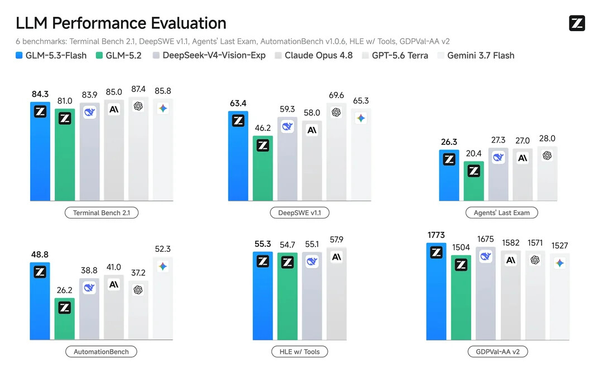
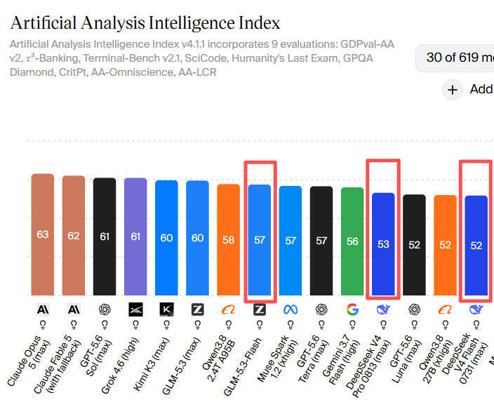
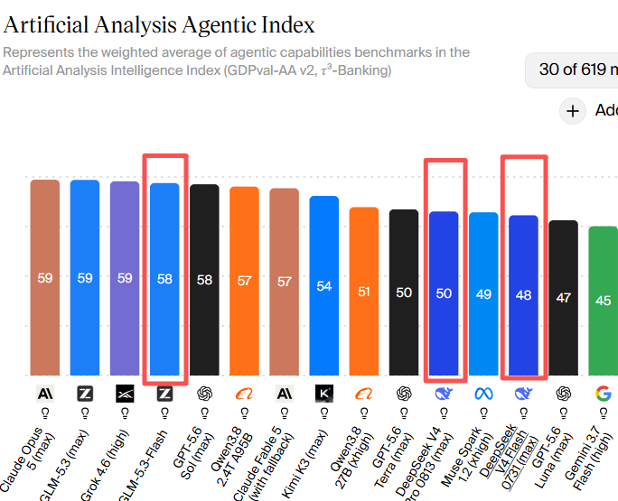
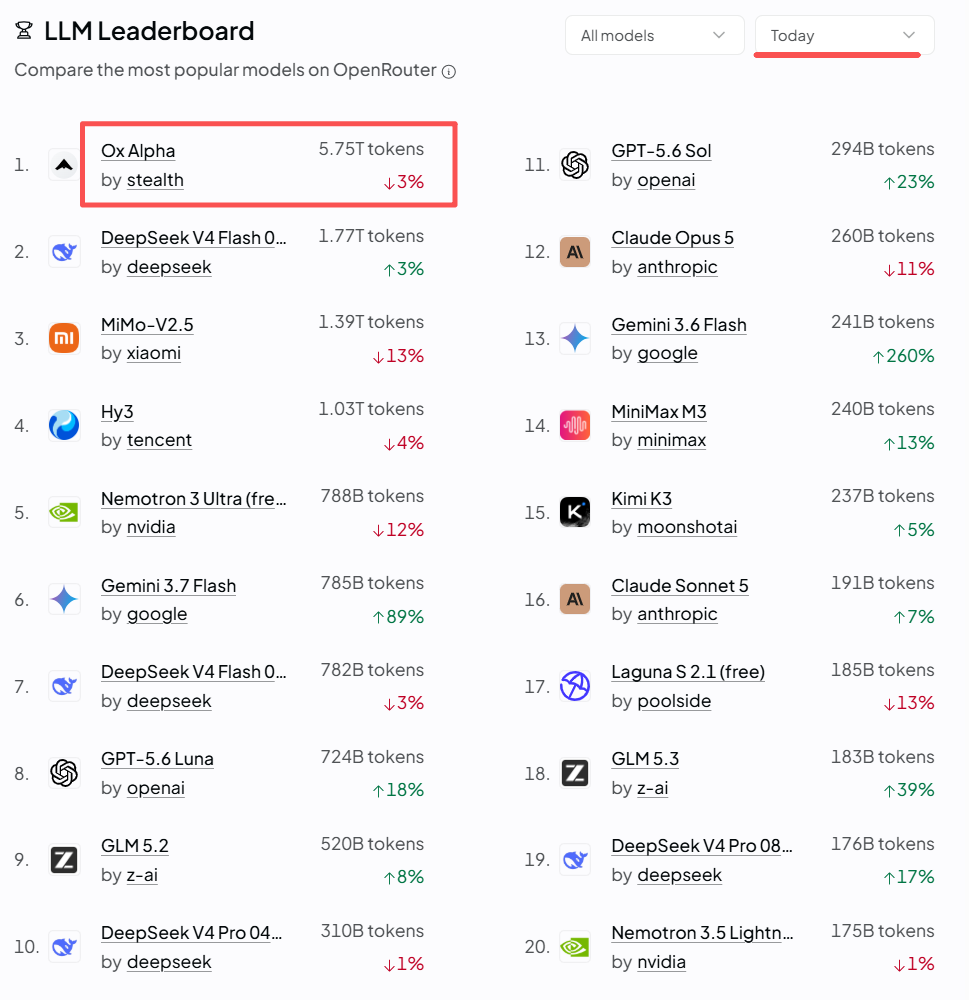

---

id: 2816401

title: ":fire:【大模型百科47】关于GLM5.3 flash(OX alpha/牛来)，你想知道的一切"

created_at: 2026-08-26T15:01:45.144Z

username: dwqxq1

display_username: "dwqxq1"

---

# :fire:【大模型百科47】关于GLM5.3 flash(OX alpha/牛来)，你想知道的一切

## 基本资料

参数:321B,激活18B,MOE

上下文:1m

价格:$0.15/0.5,

模型权重下载:[zai-org/GLM-5.3-Flash · Hugging Face](https://huggingface.co/zai-org/GLM-5.3-Flash)

### 官方自评

---

### ArtifacialAnalysis评分

来源:[https://artificialanalysis.ai/](https://artificialanalysis.ai/)

---

---

## Coding渠道

### 官网coding plan已上线

国际版:[GLM Coding Plan — AI Coding Powered by GLM-5.3, GLM-5.3-Flash, GLM-5.2 & GLM-5-Turbo for Agents & IDEs](https://z.ai/subscribe)

国内版:[智谱丨BigModel 平台](https://bigmodel.cn/glm-coding)

1x=$18=¥118

6x=$68=¥538

14x=$168=¥1078

## API渠道

### 官网API已上线

### OpenRouter API

来源:[GLM 5.3 Flash - API Pricing & Benchmarks | OpenRouter](https://openrouter.ai/z-ai/glm-5.3-flash)

OpenRouter现在半价

公测版ox alpha/L站戏称牛来,在OpenRouter连续霸榜多日,日消耗量是deepseek 4 flash的4倍,单一模型占了OpenRouter总消耗量的1/4

---

*来源: https://linux.do/t/topic/2816401.json*

