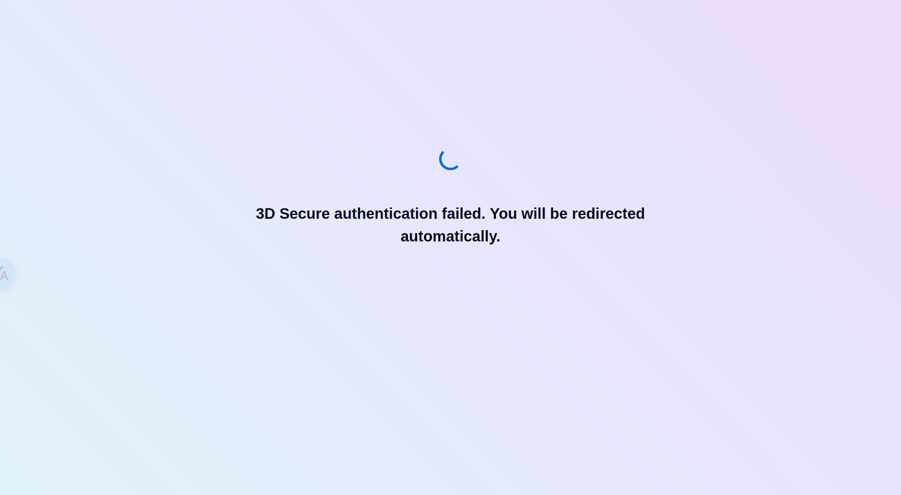

---

id: 2820728

title: "笔记：中行银行卡付费不成功可能是浏览器扩展所致"

created_at: 2026-08-27T12:43:09.738Z

username: Gramerch

display_username: "Gramerch"

---

# 笔记：中行银行卡付费不成功可能是浏览器扩展所致

之前在DLSite上用中国银行Mastercard借记卡购买，结果会跳转到下面这个页面：

一开始以为又是银行卡的问题，翻了一堆帖子未果。之后突然想到可能是浏览器的缘故，于是就把所有的FireFox浏览器扩展都关了，之后再支付则能跳转到之前一直都无法跳转到的填写验证码的页面，手机上也能收到中行发来的短信验证码，填写验证码之后就能正常付款了。

由于已经付费完了，也不知道具体是哪个扩展导致的，这里就顺带列出我装的所有扩展吧，有需要的可以对照着排查：

| Name | Type | Version | Enabled | Location | ID |

| --- | --- | --- | --- | --- | --- |

| Add-ons Search Detection | extension | 3.0.0 | true | app-builtin-addons | [addons-search-detection@mozilla.com](mailto:addons-search-detection@mozilla.com) |

| ArchLinux AUR Search | extension | 1.0.5 | true | app-profile | [ArchAur@archlinux.org](mailto:ArchAur@archlinux.org) |

| ArchLinux manual pages Search | extension | 1.0.4 | true | app-profile | [ArchMan@archlinux.org](mailto:ArchMan@archlinux.org) |

| ArchLinux Packages Search | extension | 1.0.3 | true | app-profile | [ArchPkgs@archlinux.org](mailto:ArchPkgs@archlinux.org) |

| ArchLinux Wiki Search | extension | 1.0.4 | true | app-profile | [ArchWiki@archlinux.org](mailto:ArchWiki@archlinux.org) |

| ArchLinuxCN Forum (by keywords) Search | extension | 1.0.0 | true | app-profile | [ArchCNForumK@archlinuxcn.org](mailto:ArchCNForumK@archlinuxcn.org) |

| ArchLinuxCN Wiki Search | extension | 1.0.0 | true | app-profile | [ArchLinuxCNWiki@archlinuxcn.org](mailto:ArchLinuxCNWiki@archlinuxcn.org) |

| Audio Controller | extension | 1.1.23 | true | app-profile | [firefox-audio-control@yourdomain.com](mailto:firefox-audio-control@yourdomain.com) |

| Bilibili Search | extension | 1.0 | true | app-profile | {b4365008-5306-4fa7-b850-ebb1d8ff3ca8} |

| bilibili哔哩哔哩下载助手FirFox | extension | 3.0.4 | true | app-profile | [bilibili-helper@example.com](mailto:bilibili-helper@example.com) |

| ClearURLs | extension | 1.27.3 | true | app-profile | {74145f27-f039-47ce-a470-a662b129930a} |

| Consent-O-Matic | extension | 1.1.5 | true | app-profile | gdpr@cavi.au.dk |

| Cookie-Editor | extension | 1.13.0 | true | app-profile | {c3c10168-4186-445c-9c5b-63f12b8e2c87} |

| Dark Reader | extension | 4.9.129 | true | app-profile | [addon@darkreader.org](mailto:addon@darkreader.org) |

| Decentraleyes | extension | 3.0.2 | true | app-profile | jid1-BoFifL9Vbdl2zQ@jetpack |

| Easy Youtube Video Downloader Express | extension | 25.2 | true | app-profile | {b9acf540-acba-11e1-8ccb-001fd0e08bd4} |

| Flagfox | extension | 6.2.3 | true | app-profile | {1018e4d6-728f-4b20-ad56-37578a4de76b} |

| Flash and Video Download | extension | 1.0.9.86 | true | app-profile | {adeadebb-fedc-4180-a7f4-cfdd87496551} |

| Form Autofill | extension | 1.0.1 | true | app-builtin-addons | [formautofill@mozilla.org](mailto:formautofill@mozilla.org) |

| IPP Activator | extension | 0.2.20260622.182020 | true | app-system-addons | [ipp-activator@mozilla.com](mailto:ipp-activator@mozilla.com) |

| IPvFoo | extension | 2.34 | true | app-profile | [ipvfoo@pmarks.net](mailto:ipvfoo@pmarks.net) |

| KISS Translator | extension | 2.0.32 | true | app-profile | {fb25c100-22ce-4d5a-be7e-75f3d6f0fc13} |

| New Tab | extension | 154.9.0 | true | app-builtin-addons | [newtab@mozilla.org](mailto:newtab@mozilla.org) |

| OCR - Image Reader | extension | 0.5.3 | true | app-profile | {e4c6eef1-8b3b-4daa-8757-707702e7528d} |

| Picture-In-Picture | extension | 1.0.0 | true | app-builtin-addons | [pictureinpicture@mozilla.org](mailto:pictureinpicture@mozilla.org) |

| Port Authority | extension | 2.2.0 | true | app-profile | {6c00218c-707a-4977-84cf-36df1cef310f} |

| Privacy Badger | extension | 2026.8.7 | true | app-profile | jid1-MnnxcxisBPnSXQ@jetpack |

| PT Depiler | extension | 0.0.6.1820 | true | app-profile | [ptdepiler.ptplugins@gmail.com](mailto:ptdepiler.ptplugins@gmail.com) |

| QR Lite - QR Code Generator and Scanner | extension | 3.5.0 | true | app-profile | @qrlite |

| Search by Image | extension | 8.5.3 | true | app-profile | {2e5ff8c8-32fe-46d0-9fc8-6b8986621f3c} |

| SingleFile | extension | 1.22.98 | true | app-profile | {531906d3-e22f-4a6c-a102-8057b88a1a63} |

| SteamDB | extension | 4.37 | true | app-profile | firefox-extension@steamdb.info |

| TWP - Translate Web Pages | extension | 10.2.1.0 | true | app-profile | {036a55b4-5e72-4d05-a06c-cba2dfcc134a} |

| uBlock Origin | extension | 1.74.0 | true | app-profile | [uBlock0@raymondhill.net](mailto:uBlock0@raymondhill.net) |

| User-Agent Switcher and Manager | extension | 0.6.8 | true | app-profile | {a6c4a591-f1b2-4f03-b3ff-767e5bedf4e7} |

| Violentmonkey | extension | 2.48.0 | true | app-profile | {aecec67f-0d10-4fa7-b7c7-609a2db280cf} |

| Web Compatibility Interventions | extension | 154.14.0 | true | app-builtin-addons | [webcompat@mozilla.org](mailto:webcompat@mozilla.org) |

| 知乎外链直达 | extension | 1.1.2resigned1 | true | app-profile | {e1896037-b13b-4fe4-9aaf-3fc14d0f5c54} |

| Language: English (GB) | locale | 154.0.20260824.154132 | true | app-global | [langpack-en-GB@firefox.mozilla.org](mailto:langpack-en-GB@firefox.mozilla.org) |

| Language: 简体中文 (Simplified Chinese) | locale | 154.0.20260824.154132 | true | app-global | [langpack-zh-CN@firefox.mozilla.org](mailto:langpack-zh-CN@firefox.mozilla.org) |

| Dark | theme | 1.3.4 | true | app-builtin | [firefox-compact-dark@mozilla.org](mailto:firefox-compact-dark@mozilla.org) |

| Firefox Alpenglow | theme | 1.5.3 | false | app-builtin | [firefox-alpenglow@mozilla.org](mailto:firefox-alpenglow@mozilla.org) |

| Light | theme | 1.3.4 | false | app-builtin | [firefox-compact-light@mozilla.org](mailto:firefox-compact-light@mozilla.org) |

| System theme — auto | theme | 1.4.2 | false | app-builtin | [default-theme@mozilla.org](mailto:default-theme@mozilla.org) |

另外，在`about:support`页面是能够重启浏览器到排障模式的，这个模式下会禁用所有浏览器扩展，佬友遇到无法支付的状况的可以试试看能不能在排障模式下完成支付。

---

*来源: https://linux.do/t/topic/2820728.json*

