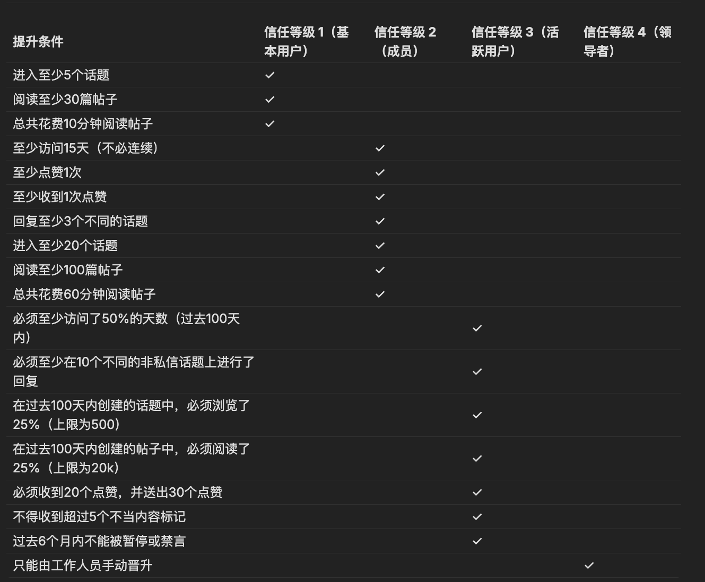

---

id: 2824464

title: "linuxdo信任等级如何查看和提升"

created_at: 2026-08-28T06:59:56.746Z

username: qixy

display_username: "qixy"

---

# linuxdo信任等级如何查看和提升

1、目前在网址站内只能查看 2 级到 3 级的进度详情：[https://connect.linux.do/](https://connect.linux.do/)

2、但是1级到2级的不知道怎么查看（感觉这个可以：[https://linux.do/u/你自己的用户名/summary](https://linux.do/u/%E4%BD%A0%E8%87%AA%E5%B7%B1%E7%9A%84%E7%94%A8%E6%88%B7%E5%90%8D/summary)）

3、也不知道是什么标准。。。帖子发出来后很多人回复，非常感谢大家的帮助，目前找到几个写的好的帖子：

> Discourse 论坛信任等级解析 用户信任系统是 Discourse 的基石之一。信任等级的设计旨在： 为论坛中新用户设置一个沙盒环境，避免他们在了解论坛操作时不小心伤害到自己或其他用户。 随着时间的推移，为经验丰富的用户赋予更多权限，让他们可以帮助维护和管理他们付出了大量时间建设的社区。 正如[《网络社区建设》](http://www.amazon.com/Community-Building-Web-Strategies-Communities/dp/0201874849?ref=blog.discourse.org)一书中所提到的，任何社区的参与者都有一个自然的进阶过程。 [图片] 这成…

> Discourse 论坛权限等级表（包括版主角色） 这旨在成为一个全面的Discourse功能列表，按信任等级标记，并包括影响这些功能的相关管理员设置。如果你发现有遗漏或不正确的地方，请在下面留言。  信任等级表 – 默认值 TL = 依赖信任等级  = 可以由管理员设置启用或调整  TL0 TL1 TL2 TL3 TL4 …

新人直接看这篇文章就够了，尽量不要再发类似的帖子了。

> 【先导篇】： 佬友们入站的原因，很多都是因为被站内的教程、干货、资源和Ai前沿信息所吸引，技术大咖喜欢这里的氛围，喜欢来这里发帖，而这良好的社区氛围背后是始皇站长对网站的费心维护、和对规则的不断优化，同时也少不了站内众多大佬的不断的高质量内容输出。 所以想融入社区，也为了社区长久发展，都遵守规则很重要。 有的新人会说，好像不注册L站，不升级也是能看帖子的，那为什么一定要注册L站？一定要升级呢？ …

---

*来源: https://linux.do/t/topic/2824464.json*

