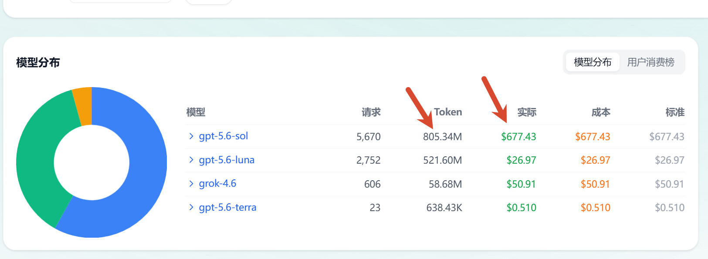

---

id: 2831355

title: "【持续更新】国内外AI订阅性价比"

created_at: 2026-08-30T05:59:50.629Z

username: XTer

display_username: "XTer"

---

# 【持续更新】国内外AI订阅性价比

规则：

1. 有很多是历史套餐，也一并放入，可能不能以该价格买到

2. 不排除有很多日抛号、bug号的存在，这里统计正价/半正价的情况，不考虑支付转移等手段

3. 限额指的是网友估算，不一定准，也存在风控等特殊情况

4. 注意一切购买，不论是否优惠价格，都可能被封号，但是美区有的时候可能更稳

5. 小贴士：标价实付是真实价格，限额是“能用多少额度”（一般用美元），一些中转站常见的倍率的意思就是1美元额度要用多少人民币买

6. 数据不一定准，欢迎补充

---

## 1. ChatGPT / Codex

### 标价/实付

#### Plus/Team：

标价$20，

一些活动经常能做到半价，例如之前的48 team 2席位、低价区等，

也有一些免费活动，比如K12、试用、美国大学生

#### Pro 5x：

标价$100，

美区就是100刀，反而是相对最便宜的

曾经有埃及 91刀左右 [https://linux.do/t/topic/2098158](https://linux.do/t/topic/2098158)

菲区免税约95刀

玻利维亚 690 BOB：大约$60（目前绝版）

#### Pro 20x：

标价$200，

菲律宾免税大约$145 [ChatGPT Pro 20x 最省钱攻略：每月980，免税冲刺上车！附完整操作](https://linux.do/t/topic/2321083)

玻利维亚1400 BOB大约$120（目前绝版）

### 限额

注意账号被风控后限额会大幅减少，甚至出现pro周限只有200-300刀的情况，现在的限额相当看号，有的就是天然多/少

- Plus：5h 约20-30刀、周限约100-160刀；

- Pro 5x：周限500-700刀左右

- Pro 20x：周限2000-3000刀左右

（pro 5x感觉有点小众单品，按照5个plus算，欢迎补充）

额度估算：按照我的典型缓存率，大约sol就是 一刀能用1M多一些

luna可以视作不要钱

### 计价逻辑

按照：

1. sub2api的技术（相对准）

2. Credits（准、有延后）

我这里的2000-3000是sub2api的估算，里面的具体价格可以看官方仓库策略，然后luna用的多的话额度会相对少

Credits方法

[关于Codex额度不正确的问题（自查方法）【threads跨账号共享 风控导致额度降低】](https://linux.do/t/topic/2740072) [

开发调优](/c/develop/4)

> 【极速版：跨账号共享的threads + 未经伪造处理导致风控】

>

> threads需要综合最近几天的情况，结论具有时效性。

> 不排除后续增加并发风控规则  。建议站在oai的角度判断自己是否正常自用  。

> 算法简单分析结论在这里： [关于Codex额度不正确的问题（自查方法）【threads跨账号共享 风控导致额度降低】 - #97，…](https://linux.do/t/topic/2740072/97)

### 特殊说明

Tibo经常重置，因此如果自己有号的话每个月可以用远超4个周限，甚至会送一些重置卡

---

## 2. Claude / Claude Code

### 标价

Pro $20 / Max 5x $100 / Max 20x $200。

注意play/apple store A\不管税，Max要付$125/$250

正价羊毛就是之前的低价区，例如玻利维亚 5x $82、20x $150

不过A\封号太狠了，有的人甚至专门买贵区，比如礼品卡养着

（没正价冲过claude、欢迎补充）

### 限额

现在讨论的是目前 26年8月 1.5倍的情况，后续会变成1.25倍，可能会更少

（现在没有订阅，欢迎佬直接编辑）

- Pro $20 周200-500刀？不确定

- Max 5x 周能到 2500刀，ccusage 统计口径

- Max 20x 周能到3000-5000刀，取决于统计口径

---

## 3. Cursor + Grok Bot

### 标价/月额度

| 档 | 标价 | Other | Auto 池 |

| --- | --- | --- | --- |

| Start（仅印度） | ₹649 | 无 | 有 |

| Pro | $20 | $20 | ~$450 |

| Pro+ | $60 | $70 | ~$1200 |

| Ultra | $200 | $400 | 现在 $3000 |

| Teams Std / Prem | $40 / $120 席 | 未公布数字 | Prem = 5× Std |

注意other池就是啥都能用（好像之后不能用gpt了，但是感觉用fable的会更多）

Auto池只有grok、composer

其实cursor如果是正价购买挺不值的（个人感觉），额度只有隔壁GPT、Claude的不到1/4

正价里，之前有官方半价活动

几周前买Supergrok heavy送Cursor Ultra，买多久送多久

### Grok Bot

周额度社区估算：

Pro 300刀

Pro+ 500刀

Ultra 1000刀

其实现在给的相当慷慨，甚至比cursor本体还要慷慨

### 特殊

Cursor这玩意儿额度计费全是bug，经常出现超级大bug，只能说懂的都懂

## 4. SuperGrok / Grok Build

### 标价/实付

#### SuperGrok Lite

买X premium送的，存在感不高

#### SuperGrok

标价 $30

经常有折扣活动：50% off 两个月，实付 $15。

AppStore/Google Play有30$三个月

曾经也有低价区（如印度、50人民币三个月这样）

买X Premium+ 会送

#### SuperGrok Plus

标价 $100

感觉无人在意

#### SuperGrok Heavy

标价 $300。

常见：

- 67% off，常见 $99/月 × 3 个月

- 8 月初$99改年付，折合每月 $80，貌似绝版

8月初买 Heavy 送 Cursor Ultra（买多久送多久），后来说新订不再送，已领的保留

相当于每月80刀：送你cursor ultra + bo t+ heavy + 蓝V，其实我觉得相当值

### 限额

所有产品（Chat / Imagine / Voice / Build）共用一个周池。

不同人说法差距超级大，因此看个乐，欢迎补充

- SuperGrok $30：130刀左右

- Heavy $300：1000刀左右

---

## 5. Command Code

### 标价/实付

| 档 | 标价 | 月用量 | 5h | 周 |

| --- | --- | --- | --- | --- |

| Go | $1 | $10 | $3 | $6 |

| GOAT | $10 | $70 | $14 | $35 |

| Pro | $20 | $80 | $16 | $40 |

| Max 10× | $100 | $150 | $45 | $90 |

| Max 20× | $200 | $300 | $90 | $180 |

主要说的是Goat档，相当于7倍API额度，主要用来用国模（如deepseek flash、qwen flash、glm flash等）

注意！总额度对不同模型有限制，比如deepseek pro的限制是20刀，就是你只能用20刀的deepseek pro，剩下的就没了，相当于共享100%的额度池

[避雷一下command code goat - 国产替代 - LINUX DO](https://linux.do/t/topic/2807970/37)

### 特殊

有人说deepseek flash等模型味道不对，可能量化，和opencode go一样

大部分模型只支持chat端点，没有response和messages，需要额外转换，算个槽点

---

## 6. OpenCode Go

### 标价/实付

$10/月。

之前有过首月 $5

### 限额

大约

- 5h $12

- 周 $30

- 月 $60

贵模型另有月封顶，Grok 4.6 / Kimi K3 / Luna / GLM-5.3 这类常见是 每月 $15。

emm，模型额度挺跳动的，也有骂的，感觉10刀的价格也没这么有吸引力

之前deepseek官方没张价前几乎用不完，涨价后一直在发生大变化

---

## 7. GLM Coding Plan（智谱）

### 标价/实付

三代价格差很多

#### V1（早期，基本绝版）

号相当值钱，咸鱼上卖3000-10000都有，甚至之前的lite也能卖几千

#### V2

- Lite ¥49 / Pro ¥149 / Max ¥469

- 季付 9 折、年付 8 折（Lite 年付大约 ¥39，max大约¥369）

#### V3（现，新客）

- Lite ¥118 / Pro ¥538 / Max ¥1,078

- 连包季 8 折、连包年 7 折

唉，肠子都悔青了，我当时怎么没买个V2/V1呢

### 限额

(等待佬友补充)

大致意思V1只有5h限额、V2有周限、V3转向积分制、量少了很多

### 特殊说明

风控在各种厂商里面算相当严的，甚至被叫Z\

[我丢 z.ai GLM 您的使用违反了 Fair Use Policy（合理使用政策）？？？？](https://linux.do/t/topic/1806984) [

搞七捻三](/c/gossip/11)

> 龙虾和cc里面突然返回

> 429 {“error”:{“code”:“1313”,“message”:“Your usage violates the Fair Use Policy. Your request rate has been restricted. See Subscription Service

> Agreement for details. To restore access, …

## 8. Kimi

### 标价/实付

国内正价：

- Andante ¥49（Code 1×，无 K3）

- Moderato ¥99（4×，有 K3）

- Allegretto ¥199（20×）

- Allegro ¥699（60×）

年付大概 8 折档。

注意目前仍处于不容易买到阶段

### 限额

对于 Code 中 K3/K3-256k：

Allegretto ¥199 网友测试：

- 5h 大约 0.64 亿 token

- 7 天大约 3.15 亿

- 月大约 12–16 亿

- 且 5h 打满大约等于周额度的 20%

- 周 大约 月的20%

699：

周大约 7-10 亿（实测）

月 * 5

### 特殊说明

Kimi Work/网页 与 Code 共用月池

Work/网页没有 5h/周限而且极度不耐用

## 9. MiniMax Token Plan

### 标价/实付

Plus **¥49** / Max **¥119** / Ultra **¥469**（年付大约省两个月）。

有受邀 9 折等活动

### 限额

Token-based，官方直接标明：

- Plus：月大约 6 亿+ token

- Max：月大约 18 亿+

- Ultra：月大约 71 亿+

有5h/周限；

经过测试，MiniMax 5H 限额约为对应档位月订阅费的一半，以 Starter(29) 为例，5H 限额约为 14.5 元，依此类推

但是minimax m3直接查无此人，所以除非出m3.1不然也没什么人会想去买吧

顺带一提，m3在openrouter和command code等里有免费版

## 10. 火山方舟 Coding / Agent Plan

### 标价/实付

Lite 刊例 **¥40**，限时首购 **¥9.9**；

Pro 刊例 **¥200**，首购 **¥49.9**（可能限时）。

### 限额

49.9套餐（新用户打折，不用认证即可购买）

不算缓存命中，月额度大概是0.8774亿token，5h为200～300万token（glm5.3flash模型）

### 特殊

对它印象很深的是，之前调用glm5.2，反向路由opus4.7等模型

[https://linux.do/t/topic/2483201](https://linux.do/t/topic/2483201)

不清楚是否现在还有这种情况，顺便一个月前用量并不是很透明，不清楚现况

## 11. 阿里云百炼 / Qwen Token Plan

### 标价/实付

Lite 刊例 ¥60、早鸟 ¥39：700 积分/5h，2500/7 天

Standard ¥180 / 早鸟 ¥139：3000 / 10000

Pro ¥600 / 早鸟 ¥499：12000 / 40000

实际上这个100分就是1块钱，所以就是499套餐周限400块这个意思

### 限额

他家的deepseek有大问题，我不知道为什么在kimi code harness里面用量消耗特别快

然后对照来看，400块周限大约等于200-300官方涨价后的deepseek额度，其他可以自己算

---

……等待更新

---

*来源: https://linux.do/t/topic/2831355.json*

