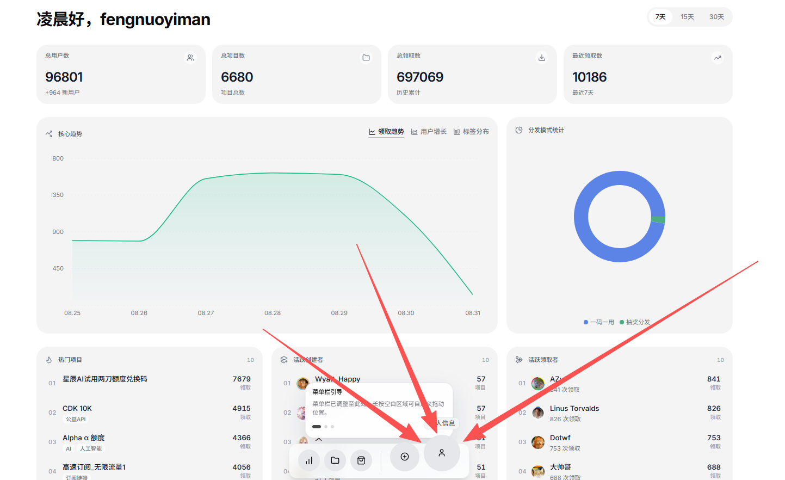
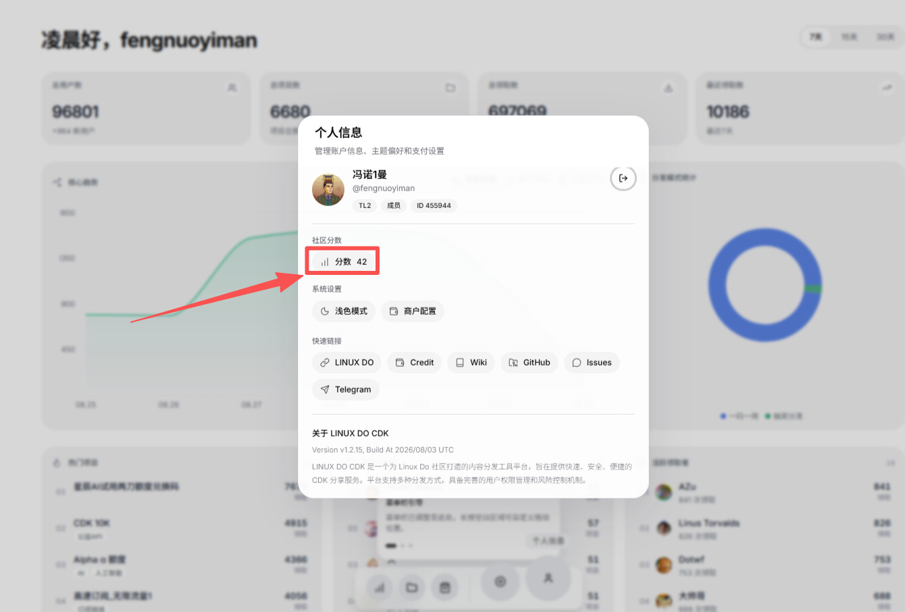
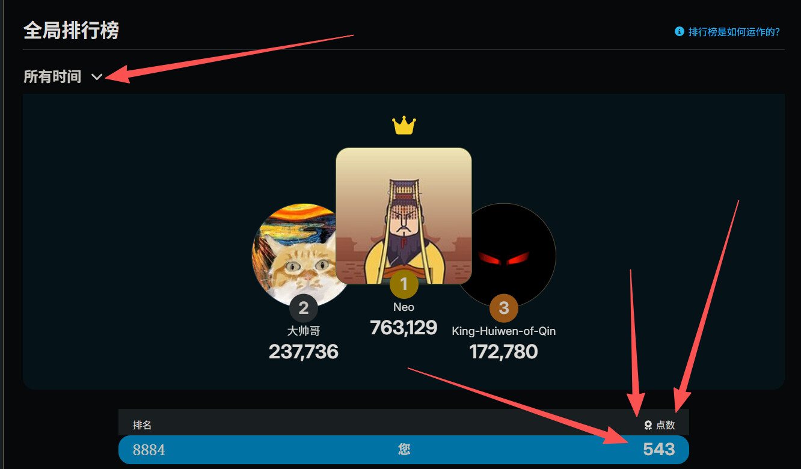
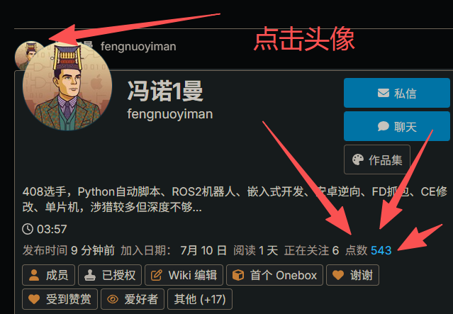
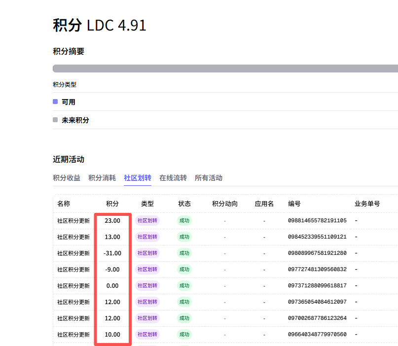
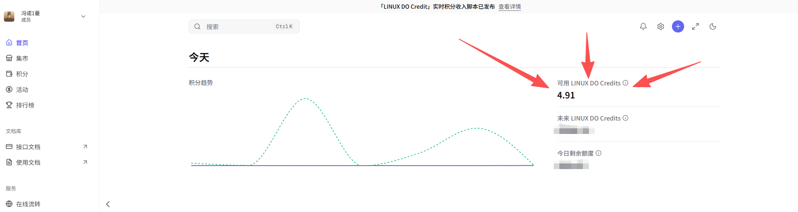
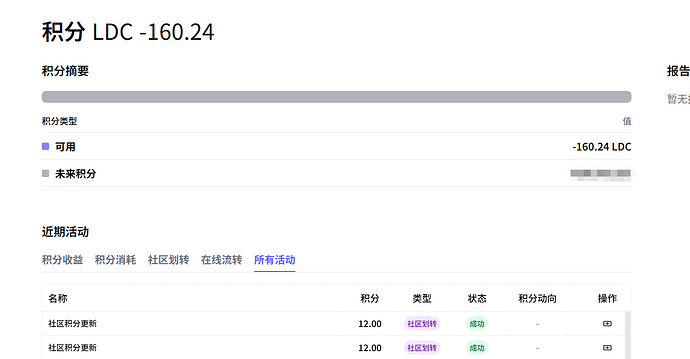
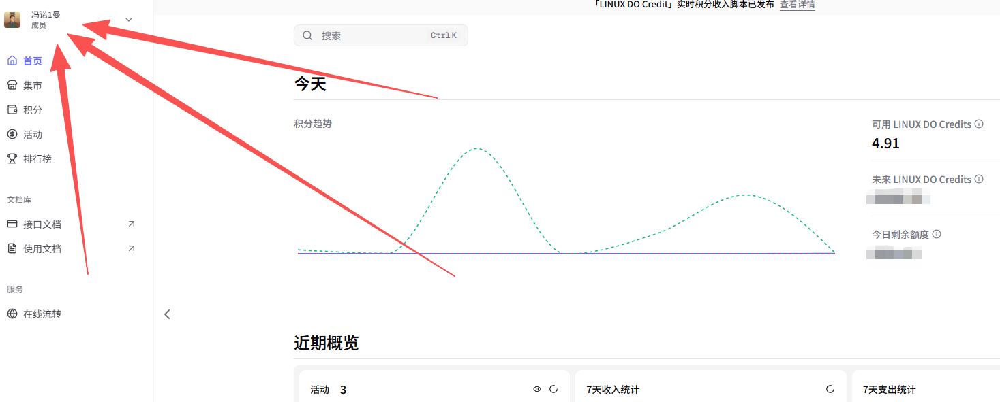
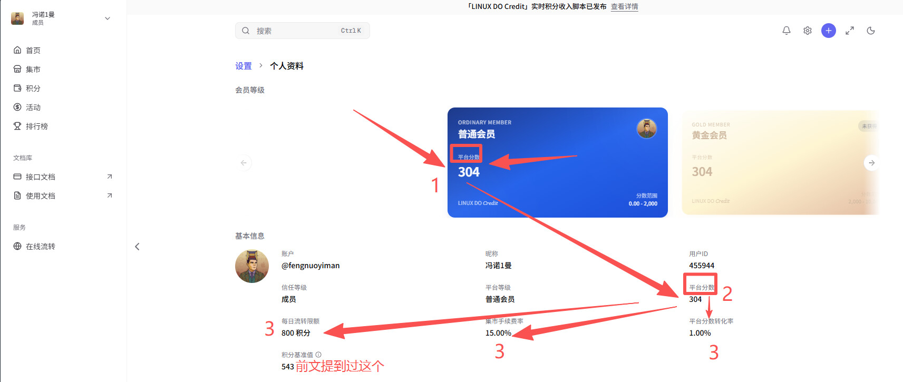

---

id: 2834331

title: "（基础教程）L站新手村导航指南--L站LDC、平台分数、社区分数、积分基准值"

created_at: 2026-08-31T02:56:12.444Z

username: fengnuoyiman

display_username: "冯诺1曼"

---

# （基础教程）L站新手村导航指南--L站LDC、平台分数、社区分数、积分基准值

**社区有了很多教程贴，但我每次看完还是一脸懵，这里放个我的理解，参考文献放最后了，要不每次跳转看帖子思路又会混乱了。这期是写给刚来一脸懵逼难以区分的佬友的，不是进阶教程。**

一篇文章带你看懂基础规则：LDC、平台分数、社区分数、积分基准值

# **1.社区分数，（CDK社区分数）**

是 CDK 系统面板的分数，衡量社区活跃度的指标，由个人获取的徽章组成，cdk的领取可能存在一定门槛，而社区分数就是这个门槛

### [实时数据 - LINUX DO CDK](https://cdk.linux.do/dashboard)

Linux Do 社区 CDK 快速分享平台 - 让分享变得更简单

# **2.积分基准值，（社区点数、LDC的底板分）**

积分基准值是衡量用户贡献度的最基础指标，社区系统的分发系统自动分发的积分，签到+10分/日（戏称：低保），被点赞1次/分

也是排行榜的排名依据，

[https://linux.do/leaderboard](https://linux.do/leaderboard)

也是社区划转+基础分的累加结果，可以相互印证

积分基准值可用于抽奖（新规），以社区积分更新的方式将每日变化的分数差值同步到LDC

# 3.LDC，（Linux Do Credit）

### [LINUX DO Credit](https://credit.linux.do/login?callbackUrl=%2Fhome)

Linux Do 社区积分服务平台

论坛积分，可用于兑换产品/服务/分发流转

初次登陆 LDC 送 50 ， 每天凌晨自动转账的社区点数-积分基准值（可能是正，也可能是负）

特别注意：交易流转需要手续费，此举可以减缓LDC贬值，服务（手续）费默认由服务方承担，且是动态费率（平台分数的等级决定）

# 4.平台分数，（LDC 平台分数）

是 LDC的流转指标，LDC使用达到门槛，可以升级会员，等级越高，每日流转限额额度越高，手续费率也会降低

### [LINUX DO Credit](https://credit.linux.do/login?callbackUrl=%2Fsettings%2Fprofile)

Linux Do 社区积分服务平台

——————————————————————————————————————————

# **基础教程结束了，再放上一些进阶帖子，和部分参考文献和我认为很有用的帖子：**

## 1.其他佬友的辨析

[社区分数、积分基准值、平台分数、LDC这几个有啥区别，有什么用处？](https://linux.do/t/topic/2730523/2) [

搞七捻三](/c/gossip/11)

> 社区分数佬可以看看这个，跟徽章有关系，徽章越多社区分数越高，一些佬发cdk的时候一般会设置多少社区分数才能领取的门槛的，分数不够就无法领取cdk

>

>

> 社区基准分佬可以看看这个

>

> 平台分数是积分站的平台分数，获取方法佬链接里已经有说明了，主要作用还是积分站的会员等级吧，消费越多分数越高会员等级越高，每天使用ldc的限额也就越高，分发的手续费越低

## 2.**LDC使用教程**

[https://linux.do/t/topic/1770989?u=fengnuoyiman](https://linux.do/t/topic/1770989)

> 1、LDC页面里，有种东西叫社区积分基准值，很多人不知道这个东西是啥，这个其实很难解释，在你没注册LINUX DO Credit服务平台的时候，这个东西就是你的社区活动值 。也被称之为 [Leaderboard](https://linux.do/leaderboard/1)。这个时候，这个玩意是没实际作用的，但当你注册了服务平台，那么你在这获得的点数，将会以1:1的形式转为LDC

文章写的很全面，但是这点我感觉可以换个理解方式，可以看一下始皇的定义，“底板分”：

> 这个积分大家应该也很熟悉，就是LDC的底板分，具体见：[https://linux.do/leaderboard](https://linux.do/leaderboard)

>

> 不过不同的是，这个底板分，无法通过流转来获得，其增减会在每天凌晨同步到LDC。

## 3.其他佬友的综合分析

[社区分数、积分基准值、平台分数、LDC这几个有啥区别，有什么用处？](https://linux.do/t/topic/2824201) [

文档共建](/c/wiki/42)

> 周五好无聊啊，我们来整理下社区ldc相关的玩法吧。顺便草稿箱清理下。

> 自从前两天始皇发了那篇量化抽奖的帖子，这里存个档:

>

>

> 社区里关于LDC底板分的讨论又多了起来。再加上水贴这几天总有新佬不知道社区点数、 CDK社区分数、 LDC、Credit平台分数这几个傻傻分不清，也不知道都是干啥的有啥用的

> 所以这篇就以我个人的角度理解结合我对源码的分析来简单梳理一遍这个玩法。

> 依旧叠个甲先：

> …

## 4.万事通教程，快速熟悉L站

[《万事不通·L站指南》](https://linux.do/t/topic/2487227) [

文档共建](/c/wiki/42)

> [!todo] 真诚、友善、团结、专业，共建你我引以为荣之社区。[《社区准则》](https://linux.do/guidelines)

>

>

> [!note]+ 简介

> 《万事不通·L站指南》v0.2.4

> 本帖为 L 站综合指南合集，收录入门教程、公益站点、实用工具等各类干货攻略。站内新老用户查阅资料均可在此一站式检索，按需取用，各有所得。

>

>  传道授业解惑也！

>    …

## 5.上述四项分数的详细说明

[【新人入站从0级到三级经验总结】：升级？赚LDC？LDC有什么用？如何兑换Ai的API Tokens？如何提升社区分数？常用的站内频道？避免被封号注意点？等等，新人可参考，少走弯路！](https://linux.do/t/topic/2235030) [

文档共建](/c/wiki/42)

> 【先导篇】：

> 佬友们入站的原因，很多都是因为被站内的教程、干货、资源和Ai前沿信息所吸引，技术大咖喜欢这里的氛围，喜欢来这里发帖，而这良好的社区氛围背后是始皇站长对网站的费心维护、和对规则的不断优化，同时也少不了站内众多大佬的不断的高质量内容输出。

> 所以想融入社区，也为了社区长久发展，都遵守规则很重要。

> 有的新人会说，好像不注册L站，不升级也是能看帖子的，那为什么一定要注册L站？一定要升级呢？ …

## 6.LDC获取规则

[【4.17 更新: 恢复运营】Linux Do Credit FAQ及积分获取规则](https://linux.do/t/topic/1353235) [

文档共建](/c/wiki/42)

> 最新更新

> 2026.4.17 LDC 恢复运营，新增规定：

>

> 场景仅许可以下四类：商户流转、在线流转、商户分发、限时红包（节假日或社区活动）

> 新增积分流转延迟结算，积分延期到账，7~14日不等

> 更严格限制单日流出上限

> 更高交易折损（手续费），不同信任级别比率不同

> 停止运营期间积分结算：结算上限不超过1000，结算下线不低于0

> ![[IMG8135]](https://cdn3.ldstatic.com/original/4X/d/9/0/d90b93b62560d75026fc4491b31b2c56289bb4ae.jpeg)

>

> 详见下面两帖：

> [「LI…](https://linux.do/t/topic/1986429)

## 7.LD士多贸易教程

[【教程】玩转LD士多：配置、测试、发布物品全流程，新手不走弯路](https://linux.do/t/topic/2443127) [

文档共建](/c/wiki/42)

> LDCStore 首次上架物品记录

> 第一次使用 LDCStore，尝试上架一个物品。虽然官方提供了不少教程和帮助文档，但实际操作过程中还是走了一些弯路。这里记录一下完整的使用过程，方便后续新人参考 

>

> [!TIP]

> 交易成功后，LDC系统流转 收取商家15%手续费。

> 示例：商家出售标价 100LDC 的物品，LDC积分最终到账 85

>

>

> 相关资料和帮助文档

>

>

>

>

>

> 一…

## 8.徽章获取教程

[盘点L站的徽章 长期更新！（2026.2.17 更新）](https://linux.do/t/topic/342888) [

文档共建](/c/wiki/42)

> 盘点 L 站的徽章长期更新!（2026.2.17 更新！！！）

>

> [!warning] 注意！！！！！！

> 做 Wiki 编辑的徽章就做，别把整个教程帖子内容覆盖成无意义的内容！！！

>

>

>

> [!caution] 注意、注意、注意

> 由于服务器有延迟，可能会存在达成了徽章获取条件但没有拿到徽章的情况，请坐和放宽，至多到第二天的凌晨四点就会刷新徽章获取情况。如果还是没有，请试试在过了 cf 盾之…

---

*来源: https://linux.do/t/topic/2834331.json*

