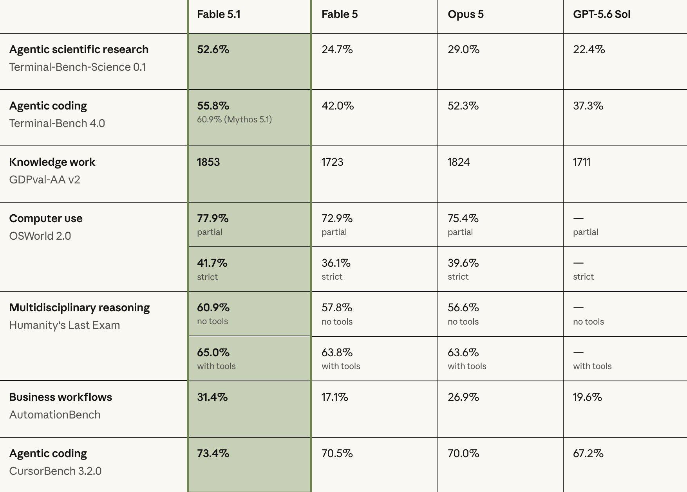
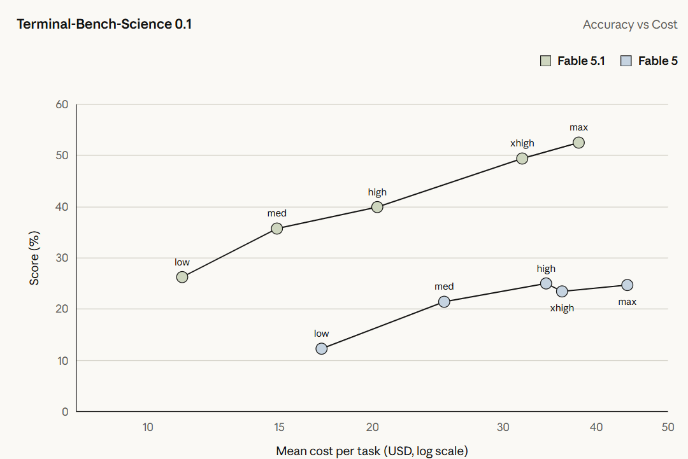
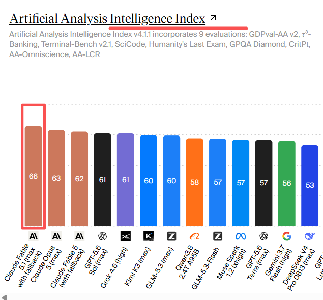
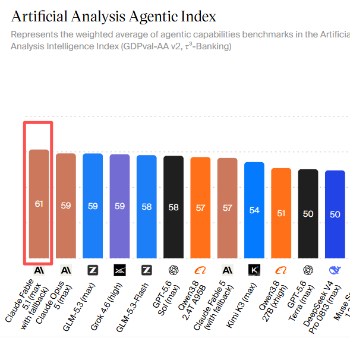
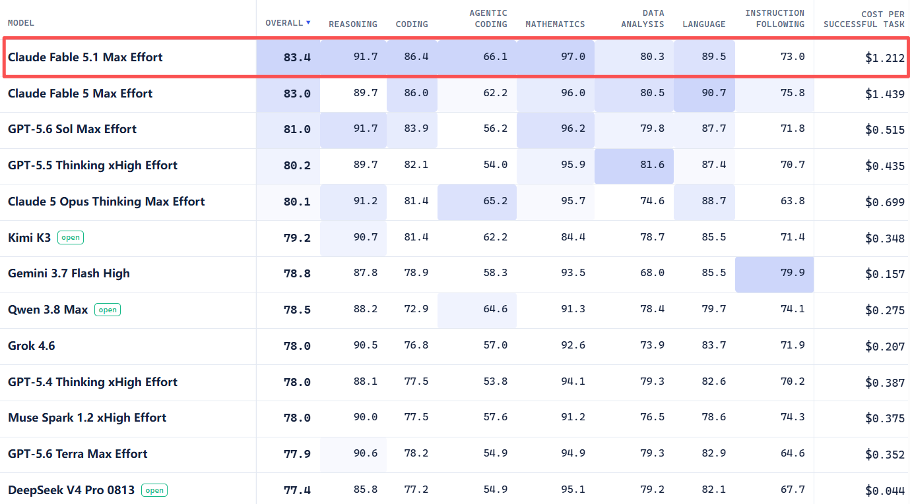
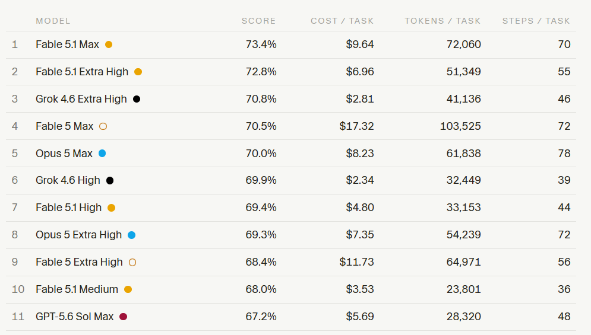
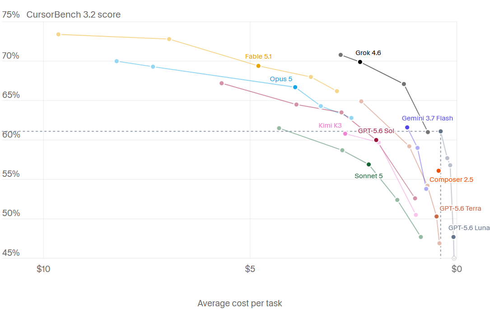

---

id: 2842501

title: ":fire:【大模型百科48】关于Fable5.1和Mythos5.1，你想知道的一切"

created_at: 2026-09-01T21:03:59.226Z

username: dwqxq1

display_username: "dwqxq1"

---

# :fire:【大模型百科48】关于Fable5.1和Mythos5.1，你想知道的一切

### 基本资料

官方文：[Introducing Claude Fable 5.1 and Claude Mythos 5.1 \ Anthropic](https://www.anthropic.com/claude-fable-and-mythos-5-1)

模型卡（212页）：[https://www-cdn.anthropic.com/0339e6a7c5c7b87f5c07798616dc32c215d14235/Claude%20Fable%205.1%20&%20Claude%20Mythos%205.1%20System%20Card.pdf](https://www-cdn.anthropic.com/0339e6a7c5c7b87f5c07798616dc32c215d14235/Claude%20Fable%205.1%20&%20Claude%20Mythos%205.1%20System%20Card.pdf)

价格：$10/$50不变

读缓存：$0.25，fable5是$1

上下文：1m不变

训练数据日期：2606

#### 优点

所有评测都是SOTA

fable5.1 max比fable5 max节约25%token

读缓存降价75%

#### 缺点

首个支持文本水印的claude模型，写作文章可以用A社官方验证器精确查询是否AI生成

### 官方自评

---

---

### ArtificialAnalysis评分

来源：[https://artificialanalysis.ai/](https://artificialanalysis.ai/)

---

---

### LiveBench评分

来源:[https://livebench.ai](https://livebench.ai)

---

### Arena评分未上线

来源：[Arena Leaderboard | Compare & Benchmark the Best Frontier AI Models](https://arena.ai/leaderboard/)

---

### CursorBench评分

来源：[Cursor · CursorBench](https://cursor.com/cursorbench)

---

---

## Chat渠道

官网

## API渠道

### 官网API

### AWS/GCP/Azure

### OpenRouter API

来源：[Claude Fable 5.1 - API Pricing & Benchmarks | OpenRouter](https://openrouter.ai/anthropic/claude-fable-5.1)

---

*来源: https://linux.do/t/topic/2842501.json*

