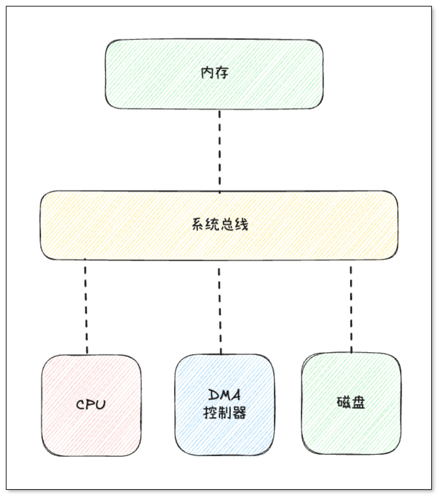
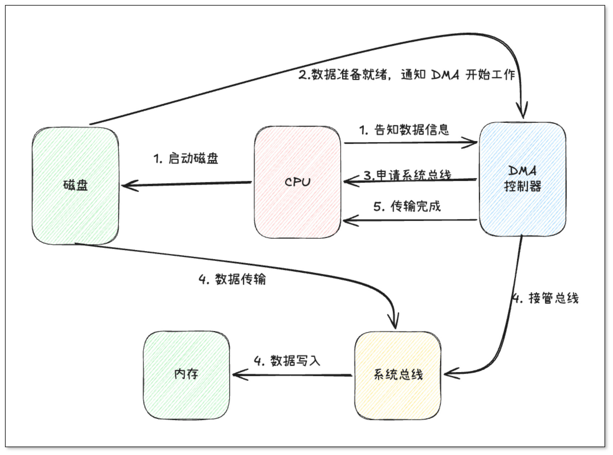

---

id: 2844504

title: "图解 DMA：数据绕过 CPU 直达内存"

created_at: 2026-09-02T06:14:21.076Z

username: Pika-Yalei

display_username: "Pika"

---

# 图解 DMA：数据绕过 CPU 直达内存

## 前言

最近偶然了解到 DMA 游戏外挂实现原理，作为一个计算机从业人员，探索心作祟，顺便了解一下 DMA 原理。

## 什么是 DMA

DMA（Direct Memory Access，直接存储器访问） 是一种让外设绕过 CPU、**直接和内存交换数据的机制**。

简单来说，CPU 就是一个“老板”，一个人干活的时候必须要亲力亲为，DMA 是“老板”招的“员工”。老板通知员工干活，员工开始干，干完之后再通知给老板就行了。

## DMA 工作流程

一次完整的工作流程：

1. CPU 启动磁盘，将搬迁的数据信息告诉 DMA 控制器。

2. 等磁盘数据准备好，告诉 DMA 控制器开始"工作"。

3. DMA 控制器向 CPU 申请系统总线。

4. DMA 控制器接管总线，数据直接从磁盘搬进内存，不经过 CPU。

5. DMA 控制器通知 CPU"完成"，CPU 来做收尾。

> CPU 只做"**发起**"和"**收尾**"，搬运全程不参与。

## DMA 使用场景

| 应用场景 | 传输路径 | 传输内容 |

| --- | --- | --- |

| 文件读写 | 磁盘 ⇄ 内存 | 文件数据块 |

| 网络收发 | 网卡 ⇄ 内存 | 网络数据包 |

| 图形渲染 | 内存 → 显存 | 视频帧数据 |

| 音频播放 | 内存 → 声卡 | 音频数据流 |

| 视频采集 | 摄像头 → 内存 | 视频帧数据 |

---

*来源: https://linux.do/t/topic/2844504.json*

