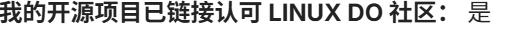

---

id: 2845814

title: "社区规则拆解|上传审核"

created_at: 2026-09-02T10:08:53.337Z

username: Turing_2202

display_username: "Turing"

---


# 社区规则拆解|上传审核


# 信息来源:

1.社区规则[https://linux.do/guidelines](https://linux.do/guidelines)


2.管理者的历史发言


3.L站关键词搜索与发帖时类似帖子推荐

# 第一部分 发帖审核

L站基于Discourse

通常就是

关键词规则 + 用户风控 + 链接/域名规则 + 人工审核

## 1.1 来自管理者的发言

为什么触发审核


## 1.2 **关键词审核**

具体的关键词用的是什么库,没有公开,可以参考一下github 的项目 sensitive-word

## 1.3 **用户风控**

没有找到相关的信息可以证明用户风控与信任等级挂钩.

但是等级与权限是有直接挂钩的,个人猜测是影响的私信与审核的排队顺序把.

lite用户等级权限


正常用户权限(很长不截图了自己看吧)

[Discourse 论坛权限等级表](https://linux.do/t/topic/18797) [


文档共建](/c/wiki/42)

> Discourse 论坛权限等级表（包括版主角色）

> 这旨在成为一个全面的Discourse功能列表，按信任等级标记，并包括影响这些功能的相关管理员设置。如果你发现有遗漏或不正确的地方，请在下面留言。 

> 信任等级表 – 默认值

> TL = 依赖信任等级

>  = 可以由管理员设置启用或调整

>

>

>

>

> 

>

> TL0

> TL1

> TL2

> TL3

> TL4

> …

## 1.4 **链接审核**

### 1.4.1 存在链接白名单,也没有公开,你可以根据自己的发帖总结经验.

个人的经验是:

国内的备案的链接>国外的链接

常见的链接>未知的链接

小技巧:然后你在发帖时可以在右侧预览

可以预览链接>无法预览链接

可以预览链接:


无法预览链接的:


### 1.4.2 开源推广,自己的GitHub的链接,需要你带一个友链,认可社区.



需要在readme里加

```
## 🔗 Friend Links

- 🐧 [**LinuxDO**](https://linux.do) — A community for tech enthusiasts
```

效果如下


### 1.4.3 如果你的帖子没有任何链接是完全不会触发审核的,但是是你后续修改自己的帖子是不用审核的.

## 1.5 **人工审核**

这块就需要揣摩审核人员的心理.


做好备份,耐心等待和有节制的重试.10-20分钟是常见的时间.


人工审核是一个耗费精力的事情,所以发帖前自检很重要.

# 重点 审核拒绝 帖子会丢弃

审核有很大的概率不通过,一定要**备份** **备份** **备份**!!!


在发帖前复制,然后新增一个草稿粘贴或者自己本地保持,一定要注意图片的链接是否正确.


一旦点击发帖后,你原本上传图片的链接就当作大概率**丢失**处理.

# 第二部分 **处理举报**

## 2 被举报了 怎么办

### 2.1.不该做的事情,二次开帖询问运维人员


#### 理由

1主要的原因,开帖属于公共资源,社区规则里明确了不能自己顶帖.所以可以理解排名在首页前面的帖子本身就是一个有价值的事情.

2带节奏,举报这个事情本身比较敏感,普通人视角下,频繁出现公开的对抗举报判决的帖子观感会很差,会影响到社区管理的威望.

### 2.2 正确的做法

审视自己的帖子是否违反了社区的规则,重新阅读.

私信管理 管理名单:[https://linux.do/g/moderators](https://linux.do/g/moderators)

**总结一下**


对于违规推广,不只是链接,还有引导私信.


引导私信是很严重的问题,无论是有意的无意的,正确的做法是把完整的信息,完整的链接在帖子正文展示.

---

写在结尾的话

希望社区越来越好.


---


*来源: https://linux.do/t/topic/2845814.json*

