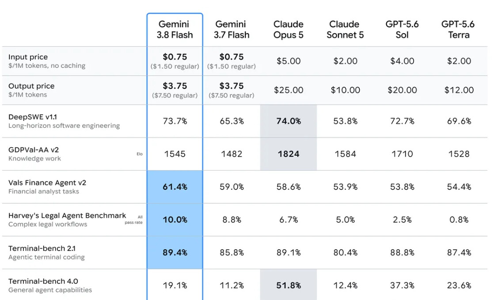
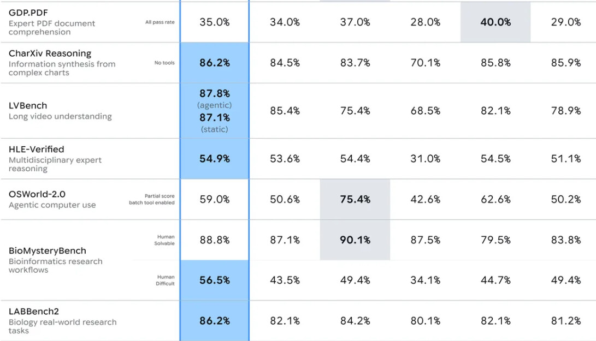
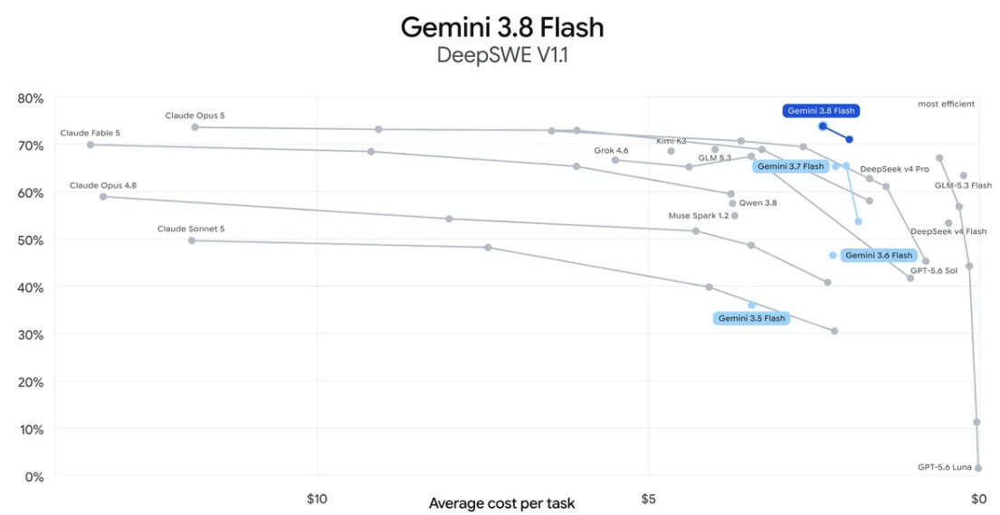
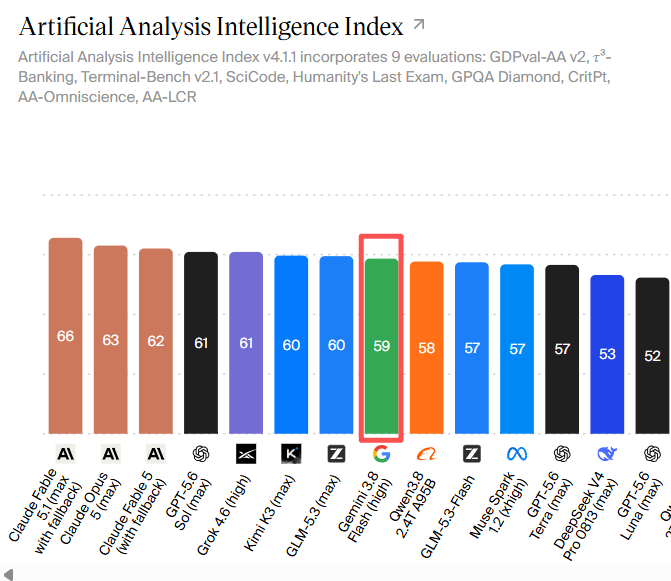
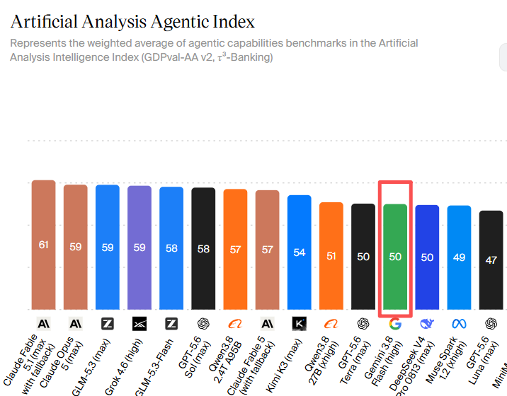
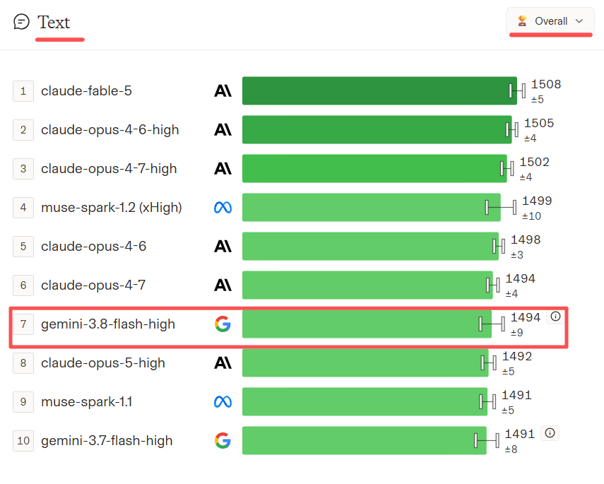
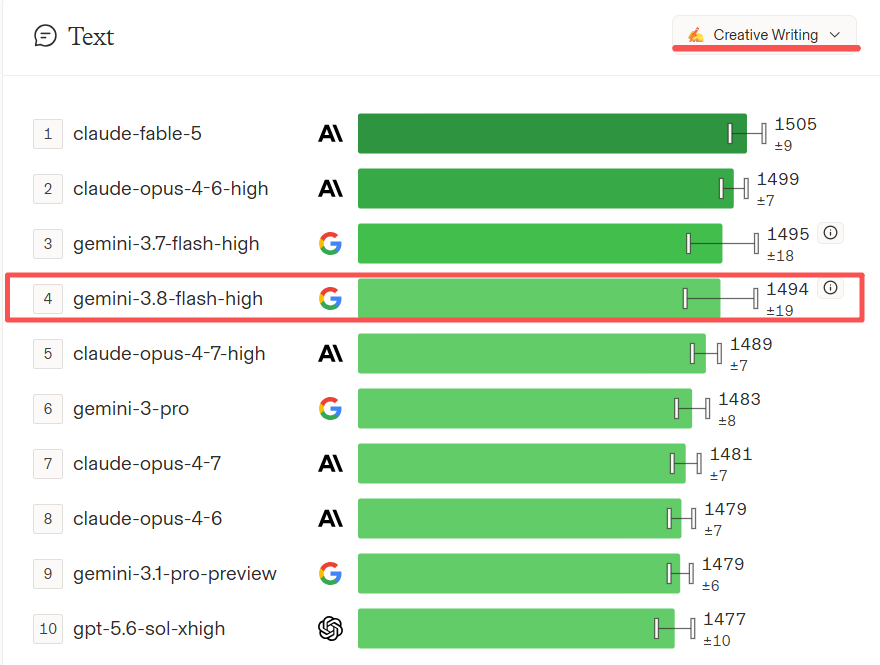
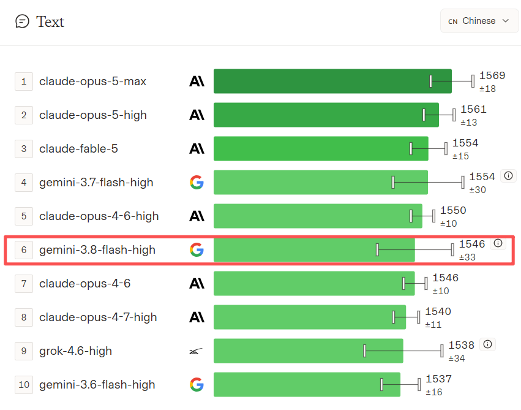
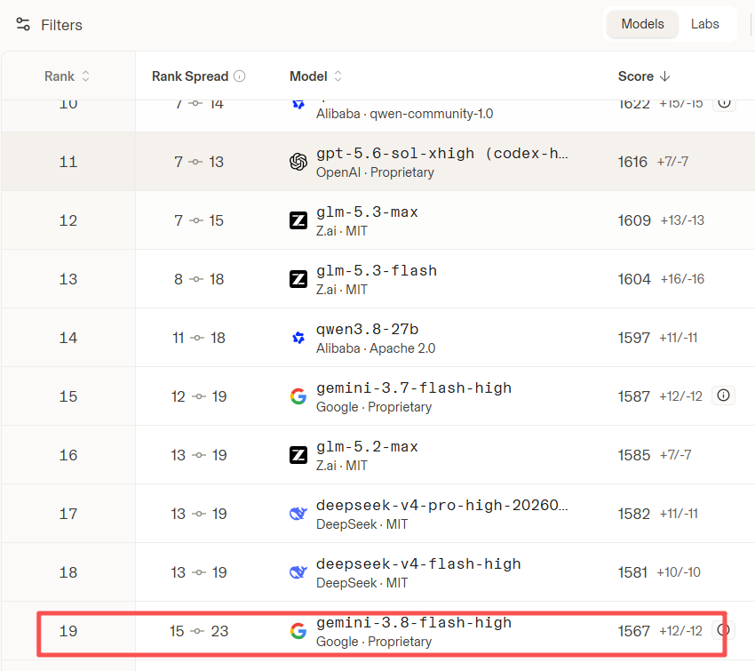
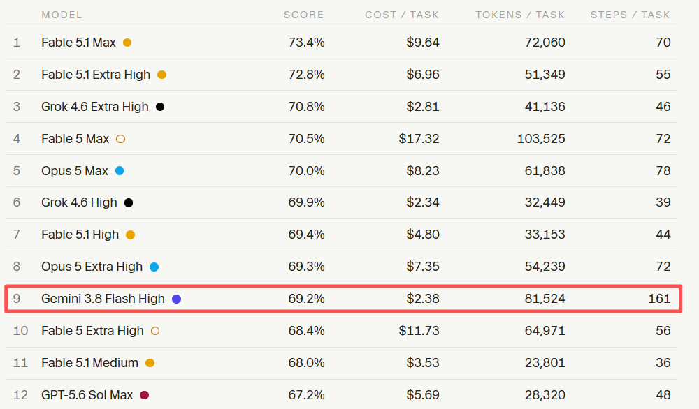

---

id: 2847145

title: ":fire:【大模型百科49】关于Gemini-3.8-flash，你想知道的一切"

created_at: 2026-09-02T19:23:17.061Z

username: dwqxq1

display_username: "dwqxq1"

---

# :fire:【大模型百科49】关于Gemini-3.8-flash，你想知道的一切

### 基本资料

官方文：[Introducing Gemini 3.8 Flash and 3.8 Flash Cyber](https://blog.google/innovation-and-ai/models-and-research/gemini-models/3-8-flash-and-3-8-flash-cyber/)

模型卡：[Gemini 3.8 Flash - Model Card — Google DeepMind](https://deepmind.google/models/model-cards/gemini-3-8-flash/)

价格：输入$0.75，输出$3.75，读缓存10%不变。OpenRouter五折

### 官方自评

---

---

### ArtificialAnalysis评分

来源：

---

---

### Arena评分

来源：[Arena Leaderboard | Compare & Benchmark the Best Frontier AI Models](https://arena.ai/leaderboard/)

---

---

---

#### 前端

---

### LiveBench评分:暂未上线

来源:[https://livebench.ai](https://livebench.ai)

---

### CursorBench评分

来源：[Cursor · CursorBench](https://cursor.com/cursorbench)

## API渠道

### 官网/AIStudio/GCP已上线

### OpenRouter API已上线：5折

来源：[Gemini 3.8 Flash - API Pricing & Benchmarks | OpenRouter](https://openrouter.ai/google/gemini-3.8-flash)

## Coding渠道

### Antigravity已上线

---

*来源: https://linux.do/t/topic/2847145.json*

