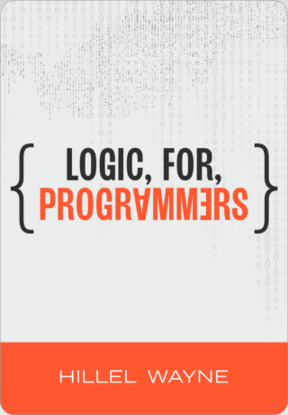

---

id: 2847510

title: "【epub】《Logic for Programmers (Hillel Wayne) 》ai翻译版"

created_at: 2026-09-03T01:22:47.488Z

username: yi124773651

display_username: "yi124773651"

---

# 【epub】《Logic for Programmers (Hillel Wayne) 》ai翻译版

一直觉得缺少了逻辑学相关知识，刚好最近出版了一本贴近程序员的逻辑学习书籍，然后用站内佬的公益站进行了一下翻译。取之于佬，用之于佬，分享给大家。

> 本书专为几乎没有形式化数学基础的程序员而写。在所有情况下，我都选择可读性和易用性，而不是精确性或严谨性。这是一本技术实践指南，不是教科书。

ai翻译，不免有些问题，敬请见谅。

[为程序员准备的逻辑学-中英对照.zip](/uploads/short-url/gYxYssvQk7PmeNj0oUh0SXANdZR.zip) (951.8 KB)

---

*来源: https://linux.do/t/topic/2847510.json*

