---

id: 2852196

title: ":fire:【大模型百科50】关于GPT 6 Astra,你想知道的一切【0914更新Arena写作分倒吸牙膏】"

created_at: 2026-09-03T20:10:43.676Z

username: dwqxq1

display_username: "dwqxq1"

---

# :fire:【大模型百科50】关于GPT 6 Astra,你想知道的一切【0914更新Arena写作分倒吸牙膏】

### 基本资料

官方文:[https://openai.com/index/gpt-6-astra/](https://openai.com/index/gpt-6-astra/)

官方文:[https://openai.com/index/path-to-astra/](https://openai.com/index/path-to-astra/)

官方文:[https://openai.com/index/safety-overview-gpt-6-astra/](https://openai.com/index/safety-overview-gpt-6-astra/)

模型卡:[GPT-6 Astra System Card - OpenAI Deployment Safety Hub](https://deploymentsafety.openai.com/gpt-6-astra)

价格:输入$10/输出$50,写缓存$1,价格是5.6sol的2.5倍,对标Fable

### 官方自评

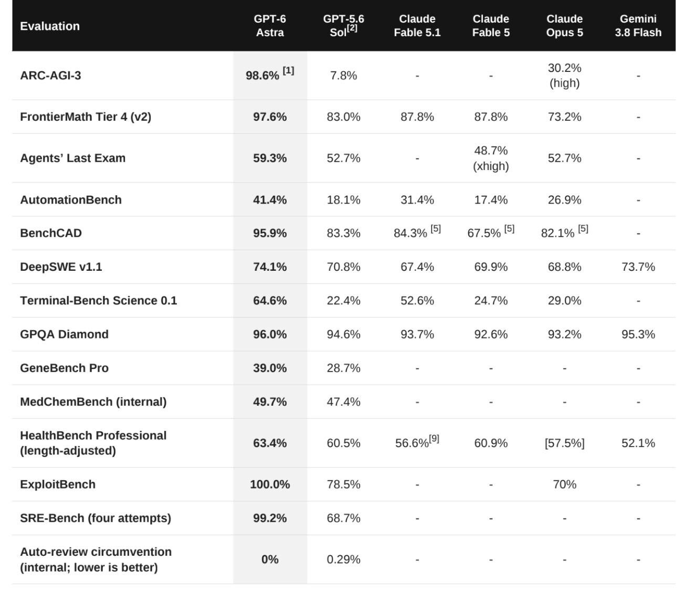

---

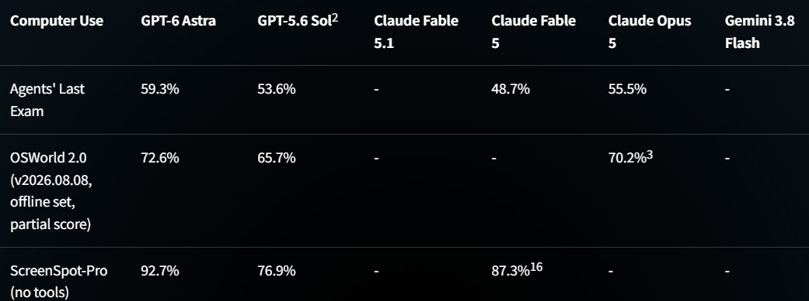

---

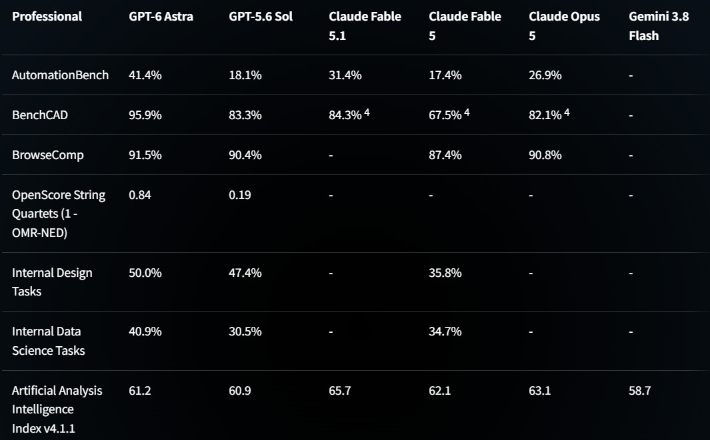

---

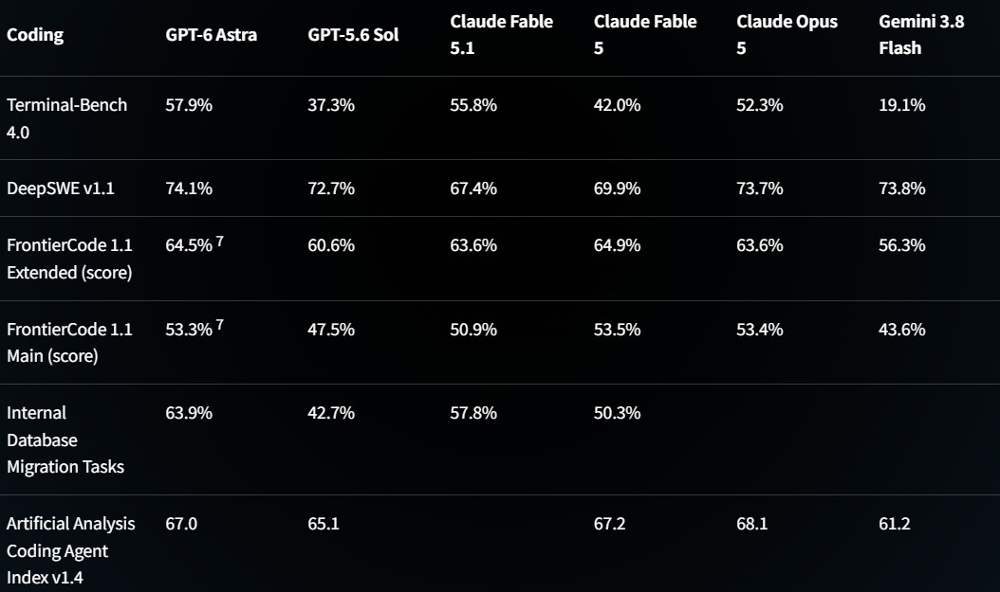

---

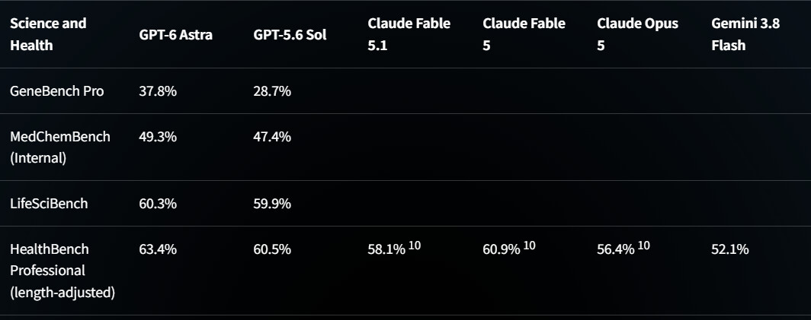

---

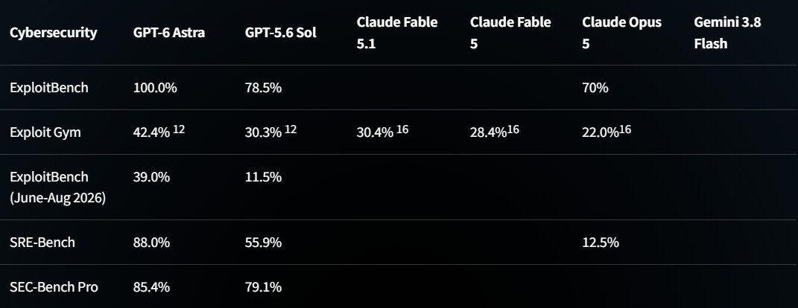

---

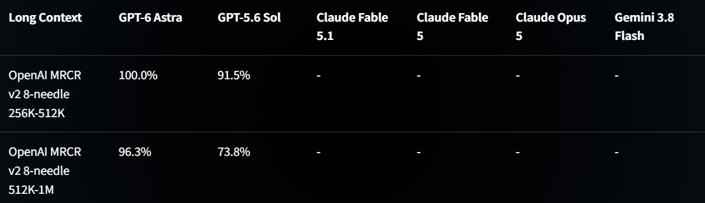

---

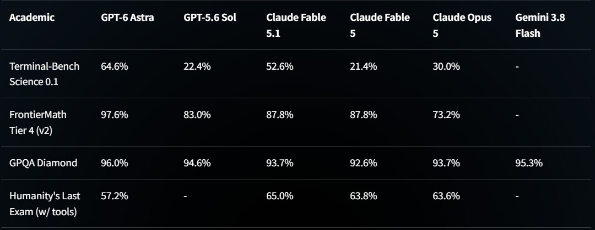

---

### LiveBench评分

来源：([https://livebench.ai](https://livebench.ai)

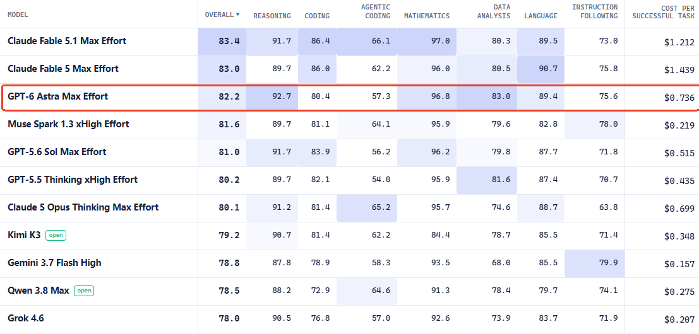

---

### ArtificialAnalysis评分

来源：[https://artificialanalysis.ai/](https://artificialanalysis.ai/)

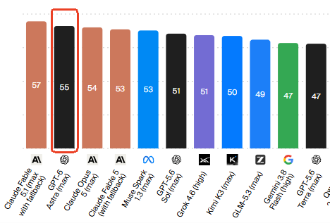

---

### Arena前端评分

来源：[Arena Leaderboard | Compare & Benchmark the Best Frontier AI Models](https://arena.ai/leaderboard/)

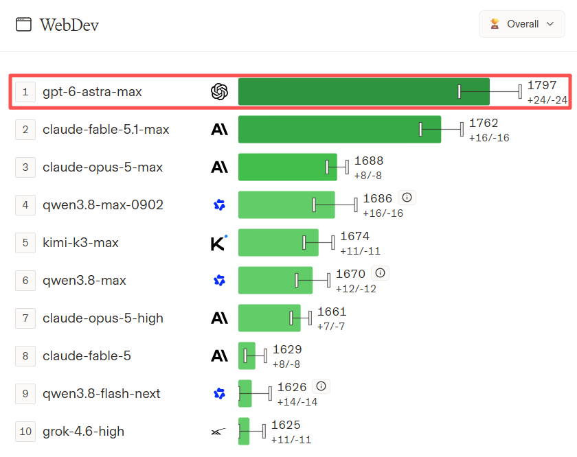

---

### Chat渠道

官网/App已上线

佬友说: astra 系列没有 thinking（thinking依旧为5.6 sol的各思考等级）

chat上即将上线的 6 pro 模式是 6 aster，而非 6 astra pro。

[【逆天】GPT Web Chat旗舰模型PRO系命名规则](https://linux.do/t/topic/2853668) [

前沿快讯](/c/news/34)

> 自此讨论：[GPT 5.6 根本就没有 Pro 版本？](https://linux.do/t/topic/2737580)

> 仅讨论Chat端

> 5.5 pro和5.5不同基座（同基座但不同模型ID）

> 5.6 sol pro是5.6sol max等级思考+chat端PRO的闭源黑盒harness

> 6 astra=6 pro

> 6 astra pro不存在

>  ![[image]](https://cdn3.ldstatic.com/original/4X/d/1/1/d11eb072e293db21a11399e2d0c046184233ca92.png)

> 第五代 5.5 pro及以前pro模型ID与数字系列模型ID不同，发布时pro被宣传为…

### API渠道

官网API/Azure已上线

### OpenRouter API已上线

Astra:[GPT-6 Astra - API Pricing & Benchmarks | OpenRouter](https://openrouter.ai/openai/gpt-6-astra)

Astra-pro:[GPT-6 Astra Pro - API Pricing & Providers | OpenRouter](https://openrouter.ai/openai/gpt-6-astra-pro)

---

*来源: https://linux.do/t/topic/2852196.json*

