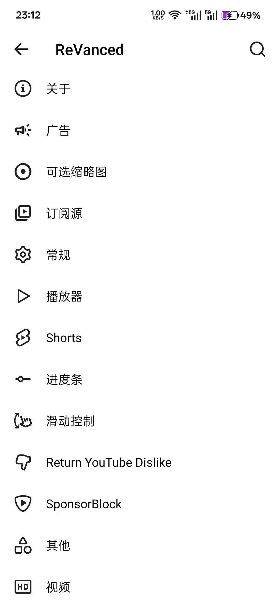

---

id: 2870572

title: "[YouTube 不仅免广告]youtube revanced"

created_at: 2026-09-07T13:42:58.790Z

username: sw666

display_username: "sw"

---


# [YouTube 不仅免广告]youtube revanced


## 简介

方案就是

使用 *revanced manager*


给youtube 旧版本打patch(补丁)


得到*youtube revanced*


这个需要搭配非Google官方的*gms*使用

除了免广告还有很多使用,相当于一般youtube +++,就像电脑浏览器使用youtube并且使用插件一样

```
环境依赖          安装包(自己打补丁)
GmsCore    +    ReVanced Manager + 旧版YouTube apk
(非Google)               │           (apkmirror,版本需一致)
                         │
                      打补丁
                         │
                   YouTube ReVanced apk
                         │
                  配合GmsCore安装使用

可选：MT管理器（文件管理/跨设备传apk）
```

---

## 缺点

- 不是开箱即用,或者开箱即用的风险很大,但是按照步骤来风险不大

- 整体折腾时间大概在10-15分钟左右(等待程序运行时间按5分组算)

---

## 优点

- 速度快(我试过newpipe,太慢了,就是随便下载了newpipe,然后发现太慢了,然后突发奇想折腾,然后弄的这个)

- 可登录(最好使用小号或者不登录)

- 不止免广告

- 后台播放

- 倍速最高8倍

- 这个方案不局限于youtube,


youtube music,x,instagram很多都可以,不过主要是youtube

- 等

总而言之就是相当于youtube premium+++(除了免广告,还可以设置把屏蔽短视频什么的),可自定义性很高



---

## 步骤

核心需要两样东西

### 安装包(YouTube ReVanced apk)

来源有两个

#### 别人弄

不是很推荐,风险很大

#### 自己弄

需要这些

#### [revanced manager](https://github.com/revanced/revanced-manager)

> 打补丁的软件,简而言之,就是下载以往的yt旧版本,然后修改apk来使用

#### 旧版本的youtube的apk安装包

(需要我提供的这个网址或者类似的,不能直接就提取Google play 的apk安装包)


网站在 [apkmirror.com](http://apkmirror.com)(一个apk镜像站,应该算是安全,反正貌似挺大的,从域名可以看出来)

[下载链接](https://www.apkmirror.com/apk/google-inc/youtube/youtube-20-40-45-release/youtube-20-40-45-2-android-apk-download/)

> 下载这个版本

>

> 还有不要下载显示 *bundled* 那个版本的

>

> 总而言之,下载我上面这个就对了

当然版本与你在manager里面打补丁的版本一样

### 环境依赖

[gmscore](https://github.com/ReVanced/GmsCore/releases)(github 下载releases链接)

> 非Google自带的gms

这个还可以适配华为(貌似可以解决华为没有gms的痛点,不过我只在我的华为平板上下载了youtube revanced)

### 可选

> mt管理器

(这个超级好用,我说的是当文件管理器用)


从官网下载,免费即可(不要Google play)


若是你想在其他设备上使用弄好的youtube revanced,可以使用mt管理器提取安装包

```
环境依赖          安装包(自己打补丁)
GmsCore    +    ReVanced Manager + 旧版YouTube apk
(非Google)               │           (apkmirror,版本需一致)
                         │
                      打补丁
                         │
                   YouTube ReVanced apk
                         │
                  配合GmsCore安装使用

可选：MT管理器（文件管理/跨设备传apk）
```

突发奇想写的,可能有很多不足,又害怕拖延症就快速写了发了


在保持简洁,大概能当教程的基础上就发表了,大致是没问题的


如果要修改的话,尽可能保持简洁或者说使用折叠的方式方便快速浏览


---


*来源: https://linux.do/t/topic/2870572.json*

