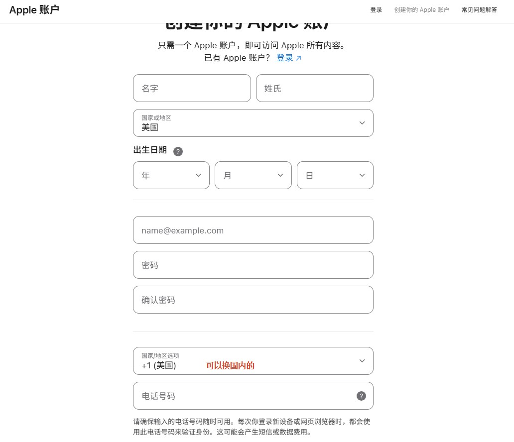
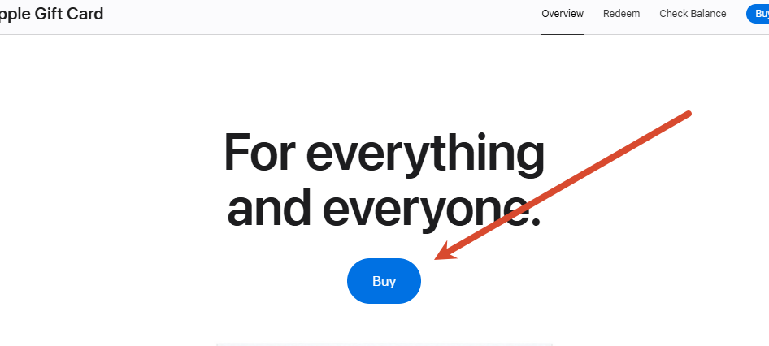
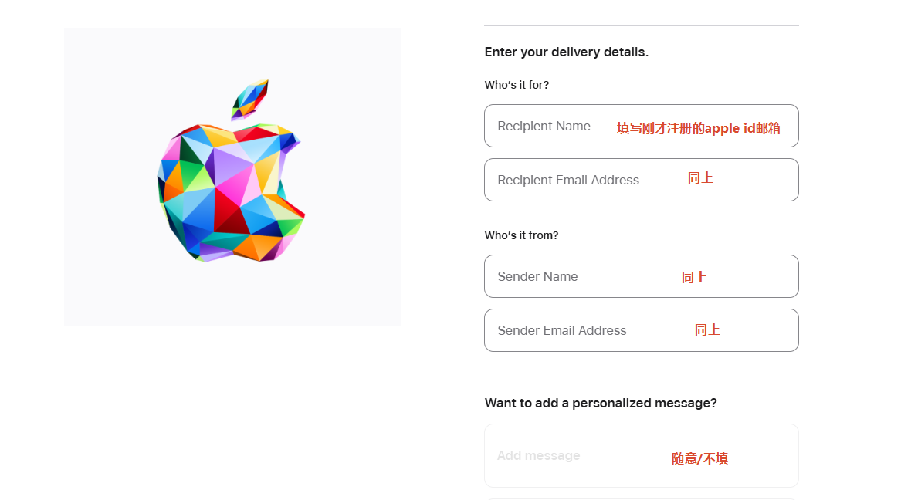
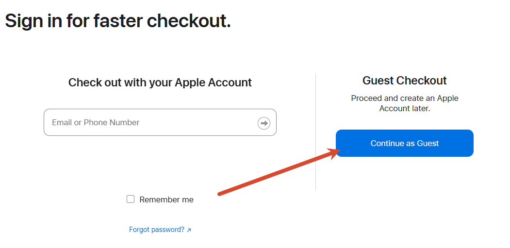
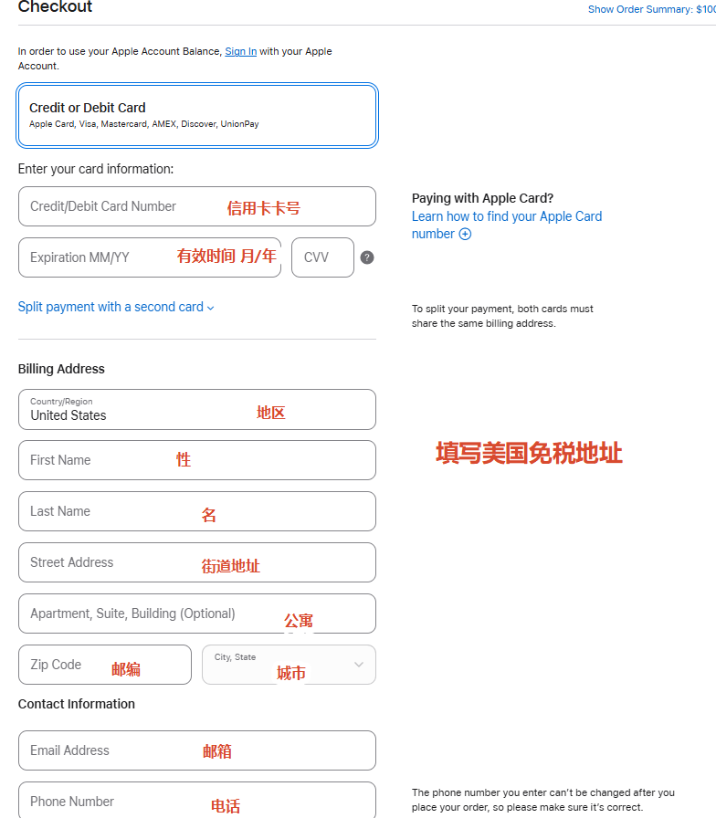
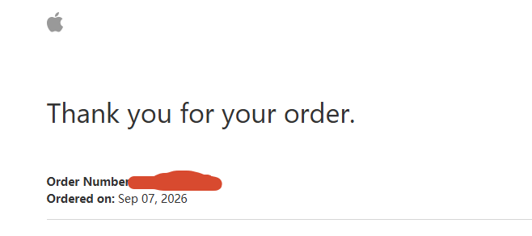
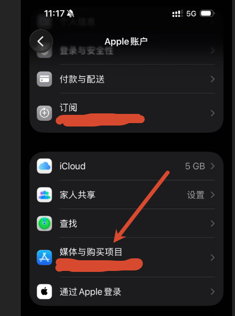
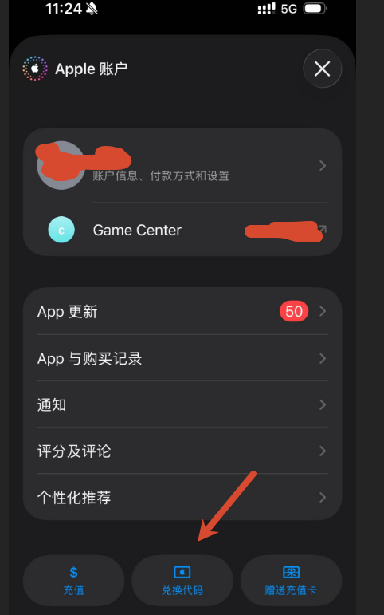

---

id: 2872853

title: "【教程】apple礼品卡 正价美区 plus/pro"

created_at: 2026-09-08T03:27:05.297Z

username: cicikiller

display_username: "cicikiller"

---

# 【教程】apple礼品卡 正价美区 plus/pro

看到站内经常有佬友问如何充值plus/pro 这里介绍的是 苹果的礼品卡渠道

**前置需要:苹果手机 visa/万事达等外币卡**

**ps:** 如果你需要pro  得先充值完plus->再充值pro

**1.首先需要去Apple 账户 · 创建账户**

正常填写信息  邮箱和手机都可以使用国内的

2.**最好等个几天 不然充不进去   直接去支付宝买礼品卡也行 刚注册完的账号直接订阅可能有风控**

充值可以去[Apple Gift Card - Apple](https://www.apple.com/shop/gift-cards)

邮寄方式选择 Email，然后是收件人的名字和邮箱、发件人的名字和邮箱，填写刚才注册的apple id，然后点击 Add to Bag。

选访客  这里的地址要填免税州的地址，不然会被收税。

支付完 之后 邮箱内就能收到邮件，框里面就是兑换码

3.**注册成功 在手机的设置->apple账户内**

登录刚才的账号

兑换邮件发来的礼品卡

4.兑换成功之后 可以去chatgpt登录 你需要充值的chatgpt账号 正常订阅就行

---

*来源: https://linux.do/t/topic/2872853.json*

